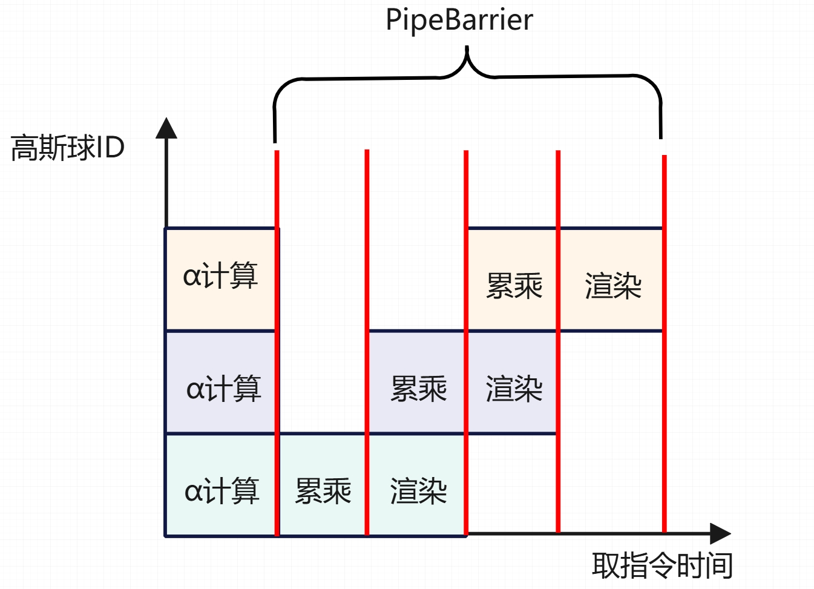
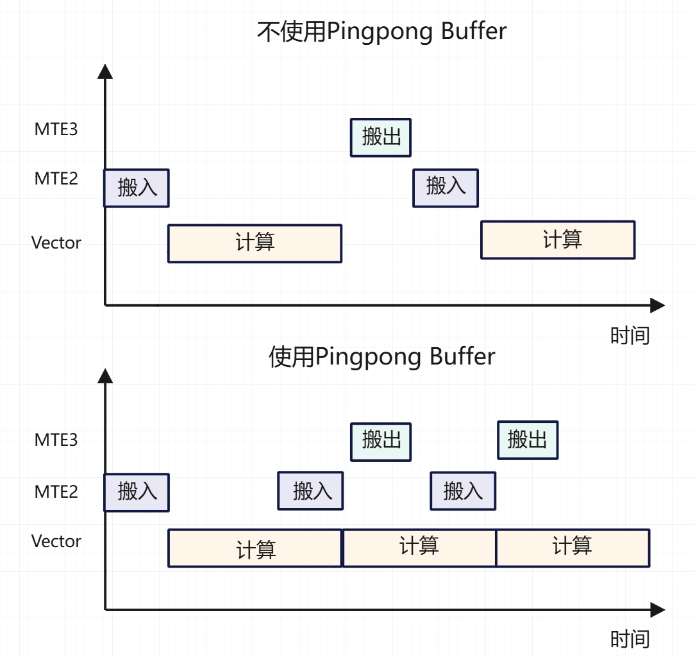
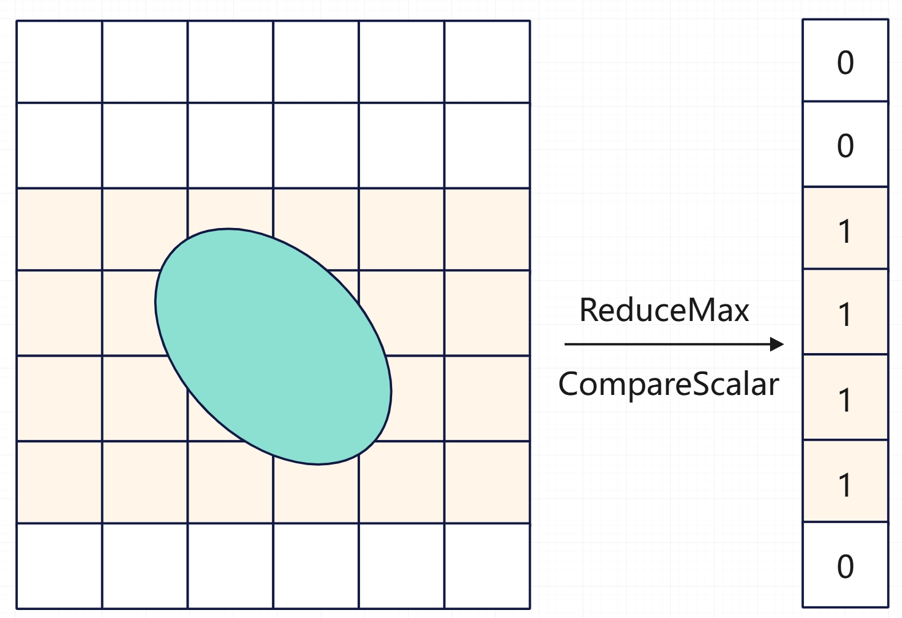

# NPU 3DGS Ascend C Alpha Blending Operator Optimization

For SIMD compute architectures, compared with the GPU implementation, the 3DGS algorithm requires special optimizations. This document specifically describes the optimization of the `CalcRender` operator, mainly covering three parts: an introduction to the 3DGS rendering flow, pipeline optimization, and pruning design.

## Highlights
- Fully leverage hardware features, efficiently implement the 3DGS algorithm under the SIMD architecture based on Ascend C APIs
- Meticulous Pipeline design, leveraging the advantages of fused operators
- Prune the Gaussians of the entire tile to end the rendering process early
- Based on SIMD features, perform efficient pixel pruning for a single Gaussian

### 3DGS Alpha blending operator flow

Alpha blending is a core step in the 3DGS rasterization process. Given a specific camera viewpoint and its corresponding projection plane, the color representation of the 3D Gaussians in space is rendered onto each pixel, thereby constructing the rendered image for the corresponding viewpoint. The specific calculation formula for alpha blending is as follows:
$$
C = \sum_{i \in N} c_i \alpha_i \prod^{i-1}_{j=1}(1-\alpha_j)
$$
$$
\alpha_i = o_i \exp(-\frac{1}{2} \delta ^ T * \Sigma * \delta)
$$

The overall algorithm flow is as follows:

1. Split the vector cores by tile; each core loops to render all pixels on its assigned tiles
2. Due to the cumulative multiplication operation, it is necessary to ensure that Gaussians are sorted before being rendered in sequence, so a for loop iterates over each Gaussian for rendering
3. For each Gaussian, compute its influence on all pixels of the tile in parallel, deriving the alpha value and color contribution
4. For each pixel position, update the accumulated color and opacity values

### Challenges of implementing the 3DGS Alpha blending algorithm on the SIMD architecture

Implementing the 3DGS Alpha blending algorithm on the SIMD architecture mainly faces the following challenges:
1. **Complex pipeline design**: Due to the parallel-computing characteristics of the SIMD architecture, pipeline design needs to fully consider data dependencies and computation order, ensuring that all compute units can collaborate efficiently.
2. **Memory access overhead and computation overhead masking each other**: Because the number of Gaussians is large, and the Gaussians rendered for a tile are not contiguous, the memory access overhead is large, affecting compute efficiency.
3. **Redundant Gaussian computation**: Each Gaussian must compute against all pixels on the tile, leading to a large amount of redundant computation that affects overall performance.

### Gaussian pipeline optimization

#### ***Instruction pipeline parallelism***

Due to the forward/backward dependency characteristics of computations between Gaussians and within a single Gaussian, PipeBarrier often needs to be inserted between vector instructions to ensure data correctness, resulting in low pipeline efficiency. According to the simulation results of the msprof op simulator, computing VMuls on 64 floats takes 15 ns, while the time required to compute VMuls on 2048 floats is not 32 times that of computing 64 floats, but only 51 ns, because instruction decoding and data prefetching overhead are included. To address this problem, we carefully designed the pipeline to minimize the frequency of PipeBarrier insertion, thereby improving pipeline efficiency.

In the initial pipeline design that computed Gaussian by Gaussian, a PipeBarrier needed to be inserted between the operations of each step when processing each Gaussian, resulting in low pipeline efficiency. After analysis, we found that the dependency-free portions of the computation across multiple Gaussians (i.e., the computation of the $\alpha$ value) can be merged together, reducing the frequency of PipeBarrier insertion. Specifically, we increased the number of Gaussians processed at a time to 4, so that a PipeBarrier is inserted only after 4 Gaussians have been processed, greatly reducing the number of PipeBarrier insertions and thereby improving pipeline efficiency.

To implement this optimization, we need to make some adjustments to the computation of a single Gaussian. Specifically, we split the computation of each Gaussian into two stages: the first stage computes the $\alpha$ value, and the second stage computes the color contribution. In the first stage, we can process 4 Gaussians in parallel, compute their $\alpha$ values, and store the results. In the second stage, we process these 4 Gaussians in sequence, compute their color contributions, and update the accumulated color and opacity values. As can be seen, this increases the required UB space usage to some extent, because more intermediate results need to be stored, requiring careful reuse of UB space, such as reusing the space of the previous Gaussian's $\alpha$ computation during color rendering.

### ***Double Buffer optimization***

In addition, another optimization is to use a double buffer to read Gaussian attribute values in advance, thereby hiding memory access overhead. Specifically, while processing the current batch of Gaussians, we can read ahead the attribute values of the next Gaussian and store them in the second buffer. In this way, when processing the next Gaussian, the attribute values can be read directly from the already-written buffer, avoiding memory access latency.

### Gaussian pruning design

During the 3DGS rendering process, many Gaussians make no contribution to the pixels of the current tile, leading to a large amount of redundant computation. To improve rendering efficiency, we designed a two-level pruning mechanism that prunes at the tile level and the pixel-row level.

#### ***Tile-level pruning***

Based on the rendering formula, it can be found that when the accumulated opacity reaches a certain threshold, the contribution of subsequent Gaussians to the pixel block becomes negligible. Therefore, we introduced a tile-level pruning mechanism in the rendering process. When the accumulated opacity of a tile reaches the preset threshold, we end the rendering process for that tile early, avoiding unnecessary computation. In terms of specific implementation, after processing each group of Gaussians (combined with the previous pipeline optimization, the threshold check is performed here after processing four Gaussians), we check whether the accumulated opacity of the tile has reached the threshold. If it has, we break out of the loop and end the rendering.

Limited by the SIMD compute architecture, we cannot prune each pixel individually, so pruning can only be performed at the tile level. During the threshold check, it must be ensured that the accumulated opacity of all pixels has reached the threshold before ending the rendering.

The specific implementation flow is as follows:
1. Use the `CompareScalar` function to compare the accumulated opacity of all pixels on the tile with the threshold, generating a mask. This instruction writes back the mask in a bitwise manner, indicating whether each pixel has reached the threshold.
2. Use the `ReinterpretCast` function to convert the mask vector into a 64-bit integer, facilitating subsequent judgment operations.
3. In a for loop, perform a bitwise AND operation between the mask integer and **UINT64_MAX**. If the results are equal, it means all pixels have reached the threshold, and rendering can be ended.
4. To correctly compute gradients during backpropagation, we need to record the Gaussian ID at which each tile terminates its rendering. During backward gradient propagation, gradient computation continues from the terminated Gaussian ID, ensuring the correctness of gradient computation.

Because tile-level pruning can only take effect when all pixels meet the condition, its pruning effect is limited. In the experimental result analysis, the performance gain is only about 5-10%. To further improve rendering efficiency, we introduced a pixel-row-level pruning mechanism.

#### ***Sub-tile-level pruning***

For sub-tile-level pruning, we designed a pruning method based on the influence range of Gaussians. Specifically, we compute the influence range of each Gaussian on the projection plane. If a pixel row lies completely outside the influence range of the Gaussian, the Gaussian makes no contribution to that pixel row, and the computation for that pixel row can be skipped. However, because the SIMD architecture requires contiguous-address computation, we cannot perform fine-grained pruning for each pixel row individually, so we adopt the approach of pruning by pixel rows. By analyzing the covariance matrix of a Gaussian, we can compute its influence range on the projection plane, thereby implementing pixel-row-level pruning. In the experimental result analysis, it is estimated that each Gaussian actually affects only about a 6x6 pixel area, while our currently preset tile size is 32x32, so each Gaussian actually affects only about 20% of the pixel rows on the tile.

The specific implementation flow is as follows:
1. Compute the $\alpha$ value over the entire tile, the influence range of the Gaussian on the projection plane, and determine the range of pixel rows it covers.
2. Use the `WholeReduceMax` function to compute the maximum $\alpha$ value for each pixel row.
3. Use the `CompareScalar` function to compare the maximum $\alpha$ value of each pixel row with the preset threshold, generating a mask that indicates whether each pixel row needs to be rendered.
4. To efficiently determine which pixel rows need rendering, we reinterpret the mask vector as a 64-bit integer and use bitwise operations to determine the state of each pixel row. First, use the `ScalarCountLeadingZeros` function to compute the number of leading zeros in the mask integer. Due to the little-endian storage feature, the position of the first 1 actually corresponds to the last pixel row that needs rendering.
5. Then use the `ScalarGetCountOfValue<1>` function to count the number of 1s in the mask integer, representing the number of pixel rows that need rendering. Therefore, we can use these two values to determine the range of pixel rows that need rendering, thereby skipping unnecessary computation.
6. To correctly compute gradients during backpropagation, we need to record the pixel-row range that each Gaussian actually affects. In UB space, use UInt8 to store the starting pixel row and ending pixel row indices of each Gaussian. After storing every 1024 Gaussians, write this data back to GM space for reading during backpropagation.

### Experimental result analysis

We trained for 30,000 iters on a scene containing 130,000 Gaussians (after filtering, the number of Gaussians that actually need to be rendered is only 67,917), and evaluated the improvement in rendering efficiency brought by the pipeline optimization and pruning design. In the experiment, the selected $\alpha$ threshold was 0.004, and the opacity threshold was 0.99. The experimental results are as follows: the forward time gain is about 10%, and the backward time gain is about 30%.

| Optimization method | PSNR | Forward device time (ms) | Backward device time (ms) |
| -------- | -------------- | -------- | ------- |
| No optimization   | 25.008          | 4.807    | 18.710   |
| Pipeline optimization | 25.005          | 4.379    |  17.565   |
| Pruning optimization | 25.010          | 5.101     |  13.141   |
| Pipeline + pruning | 24.974         | 4.495     | 13.107   |

#### Effect of different $\alpha$ thresholds on pruning effectiveness

We evaluated the effect of different $\alpha$ thresholds on pruning effectiveness (evaluation only, without retraining). The experimental results are as follows: raising the threshold significantly improves the gain for the backpropagation process. When the threshold is set to 0.1, the device backward time is only 7.5% of the original, while PSNR drops by only 3.3%.

| Threshold | PSNR | Forward device time (ms) | Backward device time (ms) |
| -------- | -------------- | -------- | ------- |
| 0   | 25.082          | 4.379    | 18.710   |
| 0.004 | 25.009        | 4.495    |  13.107   |
| 0.01 | 24.949         | 4.358     |  11.267   |
| 0.02 | 24.872         | 4.236     | 9.827   |
| 0.05 | 24.672         | 4.130     | 7.937   |
| 0.1 | 24.274          | 3.539     | 1.410   |
| 0.2 | 23.309          | 3.764     | 1.043   |

<!-- static-meta
{
  "sidebarTitle": "AlphaBlending Operator",
  "operator": ["ascendc"],
  "cover": {"type": "auto"}
}
-->
