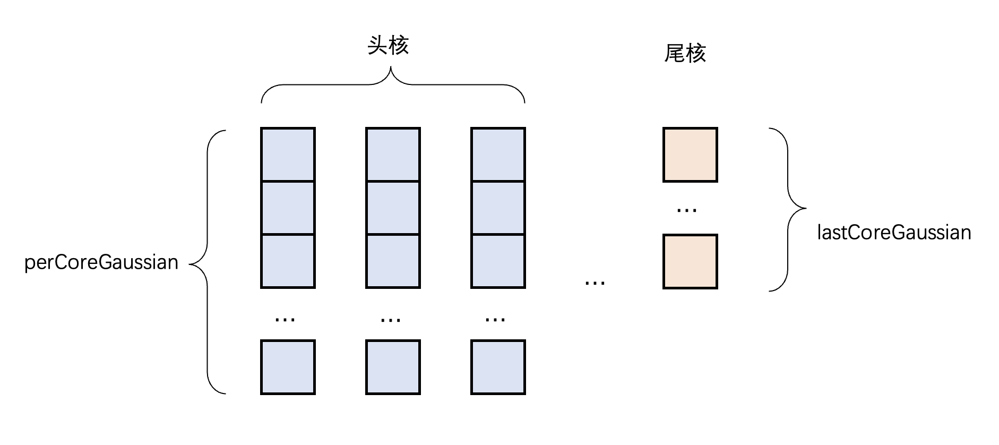
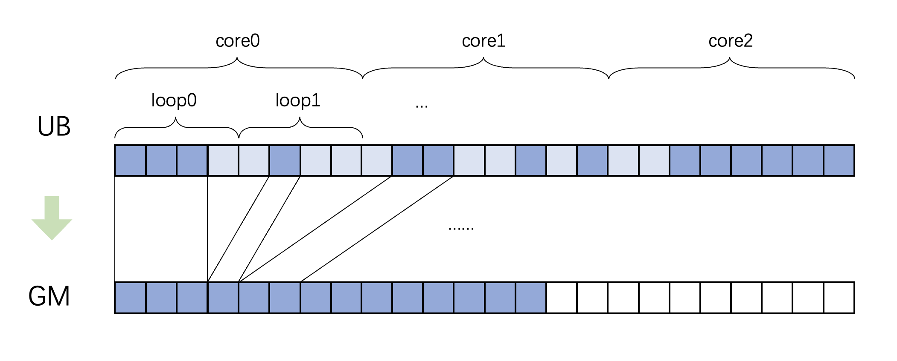
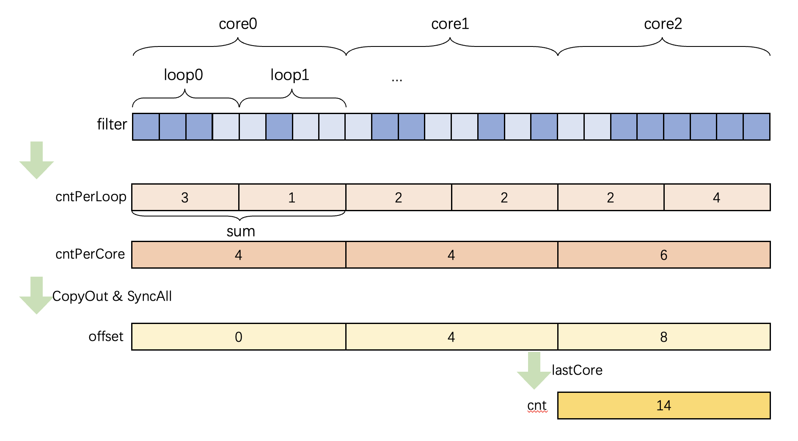
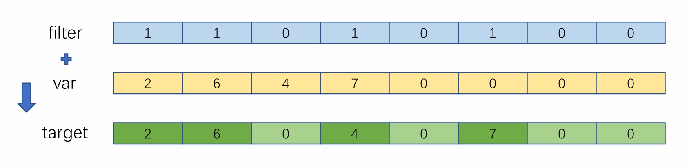
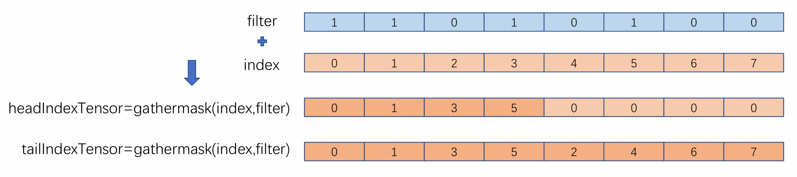
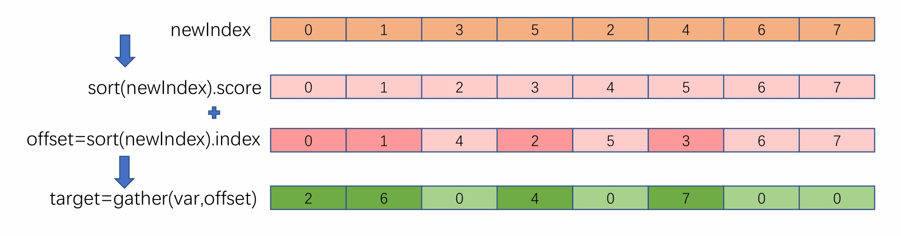
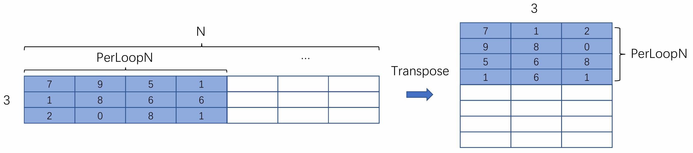

# Frustum Culling Optimization

## Operator background
In 3DGS, culling is a key optimization step before rendering. Its purpose is to filter out, in advance, the 3D Gaussian primitives that make no contribution to the rendering of the current frame, reducing the computation amount of subsequent rasterization and alpha blending and greatly improving rendering efficiency.
Its core logic is very simple: keep only the Gaussians "visible to the current camera" and discard the "invisible" Gaussians.  
The frustum culling used in the projection preprocessing stage has the following specific logic:
- Invalid Gaussian culling: ensure that a Gaussian is a valid positive definite matrix (non-degenerate, non-flattened)
- Frustum depth-direction culling: cull Gaussians whose depth is less than the near clipping plane (too close) or greater than the far clipping plane (too far), and keep only the Gaussians within the frustum depth range.
- Frustum horizontal/vertical culling: cull Gaussians whose 2D ellipse, after projection to screen space, has an x/y-direction radius of 0.
- Off-screen culling: keep only the Gaussians whose projected ellipse overlaps the screen, and cull the Gaussians completely outside the screen.

## Operator implementation and optimization
The specific implementation and optimization of the operator are divided into two steps:  
- Implement `GaussianFilter`, fusing frustum culling into a single operator to avoid the quite time-consuming index fetching + `tensormove` operations, and return `filter`, where a bit of 1 indicates that the corresponding Gaussian is valid, and a bit of 0 indicates that the corresponding Gaussian is invalid.
- Before the projection preprocessing backward operator is computed, perform inverse frustum culling to restore the original tensor; the gradients of invalid Gaussians are naturally set to 0 during gradient computation.

## Implementation difficulties
- The mapping between bits and elements needs to be aligned: each int8 element can store the mask status of 8 Gaussians, so during computation it must be strictly ensured that the Gaussian data is mapped one-to-one to the bits of int8. This requires that, during in-core iterative computation, the slice of input Gaussian data must be an integer multiple of 8; otherwise, bit mapping across elements becomes disordered, leading to incorrect mask determination.
- Since the operator's partitioning involves data dependencies between cores, a global synchronization operation must be introduced. However, the synchronization operation brings performance overhead, so the number of global synchronizations needs to be reduced while maintaining correctness.
- The core of the backward operation is to scatter the filtered data back to their original positions. The key difficulty lies in constructing the data scatter index for `GatherMask` from the irregular `filter`.

### tiling
Considering that the number of Gaussians is generally above one hundred thousand, the tiling stage does not partition cores by batch size or number of cameras, but partitions cores over the Gaussians.  
The specific tiling needs to consider the following 2 points:
- The `filter` type is int8, and the head cores need to be aligned to 8 elements.
- After aligning the core partitioning to 8 elements, the tail core may compute a negative number, so the number of used cores needs to be re-derived before performing the tail core computation.  

Assume the number of NPU cores is `coreNum`, the total number of Gaussians is `N`, the number of Gaussians processed by the head cores is `perCoreN`, and the number of Gaussians processed by the tail core is `lastCoreN`. The core partitioning is computed as follows:
$$
perCoreN = \left \lceil \left \lceil N / coreNum \right \rceil / 8 \right \rceil \cdot 8
$$
$$
usedCoreNum = \left \lceil N / perCoreN \right \rceil
$$
$$
lastCoreN = N - usedCoreNum \cdot perCoreN
$$

### kernel

#### 2.2.1 GaussianFilter
The main consideration in the kernel part of `GaussianFilter` is the offset calculation when moving data to GM after the per-core computation is completed.  

#### Offset calculation
 
Because of the UB size limitation, each core cannot filter out all valid Gaussians in one iteration, so two variables are introduced here:
- Assume the number of valid Gaussians computed by the $i$-th core ($i$ ranges from $0$ to $usedCoreNum-1$) is $cntPerCore_i$ 
- Assume the number of valid Gaussians computed by the $j$-th iteration of the $i$-th core ($j$ ranges from $0$ to $loopN_i$, where $loopN_i$ depends on the UB size) is $cntPerCore_{i,j}$

Then the offset to which the computation results need to be moved out in the $j$-th iteration of the $i$-th core can be computed as:
$$
offset = \sum_{k=0}^{i-1}{cntPerCore_i} + \sum_{k=0}^{j-1}{cntPerCore_{i,k}}
$$

#### Computation flow
Obviously, the computation offset of the $i$-th core depends on the computation results of cores $0$ to $i-1$, and since all cores compute synchronously, the offset for each iteration cannot be computed directly in one pass.  
Therefore, `SyncAll` is used here for staged synchronization to implement the per-core computation of culling.
- Phase1:
First execute $loopN$ loop iterations. In each iteration, first complete the loading, computation, and moving out of `filter`; at the same time, accumulate the cnt results within the current iteration, store the in-core iteration count array `cntPerLoop`, and synchronously update the in-core total count `cntPerCore`. After the loop of this stage ends, store `cntPerCore` in the temporary space located on `workspace`, execute the global synchronization operation (`SyncAll`) to ensure that all compute cores complete the first-stage computation, then update and move out the output offset (`coreOffset`) on GM; only when the current compute core is the last core, perform the aggregation of the global counts and move out the final count results to GM.

- Phase2:
Load the computed `filter` back in, and execute $loopN$ loop iterations again. In each iteration, load the inputs that need frustum culling in sequence, use `filter` as the `mask` and `GatherMask` to perform frustum culling, and then combine the inter-core offset (`coreOffset`) obtained in the first stage with the in-core count of the corresponding iteration (`cntPerLoop`) to determine the global memory offset address for data movement out. Use 3 `TQue`s to ensure that the MTE2, Vector, and MTE3 pipelines can proceed concurrently.

#### Backward gradient restoration and data movement
#### Scatter implementation
The backward processing of this operator needs to restore the filtered data to their original positions, requiring a data scatter operation. To avoid the long time spent on loop + scalar computation, this operator uses a combination of multiple APIs, including `GatherMask`, `Sort`, and `Gather`, to optimize the data scatter. Restoration is performed based on the mask of `Filter` aligned by `cntPerLoop`. The target data scatter for restoration is shown in the following figure:

- Phase1: Construct a new index for sorting by the `Sort` interface. The operation is: first construct an element index `Index` (0,1,...,`cntPerLoop`) with the same length as the elements to be processed, use the `GatherMask` interface to collect `Index` for the elements whose `Filter` bit is 1, and store them in the head tensor `headIndexTensor`; then collect the `Index` for the elements whose `Filter` bit is 0, and store them in the tail tensor `tailIndexTensor`. Concatenate the two to obtain the new index `newIndex` used for `Sort` sorting. Since tensor operations all require 32-byte alignment, alignment must be paid attention to during concatenation. Here, the two parts are first copied to consecutive addresses on GM, and then copied back to UB.

- Phase2: Sort through the `Sort` interface, and implement data rearrangement and restoration through `gather`. After the `Sort` interface sorts `newIndex`, it produces the sort value `score` and, for each `score`, the position index before sorting. The `Sort` interface provides the `Extract` interface to separate the sort values and the sort indices. The indices obtained here are exactly the element-address offsets used by `gather` for element collection. In the specific implementation, it should also be noted that the `Sort` interface only supports descending sorting, so an arithmetic sequence needs to be constructed to reorder the indices obtained by `Extract`, producing ascending-sorted indices.

#### Data movement optimization
Data is processed in `LocalTensor` by splitting along the N dimension and moved to `GlobalMemory`. During computation, to facilitate vector operations, the Gaussian dimension is placed at the end of the tensor, while to obtain the true shape of the gradient of the original input, the data output requires swapping the order of the last dimension and the second-to-last dimension.  
Taking the data with dimensions `(B,3,N)` moved to dimensions `(B,N,3)` as an example: after data splitting, the shape on UB is `(3, perLoopN)`. Originally, an index of the form [0, perLoopN, perLoopN * 2, 1, 1 + perLoopN, 1 + perLoopN * 2, ...] would need to be constructed, and then `GatherMask` would be used to collect the data at the corresponding indices. However, constructing the index requires a large number of scalar operations, resulting in poor performance. Therefore, the `Transpose` interface is used here to replace index construction for data movement optimization, as shown in the following figure:

<!-- static-meta
{
  "sidebarTitle": "3DGS Frustum Culling",
  "operator": ["ascendc"],
  "cover": {"type": "auto"}
}
-->
