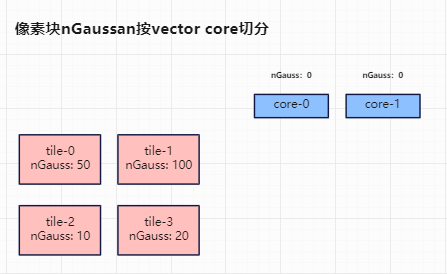
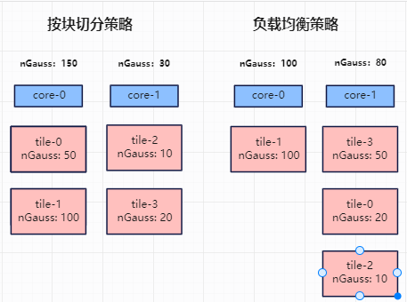
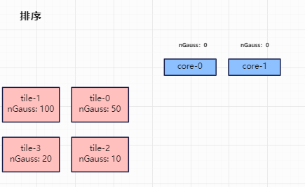
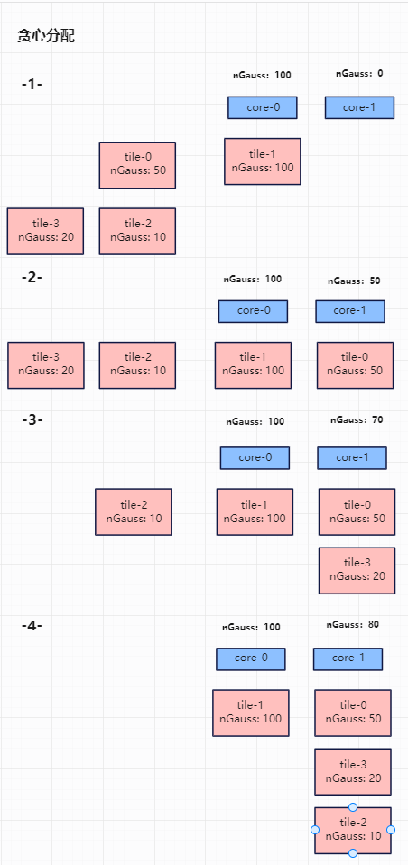

# NPU 3DGS Ascend C Alpha Blending Operator Load Balancing Strategy

For SIMD compute architectures, compared with the GPU implementation, the 3DGS algorithm requires special optimizations. This document addresses the problem that the number of Gaussians projected onto each pixel block varies greatly, which causes load imbalance when partitioning by pixel block, and introduces a load balancing strategy to improve overall rendering efficiency.

## Highlights

- Based on SIMD features, the generic uniform partitioning by pixel block cannot perceive the specific computation amount of each pixel block, and the redundancy causes a long execution tail on individual cores. A greedy algorithm is used for load allocation so that the loads of all cores are close to each other.

### 3DGS Alpha blending operator flow

Alpha blending is a core step in the 3DGS rasterization process. Given a specific camera viewpoint and its corresponding projection plane, the color representation of the 3D Gaussians in space is rendered onto each pixel, thereby constructing the rendered image for the corresponding viewpoint. The specific calculation formula for alpha blending is as follows:
$$
C = \sum_{i \in N} c_i \alpha_i \prod^{i-1}_{j=1}(1-\alpha_j)
$$
$$
\alpha_i = o_i \exp(-\frac{1}{2} \delta ^ T * \Sigma * \delta)
$$

The overall algorithm flow is as follows:

1. Split the vector cores by tile; each call renders all pixel blocks on one tile
2. Due to the cumulative multiplication operation, it is necessary to ensure that Gaussians are sorted before being rendered in sequence, so a for loop iterates over each Gaussian for rendering
3. For each Gaussian, compute its influence on all pixel blocks of the tile in parallel, deriving the alpha value and color contribution
4. For each pixel block, update the accumulated color and opacity values

### Partitioning of the 3DGS Alpha blending algorithm using a load balancing strategy on the SIMD architecture

In the open-source GPU implementation, the hardware supports warp-level scheduling, so no additional load balancing strategy is needed. However, when implementing the 3DGS Alpha blending algorithm on the SIMD architecture, uniform partitioning of the vector cores by pixel block is used. Because the number of Gaussians projected onto each pixel block varies greatly, the uniform pixel-block partitioning strategy may cause imbalanced processing loads on each core, leading to a long execution tail on individual cores and increasing the overall rendering time.

#### Load balancing using a greedy algorithm

**Goal**: Allocate the Gaussians of all pixel blocks to fixed vector cores, so that the load on each vector core is ultimately as balanced as possible, avoiding the situation of "a single core overloaded while multiple cores are idle."

**Strategy**: Use a greedy algorithm, following the principle of "heaviest first, assign to the lightest," to achieve a globally better result through locally optimal choices.

**Implementation flow**:
1. **Sort**: Sort the pixel blocks in descending order by the number of Gaussians corresponding to each pixel block.

2. **Greedy allocation**: Allocate the sorted pixel blocks, prioritizing the vector core with the current fewest Gaussians, and continue allocating pixel blocks in this way until all pixel blocks are allocated.

The following scenario is used as an example:

Four pixel blocks, with Gaussian counts of 50, 100, 10, and 20 respectively, are allocated to 2 vector cores.

The goal is shown in the following figure:

Using the average pixel-block partitioning strategy causes an imbalance problem: core-0 is allocated 150 Gaussians and core-1 is allocated 30 Gaussians, whereas with the load balancing strategy, the allocation is relatively even: core-0 is allocated 100 Gaussians and core-1 is allocated 80 Gaussians.

The comparison of the partitioning strategy results is shown in the following figure:

The specific processing flow of the load balancing strategy is as follows:

Sorting:

First, sort the four pixel blocks in descending order by the number of Gaussians corresponding to each pixel block. The sorted order is tile-1, tile-0, tile-3, tile-2, as shown in the following figure:

Greedy allocation:

Allocate the sorted pixel blocks, prioritizing the vector core with the current fewest Gaussians.

Step 1, allocate tile-1. Currently, both core-0 and core-1 have 0 Gaussians, so tile-1 is allocated to core-0, and core-0's Gaussian count is updated to 100;

Step 2, allocate tile-0. Currently, core-1 has 0 Gaussians and core-0 has 100 Gaussians, so tile-0 is allocated to core-1, and core-1's Gaussian count is updated to 50;

Step 3, allocate tile-3. Currently, core-1 has 50 Gaussians and core-0 has 100 Gaussians, so tile-3 is allocated to core-1, and core-1's Gaussian count is updated to 70;

Step 4, allocate tile-2. Currently, core-1 has 70 Gaussians and core-0 has 100 Gaussians, so tile-2 is allocated to core-1, and core-1's Gaussian count is updated to 80;

All pixel blocks have been allocated. At this point, core-0 needs to process 100 Gaussians, and core-1 needs to process 80 Gaussians.

The specific process is shown in the following figure:

### Comparative experimental data analysis

On a scene containing 130,000 Gaussians (after filtering, the number of Gaussians that actually need to be rendered is only 67,917), we evaluated the improvement in rendering efficiency brought by uniform block partitioning and the load balancing design. The experimental results are as follows: both the forward time and backward time gains are about 23%.

| Optimization method  | Forward device time (ms) | Backward device time (ms) |
| -------- | ------- | ------- |
| Block partitioning  |  5.973  | 15.908  |
| Load balancing  |  4.599  | 12.223  |

<!-- static-meta
{
  "sidebarTitle": "Operator Load Balancing",
  "operator": ["ascendc"],
  "cover": {"type": "auto"}
}
-->
