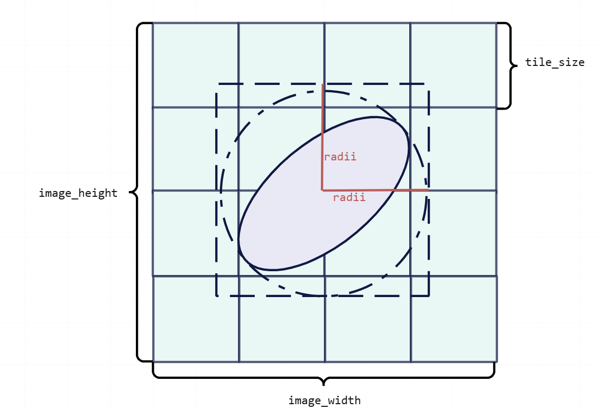
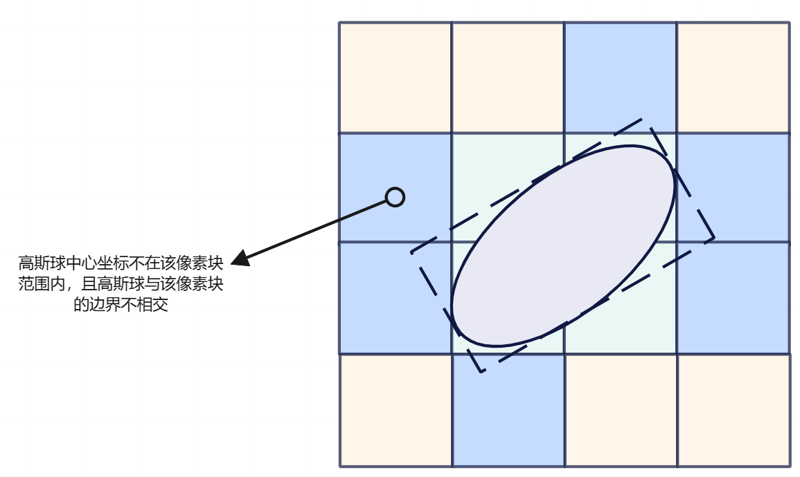
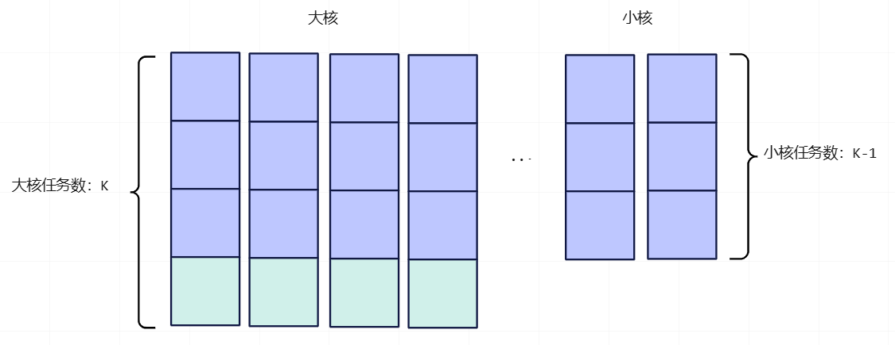
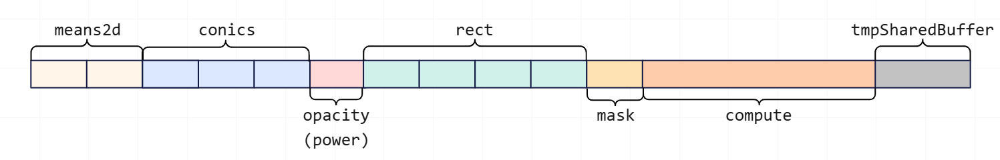
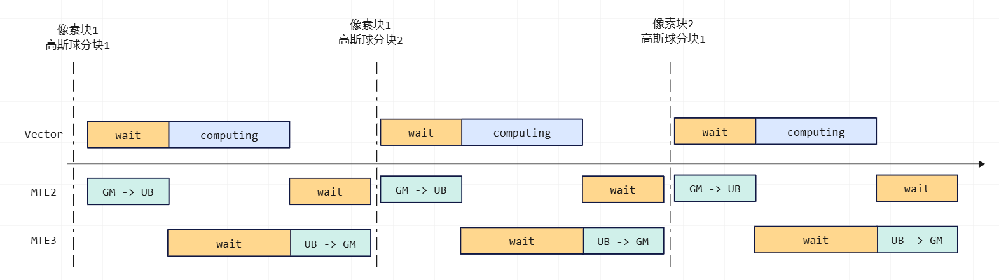
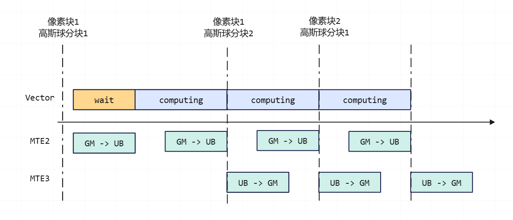
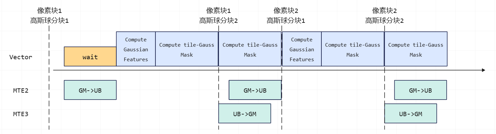

# NPU 3DGS Ascend C Precise Intersection Operator Optimization
## Outline
- [Highlights](#Highlights)
- [Precise Intersection Algorithm](#Precise-Intersection-Algorithm)
    - [Precise Intersection Operator Tiling Design](#Precise-Intersection-Operator-Tiling-Design)
    - [Vector-MTE Pipeline Parallel Optimization](#Vector-MTE-Pipeline-Parallel-Optimization)
    - [Gaussian Coordinate Pre-screening Optimization](#Gaussian-Coordinate-Pre-screening-Optimization)
    - [Mask Filtering Optimization](#Mask-Filtering-Optimization)
    - [Computation Optimization](#Computation-Optimization)
    - [Performance Experiments](#Performance-Experiments)
- [Citation](#Citation)

## Highlights
The Precise Intersection operator is used to compute the Gaussian-pixel block mapping relationship. It is implemented based on the [FlashGS algorithm](https://arxiv.org/abs/2408.07967) and has the following features and advantages:
- Fully leverages hardware features to achieve pipeline parallelism between computation and data movement, leveraging the advantages of AscendC hardware
- Fully leverages the features of the AscendC language to optimize the computation flow, reduce repeated computation, and improve operator performance
- Reduces rendering time and accelerates 3DGS-Splat training and inference speed

## Precise Intersection Algorithm
The 3DGS splatting algorithm mainly includes steps such as preprocessing, sorting, and rendering. After preprocessing, the means and covariance matrices of the Gaussians are projected from the 3D sphere onto the 2D plane. To sort the Gaussians, it is necessary to establish the mapping relationship between Gaussians and pixel blocks — that is, the intersection condition — based on the 2D means, 2D covariance matrices, and other attributes of the Gaussians.

Assume the image is split into `M` pixel blocks, and the side length of each pixel block is `tileSize`. The traditional Gaussian-pixel block mapping calculation is implemented based on the following principle:


Usually, the projection of a Gaussian onto the 2D plane is an ellipse. Assuming the major radius of the ellipse is `Radii`, the traditional Gaussian-pixel block mapping (hereinafter referred to as GS) determines a circle centered at the projected center point of the Gaussian with a radius of `Radii`, thereby obtaining the tangent bounding box of this circle. If a pixel block `m` has intersecting area with the bounding box, the Gaussian is considered to intersect with `m`. All Gaussians that intersect with `m` are sorted to determine the contribution of each Gaussian to the pixel block `m`, and they participate in the rendering of that pixel block.

However, because the 2D projection of a Gaussian is an ellipse, the GS algorithm, which uses a tangent quadrilateral to compute the Gaussian-pixel block mapping, may add Gaussians that do not overlap with a pixel block to the sorting and rendering, increasing the computation amount and reducing rendering efficiency. The Precise Intersection algorithm optimizes the GS algorithm, improving the 3DGS rendering speed and reducing memory overhead. Compared with the GS algorithm, the optimization points of the Precise Intersection algorithm mainly include:

- Use a rectangular bounding box tangent to the 2D projected ellipse of the Gaussian to determine the intersection relationship between pixel blocks and Gaussians. As shown in the figure below, the rectangular bounding box representation of the Precise Intersection algorithm is more precise than the square bounding box representation.

- For a pixel block that overlaps the bounding box, determine whether the pixel block intersects the ellipse. To reduce the computation cost of solving the quadratic equations of the intersection problem, the Precise Intersection algorithm transforms the intersection problem into: determining whether the projection of the ellipse onto the bounding box overlaps with the bounding box.

The following figure shows the principle implementation of the Precise Intersection algorithm:


It can be seen that the Precise Intersection algorithm computes the Gaussian bounding box more precisely and adds more intersection checks, removing the Gaussians that do not truly intersect the pixel block from the sorting and rendering scope of that pixel block, thereby reducing the computation amount.

The computation flow of the Precise Intersection algorithm can be broken down into the following steps:

Assume the batch size of the input Gaussians is `batchSize`, the number of cameras is `cameraView`, the number of Gaussians is `N`, and the number of pixel blocks is `M`. Then each pixel block needs to compute the mapping relationship with all the Gaussians.

For each pixel block:
1. Compute the vertex coordinates of the tangent rectangular bounding boxes of all Gaussians
2. Determine whether the bounding boxes of all Gaussians intersect the pixel block, and represent the computation result as the mask `mask`
3. Determine whether the center-point coordinates of all Gaussians are within the pixel block range, and represent the computation result as the mask `centerFlag`
4. Determine whether the pixel block boundary intersects the Gaussian projection, and represent the computation result as the mask `intersectFlag`
5. Perform AND/OR operations on the three masks to obtain the final mapping relationship mask between the pixel block and the Gaussians

### Precise Intersection Operator Tiling Design
When an AscendC operator computes, it uses the on-chip UB to temporarily store computation data. Because UB space is limited, the computation process needs to be tiled. Whether the UB storage space is fully utilized determines the degree of compute-power utilization and compute efficiency. This section describes how the Tiling design of the Precise Intersection operator fully utilizes the UB storage space to efficiently implement in-core computation.

The Tiling design includes two parts: core partitioning design and tiling design.
- Core partitioning design

Core partitioning refers to how computation tasks are allocated to each AICore so that each AICore computes different tasks in parallel. An AICore contains a Cube core and a Vector core. The Precise Intersection operator only uses the Vector core.

The Precise Intersection operator uses the number of pixel blocks `M` as the total number of tasks for core partitioning. Assuming the total number of Vector cores on the NPU is `blockDim`, each Vector core will be allocated on average `M/blockDim` pixel block mapping tasks.

Since `M` and `blockDim` are not necessarily multiples of each other, the Precise Intersection operator further uses a big-core/small-core partitioning strategy: the first `n` Vector cores compute `K` tasks, and the remaining `blockDim-n` Vector cores compute `K-1` tasks, as shown in the following figure:


- Tiling design

Because, during core partitioning, the number of pixel blocks is allocated to the AICores as the total number of tasks, the Gaussians need a tiling design: the Gaussians are split into blocks and loaded into UB, computed respectively with the pixel blocks on each core, and moved out of UB after the computation is completed.

The operator Tiling design uses 85% of the UB as the area for Gaussian loading, moving out, and block computation, and the remaining 15% for a temporary buffer to store the temporary results of compute APIs, as shown in the following figure:

With this tiling design, the number of Gaussians computed in one tiling is 2.62K.

### Vector-MTE Pipeline Parallel Optimization
The typical in-core computation flow of an AscendC operator is:
1. Load the tiled data from GM to UB. At this point, the Vector needs to be set to wait for the pipeline synchronization of MTE2. Only when the synchronization signal is completed and the Vector determines that MTE2 has finished the data movement can the computation start; otherwise, computation errors may occur because the data movement is not completed.

2. The Vector core performs the computation. At this point, MTE3 needs to be set to wait for the pipeline synchronization of the Vector. Only when the synchronization signal is completed can MTE3 move the computation results on UB out to GM.

3. Move the computation results from UB to GM. At this point, MTE2 needs to wait for the pipeline synchronization of MTE3. When the synchronization signal is completed, repeat steps 1-3.

The following figure is a schematic diagram of the in-core computation pipeline:


It can be seen that the above computation flow does not use pipeline parallelism; MTE2, Vector, and MTE3 work linearly. The Precise Intersection operator typically computes a large number of pixel blocks, and the number of Gaussians ranges from 100,000 to 1,000,000. If such a linear pipeline is used, a lot of time will be wasted and compute-power efficiency will be reduced.

To reduce the operator time overhead and fully leverage the features of Ascend hardware, the Precise Intersection operator performs parallel optimization of the pipeline, as shown in the following schematic diagram:


The optimization points mainly include:
-  After the current tiled computation is completed, MTE3 moves out the computation results. Because the data moved out by MTE is independent of the data for the next tiled computation, the MTE3 data movement runs in parallel with the next tiled computation, reducing one pipeline synchronization overhead.

-  If the current tiled computation is the mapping computation of Gaussians against the last pixel block on the Vector core, the Gaussian data required for the next tiled computation is loaded during the current tiled computation, so that the Vector core of the next tiled computation does not need to wait for the MTE2 pipeline synchronization, reducing one pipeline synchronization overhead.

Testing was performed on the garden scene in the mipnerf360_v2 dataset. The performance gain brought by the pipeline parallel optimization is shown in the following table:

| Optimization method | Forward device time (ms) |  Gain ratio  |
| :--------: | :--------: | :--------: |
| No optimization   | 4.550    |  - |
| Move-out parallel | 4.216     | 7.9% |
| Move-out parallel + move-in parallel | 3.948     |  6.8% |

Compared with before pipeline parallelism, the overall performance gain is 15.2%.

### Computation Optimization

From the introduction to the computation steps of the Precise Intersection algorithm, it can be seen that although each Gaussian needs to compute the mapping relationship for all pixel blocks, the attributes of the Gaussian itself, such as the 2D projection coordinates, the inverse covariance matrix, and the opacity, are unchanged. Therefore, if the corresponding Gaussian data is loaded in every tiled computation, unnecessary loading time will be added.

Therefore, based on the pipeline parallel optimization, the computation is further decomposed. The computation process of Precise Intersection is decomposed into Gaussian-related feature computation (such as computing the Gaussian bounding box and opacity log) and the Gaussian-pixel block mapping computation. During the tiled computation, the Gaussian-related feature computation is completed first, and then the mapping computation is performed for each pixel block, reducing the time overhead of loading and in-core computation.

The schematic diagram of the operator pipeline after decomposition is as follows:


In addition, during the computation process, we also optimized the computation based on the features of the AscendC compiler and the characteristics of Ascend hardware. The computation steps of the operator sometimes have dependencies: the computation result of the previous step needs to be obtained before the next step can be computed. The AscendC compiler automatically determines whether dependencies exist based on the code, and automatically inserts Vector pipeline synchronization between code segments that may have dependencies. Therefore, we adjusted the computation process to minimize dependencies between contexts. For example, the formula used by the Precise Intersection operator to compute the bounding box is:
$$
w = \lfloor(\sqrt{2 * cov_{00} * power} + 1)\rfloor
$$
$$
h = \lfloor(\sqrt{2 * cov_{11} * power} + 1)\rfloor
$$
The conventional computation steps compute $w$ and $h$ in sequence, but in an AscendC operator, the identical or similar parts in the formula can be computed synchronously:
$$
step1:
w_0 = 2 * cov_{00} * power, 
h_0 = 2 * cov_{11} * power
$$
$$
step2:
w_1 = \sqrt{w_0} + 1, 
h_1 = \sqrt{h_0} + 1
$$
$$
step3:
w = \lfloor w_1 \rfloor, 
h = \lfloor h_1 \rfloor
$$

This type of computation optimization can further reduce operator overhead and improve the performance of the Precise Intersection operator. Testing was performed on the garden scene in the mipnerf360_v2 dataset. The performance gain brought by the computation optimization is shown in the following table:

| Optimization method | Forward device time (ms) |  Gain ratio  |
| :--------: | :--------: | :--------: |
| Pipeline parallel optimization | 3.948     |  - |
| Pipeline parallel + computation decomposition | 3.260    |  21.1% |
| Pipeline parallel + computation decomposition + computation process adjustment| 3.116    |  4.6% |

Compared with before the computation optimization, the overall performance gain is 26.7%.

### Gaussian Coordinate Pre-screening Optimization

Because the operator partitions cores by the number of pixel blocks `M`, the minimum y-coordinate `Y_min` and maximum y-coordinate `Y_max` of the pixel blocks allocated to each core do not completely overlap. Assume the image size is `(144, 1440)`, and the size of each pixel block is `(32, 32)`. Then the total number of pixel blocks is `160`. The `1`st core is allocated `4` pixel blocks, with the y-coordinate range of the corresponding pixel blocks being `[0, 36]`; the `2`nd core is allocated `4` pixel blocks, with the y-coordinate range of the corresponding pixel blocks being `[36, 72]`... and so on.

Therefore, before computing the intersection relationship, each core can perform Gaussian coordinate pre-screening based on the positions of the Gaussians in the image, preliminarily filtering out the Gaussians whose tangent-rectangle Y coordinates are not within the current core's Y value range, reducing the amount of subsequent intersection relationship computation.

Taking the Bicycle scene in the mipnerf360_v2 dataset as an example: without Gaussian coordinate pre-screening, each pixel block requires multiple tiled computations over the Gaussians. Gaussian coordinate pre-screening does not involve pixel blocks and can filter out about 90% of the Gaussians. Therefore, when subsequently computing the pixel block-Gaussian intersection relationship, only 2-3 loop iterations are needed, greatly reducing the number of loop iterations.

### Mask Filtering Optimization

During Gaussian coordinate pre-screening, the operator saves the attributes and indices of the pre-screened Gaussians in intermediate variables. When computing `mask`, the input is no longer the original Gaussian attributes but the result of the Gaussian coordinate pre-screening. Similarly, when computing `mask`, the operator saves the attributes and indices of the Gaussians filtered by the mask. The inputs of `centerFlag` and `intersectFlag` are the mask filtering result of `mask`, and the output is the mask filtering result of `centerFlag | intersectFlag`. In this way, each round of computation can retain only the information of valid Gaussians, avoiding redundant overhead.

The Gaussian coordinate pre-screening and mask filtering optimizations further improve operator performance. Sampling scenes from the mipnerf360_v2 dataset for comparison testing, the performance gain brought by Gaussian coordinate pre-screening and mask filtering is shown in the following table:

* Note: In the "Optimization method" column, the "Baseline method" refers to the Precise Intersection algorithm with pipeline parallel and computation optimizations applied, and the "Filtering optimization" refers to the Precise Intersection algorithm with Gaussian coordinate pre-screening and mask filtering optimizations applied on top of the baseline method.

| Number of Gaussians | Number of pixel blocks | Optimization method | Forward device time (ms) |  Gain ratio  |
| :--------: | :--------: | :--------: | :--------: | :--------: |
| 20w   | 425    | Baseline method<br>**Filtering optimization** | 0.656<br>**0.593**     |  10.7% |
| 40w   | 425    | Baseline method<br>**Filtering optimization** | 1.039<br>**0.911**    |  14.0% |
| 60w   | 425    | Baseline method<br>**Filtering optimization**| 1.270<br>**1.213**    |  4.7% |
| 80w   | 425    | Baseline method<br>**Filtering optimization**| 1.610<br>**1.414**    |  13.9% |
| 100w   | 425    | Baseline method<br>**Filtering optimization**| 1.992<br>**1.663**    |  19.8% |
| 140w   | 425    | Baseline method<br>**Filtering optimization**| 2.986<br>**2.313**    |  29.1% |
| 170w   | 425    | Baseline method<br>**Filtering optimization**| 3.218<br>**2.534**    |  27.0% |
| 200w   | 425    | Baseline method<br>**Filtering optimization**| 3.915<br>**3.995**    |  30.3% |
| 300w   | 425    | Baseline method<br>**Filtering optimization**| 5.462<br>**4.558**    |  19.8% |

Compared with before the optimization, the overall performance gain is 18.8%.

### Performance Experiments
The Precise Intersection algorithm uses a more precise intersection determination algorithm than the original GS algorithm, achieving the function of filtering Gaussians quickly and efficiently. By testing scenes in the mipnerf360_v2 dataset, it can be seen that the Precise Intersection algorithm can cull more Gaussians than the GS algorithm, thereby reducing rendering time and speeding up rendering.

| Number of Gaussians | Number of pixel blocks | Mapping calculation method | Rendering forward device time (ms) |
| :--------: | :--------: | :--------: | :--------: |
| 20w   | 425    |  GS<br>**Precise Intersection** | 8.955<br>**6.671** |
| 40w   | 425    |  GS<br>**Precise Intersection** | 17.499<br>**13.017** |
| 100w   | 425    |  GS<br>**Precise Intersection** | 35.957<br>**22.880** |
| 7w   | 1107    |  GS<br>**Precise Intersection** | 7.783<br>**4.863** |
| 14w   | 1107    |  GS<br>**Precise Intersection** | 15.384<br>**9.489** |
| 28w   | 1107    |  GS<br>**Precise Intersection** | 25.311<br>**15.493** |

## Citation
```bibtex
@misc{feng2024flashgsefficient3dgaussian,
      title={FlashGS: Efficient 3D Gaussian Splatting for Large-scale and High-resolution Rendering}, 
      author={Guofeng Feng and Siyan Chen and Rong Fu and Zimu Liao and Yi Wang and Tao Liu and Zhilin Pei and Hengjie Li and Xingcheng Zhang and Bo Dai},
      year={2024},
      eprint={2408.07967},
      archivePrefix={arXiv},
      primaryClass={cs.CV},
      url={https://arxiv.org/abs/2408.07967}, 
}
```

<!-- static-meta
{
  "sidebarTitle": "Precise Intersect Op",
  "operator": ["ascendc"],
  "cover": {"type": "auto"}
}
-->
