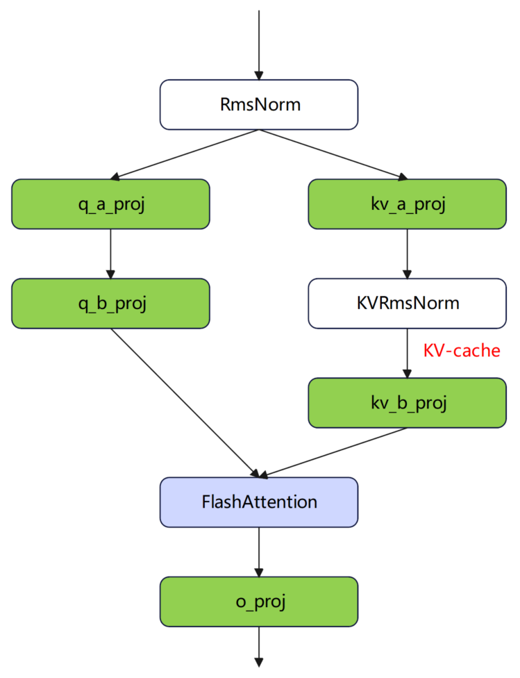
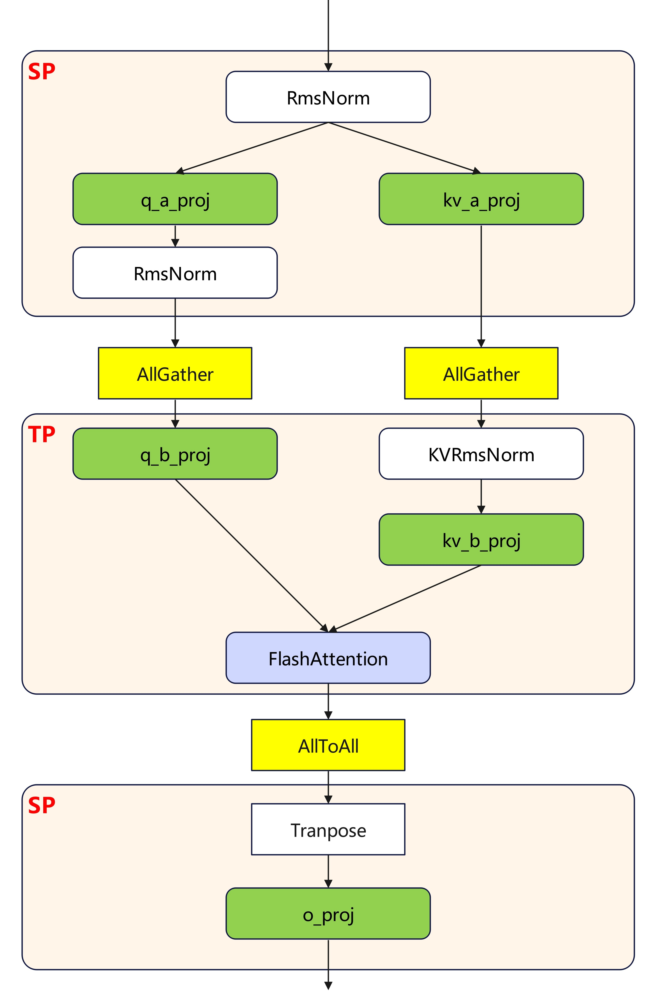
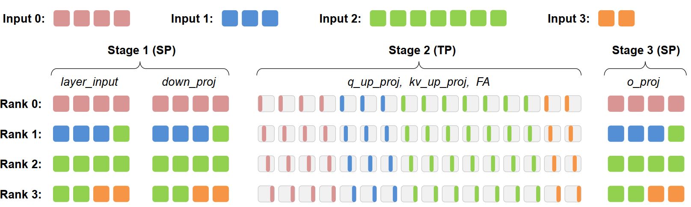
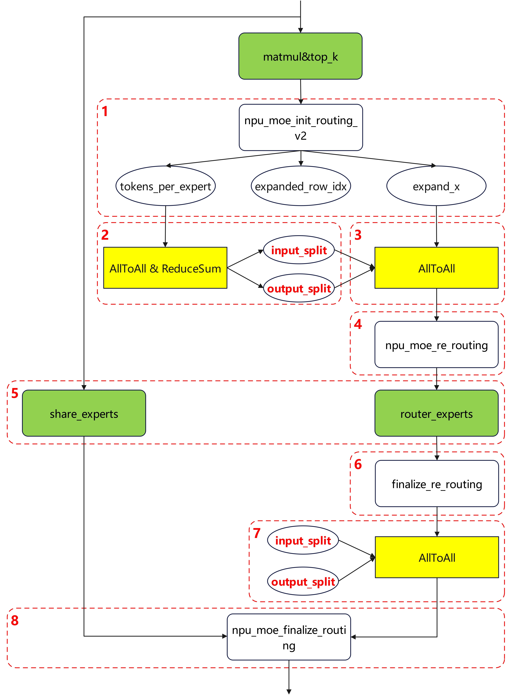
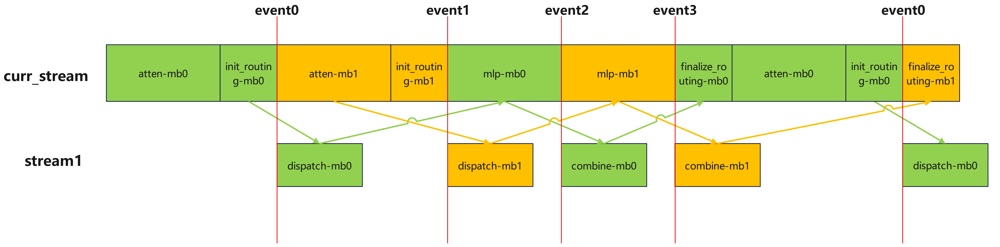

# Prefill-Stage Inference Performance Optimization for DeepSeek-R1 on an Atlas A3 Cluster
## Overview
This document describes parallel deployment and performance optimization strategies for the prefill stage of DeepSeek-R1 on Atlas A3 series products. It primarily uses key optimization techniques such as a hybrid partitioning strategy, Double-Routing, and micro-batch. It ultimately achieves a throughput of 6.5k tokens/card/s with perfect eplb on Atlas A3 series products.

## MLA (Multi-Head Latent Attention) Deployment Strategy Optimization
### DP (Data Parallelism) Partitioning Strategy
The MLA part of prefill can use a pure DP computation strategy. Each card deploys the complete model weights without partitioning the model. This strategy has the following advantages:
1. Pure DP partitioning avoids redundant KV-Cache (Key-Value Cache) across multiple cards. Each card stores only the KV-Cache data for the requests received by that card. The KV-Cache data differs across cards, so no redundant data exists.
2. The MLA part has no communication operators, which avoids communication overhead. The prefill stage can more easily fully use the computing power and achieve high throughput when processing a large amount of request data.

<div align="center">

</div>

However, this partitioning strategy causes the following issues:

1. Uneven computation load: In actual scenarios, input requests often have different sequence lengths. Cards that process shorter sequences complete computation earlier and must then wait for the longest sequence in the batch, wasting computation cycles.
2. Increased TTFT (Time to First Token): If the number of real-time requests is smaller than the number of cards, some cards remain idle. Delaying processing to form a complete batch increases the time required to generate the first token. Directly processing an incomplete batch underutilizes computing resources.

To address these issues, this sample improves the TP (Tensor Parallelism) partitioning strategy and proposes an SP-TP-SP (Sequence Parallelism, SP) hybrid partitioning strategy.

### SP-TP-SP Hybrid Partitioning Strategy

For input sequences, combine the batch and seq_len axes to convert the input into a token count. Apply SP partitioning to the tokens and evenly distribute them across cards. The following figure shows the computation process:

<div align="center">

</div>

1. Concatenate multiple request sequences, pad them to the smallest multiple of the number of cards, and apply SP partitioning. Each card then receives the same number of tokens.
2. The FlashAttention (FA) computation uses the TP strategy. It evenly distributes Attention heads across compute cards to balance the computation load across multiple cards.
3. After FlashAttention computation is complete, use AlltoAll communication to convert TP partitioning to SP partitioning. This communication operator transfers less data and provides better performance. At this point, `o_proj` consumes more memory because it must load the complete weights.

With this partitioning strategy, each card has the same MLA-stage computation workload, resulting in a balanced computation load. Assume that there are three inputs: input0, input1, and input2. After combining the batch and seq_len axes, evenly distribute the tokens across Rank0 to Rank3. `down_proj` includes the `q_a_proj` and `kv_a_proj` computations. `q_up_proj` and `kv_up_proj` represent the `q_b_proj` and `kv_b_proj` computations, respectively. Each card then processes the same amount of data and has a balanced computation load. The following figure shows the detailed computation process:

<div align="center">

</div>

The preceding strategy has the following advantages:

1. **Shorter TTFT**: This advantage is especially significant for long-sequence scenarios. For example, for one 128K request, computation can be evenly distributed across cards to reduce latency.
2. **Balanced computation load in the MLA part**: Input sequences only need to be padded to a multiple of the number of cards. Each card has the same computation workload, with almost no redundant computation.

However, this strategy introduces the following issues, which require corresponding optimizations:

1. Each card must store the complete KV-Cache. The KV-Cache is redundant across cards and consumes a large amount of memory. Store KV-Cache data across separate cards to avoid this issue.
2. Compared with the pure DP strategy, MLA computation introduces AllGather and AlltoAll communication. Use micro-batch to further optimize the communication time.

**Summary**: In the current prefill scenario, consider the DP partitioning strategy to improve throughput when there are many requests or KV-Cache occupies a large amount of memory. Consider the SP-TP-SP hybrid partitioning strategy to reduce latency when there are few requests, the request distribution is uneven, or a single request has a long sequence.

## MoE (Mixture of Experts) Deployment Strategy Optimization
The MoE computation stage uses the EP (Expert Parallelism) partitioning strategy. It evenly distributes routed experts across cards, while each card also stores one shared expert. Routed expert computation uses the **Double-Routing** strategy. Each card performs init-routing and finalize-routing operations twice. This solution has the following advantages:

1. When the load is relatively balanced, this solution has lower peak memory than the AllGather solution. Each card obtains only the tokens required by its experts, so no redundant data exists.

2. Compared with obtaining the complete token data on each card, this solution transfers less data and reduces communication time.

The following figure shows the main computation process of this solution:
<div align="center">

</div>

The main computation steps are as follows:

1. Call `npu_moe_init_routing_v2` to expand and sort the tokens on the current card to obtain `expanded_x`. The interface also obtains `tokens_per_expert`, which is the number of tokens each expert processes, and `expanded_row_idx`, which restores the original token order (**first routing operation**).
    ```python
    expanded_x, expanded_row_idx, tokens_per_expert, _ = torch_npu.npu_moe_init_routing_v2(...)
    ```
2. Perform AlltoAll and ReduceSum operations on `tokens_per_expert` to obtain the number of tokens that each card sends to other cards (**input_splits**) and the number of tokens that each card receives from other cards (**output_split**). These parameters are primarily used for AlltoAll communication so that each card obtains its corresponding tokens.
3. Call the AlltoAll communication interface to exchange tokens across cards. The experts on each card obtain the tokens they need to process.
    ```python
    dist.all_to_all_single(gathered_tokens, expanded_x, output_splits, input_splits, group=moe_ep_group)
    ```
4. At this point, each card has obtained the tokens required by its local experts, but the tokens are out of order. Therefore, the card performs another `re_routing` operation to obtain the sorted token distribution `hidden_states_ordered_by_experts`, the number of tokens processed by each local expert `tokens_per_local_expert`, and `gathered_ids_unsort`, which restores the token order on the current card (**second routing operation**).
    ```python
    hidden_states_ordered_by_experts, _, gathered_ids_unsort, tokens_per_local_expert = torch_npu.npu_moe_re_routing(...)
    ```

5. Complete the routed expert and shared expert computations.
    ```python
    hidden_states_ordered_by_experts = experts(**args)
    ```
6. Restore the order of the computed tokens (**first finalize-routing operation, corresponding to the second routing operation**). The `torch.index_select()` interface provides better performance here.
    ```python
    new_x = torch.index_select(hidden_states_ordered_by_experts, 0, gathered_ids_unsort.float().argsort().int())
    ```
7. Call the AlltoAll communication interface to exchange tokens across cards and retrieve the tokens for the current card.
    ```python
    dist.all_to_all_single(gathered_tokens, new_x, input_splits, output_splits, group=moe_ep_group)
    ```
8. Call `finalize_routing` to restore the token order on the current card and obtain the tokens in their original order (**second finalize-routing operation, corresponding to the first routing operation**). This interface can also directly compute the weighted sum of routed expert and shared expert outputs.
    ```python
    hidden_states = torch_npu.npu_moe_finalize_routing(
            gathered_tokens, skip1=hidden_states_share, skip2=None, bias=None,
            scales=topk_weight.to(gathered_tokens.dtype),
            expanded_src_to_dst_row=expanded_row_idx,
            export_for_source_row=None, drop_pad_mode=2
        )
    ```

## TND Format Support
Conventional FlashAttention uses the BNSD format ([batch, num_of_head, seq_len, head_dim]) for computation. When each request has an uncertain length, padding may be required, which wastes computing resources. The TND format combines the batch and seq_len axes into [batch*seq_len, num_of_head, head_dim] and converts the input into a token count, enabling computation without padding. This function depends on FlashAttention support.

For the TND ([token, num_of_head, head_dim]) format, combine all input requests into a list for processing. Assume that there are four requests with seq_len values of 128, 256, 512, and 1024. During FlashAttention computation, combine all requests into a list and set `actual_seq_lengths_kv=[128, 256, 512, 1024]` to complete the corresponding computation without padding the requests to a uniform length.

The TND format addresses usability and computing resource waste issues, especially for variable-length input scenarios. However, during actual computation, the TND format introduces the following issues:

1. **Unfriendly data layout**: The data layout is unfriendly to FlashAttention computation, data accesses are discontinuous, and FlashAttention has low bandwidth efficiency.
2. **Additional computation overhead**: The original BNSD format must use transpose to convert to the TND format, introducing unnecessary computation overhead.

To avoid these issues, actual FlashAttention computation uses the **NTD** format. This format improves bandwidth efficiency and reduces computation overhead from operations such as transpose. The following figure shows the actual computation process of the MLA part during the prefill stage:

<div align="center">

</div>

This computation method has the following advantages:
1. Compared with the TND format, FlashAttention computation efficiency improves by 15%.
2. Combined with matmul weight partitioning and FlashAttention support for separate NoPE (No Positional Encoding) and RoPE (Rotary Positional Encoding) inputs, this method completely eliminates additional computation overhead from split, concat, and transpose operations and improves MLA-stage computation efficiency.

## Micro-Batch Optimization
The prefill stage is usually computation-bound and also has some communication overhead, which can account for up to 30% of the total time. Different hardware units perform computation and communication. Running computation and communication in parallel further improves prefill-stage performance. Ideally, computation completely hides communication time and greatly improves computation efficiency.

Therefore, split the input into two micro-batches, use two streams to construct two pipelines, and run computation and communication in parallel through a customized pipeline layout. This approach maximizes prefill-stage computation efficiency.

Splitting the input into two micro-batches divides the data in half and changes the shape of each layer computation during the prefill stage. Shape changes affect computation and communication efficiency. In eager mode, the number of delivered tasks also doubles, imposing higher requirements on the host. Therefore, when optimizing micro-batch during the prefill stage, confirm the impact of the following issues:

1. **Good linearity of computation and communication performance**: The computation and communication performance before input partitioning must be approximately equal to the sum of the performance for the two partitions. This requirement minimizes performance degradation caused by shape changes.
2. **Computation is not host-bound**: If the model itself is host-bound, implementing micro-batch through two streams degrades host performance and increases the overall duration.

### Micro-Batch Strategy for the MLA-DP and MoE-EP Scenario
When MLA uses DP partitioning, communication operators throughout the prefill stage mainly come from AlltoAll communication in the MoE stage, including the dispatch and combine stages. Therefore, the core objective of micro-batch in this stage is to use computation to hide communication time in the dispatch and combine stages and maximize prefill-stage computation efficiency.
The following figure shows the pipeline layout for this scenario:

<div align="center">

</div>

The main steps are as follows:

1. **Computation and communication division**: Divide prefill computation into six stages: atten, init_routing, dispatch, mlp, combine, and finalize_routing.
In the figure, atten mainly includes MLA and `o_proj` computation. dispatch mainly includes AlltoAll communication that distributes tokens to the corresponding experts. mlp mainly includes routed expert and shared expert computation. combine mainly includes AlltoAll communication that restores tokens to each card.

2. **Micro-batch preprocessing**: Divide the input into two micro-batches for processing. Assume that each card has two 4k requests. Each micro-batch processes one 4k request. All computation is complete when both micro-batches finish.

3. **Communication processing**: Because communication and computation run in parallel, do not enable the AIV mode of `HCCL_OP_EXPANSION_MODE`. Use the default SDMA mode. AIV mode causes communication and computation to compete for hardware resources, increasing latency.

4. **Creating streams**: For the DP+EP partitioning strategy, place all computations on the default computation stream.
   ```python
   curr_stream = torch.npu.current_stream()
   ```
    Create a stream for communication:
   ```python
   stream1 = torch.npu.Stream()
   ```

5. **Pipeline layout**: Place computation on the current stream as follows:
   ```python
    with torch.npu.stream(curr_stream):
        # Run atten computation on curr_stream.
        atten()
   ```
   Place communication on `stream1` as follows:
   ```python
    with torch.npu.stream(stream1):
        # Run atten computation on stream1.
        dispatch()
   ```
   At synchronization points, synchronize the two streams as follows:
   ```python
   event0 = curr_stream.record_event()
   ...
   stream1.wait_event(event0)
   ```

After micro-batch computation is enabled, computation completely hides communication in the dispatch and combine stages. The entire prefill stage is computation-bound, and the chip has no idle time. Therefore, end-to-end computation efficiency improves.

On Atlas A3 series products, prefill uses a two-node, 16-card deployment with an input sequence of 64*4K. Assuming that the expert load of the MoE layer is balanced, the performance test results are as follows:

| Partitioning Strategy | Latency (ms) | Total Throughput (tokens/s) | Average Throughput (tokens/card/s) |
|------|------|------|------|
| MLA-DP32 + MoE-EP32 | 3128   | 83805 | 5237
| MLA-DP32 + MoE-EP32 + micro-batch | 2512 | 104356 | 6522 |

With this partitioning strategy, enabling micro-batch improves performance by 25%.

## Enabling the weightNZ Format for Matmul Operators
For Matmul computations in DeepSeek, process the weight Tensor of the model weights into the weightNZ format, which is friendly to Ascend AI Processors, to further improve Matmul computation efficiency.

The weightNZ format uses 512-byte alignment, which effectively improves hardware bandwidth access efficiency. For example, an int8 Tensor with a shape of [16384, 7168] is converted to [224, 1024, 16, 32] in the NZ format.

## Appendix
[Environment Deployment and Sample Execution](https://gitcode.com/cann/cann-recipes-infer/blob/master/models/deepseek_r1/README.md)(Chinese)

<!-- static-meta
{
  "sidebarTitle": "Prefill Optimization",
  "quantization": ["int8"],
  "parallelism": ["data-parallel", "tensor-parallel", "sequence-parallel", "expert-parallel"],
  "cannFeatures": ["multi-stream"],
  "hardware": ["atlas-a3"],
  "frameworks": ["cann-recipes"],
  "llmSpeculativeInference": ["none"]
}
-->
