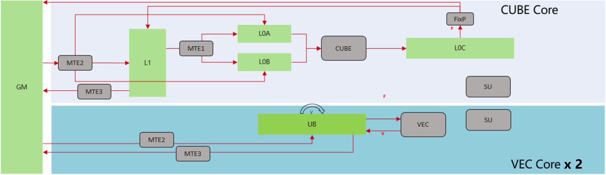
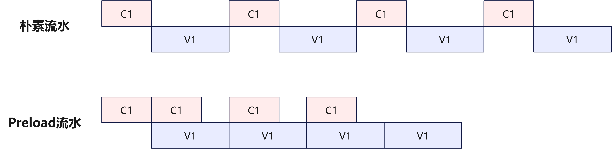
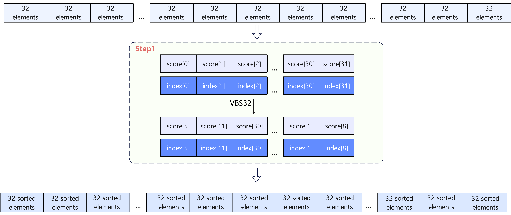
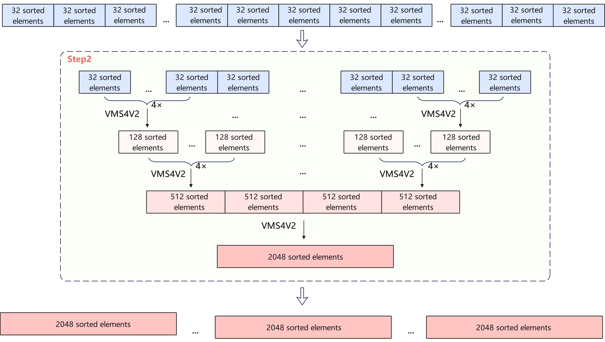
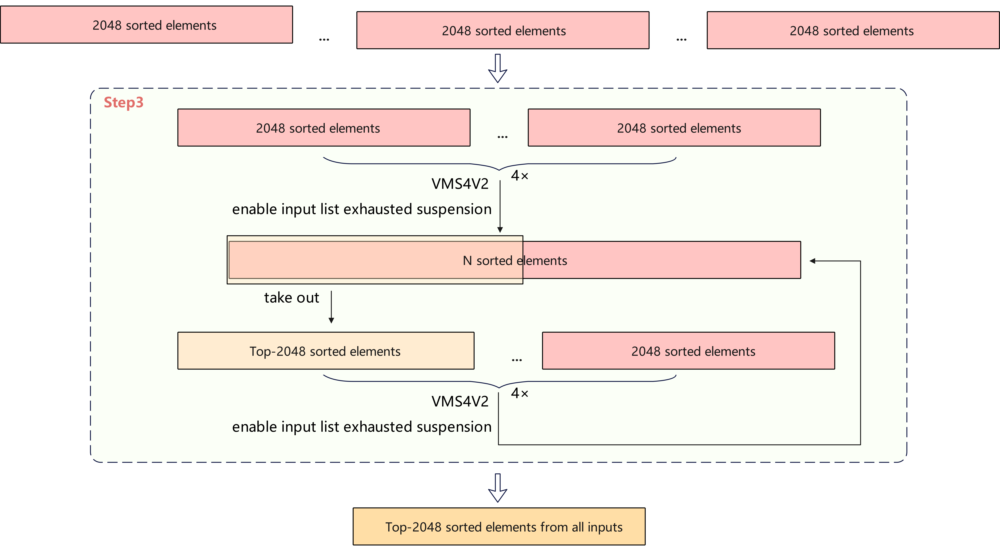
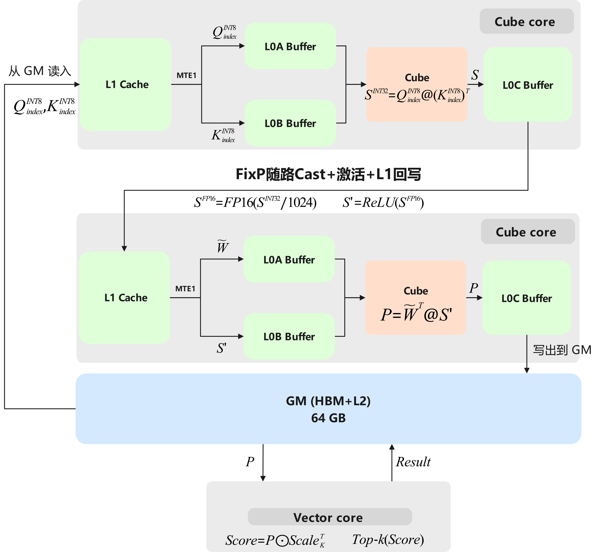
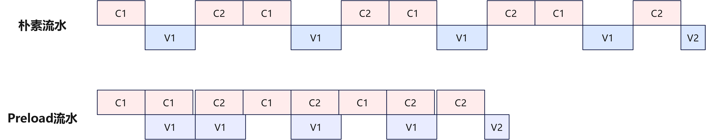
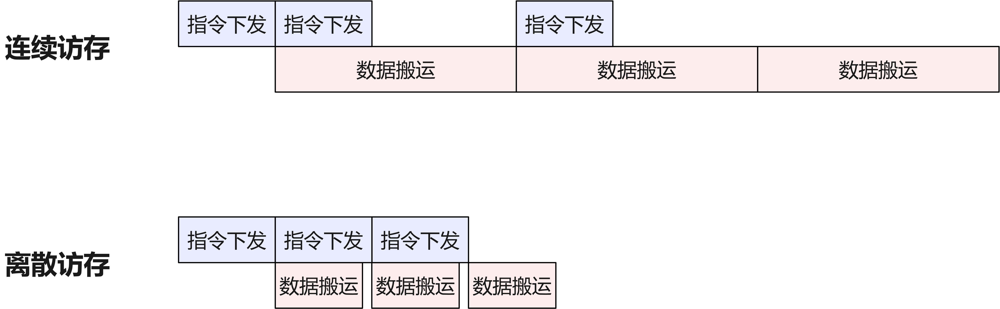
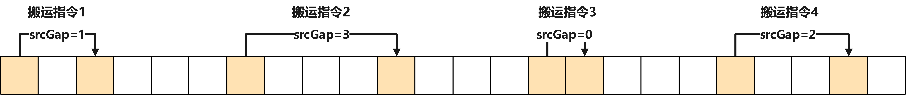

# NPU DeepSeek-V3.2-Exp Ascend C Fused Operator Optimization

For the DeepSeek-V3.2-Exp architecture, this release provides two new fused operators: `LightningIndexer` (LI) and `SparseFlashAttention` (SFA). The `LightningIndexer` operator is one of the most distinctive parts of the new DeepSeek architecture and sparsely selects important context. The Top-$k$ computation is currently integrated into the `LightningIndexer` operator, providing an improvement of approximately 20% compared with an external Top-$k$ implementation. `SparseFlashAttention` is an Attention operator specifically optimized for sparse Attention scenarios.

The ratio of Cube cores to Vector cores in A3 is $1:2$. Each Cube core and two Vector cores form a core group (one AICore). The following figure shows the structure of a core group. L1, L0A, L0B, and L0C are on-chip buffers of the Cube core, and UB is the on-chip buffer of the Vector core. For details, refer to [Basic Architecture](https://www.hiascend.com/document/detail/zh/canncommercial/82RC1/opdevg/Ascendcopdevg/atlas_ascendc_10_0008.html#ZH-CN_TOPIC_0000002336176974__section349312501823)(Chinese).

    

This technical report describes the detailed optimizations of the two fused operators on A3, including operator tiling design, pipeline optimization between Cube and Vector cores, implementation optimization of the computation process, and planned optimizations. It also introduces the current progress in improving the usability of fused operators.

## Highlights

- Detailed operator tiling and pipeline designs that fully use the advantages of fused operators
- Efficient implementation based on Ascend C APIs that fully uses hardware features
- Aggregated memory access that reduces instruction delivery and improves discrete memory access performance
- Improved usability for operator development and debugging
- Quantization support for `LightningIndexerQuant` and full use of Cube cores by the Mat-Duce algorithm

## Outline

- [NPU DeepSeek-V3.2-Exp Ascend C Fused Operator Optimization](#npu-deepseek-v32-exp-ascend-c-fused-operator-optimization)
  - [Highlights](#highlights)
  - [Outline](#outline)
  - [LightningIndexer](#lightningindexer)
    - [LI Operator Tiling Design](#li-operator-tiling-design)
    - [LI Pipeline Design](#li-pipeline-design)
    - [In-Path ReLU Implementation](#in-path-relu-implementation)
    - [Top-k Instruction Implementation](#top-k-instruction-implementation)
    - [LI Quantization Support](#li-quantization-support)
      - [Mat-Duce Algorithm](#mat-duce-algorithm)
  - [SparseFlashAttention](#sparseflashattention)
    - [SFA Operator Tiling Design](#sfa-operator-tiling-design)
    - [SFA Pipeline Design](#sfa-pipeline-design)
    - [Memory Access Optimization](#memory-access-optimization)
    - [SFA Next Feature](#sfa-next-feature)
  - [Usability Improvements](#usability-improvements)
    - [TilingKey Templating](#tilingkey-templating)
    - [Core Partition Computation Offloading](#core-partition-computation-offloading)
    

## LightningIndexer

`LightningIndexer` performs a series of operations to obtain the Top-$k$ positions corresponding to each token. For the Index Query $Q_{index}\in\R^{g\times d}$ of a token, given the context Index Key $K_{index}\in\R^{S_{k}\times d},W\in\R^{g\times 1}$, where $g$ is the group size corresponding to GQA, $d$ is the dimension of each head, and $S_{k}$ is the context length, the `LightningIndexer` computation formula is as follows:
$$
\text{Top-}k\left\{[1]_{1\times g}@\left[(W@[1]_{1\times S_{k}})\odot\text{ReLU}\left(Q_{index}@K_{index}^T\right)\right]\right\}
$$

The computation can be divided into the following process:
1. Compute the matrix multiplication: $S = Q_{index}@K_{index}^T$.
2. Compute the activation function: $S'=\text{ReLU}(S)$.
3. Compute the broadcast multiplication: $S_W=(W@[1]_{1\times S_{k}})\odot S'$.
4. Perform a Reduce operation along the G axis: $Score=[1]_{1\times g}@ S_W$.
5. Perform the $\text{Top-}k$ computation on $Score$. Obtain the top $k$ values and return their corresponding indexes.

In the Prefill scenario or the Decode scenario with MTP enabled, the $Q_{index}$ values corresponding to multiple tokens are combined for unified computation. The following sections do not distinguish between $Q_{index}$ values for one token and multiple tokens.

Actual development must fully use the features of Ascend hardware to achieve better performance. The following sections describe the current solution and its implementation in detail.

### LI Operator Tiling Design

The operator tiling design determines whether storage space is fully used and therefore affects overall computing power utilization and operator performance. For `LightningIndexer`, this section describes inter-core and intra-core tiling designs.

Because the on-chip buffer space is limited, every computation must be partitioned into blocks. Therefore, the basic block size for one iteration, namely the inter-core tiling design, must be determined. The current `LightningIndexer` operator sets the basic block size to $(512,512)$. One iteration computes 512 rows to reduce repeated movement of the right matrix. For example, when $g=64$, eight tokens are combined for unified computation. The iteration also completes computation at a granularity of 512 in the $S_{k}$ direction. This value keeps pipeline startup and completion overhead controllable and allows computation to hide the synchronization overhead between Cube and Vector cores.

The intra-core tiling design uses the following solution:
- The L1 space is divided into the following parts:
  - The $Q_{index}$ matrix remains resident: $512\times 128\times2\text{ Bytes}=128\text{ KB}$. The basic block at the L1 level is $(512,128)$. During actual computation, data can be moved at a finer granularity. Each operation moves only $(256,128)$ data to L1 to reduce movement startup overhead.
  - The $K_{index}$ matrix uses three buffers cyclically: $3\times256\times 128\times2\text{ Bytes}=192\text{ KB}$. The basic block at the L1 level is $(256,128)$.
- L0A, L0B, and L0C enable double buffering and are divided into $2\times32\text{ KB},2\times32\text{ KB},2\times64\text{ KB}$, respectively. The matrix block sizes moved into L0A and L0B each time are both $(128,128)$. This setting is friendly to Ascend hardware and improves computing power utilization.

This method ensures that $Q_{index}$ only needs to be moved once during computation and reduces repeated movement of the $K_{index}$ matrix. Assume that the basic block size of the $Q_{index}$ matrix at the L1 level is $(128,128)$ and the total number of tokens in the row direction is $S_q$. The $K_{index}$ matrix must then be moved $\lceil S_q/128\rceil$ times. Selecting a basic block size of $(512,128)$ reduces the number of repeated movements to $\lceil S_q/512\rceil$. Starting the matrix multiplication in the first computation process requires moving the right matrix. Allocating multiple buffers to the right matrix removes computation process stalls caused by buffer occupancy. Therefore, allocating three buffers to $K_{index}$ improves movement efficiency during the bandwidth ramp-up period.

### LI Pipeline Design

The `LightningIndexer` computation process has only two stages: matrix multiplication and ReLU operations ($C_1$), followed by multiple vector computations ($V_1$). To prevent serial execution of the stages, preload $C_1$ once so that the pipelines hide each other.

    

### In-Path ReLU Implementation

`LightningIndexer` first performs matrix multiplication and then applies ReLU to the result. Because matrix multiplication and ReLU run on different compute units, a basic implementation must move the matrix multiplication result from the Cube core to the Vector core. However, the FixP component of the Cube core on the Ascend NPU provides in-path ReLU. After matrix multiplication is complete, ReLU can run directly during data movement without an explicit ReLU computation. In addition to ReLU, the FixP component provides more powerful functions. For details, refer to [Basic API: FixP](https://www.hiascend.com/document/detail/zh/canncommercial/82RC1/API/ascendcopapi/atlasascendc_api_07_0251.html)(Chinese).

### Top-k Instruction Implementation

The core function of the `LightningIndexer` fused operator is to efficiently select the $k$ indexes with the highest scores, such as 2048 indexes, for each token in a sequence containing hundreds of thousands of tokens. The operator must compute Top-$k$ accurately and cannot use an approximation algorithm.

The current solution performs a full sort based on sorting instructions supported by Ascend. The Top-$k$ computation has three steps:  
- **Group sorting**: Use the `VBS32` instruction to perform a stable descending sort of every 32 tokens by $Score$. Output the sorted vector and corresponding index vector until all tokens in the sequence are sorted in groups.  

    

- **Merging**: Use the `VMS4v2` instruction to merge up to four groups, which can also be two or three groups, of sorted vectors with lengths of 32, 128, or 512 until the merged vector length reaches 2048. The merged vectors remain in stable descending order by $Score$. The length of the output vector equals the sum of the four input vector lengths. The instruction also outputs the corresponding index vector.  

    

- **Reduction**: Use the exhaustion mode of the `VMS4v2` instruction. When all available data in an input vector has been read, the sorting instruction immediately pauses. Merge up to four sorted vectors with a length of 2048. Extract the vector consisting of the first $k=2048$ parameters and repeatedly perform Top-$k$ computation with the remaining sorted vectors that have not participated in the merge sort. Continue until all sorted vectors with a length of 2048 have been compared to obtain the indexes corresponding to the 2048 highest scores across all vectors.  

    

Assume that the context length is $S_k$. The computation workload of the **group sorting** and **merging** steps is $4S_k$. The computation workload of the **reduction** step cannot be evaluated precisely. A simulation using a normal distribution and the Monte Carlo method shows that the first computation workload is close to $4k$. Starting from the second computation, a vector containing $k$ larger values already participates in the computation, so the computation workload decreases sharply until it approaches the exhaustion limit $k$. Simulation analysis expresses the workload of this part as $0.36S_k+3.32k$. Therefore, the total computation workload of the Top-$k$ process is $totalCount = 4.36S_k + 3.32k$.

### LI Quantization Support

The current `LightningIndexer` operator supports [Per-Token-Head quantized](deepseek_v3.2_exp_inference_guide.md) inputs. Both the input $Q_{index}$ and $K_{index}$ are quantized to the INT8 data type to address excessive memory usage in long-sequence scenarios.

For a token, `LightningIndexerQuant`, which supports quantized inputs, receives the Index Query $Q_{index}^{INT8}\in\R^{g\times d}$ and its dequantization coefficient $Scale_{Q}\in\R^{g\times1}$. Given the context Index Key $K_{index}^{INT8}\in\R^{S_{k}\times d}$ and its dequantization coefficient $Scale_{K}\in\R^{S_{k}\times1}$, and $W\in\R^{g\times 1}$, where $g$ is the group size corresponding to GQA, $d$ is the dimension of each head, and $S_{k}$ is the context length, the `LightningIndexerQuant` computation formula is as follows:
$$
\text{Top-}k\left\{[1]_{1\times g}@\left[(W@[1]_{1\times S_{k}})\odot\text{ReLU}\left(\left(Scale_Q@Scale_K^T\right)\odot\left(Q_{index}^{INT8}@{(K_{index}^{INT8})}^T\right)\right)\right]\right\}
$$

#### Mat-Duce Algorithm

The `LightningIndexerQuant` operator uses the Mat-Duce algorithm. This algorithm applies mathematical transformations to adjust the computation logic and uses matrix multiplication to implement reduction computation. It fully uses the in-path capabilities of the Cube cores on the A3 chip and implements most computations of `LightningIndexerQuant` within the Cube cores.

Because $Scale_Q,Scale_K\ge0$, let $\tilde{W} = Scale_Q \odot W \in \mathbb{R}^{g\times1}$. The `LightningIndexerQuant` computation formula can be equivalently transformed as follows:

$$\text{Top-}k\left\{\tilde{W}^T @ \text{ReLU}(Q_{index}^{INT8}@(K_{index}^{INT8})^T) \odot Scale_K^T\right\}.$$

The corresponding computation process is as follows:
1. Preprocess the data. Compute $\tilde{W} = Scale_Q \odot W$ in the UB, cast the result to FP16, and write it to the GM.
2. Compute $S^{INT32} = Q_{index}^{INT8}@(K_{index}^{INT8})^T$ in the Cube core. The data type of $S$ is INT32.
3. Use the FixP DEQF16 instruction to compute $S^{FP16}=\text{FP16}(S^{INT32}/1024)$. Multiply the INT32 result by $1/1024$ and convert it to the FP16 data type. Here, $1/1024$ prevents numeric overflow without affecting the final Top-$k$ result.
4. Continue using the in-path ReLU function of FixP to compute $S'=\text{ReLU}(S^{FP16})$ and move the result to L1 for the next matrix multiplication.
5. Compute $P=\tilde{W}^T@S'$ in the Cube core and write the result to the GM. This step simultaneously performs dequantization for $Scale_Q$, row-wise scaling for $W$, and summation of the results from different heads.
6. Read $P$ from the GM into the Vector core and perform dequantization for $Scale_K$: $Score = P \odot Scale_K^T$.
7. Compute Top-$k$ for $Score$ in the Vector core.

The following figure shows the computation process:

    

Compared with the standard implementation, this solution uses mathematical transformations to implement most vector operations in the Cube core in step 5. It also fully uses the FixP [in-path quantization, activation, and movement](https://www.hiascend.com/document/detail/zh/CANNCommunityEdition/83RC1alpha003/API/ascendcopapi/atlasascendc_api_07_00130.html)(Chinese) capabilities to convert the quantized matrix multiplication result from INT32 to FP16 in steps 3 and 4, enabling the second half-precision matrix multiplication and significantly improving operator performance.

## SparseFlashAttention

As the context length of large models increases, Sparse Attention becomes increasingly important. This technique substantially reduces the computation workload by computing only critical parts. However, it introduces extensive discrete memory access, increasing data movement time and affecting overall performance. Sparse Attention computation can be expressed as follows:

$$
\text{softmax}(\frac{Q@\tilde{K}^T}{\sqrt{d_k}})@\tilde{V}
$$
Here, $\tilde{K},\tilde{V}$ are important Key and Value values obtained by a selection algorithm such as `LightningIndexer`. They generally have sparse or block-sparse characteristics. $d_k$ is the dimension of each head of $Q,\tilde{K}$.

The released `SparseFlashAttention` operator is a new operator for Sparse Attention. It provides detailed optimizations for discrete memory access by reducing instructions and aggregating data movement. The `SparseFlashAttention` operator uses the computation process of [FlashAttention](https://arxiv.org/pdf/2307.08691), which consists of four stages:
- $C_1$: $Q@K^T$.
- $V_1$: online softmax.
- $C_2$: $P@V$.
- $V_2$: rescaling $O$.

### SFA Operator Tiling Design

The basic block size for one `SparseFlashAttention` iteration is $(256,512)$.

The intra-core tiling design of the operator is as follows:
- The L1 space is divided into the following parts:
  - The $Q/P$ matrices reuse the space at different times, where the $P$ matrix is the softmax result: $4\times128\times 288\times2\text{ Bytes}=288\text{ KB}$. In a $C_1$ or $C_2$ stage, the left matrix is moved to L1 four times and remains resident in L1 during one iteration. Each movement of the $Q$ matrix has a size of $(128,288)$, and each movement of the $P$ matrix has a size of $(128,256)$.
  - The $K/V$ matrices use three buffers cyclically: $3\times128\times 288\times2\text{ Bytes}=216\text{ KB}$. Each movement of the $K$ matrix has a size of $(128,288)$, and each movement of the $V$ matrix has a size of $(256,128)$.
- L0A, L0B, and L0C enable double buffering and are divided into $2\times32\text{ KB},2\times32\text{ KB},2\times64\text{ KB}$, respectively. In the $C_1$ stage, the matrix block sizes moved into L0A and L0B are $(128,96)$ and $(96,128)$, respectively. In the $C_2$ stage, the matrix block sizes moved into L0A and L0B are both $(128,128)$.

### SFA Pipeline Design

For complex fused operators, efficient collaboration between Cube and Vector cores is the main challenge in fully using hardware computing power. Pipeline overlapping is the core scheduling mechanism that connects the two types of cores, and its design directly determines operator performance.

Because `SparseFlashAttention` uses the [AMLA](https://gitcode.com/ascend-tribe/ascend-inference-cluster/blob/main/OptimizedOps/AMLA-%E4%BB%A5%E5%8A%A0%E4%BB%A3%E4%B9%98%E7%9A%84%E9%AB%98%E6%80%A7%E8%83%BD%E6%98%87%E8%85%BEMLA%E7%AE%97%E5%AD%90.pdf)(Chinese) algorithm, it has only three computation stages, $C_1,V_1,C_2$, in addition to the final normalization operation. Compared with `LightningIndexer`, `SparseFlashAttention` has a more complex computation process with more dependencies. A basic pipeline layout introduces many bubbles during computation. As shown in the upper half of the following figure, data dependencies between different stages of the computation process introduce many idle periods in both Cube and Vector streams, resulting in low computing power utilization. This operator uses a preload pipeline layout to eliminate dependencies. During the steady-state period, excluding pipeline startup and completion, the Cube stream completely hides the Vector stream. The lower half of the following figure shows the result. This method provides a significant performance improvement compared with the basic pipeline layout.

    

### Memory Access Optimization

Actual memory access behavior can be divided into instruction delivery and data movement. For an Attention operator in a non-sparse scenario, data access is generally continuous. Therefore, one data movement takes longer than instruction delivery, enabling multiple continuous memory accesses and high memory access bandwidth. For discrete memory access in Sparse Attention, however, the duration of a single memory access decreases substantially and may be shorter than instruction delivery. This causes severe instruction delivery stalls, as shown in the following figure.

    

Attention computation starts from the Cube core, which also issues the memory access instructions. Based on the $1:2$ ratio of Cube cores to Vector cores on the A3 chip, use Vector cores to issue memory access instructions and double the instruction delivery efficiency. The amount of data in a single memory access also affects the actual bandwidth. A discrete memory access transfers a small amount of data, which causes the data movement itself to take longer than expected. To address this issue, aggregate discrete data points in pairs and use the [srcGap](https://www.hiascend.com/document/detail/zh/CANNCommunityEdition/83RC1alpha002/API/ascendcopapi/atlasascendc_api_07_0103.html#ZH-CN_TOPIC_0000002449889097__table9182515919)(Chinese) parameter to implement paired data access and improve memory access bandwidth, as shown in the figure.

    

### SFA Next Feature

Future work will explore quantization support for the `SparseFlashAttention` operator to address excessive memory usage in long-context scenarios.

## Usability Improvements
### TilingKey Templating

TilingKey distinguishes different operator implementations by separating code so that different branches process different features. However, TilingKey values are difficult to remember and understand because they are usually long numbers without clear meanings, which severely affects code readability and programmability.

To improve operator code readability and reduce development difficulty, the two new open-source operators use the Ascend C tiling template programming method instead of conventional TilingKey programming. Developers only need to define template parameters and their combinations to manage branches. This method reduces dependency on specific TilingKey values and improves code management efficiency. For details, refer to [Tiling Template Programming](https://www.hiascend.com/document/detail/zh/CANNCommunityEdition/83RC1alpha002/opdevg/Ascendcopdevg/atlas_ascendc_10_00025.html)(Chinese).

### Core Partition Computation Offloading

Tiling is the preprocessing stage before operator execution. During this stage, the host computes the workspace usage, core partitioning strategy, and other information required for operator execution. Host-bound issues may occur in single-operator mode. [Static graph offloading](https://mp.weixin.qq.com/s?__biz=MzA4MzM0ODMyMA==&mid=2447512608&idx=1&sn=c093b0529cf83f57a1609f27a4fdb7ce&scene=21&poc_token=HKIs0WijUEkVAZiRySCCHG8qH1y2Hk9fbFfAAxs4)(Chinese) avoids this issue.

However, for Attention operators, different batches in the actual input may have different context lengths. Therefore, computing the core partitioning strategy during tiling has a value dependency on the specific context length (`actualSeqLengths`). This prevents Attention operators from being completely offloaded to static graph execution, producing too many small static subgraphs in the entire network and introducing substantial static subgraph scheduling overhead. Core partition computation also requires copying the corresponding data from the device to the host, resulting in poor end-to-end network performance.

    

To address this issue, Attention operators use a tiling offloading solution that offloads core partition computation to the AICPU on the device. During end-to-end network execution, core partition computation starts when its dependent data is ready and can run in parallel with the operator execution stream. However, when core partition computation depends on a preceding operator, this method still cannot prevent an execution interruption. From a usage perspective, this approach introduces additional AICPU tiling logic. The custom operator process must separately develop the corresponding tiling function and work with offloaded graph execution scheduling. The function is complex and the invocation chain is long, making custom development and debugging difficult.

    

The released `LightningIndexer` and `SparseFlashAttention` operators further optimize tiling offloading by offloading the core partition computation process from the AICPU to the AICore. This optimization simplifies the invocation chain, eliminates scheduling overhead caused by tiling dependencies on preceding operators, and simplifies development and debugging.

    

<!-- static-meta
{
  "sidebarTitle": "Ascend C Fused Operators",
  "operator": [
    "ascendc"
  ],
  "hardware": [
    "atlas-a3"
  ],
  "frameworks": [
    "cann-recipes"
  ],
  "llmSpeculativeInference": [
    "mtp"
  ]
}
-->
