# NPU DeepSeek-V3.2-Exp Inference Optimization Practice

The DeepSeek team released its latest model, DeepSeek-V3.2-Exp. The model uses the sparse **DeepSeek Sparse Attention (DSA)** architecture to improve long-sequence computation efficiency and reduce inference costs. Long-context scenarios and the new DSA structure jointly introduce new requirements for inference optimization systems.

This document describes Prefill and Decode inference optimizations for DeepSeek-V3.2-Exp on an A3 cluster. It first analyzes the structural characteristics of DeepSeek-V3.2-Exp, implements a model parallel strategy friendly to long sequences, and designs new NPU fused kernels and multi-stream parallel optimizations. Based on these optimizations, this practice deployed the DeepSeek-V3.2-Exp BF16 model on day 0 and the W8A8C16 model on day 1. It currently supports C8 quantization and will continue to implement low-bit quantization algorithms. Conventional 4K to 8K sequences inherit the existing DeepSeek-V3.1 optimizations. In long-sequence inference scenarios from 16K to 166K, DSA sparsity provides benefits and enables performance that exceeds DeepSeek-V3.1. Both the model and fused kernels are open source.

For the new **Lightning Indexer (LI)** and **Sparse Flash Attention (SFA)** operators in the DSA structure, this open-source release includes not only an **AscendC** implementation but also the first release of the in-house **PyPTO** implementation. Developers can program dynamic-shape operators with only a few hundred lines of code. PyPTO is a programming system for large fused operators released by CANN and provides a MegaKernel-oriented programming paradigm. Its core concept uses Tensor/Tile as the basic data representation and describes and assembles a complete computation process through a series of basic Tensor operations. A human-in-the-loop and white-box approach fully uses SRAM space and enables efficient use of multiple cores.

The open-source **TileLang** community has also integrated with the CANN software stack and supports the new LI and SFA operators in the DSA structure.

## Highlights
- The overall deployment strategy retains the large-EP parallel solution of DeepSeek. For the sparse DSA structure, it adds a CP parallel strategy friendly to long sequences to balance latency and throughput. The [model inference code](https://gitcode.com/cann/cann-recipes-infer/blob/master/models/deepseek_v3_2_exp/README.md)(Chinese) is open source and has also been adapted to the mainstream open-source inference frameworks vLLM and SGLang.
- NPU LI and SFA fused kernels are implemented in AscendC to realize the potential of sparse computation. The AscendC kernel technical documentation and code are open source in the corresponding operator directories of the [CANN/ops-transformer repository](https://gitcode.com/cann/ops-transformer), including [Lightning Indexer](https://gitcode.com/cann/ops-transformer/tree/master/attention/lightning_indexer) and [Sparse Flash Attention](https://gitcode.com/cann/ops-transformer/tree/master/attention/sparse_flash_attention).
- NPU DSA is implemented based on the in-house PyPTO framework to improve fused operator programming usability. It implements not only an LI fused kernel but also a larger Decode Attention fusion scope. The PyPTO kernel [technical documentation](./deepseek_v3.2_exp_pypto_operator_guide.md) and [code](https://gitcode.com/cann/cann-recipes-infer/blob/master/ops/pypto/README.md)(Chinese) are open source.
- The open-source TileLang community supports the LI and SFA operators in the DSA structure. The TileLang kernel [technical documentation](./deepseek_v3.2_exp_tilelang_operator_guide.md) and [code](https://gitcode.com/cann/cann-recipes-infer/blob/master/ops/tilelang/README.md)(Chinese) are open source.
- Based on the preceding optimizations, CANN supported DeepSeek-V3.2-Exp BF16 inference deployment on day 0 and Int8 quantization on day 1. The reference performance for Prefill and Decode is as follows: using lossless BF16 precision, the TTFT of a 128K long sequence on 64 cards is less than 2 seconds without a cache hit, and TPOT is less than 30 ms. In the W8A8C8 quantization scenario, TPOT for a 128K long sequence on 64 cards is less than 20 ms.

## Outline

- [DeepSeek-V3.2-Exp vs V3.1](#deepseek-v32-exp-vs-v31)
- [Parallel Strategies](#parallel-strategies)
- [MTP](#mtp)
- [Fused Kernels](#fused-kernels)
- [Quantization Strategy](#quantization-strategy)
- [Multi-Stream Parallel Optimization](#multi-stream-parallel-optimization)
- [KVCache Offload](#kvcache-offload)
- [Benchmark](#benchmark)
- [Future Plan](#future-plan)

## DeepSeek-V3.2-Exp vs V3.1

Compared with DeepSeek-V3.1, DeepSeek-V3.2-Exp primarily adds the sparse **Lightning Indexer** module, which sparsely selects the TopK tokens from a long sequence for attention computation.

- Weight memory analysis

  Lightning Indexer is a lightweight MQA-like structure that adds three Linear layers: **q_b proj**, **wk proj**, and **weight proj**. Their weight sizes are as follows:
  $$
  \begin{aligned}
  \mathrm{Param}_{\mathrm{q\_b\_proj}}&=\mathrm{q\_lora\_rank}  \times \mathrm{Indexer\_head\_num} \times \mathrm{Indexer\_head\_dim} \\
  \mathrm{Param}_{\mathrm{wk\_proj}} &= \mathrm{hidden\_size} \times \mathrm{Indexer\_head\_dim}\\
  \mathrm{Param}_{\mathrm{weight\_proj}} &= \mathrm{hidden\_size} \times \mathrm{Indexer\_head\_num}
  \end{aligned}
  $$
  Across all layers, the number of weight parameters increases by approximately **0.85B**.

- KVCache memory analysis

  To preserve model quality, DeepSeek-V3.2-Exp still caches the complete MLA Full KVCache. To improve inference efficiency and prevent repeated computation of the Indexer Key during Decode, it must also **add an Indexer Key Cache**. Its memory size is as follows:
  $$
  \mathrm{batch\_size}\times \mathrm{kv\_length} \times \mathrm{Indexer\_head\_dim} \times \mathrm{storage\_bytes} \times \mathrm{num\_layers}
  $$
  For example, when each rank processes four batches with a sequence length of 64K, the additional Indexer Key Cache in the BF16 scenario is approximately **4 GB**.

- MLA Naive vs Absorb

  During Prefill, using one batch of 64K inference as an example, Lightning Indexer selects TopK=2048 KV tokens for each Q token. The MLA computation process has three options:

  **Solution 1:** MLA Naive + Sparse Mask. Prefill MLA uses Naive mode, consistent with the original DeepSeek V3. Each Q token computes Attention with all historical KV tokens. An Attention Mask filters out tokens that do not belong to TopK before softmax. The shapes of the two BatchMatmul operations in Attention are as follows:

  | Solution 1 | Batch |  M   |  K   |  N   |
  | :---------: | :---: | :--: | :--: | :--: |
  | BMM1(Q*K^T) | 1*128 | 64K  | 192  | 64K  |
  |  BMM2(P*V)  | 1*128 | 64K  | 64K  | 128  |

  This solution has the same computation workload as the original Full Attention, but it cannot obtain the sparse computation benefits of DSA and has poor performance in long-sequence scenarios.

  **Solution 2:** MLA Naive + Sparse Attention. Prefill MLA uses Naive mode, and each Q token computes Attention with TopK=2048 KV tokens.

  | Solution 2 |   Batch    |  M   |  K   |  N   |
  | :---------: | :--------: | :--: | :--: | :--: |
  | BMM1(Q*K^T) | 1\*64K*128 |  1   | 192  | 2048 |
  |  BMM2(P*V)  | 1\*64K*128 |  1   | 2048 | 128  |

  Solution 2 has a smaller BMM computation workload, which is 64K/2048=32 times smaller than the original Full Attention, but it has the following issues:

  - The M axis of BMM is 1, resulting in low matrix multiplication efficiency.
  - Compared with the original Full Attention, the HBM memory access volume of BMM increases by 2048 times, causing a memory access bottleneck.

  **Solution 3:** MLA Absorb + Sparse Attention. Prefill MLA uses Absorb mode, consistent with Decode. Similarly, each Q token computes Attention with TopK=2048 KV tokens.

  | Solution 3 | Batch  |  M   |  K   |  N   |
  | :---------: | :----: | :--: | :--: | :--: |
  | BMM1(Q*K^T) | 1\*64K | 128  | 576  | 2048 |
  |  BMM2(P*V)  | 1\*64K | 128  | 2048 | 512  |

  Solution 3 and Solution 2 differ as follows:

  - Solution 3 increases the computation workload by approximately three times, but its BMM M axis is 128, which is more friendly to matrix multiplication.

  - Solution 3 reduces HBM memory access by dozens of times compared with Solution 2, resulting in a shorter memory access duration.


Considering computation and memory access time and long-sequence application scenarios, this practice uses Solution 3, MLA Absorb + Sparse Attention, for Prefill deployment. This solution unifies the MLA computation flows of Prefill and Decode.

To achieve better inference latency and throughput for long sequences and DeepSeek-V3.2-Exp, this practice designs an NPU-friendly parallel strategy and implements NPU Lightning Indexer (LI) and Sparse Flash Attention (SFA) fused kernels. The following sections provide details.

## Parallel Strategies

The following figure shows the recommended deployment strategy for Atlas A3. Prefill uses M nodes, Decode uses N nodes, and each node contains eight cards. In the BF16 scenario, dynamically adjust M within 4 to 8 and N within 4 to 16 based on constraints such as the number of resources and the SLA.

<p align="center">
  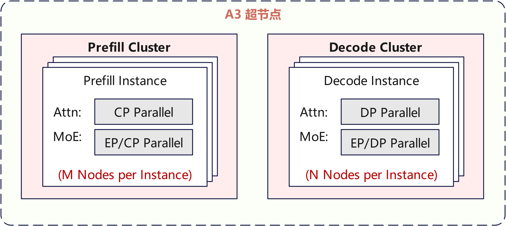
</p>


### Prefill Parallel Strategy

The new DSA in DeepSeek-V3.2-Exp primarily targets **long-sequence inference** scenarios. During Prefill, device memory has a high OOM risk, and TTFT also presents a major challenge when deploying inference services. Therefore, the main goals of parallel strategy design are to optimize memory usage and TTFT.

If the Attention DP strategy in the DeepSeek R1 Blog is retained, each rank must infer a different ultra-long sequence. This approach has a large total computation workload, high TTFT, and a poor user experience.

Tensor Parallel (TP) is an important method for optimizing inference TTFT. However, the computation workload of the new Indexer module in DSA is proportional to $S^2$, making it the main bottleneck in long-sequence scenarios. This module performs a Reduce Sum operation along the head axis. TP partitioning produces substantial communication overhead and affects end-to-end network performance.

Considering these two points, **Prefill Attention in DeepSeek-V3.2-Exp uses Context Parallel (CP)**. Multiple ranks share long-sequence computation. Each rank has a smaller computation workload and activation memory, resulting in controllable TTFT and a better user experience. The MoE module retains the EP parallelism of DeepSeek-V3.1 to balance throughput and latency.

The Prefill parallel strategy can be designed as follows:

<p align="center">
  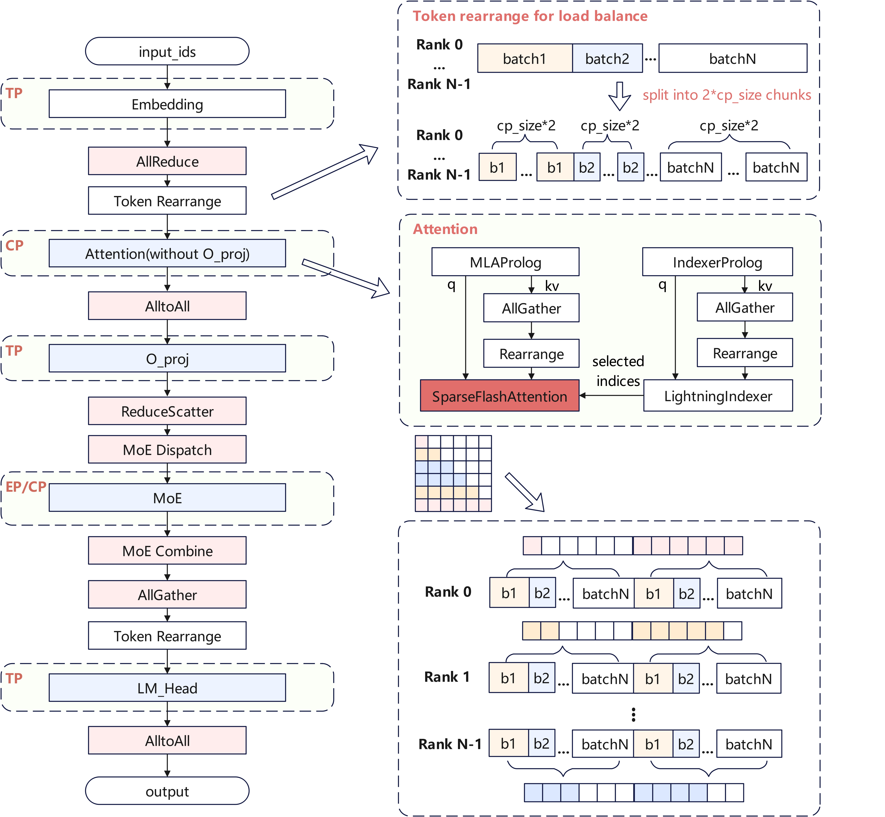
</p>


- Embedding parallel strategy

  To reduce the memory occupied by the Embedding Table, Embedding computation uses TP parallelism. `tp_size` remains within a single node, followed by AllReduce aggregation.

- Attention parallel strategy

  Attention uses CP parallelism as a whole. Using inference with a 64K input as an example, each rank processes 64K/cp_size=1K tokens. After KV computation, perform AllGather on the KV tokens in all CP domains to obtain the complete KV result. Each rank receives 64K/cp_size Q tokens and the complete KV tokens for subsequent Attention computation.

  Attention computation must follow causal attention. If CP simply partitions data in rank order, the computation load may be unbalanced. For example, the first rank attends to fewer historical KV tokens and has a smaller computation workload, while the last rank attends to more historical KV tokens and has a larger computation workload. To reduce the impact of load imbalance, partition the input `input_ids` by cp_size*2. As shown on the right of the preceding figure, each rank computes two symmetric partitions at the beginning and end. Before Lightning Indexer and Sparse Flash Attention compute in each layer, token rearrangement restores KV to causal order.

  Because the `O_proj` module occupies a large amount of memory, this practice applies local TP partitioning to it. Therefore, AlltoAll and ReduceScatter operators are introduced before and after `O_proj`.

- MoE parallel strategy

  The MoE module retains the EP parallel deployment used by DeepSeekV3. EP reuses the CP communication domain.

- LM Head parallel strategy

  To reduce LM Head memory usage, LM Head uses TP partitioning, and `tp_size` remains within a single node.

  The `LM_Head` module uses TP partitioning and also requires AllGather within the TP domain. However, this operation is an AllGather across the entire CP domain. Token rearrangement restores the feature map finally input to `LM_Head` to the original sequence layout.

### Decode Parallel Strategy
The Decode stage retains the deployment strategy of DeepSeek-V3.1 and uses Attention DP + MoE EP deployment.

In particular, the `O_proj` and `LM_Head` weights occupy a large amount of memory and present clear memory access bottlenecks during Decode. This practice uses local TP parallelism. The Embedding layer also uses TP partitioning to reduce device memory usage. To minimize communication overhead from TP parallelism, the TP domain remains within the high-speed HCCS interconnect domain.

<p align="center">
  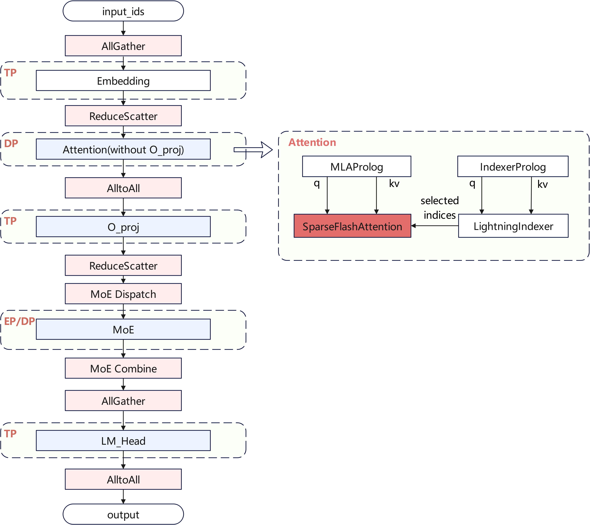
</p>

## MTP

DeepSeek-V3.2-Exp still provides a native Multi-Token Prediction (MTP) mechanism. MTP allows multiple tokens to be inferred during one main-model inference process. With similar data movement, it performs more computation to fully use chip computing power and improve the effective model latency and throughput.

Because DeepSeek-V3.2-Exp uses the new DSA structure, MTP acceleration is more complex than in DeepSeek-V3.1. In a Full Attention scenario, MLA moves the same amount of KV Cache data with or without MTP. Therefore, MTP increases the computation-to-memory-access ratio and improves computing power utilization. The computing power utilization of the MLA operator in CANN can exceed 70% in the MTP1 scenario. For Sparse Flash Attention in DeepSeek-V3.2-Exp, however, each Q token selects 2048 active KV tokens. In an extreme case, the MTP1 scenario must move twice as much KV Cache data as the non-MTP scenario, increasing the cost of discrete memory access.

<div style="text-align: center;">


**Data Movement and Computation Workloads for Four Batches with a 64K Sequence Length**

<table style="width:99%; border-collapse:collapse; margin:20px 0;">
    <tr>
        <th style="border:1px solid #ddd; padding:10px; text-align:center;"> </th>
        <th style="border:1px solid #ddd; padding:10px; text-align:center;"> </th>
        <th style="border:1px solid #ddd; padding:10px; text-align:center;">KV Data Movement (MB)</th>
        <th style="border:1px solid #ddd; padding:10px; text-align:center;">Cube Computation Workload (GFlops)</th>
        <th style="border:1px solid #ddd; padding:10px; text-align:center;">QK^T Data Movement (MB)</th>
    </tr>
    <tr>
        <td rowspan="2" style="border:1px solid #ddd; padding:10px; text-align:center;">MLA</td>
        <td style="border:1px solid #ddd; padding:10px; text-align:center;">Non-MTP</td>
        <td style="border:1px solid #ddd; padding:10px; text-align:center;">144</td>
        <td style="border:1px solid #ddd; padding:10px; text-align:center;">19.33</td>
        <td style="border:1px solid #ddd; padding:10px; text-align:center;">32</td>
    </tr>
    <tr>
        <td style="border:1px solid #ddd; padding:10px; text-align:center;">MTP1</td>
        <td style="border:1px solid #ddd; padding:10px; text-align:center;">144</td>
        <td style="border:1px solid #ddd; padding:10px; text-align:center;">38.65</td>
        <td style="border:1px solid #ddd; padding:10px; text-align:center;">64</td>
    </tr>
    <tr>
        <td rowspan="2" style="border:1px solid #ddd; padding:10px; text-align:center;">SFA</td>
        <td style="border:1px solid #ddd; padding:10px; text-align:center;">Non-MTP</td>
        <td style="border:1px solid #ddd; padding:10px; text-align:center;">4.5</td>
        <td style="border:1px solid #ddd; padding:10px; text-align:center;">0.60</td>
        <td style="border:1px solid #ddd; padding:10px; text-align:center;">1</td>
    </tr>
    <tr>
        <td style="border:1px solid #ddd; padding:10px; text-align:center;">MTP1</td>
        <td style="border:1px solid #ddd; padding:10px; text-align:center;">9</td>
        <td style="border:1px solid #ddd; padding:10px; text-align:center;">1.21</td>
        <td style="border:1px solid #ddd; padding:10px; text-align:center;">2</td>
    </tr>
    <tr>
        <td rowspan="2" style="border:1px solid #ddd; padding:10px; text-align:center;">LI</td>
        <td style="border:1px solid #ddd; padding:10px; text-align:center;">Non-MTP</td>
        <td style="border:1px solid #ddd; padding:10px; text-align:center;">32</td>
        <td style="border:1px solid #ddd; padding:10px; text-align:center;">2.15</td>
        <td style="border:1px solid #ddd; padding:10px; text-align:center;">16</td>
    </tr>
    <tr>
        <td style="border:1px solid #ddd; padding:10px; text-align:center;">MTP1</td>
        <td style="border:1px solid #ddd; padding:10px; text-align:center;">32</td>
        <td style="border:1px solid #ddd; padding:10px; text-align:center;">4.29</td>
        <td style="border:1px solid #ddd; padding:10px; text-align:center;">32</td>
    </tr>
</table>

</div>

Although Sparse Flash Attention cannot easily achieve significant acceleration through MTP, Lightning Indexer accounts for a higher percentage of the duration in long-sequence scenarios. Its K Cache movement is similar to dense MLA, so the MTP mechanism can increase the computation-to-memory-access ratio. In addition, sparse DSA computation significantly reduces the long-sequence computation workload and decreases the proportion of Attention in the complete inference process. The remaining operators, such as Matmul, can achieve better computation-to-memory-access ratios. Therefore, MTP provides significant acceleration for the complete inference process.


## Fused Kernels

The DSA computation process consists of five parts: MLAProlog, IndexerProlog, Lightning Indexer, Sparse Flash Attention, and MLAEpilog, as shown in the following figure:

<p align="center">
  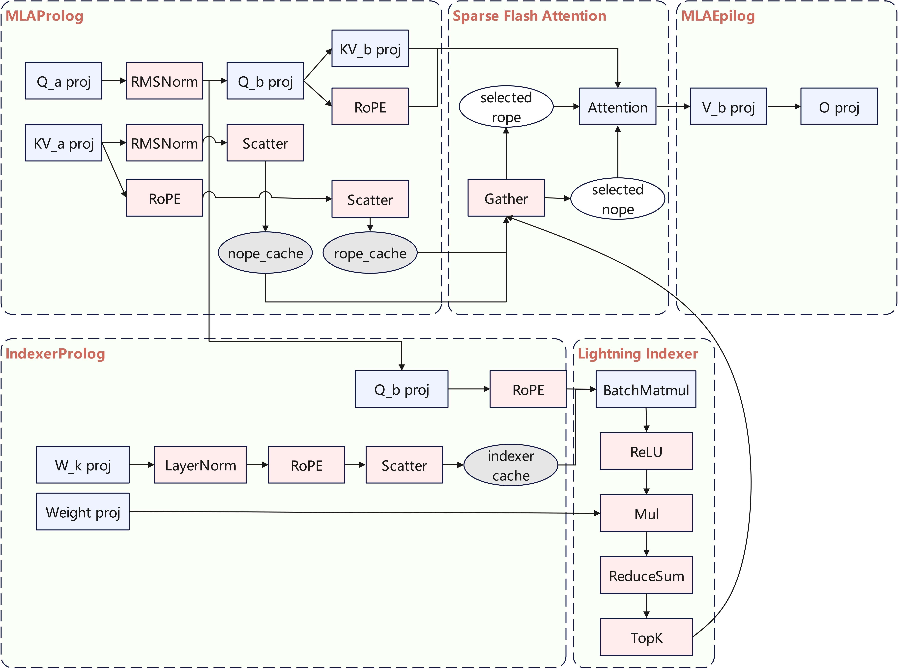
</p>


- Lightning Indexer: It includes Score Batchmatmul, ReLU, ReduceSum, TopK, and other operations. In long-sequence scenarios, the TopK operation becomes a bottleneck. Pipeline overlapping can use the TopK computation time to hide the time of other operations and obtain computation pipeline benefits.
- Sparse Flash Attention: It selects TopK related tokens from the complete KVCache and computes sparse Flash Attention. The main duration bottleneck is discrete aggregated memory access. Pipeline parallel acceleration can use this duration to hide the time of other operations.
- MLAProlog and IndexerProlog: They include Q/KV LoRA, RoPE, Norm, KVCache updates, and other operations, providing substantial pipeline parallelism between Cube and Vector cores.
- MLAEpilog: It includes `O_proj` and V dimension expansion operations.

The NPU implementations of [**lightning_indexer**](https://gitcode.com/cann/ops-transformer/tree/master/attention/lightning_indexer), its quantized version [**quant_lightning_indexer**](https://gitcode.com/cann/ops-transformer/tree/master/attention/quant_lightning_indexer), [**sparse_flash_attention**](https://gitcode.com/cann/ops-transformer/tree/master/attention/sparse_flash_attention), and its quantized version [**kv_quant_sparse_flash_attention**](https://gitcode.com/cann/ops-transformer/tree/master/attention/kv_quant_sparse_flash_attention) are implemented and open source in the CANN/ops-transformer repository.


## Quantization Strategy

Compared with BF16 inference, Int8 quantization effectively reduces end-to-end latency and improves system throughput. This practice currently supports W8A8C8/W4A8C8 quantization. The quantization architecture is as follows:

<p align="center">
  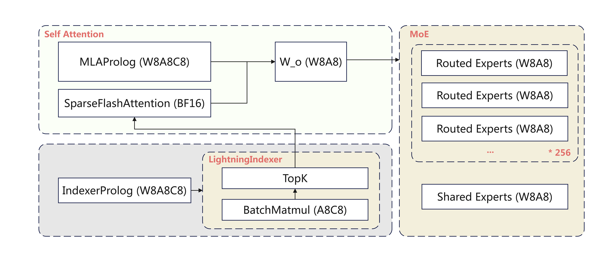
</p>

The four quantized fused operators MLAProlog, MLAEpilog, IndexerProlog, and LightningIndexer are as follows:

<p align="center">
  
</p>

- MLAProlog: All Linear operations except `Q_b_proj`, which uses W8A8, are not quantized. KVCache is quantized to C8.
- Sparse Flash Attention: KVCache uses Int8 storage and BF16 computation.
- IndexerProlog: All Linear operations except `Q_b_proj`, which uses W8A8, are not quantized. Indexer Q uses A8 quantization, and Indexer Cache uses C8 quantization.
- Lightning Indexer: BatchMatmtul uses Int8 computation.
- MoE: Routed experts use W8A8/W4A8 quantization, and shared experts use W8A8 quantization.
- MLAEpilog: `O_proj` uses W8A8 quantization.
- LM_Head: It is not currently quantized.

**Note:
W8A8: W8 indicates that weights use static Per-Channel Int8 quantization, and A8 indicates that data uses dynamic Per-Token Int8 quantization.
A8C8: A8 indicates that Q in Lightning Indexer uses dynamic Per-Token-Head Int8 quantization, and Indexer Cache uses dynamic Per-Token-Head Int8 quantization.
MLAEpilog: `O_proj` uses W8A8 quantization.
KVCache C8: KVCache uses dynamic Per-Token-Head-Tile-128 Int8 quantization.**


W8A8C8 quantizes fewer linear layers. For MLA linear layers, only `q_b_proj` and `w_o_proj` are quantized. For Indexer linear layers, only `wq_b_proj` is quantized. The main reason is that the IndexerProlog fused operator is designed to output FP16 from `weights_proj` without quantization. Therefore, Linear operations associated with the MLA input are not quantized, allowing the same BF16 data to be input to IndexerProlog and MLAProlog.

In addition, the MLAProlog KVCache quantization strategy dynamically stores data in 8-bit precision and computes in 16-bit precision. In ultra-long-sequence scenarios, W8A8C8 quantization has nearly lossless precision while reducing weight memory usage by two times. MLA C8 storage and 16-bit computation provide memory benefits and enable high throughput. LightningIndexer A8C8 provides computation benefits, reduces LI computation latency, and also optimizes TTFT and TPOT.

For `DeepSeek-V3.2-Exp`, the W4A8C8 quantized version uses a learning-based quantization algorithm to optimize the Clamp parameter, mitigating the difficulty of quantizing W4A8 outliers and achieving high quantized model accuracy. The W4A8C8 version also reduces MoE weight memory by two times compared with W8A8C8. Therefore, in a large-EP scenario, the W4A8 MoEGMM operator allows one card to store more experts, reducing resource usage, optimizing the computation-to-memory-access ratio, and enabling single-node deployment.


**Quantized Model Accuracy**

| Model | MMLU | GPQA | DROP | MGSM |
| ---- | ---- | ---- | ---- | ---- |
| DeepSeek-V3.2-BF16 | 90.8 | 75.85 | 87.57 | 90.9 |
| DeepSeek-V3.2-Exp-W8A8C8 | 90.62 | 75.90 | 87.41 | 90.87 |
| DeepSeek-V3.2-Exp-W4A8C8 | 90.66 | 76.5 | 87.68 | 91.3 |

## Multi-Stream Parallel Optimization

CANN provides a [multi-stream parallelism](https://gitcode.com/Ascend/torchair/blob/master/feature/多流并发.md)(Chinese) mechanism that supports computation/communication parallelism and other scenarios. Because the A3 chip uses a separated Cube and Vector architecture, it also supports Cube/Vector parallelism.

For MoE models, use the multi-stream parallel capabilities of CANN to improve chip resource utilization. In the MoE module, routed experts use EP deployment, and shared experts use DP deployment. Shared expert computation has no dependency on Gating, Dispatch, or routed expert computation. A multi-stream parallel mechanism can overlap the two pipelines. The Gating function has small weights, and the Dispatch operator is a communication operator, so both have low HBM bandwidth utilization. They can run concurrently with the shared experts, which are bandwidth-bound, to hide the shared expert duration.

<p align="center">
  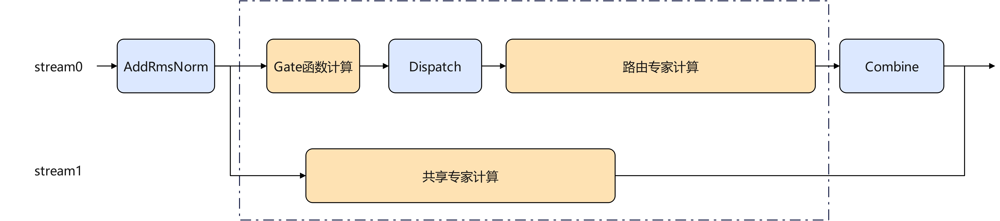
</p>


A simple code sample is as follows:

```python
with torchair.scope.npu_stream_switch(stream_tag, stream_priority):
	# shared_expert use another stream
    hidden_states_share = self.shared_experts(hidden_states)
# router_experts use main stream
hidden_states_router = self.router_experts(hidden_states)
hidden_states = hidden_states_share + hidden_states_router
```

In addition to the MoE module, a series of Cube and Vector operators before Lightning Indexer, namely IndexerProlog, can use multi-stream parallelism. The following figure shows the pipeline:

<p align="center">
  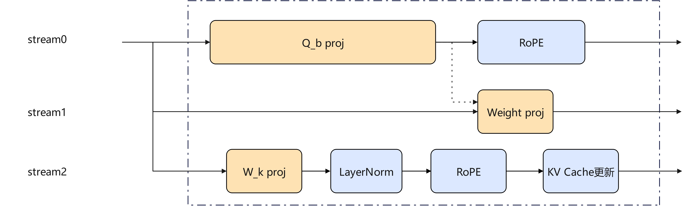
</p>


## KVCache Offload
After W8A8C8 quantization is enabled, device memory still prevents further increases to the batch size in long-sequence scenarios. To address device memory pressure, offload the MLA Full KVCache, which occupies a large proportion of memory, to host memory. KVCache Offload releases device memory and increases the batch size. The KVCache Offload solution involves the Prefill and Decode stages.
### Prefill Stage
During Prefill, allocate only **one layer of MLA KVCache** on the device and allocate 61 layers of KVCache memory in host memory for each card. After MLA computation is complete, use multiple streams to offload the KVCache of the current layer from the device to host memory.
<p align="center">
  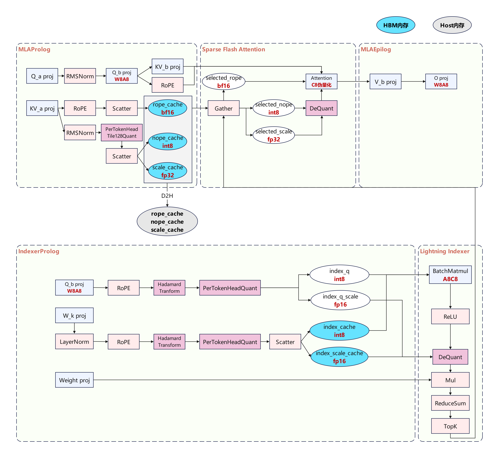
</p>

### Decode Stage
During Decode, update the Cache of the current token computed in each layer to host memory. Based on the positions of the TopK related tokens returned by Lightning Indexer, the new [GatherSelectionKvCache](https://gitcode.com/cann/cann-recipes-infer/blob/master/ops/ascendc/docs/custom-npu_gather_selection_kv_cache.md)(Chinese) operator selects the corresponding KV tokens that participate in computation from the Full KVCache on the host and sends them to the subsequent SFA computation.
<p align="center">
  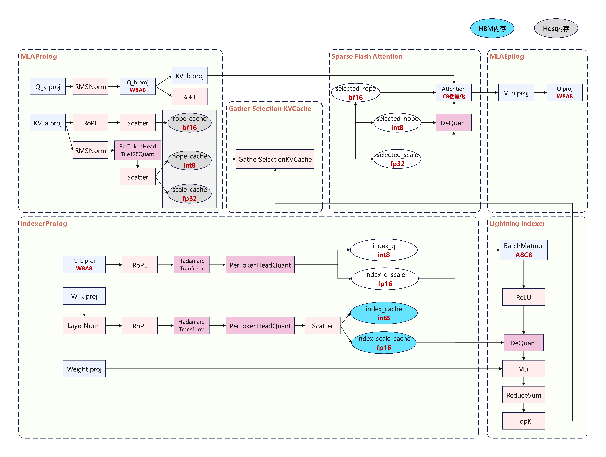
</p>

The GatherSelectionKvCache operator fully uses the TopK hit rate, or similarity, between adjacent tokens at the same layer to reuse the Cache already present on the device. If 60% of the TopK=2048 KV tokens in the current step are the same as those in the preceding step, only the 40% of KV tokens that cannot be reused must be read from the host. The reusable 60% can be read directly from the device, reducing the H2D duration.


## Benchmark

#### W8A8C8

On Atlas A3, this practice benchmarks the performance of the DeepSeek-V3.2-Exp and DeepSeek-V3.1 W8A8C8 versions. The throughput comparison curve shows that the performance advantage of DeepSeek-V3.2-Exp gradually increases with the sequence length. At a sequence length of 128K, its throughput reaches 450% of DeepSeek-V3.1 throughput.

<p align="center">
  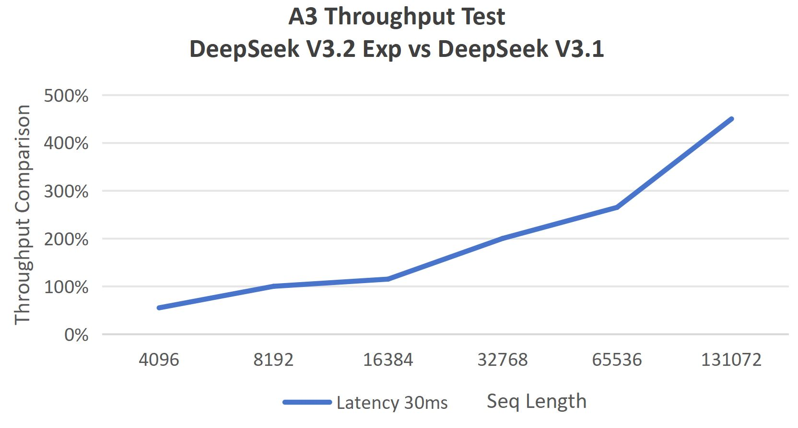
</p>

The following table shows inference latency and throughput for different batch sizes and sequence lengths when Offload is not enabled.

| Global Batch Size | Seq Length | Chips | TPOT (ms) | Throughput (tokens/p/s) |
| ----------------- | ---------- | ----- | --------- | ----------------------- |
| 256               | 65536      | 64    | 19.84     | 202                     |
| 512               | 65536      | 64    | 22.78     | 351                     |
| 128               | 131072     | 64    | 18.85     | 106                     |
| 512               | 131072     | 64    | 25.8      | 310                     |

> Note: The performance data is collected with the MTP3 and perfect eplb configurations. On average, 1.44 tokens are accepted from three draft tokens.

#### MoE W4A8 + Attention W8A8C8

This practice adds support for W4A8 quantization in the MoE part. In scenarios where large weights cause a data movement bottleneck, W4A8 effectively reduces memory usage and weight movement time, significantly improving inference performance. This practice benchmarks the MoE W4A8 quantization feature on Atlas A3. With the same cluster scale and configuration, model inference performance improves compared with W8A8 quantization. The larger the weights on a single chip, the more significant the performance improvement.

| MoE Quant Mode | Global Batch Size | Chips | TPOT (ms) | Throughput (tokens/p/s) |
| -------------- | ----------------- | ----- | --------- | ----------------------- |
| W8A8           | 64                | 32    | 20.81     | 96                      |
| W4A8           | 64                | 32    | 20.18     | 99                      |
| W8A8           | 32                | 16    | 24.39     | 82                      |
| W4A8           | 32                | 16    | 22.51     | 89                      |

> Note: The performance data uses the same input sequence length of 65536. MTP and other configurations are the same as those described previously.

#### KVCache Offload

On Atlas A3, this practice benchmarks the KVCache Offload feature with W8A8C8 quantization enabled for DeepSeek-V3.2-Exp. At the same sequence length, enabling the KVCache Offload solution doubles the maximum batch size supported by model inference compared with non-Offload. The following figures show the memory benefits of Offload. With a fixed sequence length of 64K, using Offload increases the global batch size from 1024 to 2048 compared with non-Offload. With a fixed global batch size of 128, using Offload increases the sequence length from 256K to 384K.

<p align="center">
  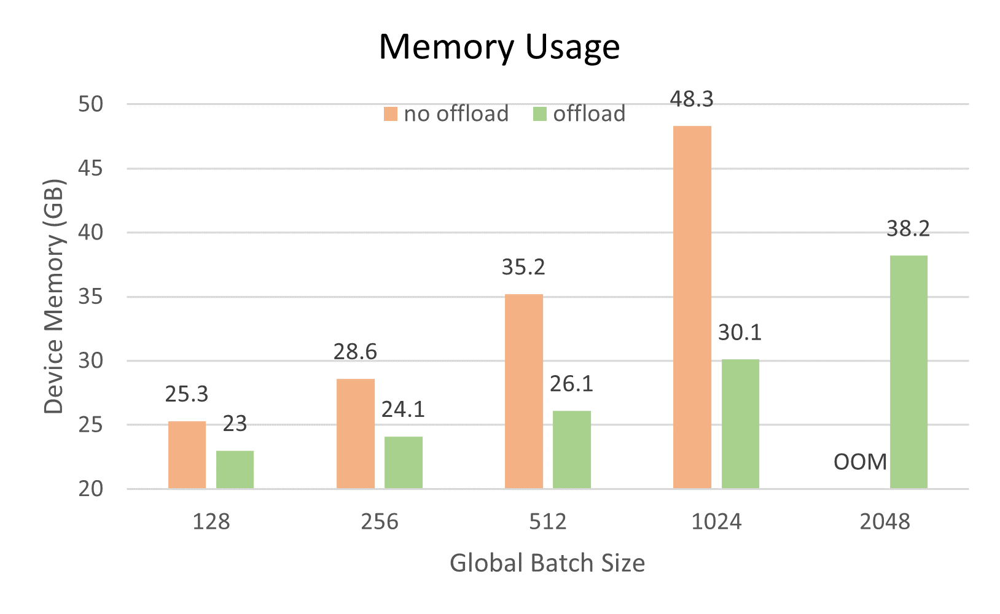
  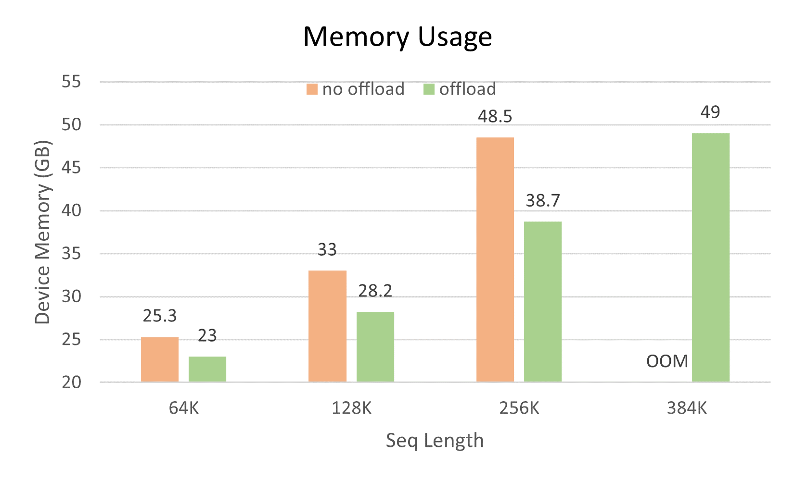
</p>

> Note: The memory data is collected with the MTP3 and perfect eplb configurations.

## Future Plan

- Quantization: BF16/Int8 inference is currently supported. Future work will develop low-bit quantized versions, explore KVCache quantization and compression algorithms, optimize NPU computation efficiency through software-hardware co-design, and reduce system latency.
- KVCache Offload: Future work will use the hit-rate relationship between adjacent tokens or cross-layer prefetching to further reduce the GatherSelectionKvCache duration.
- MegaKernel: The Decode stage still provides substantial pipeline parallelism. PyPTO can implement a larger MegaKernel scope, complete multi-core MPMD parallel scheduling, and improve computation efficiency.

<!-- static-meta
{
  "sidebarTitle": "Inference Optimization",
  "quantization": ["bf16", "int8", "int4"],
  "parallelism": ["data-parallel", "tensor-parallel", "context-parallel", "expert-parallel"],
  "operator": ["ascendc", "pypto", "tilelang"],
  "cannFeatures": ["multi-stream"],
  "hardware": ["atlas-a3"],
  "frameworks": ["cann-recipes"],
  "llmSpeculativeInference": ["mtp"]
}
-->
