# NPU DeepSeek-V3.2-Exp PyPTO Fused Operator Development and Optimization Practice

## Introduction

In recent years, the scale of large AI models has grown explosively, imposing increasingly high operator performance requirements. Limited by hardware memory size and bandwidth constraints, operators in the large-model era must fully consider computation process optimization, memory read/write optimization, memory reuse at different levels, and other factors. Operator fusion is an important method for improving operator performance. Operator fusion combines multiple computations into one operator kernel to reduce kernel launch overhead and memory reads and writes, improve memory reuse, and improve operator performance. Although operator fusion provides significant performance benefits, developing fused operators often presents major challenges:

1. Fusion introduces multiple computation logics, such as MatMul, Softmax, and ReLU, into a single operator, resulting in a large amount of complex code.
2. Fused operators usually have multiple inputs and outputs and impose high memory access requirements. Poor use of different SRAM levels within a core significantly degrades performance.
3. Achieving high performance requires extensive use of hardware-specific features, making operators difficult to reuse across platforms.
4. Fused operators usually have many configurable parameters, making manual tuning difficult and unsustainable.

As the scale of fused operators grows, manual development of fused operators becomes increasingly unsustainable because of the development difficulty. As a result, an efficient and easy-to-use computing programming paradigm for modern hardware has emerged in operator programming: tile-based programming. It decomposes large-scale computation tasks and data into smaller, more manageable tiles, allowing better use of the hardware memory hierarchy and parallel computing capabilities.

PyPTO is an efficient in-house programming framework released by CANN. It simplifies operator development, substantially improves operator programming usability, and maintains high-performance computing capabilities. It provides developers with a Tensor/Tile-based programming paradigm for MPMD development, which is similar to MegaKernel. Compared with existing operator development tools, it has the following main characteristics:

1. It automatically generates read and write instructions, so developers do not need to manually manage on-core SRAM. Developers can also configure parameters to control tiling partitioning and SRAM usage strategies, enabling efficient use of on-core SRAM.
2. It defines a set of abstract Parallel Tile Operation (PTO) Instructions. Programs written by developers are converted into a set of PTO instructions. Implementing the corresponding PTO instructions on different hardware platforms automatically ports operators across platforms without manual adaptation.
3. It provides an MPMD (Multiple Program Multiple Data) runtime. Compared with SPMD (Single Program Multiple Data), MPMD does not require global synchronization. Instead, it uses producer-consumer relationships to construct dependencies between tasks, allowing different cores to run different programs simultaneously and fully use multi-core parallelism.
4. It provides an integrated development environment that visualizes operator compilation and execution, helping developers locate and debug operator accuracy and performance issues and rapidly iterate operators.

The following figure shows the main PyPTO architecture:

<p align="center">
  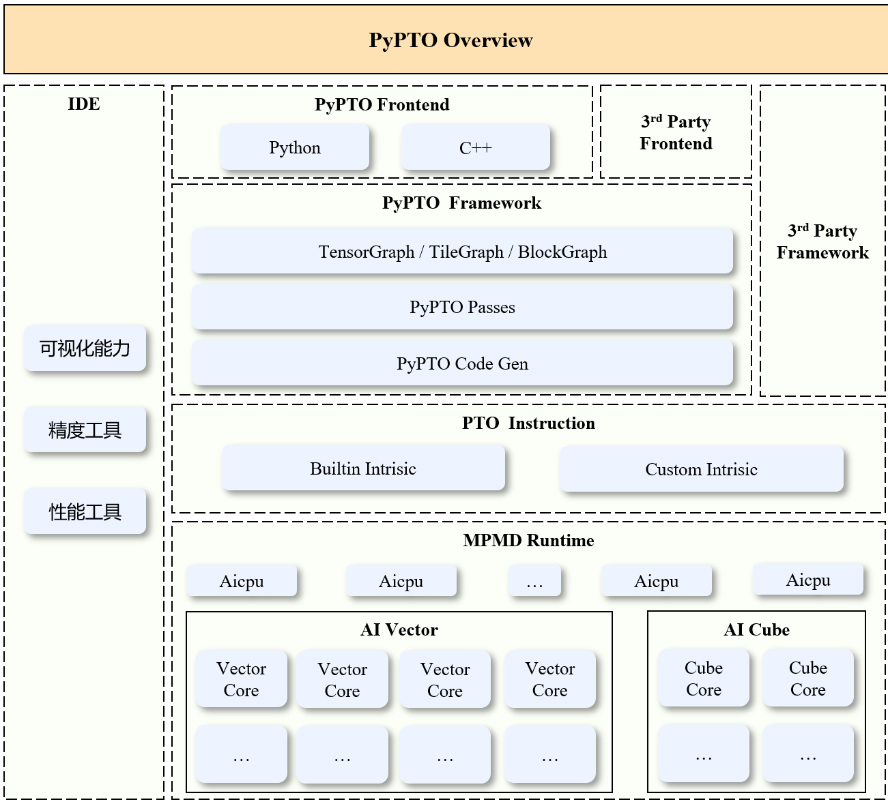
  <center>PyPTO Architecture</center>
</p>

## Feature Introduction

### Tensor/Tile-Based Programming Paradigm

PyPTO uses a Tensor/Tile-based programming paradigm. Its core concept uses Tensor/Tile as the basic data representation and describes and assembles a complete computation process through a series of basic Tensor operations.

- Tensor is the basic data structure, and the computation process performs mathematical operations on Tensor data.
- Small data blocks obtained by partitioning the original Tensor are called Tiles, and the partitioning process is called Tiling. Tiling allows processor cores to hold the Tile data used in computation based on the on-core SRAM capacity and reuse the Tiles to reduce Global Memory access.
- Code developed with PyPTO has a concise and clear overall style. Developers can focus on the algorithm computation logic and the Tile Shape setting of each OP without handling complex implementation details such as memory, scheduling, and hardware. This approach is more developer-friendly and significantly reduces development difficulty.

### Parallel Tile Operation

In PyPTO, an operation on data is called an Operation. A Tensor Operation is converted into a Tile Operation after Tiling. The framework provides a set of basic Tile Operations for underlying hardware abstraction. These operations can be adapted to different chips to support cross-platform operators. Developers can also define additional Tile Operations to support new hardware platforms or obtain efficient performance on a specific platform.

The following table lists some PTO instruction examples:

| Category | Instruction | Function Description |
| -------------------------- | ----------- | -------------------------------- |
| **Element Op** | TADD | Performs element-wise addition on two Tile data blocks. |
| | ... | ... |
| **Tile-Scalar Op** | TADDS | Adds a scalar to each element in a Tile data block. |
| | ... | ... |
| **Axis Op** | TROWSUM | Sums each row of a Tile data block. |
| | ... | ... |
| **MATMUL Op** | MAMULB | Multiplies two Tile matrix data blocks. |
| | ... | ... |
| **Fix Pipe Op** | TMOV | Moves Tile elements from the source register to the destination register, optionally with an in-path operation. |
| | ... | ... |
| **MEM Op** | TLOAD | Loads data from memory into a Tile data block. |
| | TSTORE | Writes a Tile data block back to memory. |
| | ... | ... |
| **Complex Op** | TCVT | Converts the data type of a Tile data block. |
| | ... | ... |

### On-Core SRAM Management

PyPTO provides developers with two methods for tuning Tiling:
1. Set Tile Shape parameters. The framework expands the Tensor Operation computation graph into a Tile Operation computation graph based on a built-in Tiling method.
2. Define a custom Tiling method to implement more specialized and efficient expansion logic.

After Tiling produces a computation graph at Tile Operation granularity, the framework partitions the computation graph and inserts data movement instructions into the resulting subgraphs to use on-core SRAM at each level. The inputs and outputs of each subgraph reside in Global Memory, while each subgraph uses only on-core SRAM for intermediate data.

The PyPTO subgraph partitioning process considers the following factors:

1. Operation affinity. Operations that run on the same type of core are assigned to the same subgraph whenever possible.
2. Subgraph isomorphism. The framework makes the partitioned subgraphs reusable whenever possible to reduce compilation time and the ICache Miss rate.
3. The tradeoff between subgraph parallelism and repeated data movement. An excessively large subgraph leaves cores idle, while an excessively small subgraph repeatedly moves the same data to different cores. Developers can configure parameters to adjust the partitioning strategy and balance parallelism and SRAM utilization.

The following figure shows an example of operator Tiling and partitioning:

The figure shows a computation example that multiplies A by a constant, adds B, performs matrix multiplication with W, and finally sums the last axis. A and B have dimensions of (64, 64), and W has dimensions of (64, 32).

<p align="center">
  
  <center>Tensor Graph Example</center>
</p>

MulS, Add, and RowSum are Vector operations, and their Tile Shape is set to (32, 32). Matmul is a Cube operation and is not partitioned. Tiling produces the following Tile computation graph.

<p align="center">
  
  <center>Tile Graph Example</center>
</p>

For the separated Cube and Vector architecture of A3, the framework partitions Matmul into a separate subgraph, partitions MulS + Add before Matmul into one subgraph, and partitions RowSum after Matmul into one subgraph. The MulS_Add subgraph is called four times, and the RowSum subgraph is called twice, processing a different Tile block each time.

<p align="center">
  
  <center>Execution Graph Example</center>
</p>

### MPMD Runtime

The graph partitioning in the preceding stage produces many small subgraphs, which are the minimum PyPTO execution units. Each subgraph is compiled into an executable file, generates a corresponding task, and is dispatched to a different core for execution. The PyPTO runtime uses MPMD. The complete execution process consists of the following steps:

1. Create dependencies between tasks based on data dependencies between subgraphs.
2. The scheduling AICPU dispatches tasks without preceding dependencies to idle AI cores in topological order. An AI core starts asynchronous execution immediately after receiving a task.
3. After a task finishes, the scheduling AICPU receives callback information, releases the dependencies of subsequent tasks, and continues attempting to dispatch them.

### Human-In-The-Loop Tuning Approach

The complete process from operator description to execution on hardware includes Tile expansion, graph partitioning, runtime scheduling, and many other stages. Many stages address NP-hard problems, so expecting the framework to automatically generate high-performance fused operators is unrealistic. Therefore, the framework provides a visual integrated development environment. Developers can view the output of each stage, control stage execution, resubmit modified operators to the NPU, and obtain new results and performance data. This mechanism enables rapid iteration and allows developers to create high-performance operators within a short period.

The following figure shows the PyPTO operator development and tuning process:

<p align="center">
  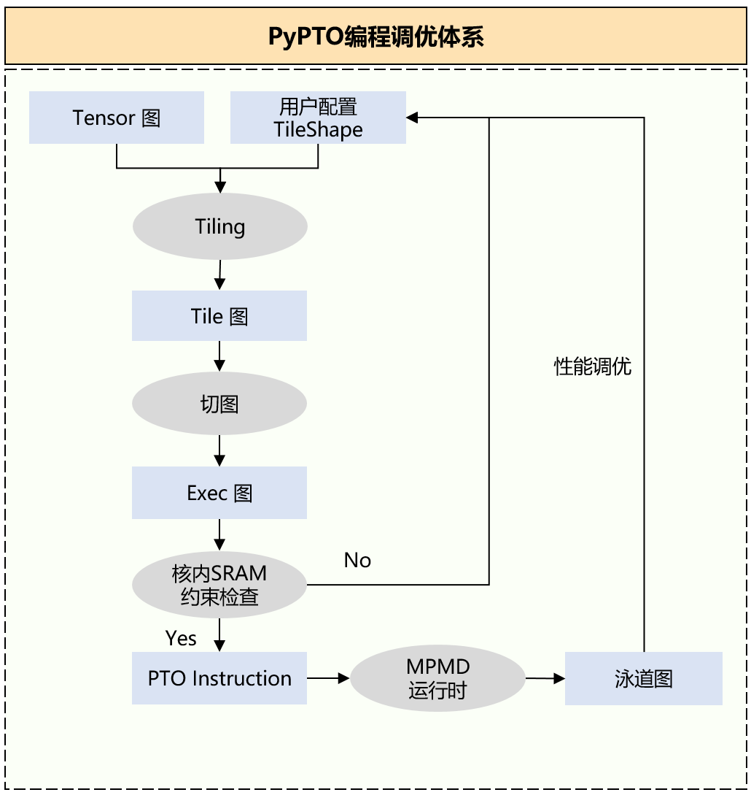
  <center>PyPTO Workflow</center>
</p>

## Fused Operator Examples

PyPTO uses an MPMD scheduling concept similar to MegaKernel and allows developers to select the fusion scope. This document uses the development of Indexer Prolog, Deepseek Indexer Attention, and Lightning Indexer in DeepSeek-V3.2-Exp as examples. From the perspective of a fused operator developer, it explains how to develop operators with different fusion scopes in the PyPTO programming framework and tune them through a Human-In-The-Loop approach.

### Indexer Prolog

Indexer Prolog is the first half of Deepseek Indexer Attention computation in DeepSeek-V3.2-Exp. For the corresponding PyPTO source code, refer to [PyPTO Deepseek Lightning Indexer Prolog](https://gitcode.com/cann/cann-recipes-infer/tree/master/ops/pypto/src/lightning_indexer_prolog_pto/op_kernel/). The following figure shows its computation flow:

<p align="center">
  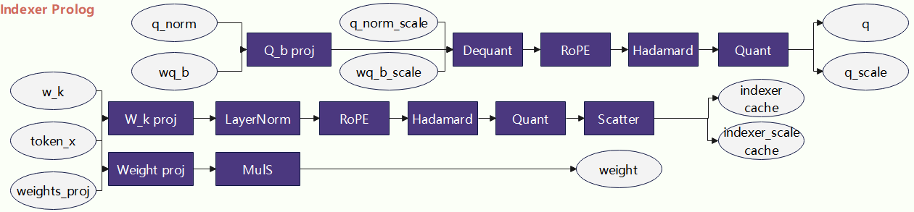
  <center>Indexer Prolog</center>
</p>

The Indexer Prolog quantization strategy is as follows: `Q_b_proj` uses W8A8 quantization, while other Linear operations are not quantized. Indexer Q uses A8 quantization, and Indexer Cache uses C8 quantization. Dequantization factors are stored in FP16. Before quantization, a Hadamard transform is performed. Hadamard transforms are widely used in the latest low-bit quantization solutions and effectively eliminate outliers.

For a typical shape with four batches, MTP1, and a KV-Cache length of 64K, the kernel performance of this fused operator approaches the theoretical limit.

#### Computation Formulas

The Indexer Q computation formula is as follows:

$$
\bold{q}, \bold{q}_{scale} = \text{DynamicQuant}(\text{Hadamard}(\text{RoPE}(\text{DeQuant}(\bold{q} \cdot \bold{w}_{qb}))))
$$

Q computation uses dynamic Per-Token-Head quantization, where the Hadamard transform is implemented by right-multiplying by `hadamard_q`. Both $\bold{q}$ and $\bold{w}_{qb}$ have the Int8 data type.

The Indexer Cache computation formula is as follows:

$$
\bold{k}, \bold{k}_{scale} = \text{DynamicQuant}(\text{Hadamard}(\text{RoPE}(\text{LayerNorm}(\bold{x} \cdot \bold{w}_k))))
$$

Cache computation also uses dynamic Per-Token-Head quantization, where the Hadamard transform is implemented by right-multiplying by `hadamard_k`.


The Indexer Weight computation formula is as follows:

$$
\bold{weight} = (\bold{x} \cdot \bold{w}_{proj}) * \text{scale}
$$

Weight computation does not use quantization. The result must be converted to FP16 for subsequent Lightning Indexer computation.

#### Swimlane Diagram and Performance Analysis

The following figure shows the profiling data, namely the swimlane diagram, of this fused operator for a typical shape with four batches, MTP1, and a KV-Cache length of 64K:

<p align="center">
  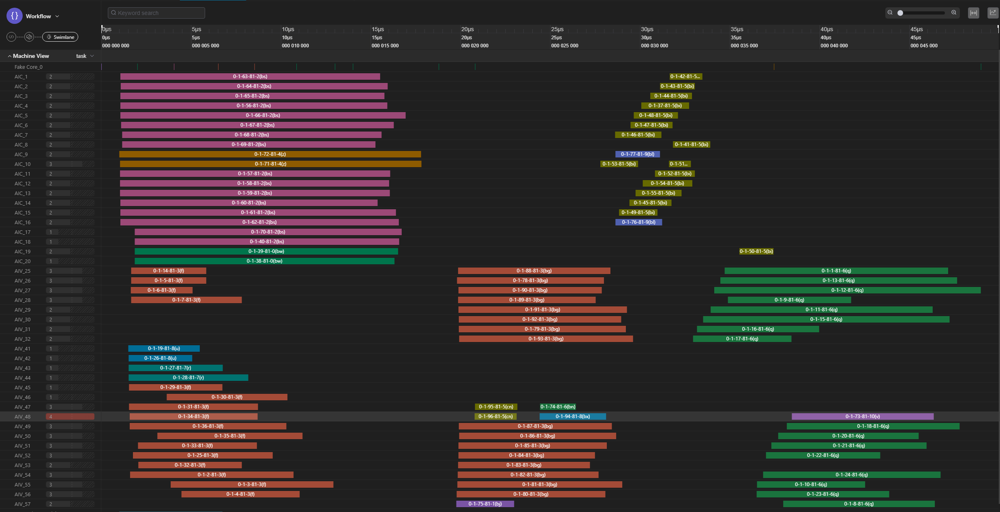
  <center>Indexer Prolog Swimlane</center>
</p>

##### Computation Flow Breakdown
The Indexer Prolog computation flow has the following characteristics:

* The computation includes Indexer Q, Indexer Cache, and Indexer Weight. The three parts are independent, and each part runs serially.
* Among the three independent computation flows, Indexer Q takes the longest and can hide Indexer Cache and Indexer Weight.
* For a typical shape, the computation workload is small and does not fully use all cores. The performance bottleneck is data movement.

##### Theoretical Performance Analysis
The computation flow breakdown shows that Indexer Q determines the performance of this fused operator. Its performance can be divided as follows:
1. The first part is the (8, 1536) @ (1536, 8192) Matmul computation. This computation is MTE-bound, and its theoretical performance limit is 13 us. However, the K and Weight Matmul computations run in parallel and compete for bandwidth, so the computation can be considered close to the performance limit.
2. The second part consists of DeQuant and RoPE computation. These computations run on Vector cores. With proper Tile partitioning, all computations run in the UB without redundant movement between the UB and GM, reaching the performance limit.
3. The third part is the Hadamard transform, which is implemented by the (8, 64, 128) @ (1, 128, 128) BatchMatmul. This computation is also MTE-bound and reaches the performance limit.
4. The fourth part is Int8 quantization computation, which runs on Vector cores. With proper Tile partitioning, all computations run in the UB and reach the performance limit.

In summary, Indexer Prolog computation approaches the theoretical performance limit.

#### Next Plan
Following the Indexer Prolog tuning process, independently tune the performance of the other sub-operators to achieve the performance limit.

### Deepseek Indexer Attention

The Lightning Indexer operator demonstrates that PyPTO allows developers to control the operator fusion scope. The following Deepseek Indexer Attention fusion example demonstrates the end-to-end network fusion capability of PyPTO.

<p align="center">
  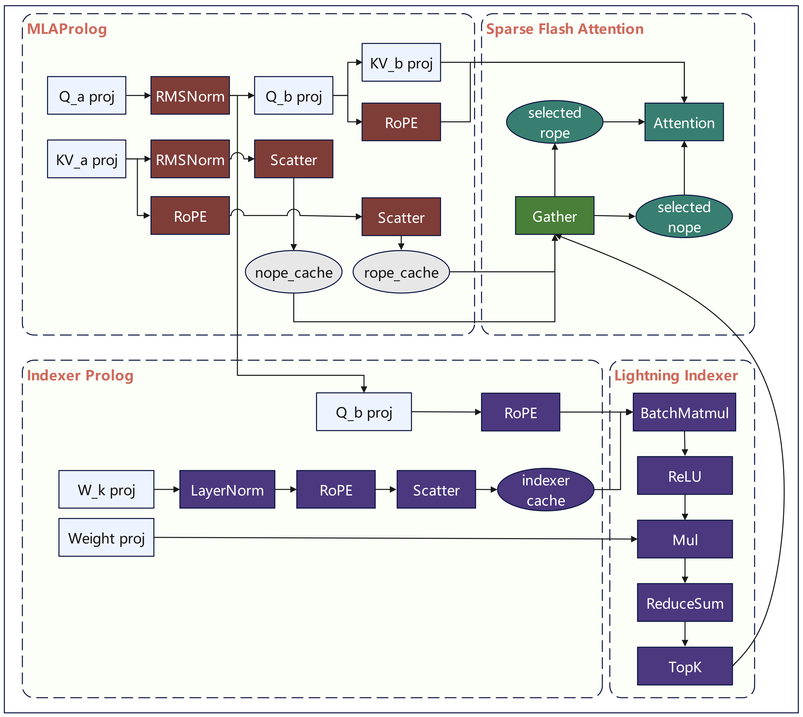
  <center>Deepseek Indexer Attention</center>
</p>

The figure shows the Deepseek Indexer Attention computation logic. It primarily consists of four relatively independent parts: MLA Prolog, Indexer Prolog, Lightning Indexer, and Sparse Flash Attention. A larger fusion scope provides more parallelism to explore. PyPTO allows developers to manually write these four independent parts and use the framework to fuse them into one complete Deepseek Indexer Attention large operator. Therefore, use the following development strategy for a large operator:
* Divide a complex fused operator into several relatively independent sub-operators. Independently tune each sub-operator based on its swimlane diagram.
* After each sub-operator approaches optimal performance, fuse the sub-operators at a larger scope to obtain optimal performance for the complete fused operator.

For the corresponding PyPTO source code, refer to [PyPTO Deepseek Indexer Attention](https://gitcode.com/cann/cann-recipes-infer/blob/master/ops/pypto/src/deepseek_indexer_attention/op_kernel/deepseek_indexer_attention.cpp). As with the Lightning Indexer fused operator, run it on hardware to obtain the Deepseek Indexer Attention swimlane diagram:

<p align="center">
  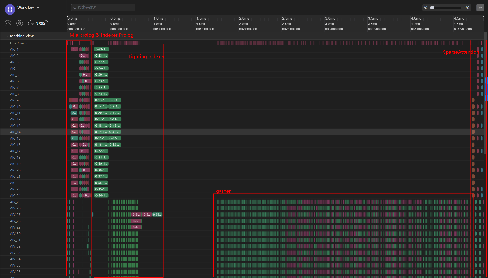
  <center>DeepseekIndexerAttentionSwimlane</center>
</p>

#### Swimlane Diagram Analysis

The main advantage of large fused operators is that they fuse all relatively independent subgraphs to improve memory utilization and fully use NPU performance. Therefore, the complete DIA graph is more complex than a standalone Lighting Indexer graph. All computation steps are fused and scheduled out of order. The diagram quickly and clearly reveals the following performance bottlenecks:

* Discrete Gather accounts for more than 70% of the duration. This part primarily reads the KV values at the corresponding indexes discretely from `kv_cache`/`kr_cache` based on the TopK indexes computed by Lightning Indexer in SparseFlashAttention. The current aggregation process uses Vector core movement to convert discrete data to continuous data, writes the data to the GM Workspace, and then uses the Cube core to move it to L1. This process wastes memory and introduces significant performance loss through repeated movement.
* The Indexer Prolog subgraph has too many Matmul tasks. The current Matmul M axis is 1 and has not been combined with another axis, resulting in low utilization.
* A large pipeline bubble exists. An unremoved barrier between two subgraphs stalls all subsequent tasks without dependencies, producing a large pipeline bubble.
* An empty reshape subgraph causes task launch latency. Reshape is not fully optimized, producing an empty subgraph that stalls subsequent tasks dependent on the reshape result.

#### Improvements and Results

Analyze and resolve the identified key performance bottlenecks individually:

* PyPTO allows developers to define custom Tile Operations. Therefore, this scenario requires a specific TileOp that directly moves discrete data from the GM to continuous L1 space based on indexes so that Matmul can compute it directly. This TileOp eliminates the additional workspace used to convert discrete data to continuous data and removes redundant movement, providing a significant performance improvement. The following figure shows the approach:

<p align="center">
  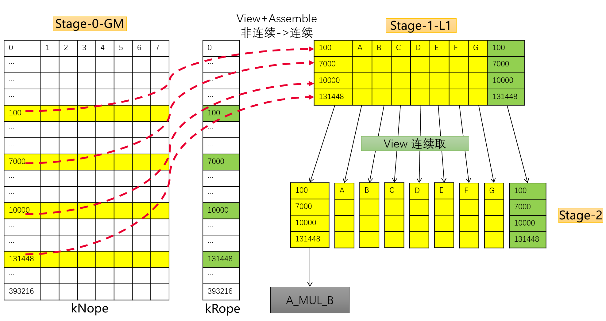
  <center>Custom Gather Tile Op</center>
</p>

* Combine the b and s1 axes, adjust Tiling, expand the M axis, fully use L0A, and substantially improve Matmul computation efficiency to double performance.
* Remove the barrier between the two subgraphs and fully fuse them. Tasks without dependencies can start earlier, eliminating pipeline bubbles.
* The reshape operation does not change the data layout. Removing it eliminates the delay of tasks that previously depended on reshape and reduces dependency-release time.

After the preceding analysis and optimization, the following new swimlane diagram is obtained. Enabling these optimizations reduces the fused operator runtime by 75%.

<p align="center">
  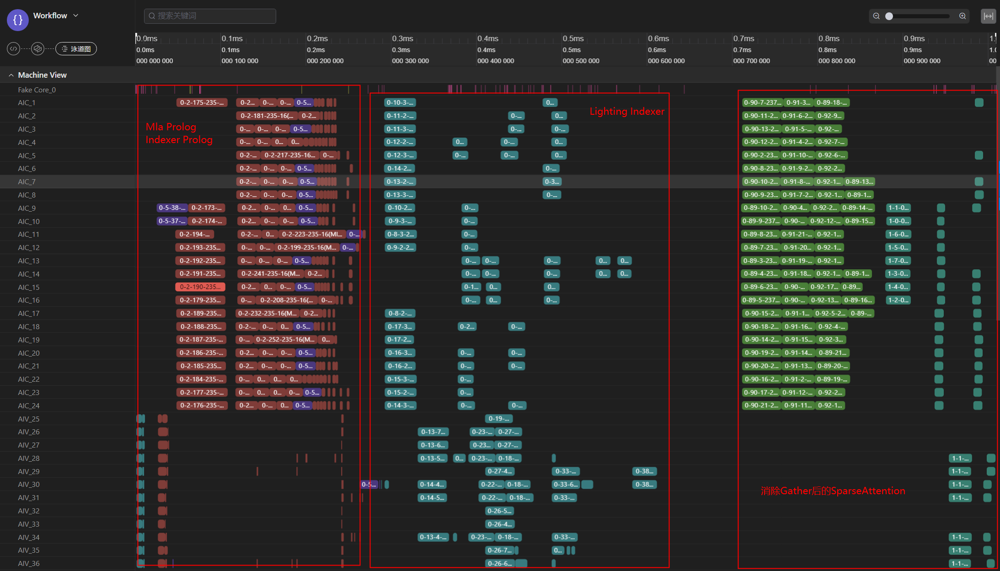
  <center>DeepseekIndexerAttentionSwimlaneNew</center>
</p>

#### Next Plan

The preceding optimizations eliminate several key performance bottlenecks in the swimlane diagram and significantly improve performance. Based on the new swimlane diagram, continue identifying performance optimization opportunities to improve performance.

* The tasks are relatively scattered and task scheduling is not compact. Analyze dependencies between tasks to eliminate pipeline bubbles.
* Discrete data movement in SparseAttention has low efficiency. Increase movement parallelism.
* Large gaps still exist between multiple subgraphs. Further fuse the subgraphs and integrate computations with data dependencies into the same LOOP.

After these optimizations, the tasks in the swimlane diagram are expected to be more compact. In general, performance optimization requires multiple iterations. After resolving the key performance bottlenecks in each iteration, analyze the new swimlane diagram and continue optimization.

### Lightning Indexer

Lightning Indexer is part of Deepseek Indexer Attention computation in DeepSeek-V3.2-Exp. The following figure shows its computation flow:

<p align="center">
  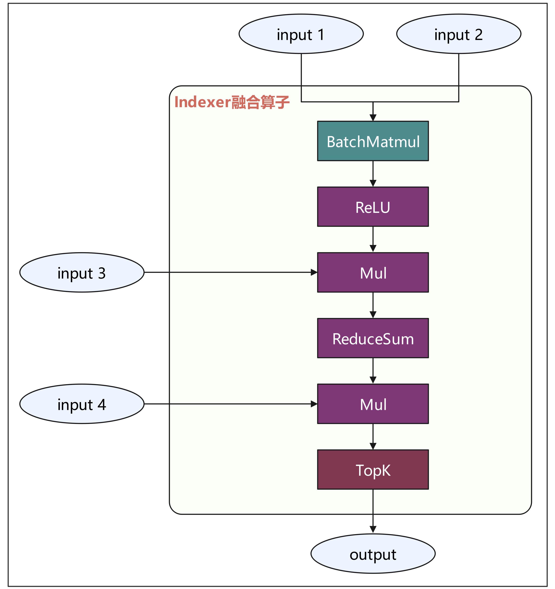
  <center>LightningIndexer</center>
</p>

1. Develop the fused operator code based on the computation flow. For the corresponding PyPTO source code, refer to [PyPTO Deepseek Lightning Indexer](https://gitcode.com/cann/cann-recipes-infer/blob/master/ops/pypto/src/lightning_indexer_pto/op_kernel/lightning_indexer_topk.cpp).
2. After development is complete with PyPTO, its comprehensive visual integrated development environment provides outputs from different stages. The most important output is the performance profiling data obtained by running on the NPU, namely the swimlane diagram shown in the following figure. Developers use the swimlane diagram to analyze the duration of each part of the fused operator and perform subsequent performance tuning.

<p align="center">
  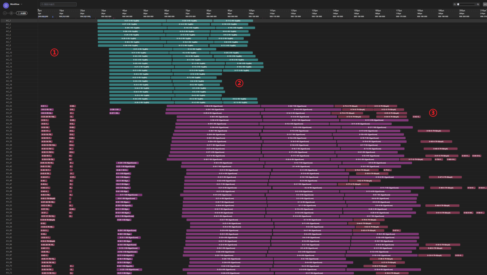
  <center>LightningIndexerSwimlane</center>
</p>

- The horizontal axis of the swimlane diagram represents time, and the vertical axis consists of swimlanes, where each swimlane represents an AI core. Tasks running on the corresponding AI core are arranged over time on each swimlane.
- Each task has a label. This label is a Semantic Label written by the developer in the source code and helps the developer understand which frontend code corresponds to the task currently running on the hardware.
- Selecting a task displays its preceding and subsequent dependencies, allowing developers to determine whether the task execution order and dependency intervals are reasonable.
- The swimlane diagram shows different colors, which represent different code written by frontend developers, running in parallel on different compute cores at the same time. Conventional SPMD scheduling requires the same program to run simultaneously. The MPMD runtime schedules tasks based on dependency release during actual execution. After a task has all dependencies released, it can run asynchronously in parallel with tasks on different AI cores.

#### Swimlane Diagram Analysis

After developers finish writing PyPTO code and obtain the first out-of-the-box performance results, they must analyze possible optimizations based on the swimlane diagram. The preceding swimlane diagram shows execution with a typical shape containing four batches and a KV-Cache length of 64K. It intuitively shows several anomalies that can be optimized:
1. The preceding MatMul Cube task has no dependencies. Why does it not run immediately?
2. The main Cube and Vector tasks each have three columns, but only some cores work in the third column, which does not align well at the end.
3. The final TopK appears to have a severe long tail.

PyPTO developers can then analyze these issues.
- Analysis of anomaly 1 shows that when the framework handles data movement Operations, it lacks optimization capabilities for scenarios that do not require data movement.
- Analysis of anomaly 2 shows that in the four-batch, 64K scenario, the Block Size specified in Page Attention is 128. MatMul is therefore partitioned into `4*64*1024/128=2048` tasks. The program configuration sets task L1 reuse to 32, leaving `2048/32=64` tasks, which cannot be evenly distributed across the cores because the current hardware has 24 Cube cores.
- Because the scenario also has four batches and the final TopK task performs a single-core merge, a long tail occurs on the Vector core. Optimize the final sorting and merging tasks to reduce the long tail.

#### Improvements and Results

- For anomaly 1, modify the corresponding Pass to add generalization capabilities and improve performance by 10%. Unlike a conventional black-box tuning framework, PyPTO uses a visual integrated development environment to help developers identify operator and framework issues. Developers can fix an issue locally or report it to the open-source community.
- For anomaly 2, adjust L1 reuse to balance performance for a specific shape and dynamic-shape generalization. In this example, setting L1 reuse to 32 provides good generalization.
  ```cpp
  config::SetPassOption(L1_REUSE, 32);
  ```
- During the analysis of anomaly 2, the MatMul output granularity was found to be 128, and Tile Shape was also set to 128, which is not the most efficient setting for hardware computation. Therefore, adjust Tile Shape so that MatMul outputs data to continuous memory before subsequent large-granularity Vector operations, improving performance by 17%.
  ```cpp
  TileShape::Current().SetVecTile({64, 256});
  ```

After the preceding optimizations, the following new swimlane diagram is obtained, showing a significant performance improvement of 27%.

<p align="center">
  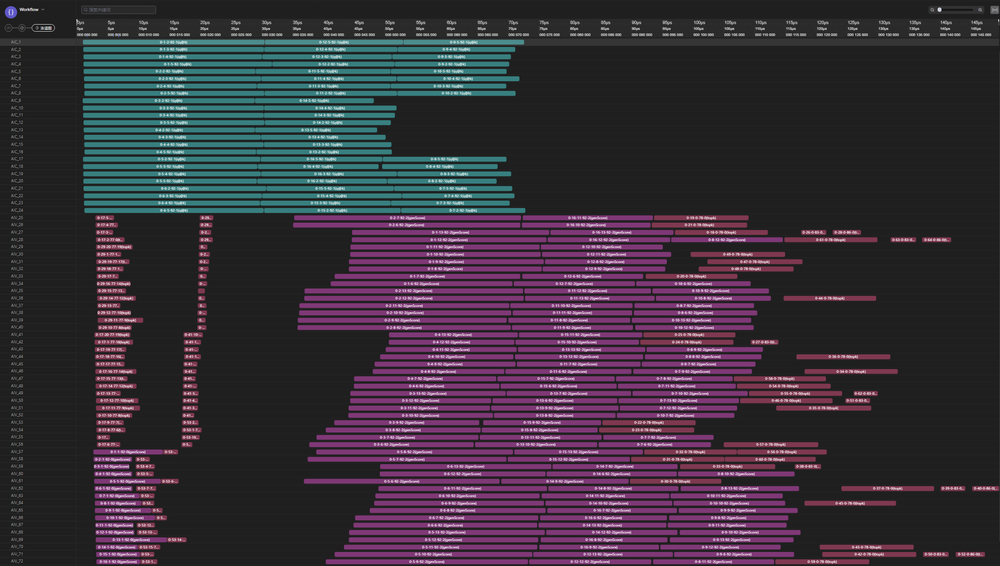
  <center>LightningIndexerSwimlaneNew</center>
</p>

#### Next Plan

After the preceding optimizations, the swimlane diagram is relatively dense. However, the diagram still contains areas that can be optimized:

* An excessively large MatMul subgraph delays the start of subsequent Vector tasks, and a large amount of idle time remains below the first column of Cube tasks. Analysis of the original computation logic shows that this part can run in parallel. Future work can optimize it by controlling the degree of reuse.
* The final TopK result is produced through sorting and merging. Move the sorting part into preceding Vector operations and perform only merging at the end to reduce long-tail time.

<!-- static-meta
{
  "sidebarTitle": "PyPTO Fused Operators",
  "quantization": ["int8"],
  "operator": ["pypto"],
  "hardware": ["atlas-a3"],
  "frameworks": ["cann-recipes"],
  "llmSpeculativeInference": ["mtp"]
}
-->
