# NPU DeepSeek-V3.2-Exp TileLang Operator Development Practice

## Introduction

In recent years, large AI models have grown explosively, imposing increasingly high requirements on high-performance operators. However, developing high-performance operators is difficult. Conventional AI programming involves complex scheduling optimizations, such as thread binding, layout optimization, and tensorization, and requires extensive manual scheduling code, resulting in low development efficiency and poor maintainability. Against this background, DSLs specialized for AI have emerged. Although recent DSLs for AI workloads greatly simplify the creation of high-performance operator kernels, they still tightly interweave most low-level optimizations with operator kernels, even when the data flow is explicitly exposed. For example, Triton provides intuitive block-level primitives but hides thread behavior, memory layout, and address-space annotations behind automatically generated policies. This abstraction simplifies programming but hinders experienced developers who seek maximum performance.

To address these DSL limitations, the TileAI open-source community introduced the TileLang operator programming language to simplify the development of high-performance GPU/NPU/CPU operators, such as GEMM, Dequant GEMM, FlashAttention, and LinearAttention. TileLang uses Python-like syntax and builds its underlying compiler infrastructure on TVM. It automatically generates code optimized for specific hardware, allowing developers to focus on productivity without sacrificing the low-level optimizations required for optimal performance. TileLang separates the scheduling space, including thread binding, layout, tensorization, and pipelines, from the data flow and encapsulates it as a set of customizable annotations and primitives. Users can focus on the kernel data flow while the compiler performs most other optimizations.

This document describes the process of adapting TileLang to Ascend NPUs and the practice of developing high-performance operators with it.

## Highlights

- Simplified NPU operator programming: TileLang uses Python-like syntax to significantly reduce the barrier to NPU operator development. It encapsulates the scheduling space as custom primitives, allowing developers to focus on the data flow.

- Flexible extensions: TileLang separates the scheduling space from the data flow. The compiler automatically optimizes NPU operators while fully using low-level NPU hardware features.

- High performance: TileLang can implement high-performance NPU operators and allows users to account for NPU hardware features. It can theoretically achieve better performance than Triton.
## TileLang NPU Workflow

The following figure shows the TileLang workflow on an NPU. It consists of compilation and execution stages:


<p align="center">
  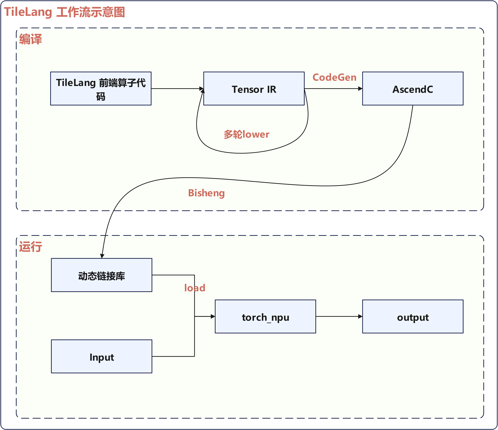
  <center>TileLang Workflow</center>
</p>


- Compilation stage

  1. Multi-level Lowering: Lower the TileLang operator through multiple levels based on NPU hardware features to generate a TensorIR representation optimized for Ascend hardware.
  2. AscendC code generation: Use the dedicated Ascend Codegen module to generate the corresponding AscendC code based on TensorIR.
  3. Dynamic library compilation: Use the BiSheng compiler (`bisheng`) to compile AscendC code into a dynamic-link library (`.so` file).

- Execution stage

  4. Library loading: Use the `torch_npu` runtime library to load the `.so` file into the Python environment.
  5. Function encapsulation: Encapsulate the operator as a callable Python function object.
  6. Invocation: Call the operator as a regular Python function. Provide input tensors to run computation on the Ascend NPU and obtain results.


## TileLang NPU Adaptation

The following figure shows the overall TileLang compilation and execution process and the parts modified for this adaptation, which are shown in dark green:


<p align="center">
  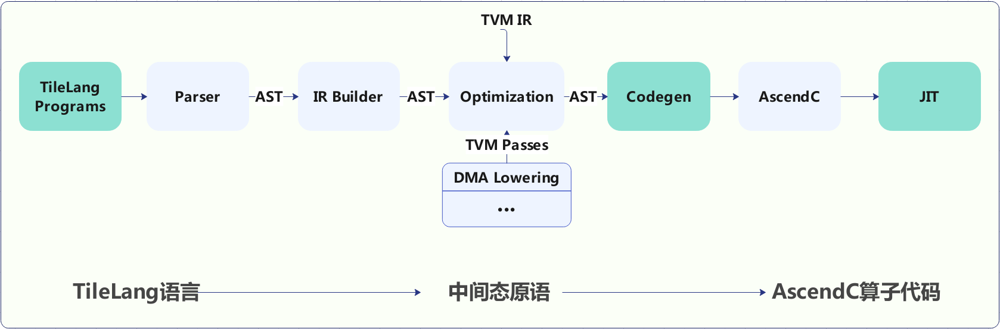
  <center>TileLang Compilation and Execution Process</center>
</p>


### TileLang API

Operator language primitives are the basic operation units that support operator development and execution throughout the complete operator lifecycle. TileLang API primitives encapsulate AscendC backend interfaces and provide concise and efficient primitive instructions. The primitives work together to efficiently schedule hardware resources and reliably run data processing logic. Their core functions are as follows:
- Precise adaptation to NPU hardware capabilities. TileLang primitives encapsulate low-level NPU hardware details, enable efficient collaboration between operators and the NPU architecture, shield low-level differences, and reduce development complexity.
- Improved operator development efficiency. TileLang API primitives simplify NPU operator development and reduce technical barriers. Encapsulated TileLang instructions allow developers to quickly construct an NPU operator framework and invoke AI Core-level functions with efficient Python syntax. Standardized interfaces also improve code reuse and facilitate richer and more complex computation logic.
- Operator performance optimization and reliability. TileLang API primitives encapsulate the AscendC operator backend language and provide automatic pipeline scheduling and memory storage access pattern optimization. These features improve the NPU cache hit rate, reduce computing resource usage and data movement, and prevent issues caused by the low-level language, such as residual data and out-of-bounds memory access.

The following figure shows the NPU storage structure and multi-level memory architecture to help users understand the corresponding memory allocation and copy semantics.
<p align="center">
  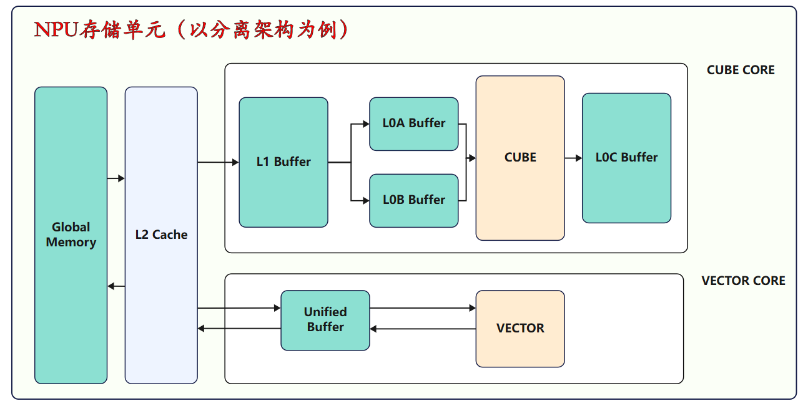
  <center>NPU Storage Structure</center>
</p>

The Ascend backend implements the following types of primitives. The table describes the primitive types and representative primitives:


| Primitive Type | Primitive Name | Usage Sample | Function Description |
| ------------ | ------------------------------------------------------------ | ------------------------------------------------ | ------------------------------------------------------------ |
| Kernel primitive | kernel | T.kernel(block\_num, is\_npu=True) as (cid, vid) | This primitive corresponds to an AscendC kernel invocation. `block_num` corresponds to the first parameter in `<<< >>>` and indicates the number of subtasks started by the kernel. The range of `cid` is $[0, block\_num)$, and the range of `vid` is 0 or 1. Because the default Cube-to-Vector core ratio of A2 is 1:2, use `vid` to specify the current Vector index. |
| Memory allocation primitive | alloc\_L1/L0A/L0B/L0C/UB | T.alloc\_L1/L0A/L0B/L0C/UB(shape, dtype) | Allocates a buffer in on-chip memory. Specify the shape and data type to mark the buffer information. |
| Data movement primitive | copy | T.copy(src, dst) | Copies the buffer on `src` to `dst`. Use BufferLoad or BufferRegion to specify a small buffer region. |
| Computation primitive | gemm, add, mul, reduce\_max... | T.reduce\_max(dst, src, tmp, dim) | `dim` specifies the reduction dimension. Currently, only two-dimensional reduction is supported. |
| Synchronization primitive | set\_flag, wait\_flag, set\_cross\_flag, wait\_cross\_flag, pipe\_barrier | T.set\_cross\_flag(pipe: str, eventId: int) | `pipe` is the pipeline to synchronize, and `eventId` is the synchronization event ID. |


### CodeGen

In the TileLang operator development process for Ascend NPUs, CodeGen connects concise frontend development to efficient backend execution. It automatically converts high-level TileLang API syntax into standard AscendC through instruction template encapsulation and instruction mapping, providing standardized and efficient support for backend operator development.
- Syntax conversion and hardware adaptation. CodeGen uses predefined AscendC instruction templates to encapsulate the syntax details and parameter constraints of low-level NPU hardware operations, such as AI Core computation instructions and DMAC data transfer instructions. It automatically parses the TileLang syntax tree, matches instruction templates based on semantic logic, and uses instruction mapping rules to seamlessly adapt TileLang to the AscendC NPU backend.
- Standardized and efficient operator code generation. CodeGen automates TileLang-to-AscendC conversion and substantially shortens the backend operator development cycle. Its instruction templates are optimized for AscendC NPU performance, so the generated AscendC code can directly use NPU hardware acceleration and effectively reduce performance loss from manual coding. The highly standardized generated code also substantially improves backend operator code maintainability and cross-version compatibility.

#### Codegen Adaptation
- Instruction template encapsulation

  Encapsulate corresponding instruction templates based on the basic and high-level AscendC APIs. For example, `copy_gm_to_l1` moves a tile from Global Memory to the L1 buffer.
  ```
  template <typename T, uint32_t srcM, uint32_t srcN, uint32_t dstM, uint32_t dstN>
  void copy_gm_to_l1(LocalTensor<T> dstTensor, GlobalTensor<T> srcTensor) {
    AscendC::DataCopy(dstTensor, srcTensor, {1, dstM, dstN, 0, srcN, dstM, 1, 0});
  }
  ```

- Instruction mapping

  Map frontend Tile API primitives to backend instruction templates. This mapping generates AscendC code.
  ```
  def div(dst: Buffer, src0: Buffer, src1: Union[Buffer, BufferLoad]):
    return binary_op(dst, src0, src1, "Div")
  ```

- Compilation

  Finally, use the BiSheng compiler to compile the AscendC code into a dynamic-link library, producing a `.so` file.
### JIT

JIT (Just-in-Time compilation) is a dynamic compilation technique. During TileLang operator development, JIT invokes CodeGen to generate AscendC code and dynamically controls the complete process. It addresses static compilation limitations, ensures that the generated AscendC code dynamically adapts to NPU features, and maximizes operator execution efficiency.
- Dynamic parameter-driven AscendC custom code generation. During execution, JIT parses input parameters in real time and passes information such as parameter dimensions and data types to CodeGen, ensuring that NPU operators support dynamic inputs.
- AscendC syntax correction under NPU hardware constraints. At runtime, JIT detects the resource configuration of the current NPU and guides CodeGen to generate AscendC code that complies with performance constraints and hardware resource limits.
- Just-in-Time compilation and dynamic optimization during operator execution. During compilation, JIT uses the current NPU hardware status to optimize instruction allocation and dynamically adjusts the compilation strategy based on AI Core utilization and memory usage.

#### JIT Adaptation

1. Code generation and compilation:
Use the CodeGen module to generate AscendC source code and compile it into a dynamic-link library (`.so` format).
2. Adapter integration:
Modify the Cython adapter in TileLang to connect to the corresponding NPU interface.
3. Python environment integration:
The preceding adaptation process seamlessly integrates JIT compilation invocations and enables convenient use of kernel functions in the Python environment while preserving consistency with existing TileLang interfaces.


## Extending TileLang NPU APIs

NPU TileLang backend APIs are provided as Python-encapsulated interfaces in the TileLang framework and support extensions. Users can extend them based on their requirements.

### Simple API Encapsulation

A simple API can be encapsulated by directly invoking an [Ascend C API](https://www.hiascend.com/document/detail/zh/canncommercial/82RC1/API/ascendcopapi/atlasascendc_api_07_0003.html)(Chinese).


Use **T.exp** as an example:

#### a) Python Encapsulation Interface

tilelang/tilelang/language/ascend.py

```
def unary_op(dst: Buffer, src0: Buffer, op: str):
    size_0 = math.prod(src0.shape)
    size_2 = math.prod(dst.shape)

    assert size_0 == size_2, "size must be same"
    
    return T.call_extern("handle", f"AscendC::{op}", dst.access_ptr("w"), src0.access_ptr("r"), size_0)

def exp(dst: Buffer, src0: Buffer):
    return unary_op(dst, src0, "Exp")
```

#### b) Codegen

tilelang/src/target/codegen_ascend.cc

The Codegen step generates AscendC source code mapped from TileLang operator code.

```
void CodeGenTileLangAscend::VisitExpr_(const CallNode *op, std::ostream &os) {
    ...
    else if (op_name == "AscendC::Add" || op_name == "AscendC::Max" || op_name == "AscendC::Sub" || op_name == "AscendC::Mul" || op_name == "AscendC::Exp") {
      std::vector<std::string> var_names;
      for (int i = 1; i < op->args.size() - 1; i++) {
        auto var_name = print_buffer_offset(op->args[i].as<CallNode>());
        var_names.push_back(var_name);
      }
      this->PrintIndent();
      this->stream << op_name << "("; 
      for (int i = 0; i < var_names.size(); i++) {
        this->stream << var_names[i];
        if (i != var_names.size() - 1) {
          this->stream << ", ";
        }
      }
      this->stream << ", " << PrintExpr(op->args[op->args.size() - 1]) << ");\n";
    }
    ...
}
```

### Complex API Encapsulation
This section describes complex API encapsulation. It uses **T.gemm_v0** as an example. **T.gemm_v0** receives matrices A and B, both located in L1, performs matrix multiplication, and outputs C, which is located in L0C.

#### a) Python Encapsulation Interface

```
def gemm_v0(A, B, C, transpose_A=False, transpose_B=False, init=False):

    def legalize_arguments(arg: Union[Buffer, Var]):
        """Convert let-bound variables to their corresponding buffers.

        Args:
            arg (Union[tir.Buffer, tir.Var]): Input argument to legalize

        Returns:
            Union[tir.Buffer, tir.Var]: The legalized argument
        """
        if isinstance(arg, Var) and T.has_let_value(arg):
            return T.get_let_value(arg).buffer
        return arg

    A = legalize_arguments(A)
    B = legalize_arguments(B)
    C = legalize_arguments(C)

    def retrieve_shape(object: Union[Buffer, BufferRegion]) -> List[int]:
        if isinstance(object, Buffer):
            return object.shape
        elif isinstance(object, BufferRegion):
            region = object.region
            shape = []
            for r in region:
                shape.append(r.extent)
            return shape
        else:
            raise ValueError(f"Unsupported argument type: {type(object)} for buffer {object}")

    A_shape = retrieve_shape(A)
    B_shape = retrieve_shape(B)
    C_shape = retrieve_shape(C)

    assert len(C_shape) == 2, "current only support C as a 2D tensor"
    assert len(A_shape) >= 2, "current only support A as a 2D or higher-order tensor"
    assert len(B_shape) >= 2, "current only support B as a 2D or higher-order tensor"
    if len(A_shape) > 2:
        for i in range(len(A_shape) - 2):
            assert A_shape[i] == 1, \
                "current only support A as a 2D or higher-order tensor with the last two dimensions being the matrix dimensions"
    if len(B_shape) > 2:
        for i in range(len(B_shape) - 2):
            assert B_shape[i] == 1, \
                "current only support B as a 2D or higher-order tensor with the last two dimensions being the matrix dimensions"

    M, N = C_shape
    K = A_shape[-2] if transpose_A else A_shape[-1]
    K_B = B_shape[-1] if transpose_B else B_shape[-2]
    assert K == K_B, f"T.gemm K shape check failed: K_A = {K}, K_B = {K_B}"

    def retrieve_ptr(object: Union[Buffer, BufferRegion], access_type: str = "r") -> PrimExpr:
        if isinstance(object, Buffer):
            return object.access_ptr(access_type)
        elif isinstance(object, BufferRegion):
            buffer, region = object.buffer, object.region
            indices = []
            for r in region:
                indices.append(r.min)
            strides = []
            stride = 1
            for s in reversed(buffer.shape):
                strides.insert(0, stride)
                stride *= s
            offset = 0
            for i in range(len(indices)):
                offset += indices[i] * strides[i]
            return buffer.access_ptr(access_mask=access_type, offset=offset)
        else:
            raise ValueError(f"Unsupported argument type: {type(object)} for buffer {object}")

    Aptr = retrieve_ptr(A, "r")
    Bptr = retrieve_ptr(B, "r")
    Cptr = retrieve_ptr(C, "rw")

    # assert _dtype(A) == _dtype(B), f"gemm A and B dtype mismatch: {_dtype(A)} vs {_dtype(B)}"
    return T.call_extern(
        "handle", f"tl::ascend::gemm_v0<{_dtype(A)}, {_dtype(C)}, {M}, {N}, {K}, {str(transpose_A).lower()}, {str(transpose_B).lower()}>",
        Aptr, Bptr, Cptr, init)
```

#### b) AscendC Encapsulation

Complex API encapsulation may require more complex processing and invocations of multiple AscendC interfaces. Place this code in the following file:

**tilelang/src/tl_templates/ascend/common.h**

```
template <typename T1, typename T2, uint32_t M, uint32_t N, uint32_t K, bool transpose_A=false, bool transpose_B=false>
CATLASS_DEVICE void gemm_v0(
  LocalTensor<T1> const &A,
  LocalTensor<T1> const &B,
  LocalTensor<T2> const &C, // this must be located in l0c
  AscendC::TBuf<AscendC::TPosition::A2> &l0a_,
  AscendC::TBuf<AscendC::TPosition::B2> &l0b_,
  bool clear
) {
  auto l0a = l0a_.Get<T1>();
  auto l0b = l0b_.Get<T1>();
  AscendC::PipeBarrier<PIPE_ALL>();
  if constexpr (!transpose_A) {
    tl::ascend::copy_l1_to_l0a<half, layout::zN, M, K, M, K>(l0a, A);
  } else {
    tl::ascend::copy_l1_to_l0a<half, layout::nZ, M, K, M, K>(l0a, A);
  }
  if constexpr (!transpose_B) {
    tl::ascend::copy_l1_to_l0b<half, layout::zN, K, N, K, N>(l0b, B);
  } else {
    tl::ascend::copy_l1_to_l0b<half, layout::nZ, K, N, K, N>(l0b, B);
  }

  AscendC::PipeBarrier<PIPE_ALL>();

  tl::ascend::mma<T1, T2, M, N, K>(l0a, l0b, C, clear);
  AscendC::PipeBarrier<PIPE_ALL>();
}
```

#### c) Codegen

The Codegen step generates AscendC source code mapped from TileLang operator code.

```
void CodeGenTileLangAscend::VisitExpr_(const CallNode *op, std::ostream &os) {
    ...
    else if (op_name.find("gemm_v0") != std::string::npos) {
        this->PrintIndent();
        auto a_var = op->args[1].as<CallNode>()->args[1].as<VarNode>();
        auto b_var = op->args[2].as<CallNode>()->args[1].as<VarNode>();
        auto c_var = op->args[3].as<CallNode>()->args[1].as<VarNode>();

        auto a_offset = PrintExpr(op->args[1].as<CallNode>()->args[2]);
        auto b_offset = PrintExpr(op->args[2].as<CallNode>()->args[2]);
        auto c_offset = PrintExpr(op->args[3].as<CallNode>()->args[2]);

        auto a_name = var_idmap_[a_var];
        auto b_name = var_idmap_[b_var];
        auto c_name = var_idmap_[c_var];

        auto src_type = op->args[1].as<CallNode>()->args[0].as<CallNode>()->dtype;
        auto dst_type = op->args[3].as<CallNode>()->args[0].as<CallNode>()->dtype;


        this->stream << op_name << "(" << a_name << "[" << a_offset << "], "
            << b_name << "[" << b_offset << "], " << c_name << "[" << c_offset << "], ascend_l0a, ascend_l0b, "  << PrintExpr(op->args[4]) << ");\n";
    } 
    ...
}
```

## Main Operator Implementations

This section describes the SparseFlashAttention and LightningIndexer operators developed with TileLang on the NPU.

### SparseFlashAttention

#### Overview

The following figure shows the overall SparseFlashAttention computation process:

<p align="center">
  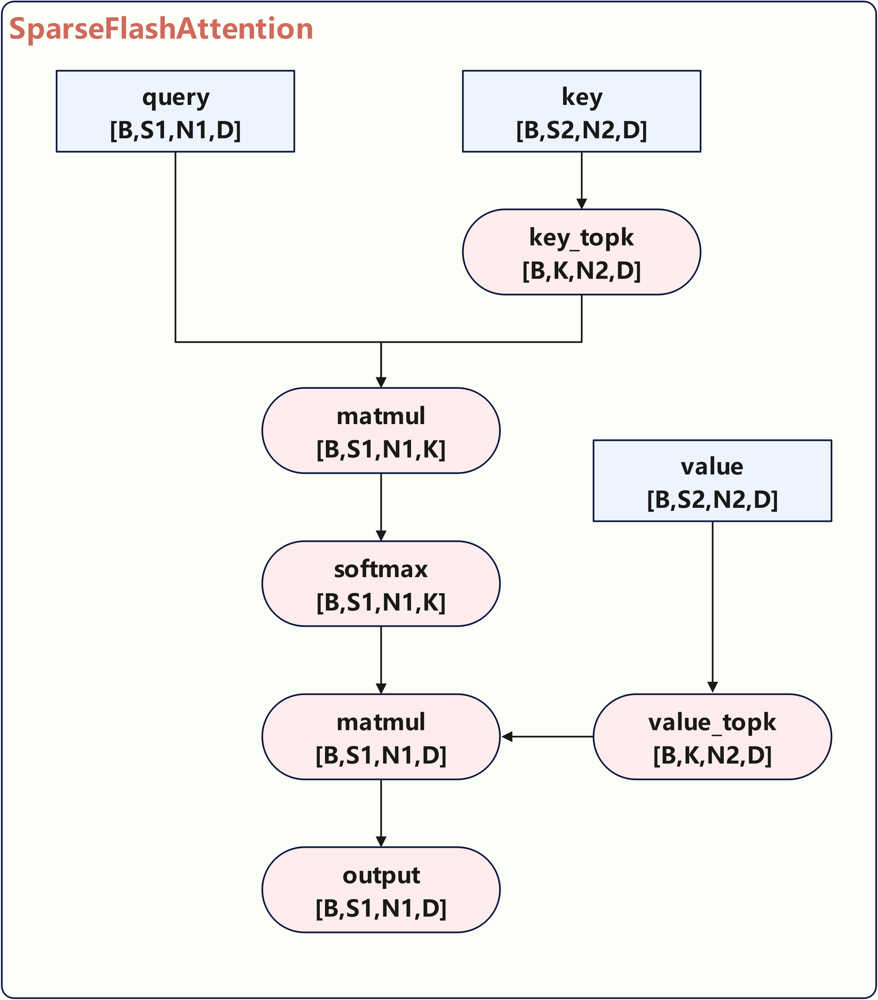
  <center>SparseFlashAttention Computation Flow</center>
</p>

Compared with the original FlashAttention (FA), the core innovation of SparseFlashAttention is the introduction of an **index tensor** as an input. This tensor explicitly specifies the **sparse associated subset** in the key/value sequence with which each token in the query sequence interacts. By limiting attention computation to these predefined subsets, the algorithm significantly reduces computation complexity, from O(N²) to O(N·S), where S is the sparse association size, and memory bandwidth requirements. It is particularly suitable for ultra-long sequences or structured sparse scenarios.

#### Detailed Algorithm Process from a Block-Level Perspective

The following implementation details use specific dimensions from the NPU block-level execution perspective. Assume that the input tensor dimensions are:

- **query**: `[batch_size=1, seq_len_q=128, num_heads=128, head_dim=576]`
- **key/value**: `[batch_size=1, seq_len_kv=32768, num_heads_kv=1, head_dim=576]` (Note: num_heads_kv=1 indicates a multi-head fusion or sharing mechanism.)
- **index**: `[batch_size=1, seq_len_q=128, num_heads=1, topk=2048]`

##### Implementation Steps

1. **Query block loading**
   - **Parallel partitioning strategy**: Use batch_size and seq_len_q as data-parallel dimensions. Partition the num_heads dimension at a granularity of block_size=64 for tensor parallelism.
   - **Core operation**: Load the currently processed query block from Global Memory.
     - Main block (`q_tile`): Load data from 512 consecutive feature dimensions → Shape: `[64, 512]`.
     - Tail block (`q_tail_tile`): Load data from the remaining 64 feature dimensions → Shape: `[64, 64]`.

2. **Sparse key/value block gathering**
   - **Index-driven loading**: For each query position in the current query block, use the index tensor to obtain the indexes of the topk_tile=64 associated tokens in the key/value sequence.
   - **Hardware-optimized gathering**: Gather the corresponding data from the global key/value tensors by index.
     - Main block (`kv_tile`): Gather the 512-dimensional main feature of each associated token → Shape: `[64, 512]`.
     - Tail block (`kv_tail_tile`): Gather the 64-dimensional tail feature of each associated token → Shape: `[64, 64]`.

3. **Attention score computation**
   - **Main-path computation**: Use Cube to compute main-block similarity and clear the L0C buffer.  
     `S_block = q_tile @ kv_tile.T` → Shape: `[64, 64]`
   - **Tail-path computation**: Compute tail-block similarity and accumulate it onto the existing computation result in the L0C buffer.  
     `S_block += q_tail_tile @ kv_tail_tile.T` → Shape: `[64, 64]`

4. **Online Softmax**
   - Perform block-wise stable online Softmax on `S_block`.
   - Compute along the topk_tile dimension (`dim=-1`).
   - Dynamically maintain intermediate statistics such as the maximum value (`m`) and exponential sum (`l`) to ensure numerical stability.

5. **Context vector computation**
   - Multiply the attention weight `P_block` by `kv_tile`.  
     `O_tile = P_block @ kv_tile` → Shape: `[64, 512]`

6. **Loop accumulation and rescaling**
   - **Result accumulation**: In the loop that traverses topk at a granularity of 64, accumulate `O_tile` into the output buffer.
   - **Online rescaling**: After the loop, use the statistics (`m`, `l`) maintained by online Softmax to globally rescale the accumulated result with vectorized operations and correct errors introduced by block-wise computation.

7. **Global Memory write-back**
   - Write the final rescaled output block `O_tile` to the corresponding position in Global Memory.

### LightningIndexer

#### Overview

As the operator preceding SparseFlashAttention, LightningIndexer receives Query and Key and outputs the TopK Key/Value indexes for each Query. It sparsifies Key/Value and compresses the attention computation length to TopK. The following figure shows the operator flow:


<p align="center">
  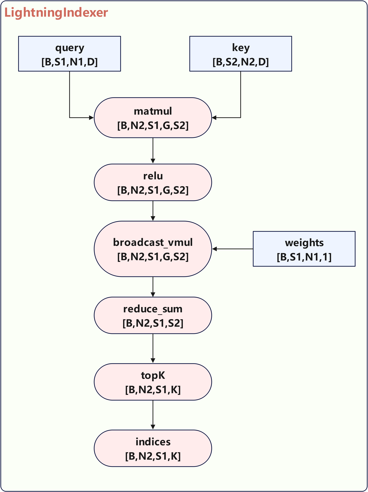
  <center>LightningIndexer Computation Flow</center>
</p>

#### Input and Output Tensors

- **Query**: `(B, S1, N1, D)` - A set of query vectors. Each query vector is divided into G groups, with D dimensions in each group.
- **KEY**: `(B, S2, N2, D)` - A set of key vectors.
- **QK_RES**: `(B, N2, S1, G * S2)` - Stores similarity scores between Query and Key.
- **WEIGHTS**: `(B, S1, N2, G)` - A weight matrix that weights similarity scores from different groups.
- **OUT**: `(B, N2, S1, TOP_K)` - The final output containing Top-K index results.

#### Key Parameters

- **B**: Batch size. It supports batch processing of multiple samples.
- **S1, S2**: Query and Key sequence lengths. They support sequence matching with different lengths.
- **N2**: Number of KV attention heads.
- **G**: Number of groups, satisfying G × N2 = N1.
- **D**: Feature dimension of each group.
- **TOP_K**: Number of most similar results to return.
- **VECTOR_BASEN, VECTOR_BASEG**: Basic units of vectorized computation.
- **BLOCK_M, BLOCK_N, BLOCK_K**: Matrix block sizes.

#### Cube Core Computation

##### Memory Hierarchy Design

Cube core computation fully uses the NPU memory hierarchy:

- **L1 cache**: The main data staging area that stores the Query and Key data blocks currently being computed.
- **L0C cache**: The computation cache dedicated to intermediate matrix multiplication results.

Using `BLOCK_M=128, BLOCK_N=128, BLOCK_K=128` as an example, the basic movement/computation block for Query and Key is 128\*128. The memory size of the Query sub-block is 128\*128\*sizeof(half)=32768. The memory address allocation strategy is as follows:

```
- Q_L1: Starts at address 0 and stores the Query data block.
- K_L1: Starts at address 32768 and stores the Key data block.
- C_L0: Starts at address 0 and stores the computation result.
```

This manually controlled memory address allocation prevents address conflicts between different data and optimizes memory access locality.

##### Partitioning Logic

###### Inter-Core Partitioning

- Partition the Batch dimension and use different offsets to determine the different data processed in parallel by each core.

###### Intra-Core Partitioning

Use a nested loop structure for block matrix multiplication:

1. **Outer loop - attention head traversal (`n2`)**: Independently compute each attention head to support multi-head attention.
2. **Second loop - group traversal (`g`)**: Traverse each group of the Query vector and match it with the complete Key vector.
3. **Third loop - Query sequence partitioning (`m`)**: Partition the Query sequence of length S1 by BLOCK_M.
4. **Inner loop - Key sequence partitioning (`n`)**: Partition the Key sequence of length S2 by BLOCK_N.

##### Detailed Computation Steps

Perform the following precise computation steps in each inner-loop iteration:

1. **Data loading**: Use `T.copy` to load the Query data block from Global Memory to the Q_L1 region of the L1 cache.
2. **Key data loading**: Load the Key data block into the K_L1 region.
3. **Matrix multiplication**: Use `T.gemm_v0` to perform optimized matrix multiplication. `transpose_B=True` transposes the Key matrix.
4. **Result write-back**: Use `T.copy` to write the computation result back to Global Memory. `enable_relu=True` uses the native capabilities of the AscendC Fixpipe operator to perform ReLU during data movement.

##### Synchronization and Cube-Vector Collaboration

- Use `T.barrier_all()` for synchronization after each key step to ensure data consistency and computation correctness.
- After Cube core computation is complete, use `T.set_cross_flag("FIX", 0)` to set a cross-core synchronization flag and notify the Vector core to start subsequent processing.

#### Vector Core Computation

##### Memory Management

The Vector core uses multiple dedicated buffers to process different data types:

- **Computation buffers**: `mm_res_ub` (similarity matrix), `weight_ub` (weight vector), and `reduce_tmp_ub` (accumulation buffer).
- **Top-K buffers**: `reduce_g_ub` (scores after reduction), `sort_indice_tmp_ub` (sorting indexes), and `topk_global_ub1/ub2` (incremental Top-K).
- **Type conversion buffers**: `mm_res_ub_uint8` and `sort_indice_tmp_ub_uint`.

##### Parallel Load Balancing

- Evenly distribute the total `N2 * S1` tasks across two Vector cores.
- Each Vector core processes `total_process_num // 2` tasks.
- The core uses `vid` to determine the processing range from `s1_start_idx` to `s1_end_idx`.

##### ReduceSum Computation

For each query position `s1_id`, compute the weighted similarity to all key positions:

1. **Initialization**: `T.init_sort_buf(topk_global_ub2, TOP_K * 2, 0)`.
2. **Block-wise Key sequence processing**: Partition by `VECTOR_BASEN`.
   - Reset the accumulators (`reduce_tmp_ub` and `reduce_g_ub`).
   - Compute by group `g_id`: Load scores from `QK_RES`, load weights from `WEIGHTS`, multiply, and accumulate.
   - Dimension reduction: Use `T.reduce_sum()` to sum along the group dimension and obtain the final score.

##### Top-K Algorithm Implementation

Use an incremental merge sort strategy:

1. **Block sorting**: Generate indexes and sort the current block.
2. **Incremental merging**:
   - Use `merge_sort_times = TOP_K // VECTOR_BASEN` to determine the number of sorted blocks.
   - First merge: Directly run `T.merge_sort()`.
   - Subsequent merges: After merging, use a Top-K operation to maintain the result set size.
3. **Result output**: Extract and write back the final Top-K indexes.

## Training Operator Implementations

This chapter describes eight training operators implemented by TileLang-Ascend for DeepSeek-V3.2. For model training, refer to this [document](https://gitcode.com/cann/cann-recipes-train/blob/master/docs/llm_pretrain/deepseekv32_pre_train_optimization.md)(Chinese). For TileLang operator replacement, refer to this [document](https://gitcode.com/cann/torchtitan-npu/blob/master/docs/feature_guides/tilelang_ops.md).

### 1. Rotary Position Embedding

#### **Overview**

RoPE (Rotary Position Embedding) is a positional encoding operator used to compute rotary position embeddings in large models. Unlike conventional absolute positional encoding, RoPE integrates position information into the attention mechanism by rotating vectors, allowing it to better capture relative position relationships. This operator supports forward and backward propagation and applies to model training and inference scenarios.

The following figure shows the overall Rotary Position Embedding computation process:

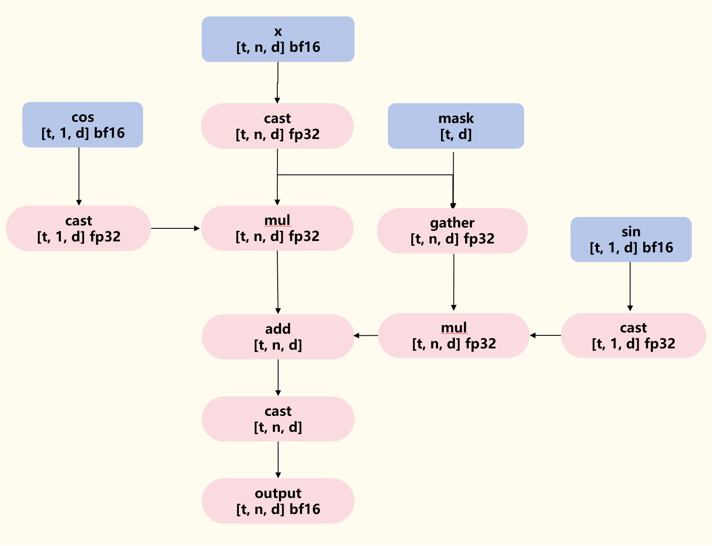
<center>Rotary Position Embedding Computation Flow</center>


#### Detailed Algorithm Process

Analysis of typical input and output tensor dimensions:

- **x**: [M, hidden_size] or [B, S, N, D], the input tensor.
- **sin**: [sc_rows, rope_dim], the rotary sine-angle vector.
- **cos**: [sc_rows, rope_dim], the rotary cosine-angle vector.
- **mask**: [row_per_vec, rope_dim], the rotary index mask vector.
- **output**: The rotary position encoding output tensor, with the same shape as the input.

**Computation process:**

##### 1. Data Loading and Preprocessing

- **Block loading:** Load input data into the UB buffer in blocks of `block_M`. The default `block_M` is 64 for float16/bfloat16 or 32 for float32.
- **Partial RoPE support:** When `rope_dim` is smaller than `hidden_size`, apply rotary position encoding only to the last `rope_dim` dimensions of the input tensor and keep the preceding `dim_start` dimensions unchanged.


##### 2. Data Type Conversion

- **Precision improvement:** For float16/bfloat16 inputs, use `T.tile.cast` to convert the data to float32 for computation, ensuring numerical precision and stability.


##### 3. sin/cos Loading

- **Position index computation:** Compute the corresponding sin/cos index based on `head_num` and the row position using `row_sin_cos = (row_x // head_num) % sc_rows`.
- **Rotation angle loading:** Load the corresponding sin and cos values into the UB buffer based on the computed index.


##### 4. Rotation Operation

- **Element rearrangement:** Use `T.tile.gather` with `mask` to rearrange elements during rotation. The mask vector encodes the index mapping required for rotation.
- **Rotation modes:**
  - **interleave mode:** Swap and rotate adjacent element pairs: `rotate([x0, x1, x2, x3]) = [-x1, x0, -x3, x2]`.
  - **half mode:** Swap and rotate the first and second halves: `rotate([x0, x1, x2, x3]) = [-x2, -x3, x0, x1]`.


##### 5. RoPE Computation

- **Forward propagation:** Perform rotary position encoding using `out = x * cos + rotate(x) * sin`.
- **Backward propagation:** Compute the backward gradient using `dx = cos * dy + swap(sin_masked * dy)`.


##### 6. Result Write-Back

- **Type conversion:** Convert the computation result from float32 back to the original data type (float16/bfloat16).
- **Result storage:** Write the result back to Global Memory in blocks. For partial RoPE, update only the last `rope_dim` dimensions.


### 2. moe_token_permute 

#### Overview

The following figure shows the overall MoeTokenPermute computation process:

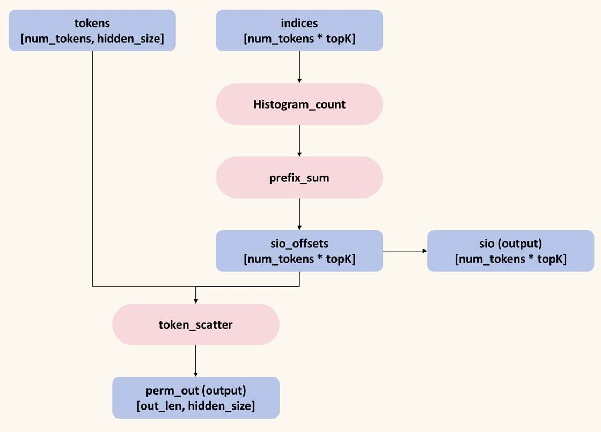
<center>MoeTokenPermute Computation Flow</center>

In large language models based on the Mixture of Experts (MoE) architecture, the number of tokens received by different experts changes dynamically. Token distribution operations (Token Permute / Scatter) can become a computation bottleneck because of intensive discontinuous memory access.

As the only user-facing interface for this operator, the `MoeTokenPermute` class deeply fuses histogram statistics, global prefix-sum computation, and data rearrangement by using low-level NPU features. The operator shields users from low-level memory alignment and inter-core synchronization details. Users only provide tokens and routing indexes to efficiently obtain a token tensor arranged contiguously by expert and corresponding Scatter offset records.

#### Interface Parameters

To better understand the algorithm process, the complete interface parameter definitions of the `MoeTokenPermute` class are as follows:

**1. Initialization parameters (`__init__`):**

- **num_tokens**: `int`, the total number of tokens in the input sequence.
    
- **topK**: `int`, the number of experts assigned to each token. For example, set it to 2 for Top-2 routing.
    
- **hidden_size**: `int`, the hidden-state vector dimension of a token.
    
- **num_experts**: `int`, the total number of experts in the model. The default value is 64.
    
- **num_out_tokens**: `int`, the expected output token capacity. If it is 0, the default allocation size is `num_tokens * topK`.
    
- **NUM_CORES**: `int`, the number of physical NPU cores used. The default value is 24.
    
- **TILE_H**: `int`, the hidden-layer block size for intra-core data partitioning. The default value is `None`, which automatically uses the full `hidden_size` length.
    
- **dtype**: `str`, the computation type of token data. The default value is `"float16"`.
    

**2. Invocation parameters (`__call__`):**

- **tokens**: `Tensor[num_tokens, hidden_size]`, the original input token hidden-state tensor.
    
- **indices**: `Tensor[num_tokens * topK]`, the one-dimensional flattened expert index tensor output by the routing network.
    

**3. Output values:**

- **perm_out**: `Tensor[out_len, hidden_size]`, the token tensor rearranged by expert assignment, where the initialization parameter `num_out_tokens` determines `out_len`.
    
- **sio**: `Tensor[num_tokens * topK]`, the Scatter offset/write-position index corresponding to a token, excluding the invalid part of the low-level padding.
    

#### Detailed Algorithm Process

Based on the input and output parameters of the `MoeTokenPermute` class, the low-level operator runs as follows:

##### 1. Tensor Initialization and Alignment Padding

- When `__call__` is invoked, first compute the logical total number of indexes `E = num_tokens * topK`.
    
- To meet the alignment requirements for even NPU multi-core partitioning, the operator computes an aligned length `padded_E`, which is a common multiple of `NUM_CORES` and `chunk_size`, and creates a padded index tensor `indices_padded`. It copies the user-provided `indices` into this tensor and pads the part beyond `E` with zeros.
    

##### 2. Data Partitioning and Multi-Core Parallel Strategy

- **Inter-core partitioning:** Based on the `NUM_CORES` specified during initialization, use the smaller of `NUM_CORES` and `num_tokens` as the actual number of cores and evenly divide the input token sequence across NPU cores. Each core processes a segment of token data with size `tokens_per_core` and its corresponding index block (`chunk_size`).
    
- **Intra-core partitioning:** For the `hidden_size` dimension, use the initialized `TILE_H` to divide it into multiple sub-blocks (HTiles), and divide each sub-block in half (`HALF_H`) across multiple vector compute units within one NPU core to implement finer-grained instruction-level parallelism.
    

##### 3. Local Expert Histogram Statistics

- Each NPU core first asynchronously loads its assigned index data block from the global `indices_padded`.
    
- Use a pipelined loop to count the token frequency assigned to the `num_experts` experts in the data block (Histogram Count).
    
- After the statistics are complete, each core writes its local histogram result to the global Workspace and triggers a global synchronization Barrier to wait for all cores to finish statistics collection.
    

##### 4. Global Offset Computation (Prefix Sum)

- Each core reads the complete histogram data from the global Workspace.
    
- Use two accumulations, the cumulative value of all cores `acc_ub` and the preceding cumulative value of the current core `cpre_ub`, with the prefix-sum algorithm to compute the absolute base write offset (Scatter Offset) in the global output tensor `perm_out` for each token-expert pair on the current core.
    
- Store these offsets in the internal `sio_chunk_ub` array.
    

##### 5. Pipelined Token Rearrangement (Pipelined Token Scatter)

- Construct a software pipeline buffer of size 2 (Double Buffering). Use flag synchronization between NPU asynchronous copy instructions (MTE2/MTE3) and vector computation instructions (V) to overlap memory reads with rearranged writes.
    
- In each loop, preload the next token data block from the input `tokens` tensor (MTE2).
    
- For the current token data block, query the write offset computed in step 4. If the offset is valid and does not exceed `num_out_tokens`, write the token data to the specified position in the output tensor `perm_out` (MTE3).
    

##### 6. Result Extraction and Return

- After the pipeline is complete, the low-level operator outputs the padded rearranged token tensor and an index tensor recording global write positions.
    
- At the Python class interface layer, slice the valid Scatter indexes: `sio = sio_padded.squeeze(0)[:E]`.
    
- Finally, return the rearranged contiguous token representation `perm_out` and offset record `sio`, completing the token arrangement process.

### 3. moe_token_permute_grad 

#### Overview

The overall computation workflow of the MoeTokenPermuteGrad operator is shown in the following figure:

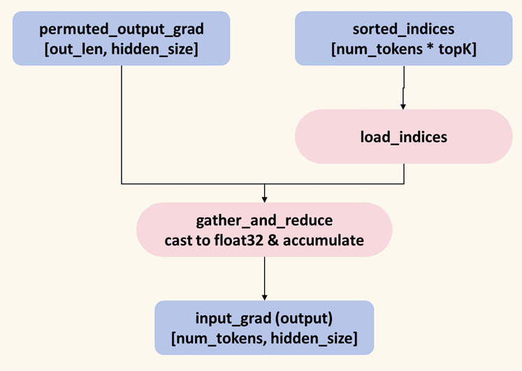
<center>MoeTokenPermuteGrad computation workflow</center>


During backpropagation in large language models based on the Mixture of Experts (MoE) architecture, the token gradients calculated by each expert must be precisely propagated back to the original tokens according to the routing and dispatch rules used during forward propagation. Because one token may be routed to the Top-K experts during forward propagation, the gradient of the original token during backpropagation is the sum of the gradient vectors corresponding to these K experts (the Gather-Reduce operation).

The `MoeTokenPermuteGrad` class is a fused operator for this operation. It uses the NPU's highly concurrent read/write capabilities and on-core accumulators to efficiently collect and merge gradients in reverse through the "**batch index loading -> vector aggregation (Gather) -> high-precision accumulation (Reduce)**" computation paradigm. To address numerical overflow or precision truncation that can easily occur in half-precision computation (such as float16), the operator specifically implements an accumulation mechanism with type upcasting (Cast to FP32) to ensure the numerical stability of gradient computation.

#### **Interface Parameters**

The complete interface parameter definitions of the `MoeTokenPermuteGrad` class are as follows:

**1. Initialization parameters (`__init__`):**

- **num_tokens**: `int`, total number of tokens in the original input sequence.
    
- **topK**: `int`, number of experts to which each token is assigned during forward propagation.
    
- **hidden_size**: `int`, hidden-layer vector dimension of a token.
    
- **num_experts**: `int`, total number of experts in the model. The default value is 64 and is mainly used to maintain API symmetry in the backward operator.
    
- **num_out_tokens**: `int`, total token length output by forward propagation. If it is set to 0, it defaults to `num_tokens * topK`.
    
- **NUM_CORES**: `int`, number of physical NPU cores to use. The default value is 24.
    
- **TILE_H**: `int`, hidden-layer block size for on-core data partitioning. The default value is `None` (the optimal size is automatically derived based on `hidden_size` and the data type).
    
- **dtype**: `str`, data type of the input gradient. The default value is `"float16"`.
    

**2. Call parameters (`__call__`):**

- **permuted_output_grad**: `Tensor[out_len, hidden_size]`, gradient corresponding to the forward-propagation output tensor, that is, the contiguous gradient tensor output by expert-layer backpropagation.
    
- **sorted_indices**: `Tensor[num_tokens * topK]`, offset/target-position indices generated by the forward Scatter operator (corresponding to the forward `sio` output).
    

**3. Return value:**

- **input_grad**: `Tensor[num_tokens, hidden_size]`, token gradient tensor propagated back to the original input after Gather-Reduce aggregation and accumulation.
    

---

#### **Algorithm Workflow**

The gradient aggregation workflow of the `MoeTokenPermuteGrad` class is as follows:

##### 1. Tensor initialization and alignment padding

- When `__call__` is invoked, first calculate the theoretical forward logical length `E = num_tokens * topK`.
    
- If the actual length of the passed `permuted_output_grad` is less than `E`, the operator creates an all-zero padding tensor `perm_grad_padded` to pad the length and prevent out-of-bounds access during Gather.
    
- At the same time, pad and align the user-provided `sorted_indices` to the `padded_E` length required for even NPU multi-core distribution.
    

##### 2. Data partitioning and multi-core parallelization strategy

- **Inter-core partitioning (Core-level):** Calculate `actual_cores` based on `NUM_CORES` (use the smaller of `NUM_CORES` and `num_tokens` as the actual number of cores). Partition along the original token dimension. Each core restores the gradients of `tokens_per_core` original tokens.
    
- **Batch dimension (Batch-level):** To prevent Unified Buffer (UB) overload, further partition the tokens assigned to each core into multiple batches (`BATCH_T`) for batch-wise computation.
    
- **Intra-core partitioning (Thread-level):** Along the `hidden_size` dimension, the operator partitions data into multiple sub-blocks (`n_htiles`) and further divides each sub-block in half (`HALF_H` = `TILE_H // 2`) within a single compute core for parallel accumulation by two compute units.
    

##### 3. Batched index loading

- Enter the serial batch-processing loop in units of `BATCH_T`.
    
- Each NPU core asynchronously loads the expert routing indices corresponding to the current batch (with a size of `BATCH_T * topK`) from `sorted_idx_gm` into the Unified Buffer `idx_ub`.
    

##### 4. Gradient aggregation and high-precision accumulation (Gather & Reduce)

This is the core computation module of the backward operator. Based on the `dtype` specified during initialization, it routes execution to two different kernel functions (Cast and NoCast):

- **High-precision accumulation mode (for float16 input):**
    
    - For a `hidden_size` block of the current token, first initialize an all-zero float32 accumulator (`acc_buf`) in the buffer.
        
    - Iterate `topK` times.
        
    - Based on the loaded indices, use asynchronous copy (MTE2) to precisely fetch the corresponding Top-K gradient vector block from global memory `perm_grad_gm` into `row_buf`.
        
    - Convert (Cast) the fetched float16 gradient vector to the high-precision float32 type (`CAST_LOW2HIGH`) through a Vector Instruction.
        
    - Accumulate the vector into `acc_buf` at float32 precision to prevent small gradients from being lost or overflow caused by half-precision addition.
        
    - After accumulation is complete, convert the result back to the float16 data format through `CAST_HIGH2LOW`.
        
- **Standard accumulation mode (for float32 input):**
    
    - If the input is already single-precision, omit the Cast overhead and directly use shared memory with loop unrolling for contiguous loading and addition.
        

##### 5. Writing back the result

- After block-wise accumulation along the `hidden_size` dimension for a single token is complete, trigger a memory-to-global-memory write-back barrier (`pipe_barrier`).
    
- Output the merged and restored gradient from the internal buffer and write it to the corresponding original-token position in global memory `input_grad_gm`.
    
- The Python layer receives the final aggregated `input_grad` tensor, which continues to participate in network backpropagation.


### 4. moe_token_unpermute 

#### **Overview**

The overall computation workflow of the MoeTokenUnpermute operator is shown in the following figure:

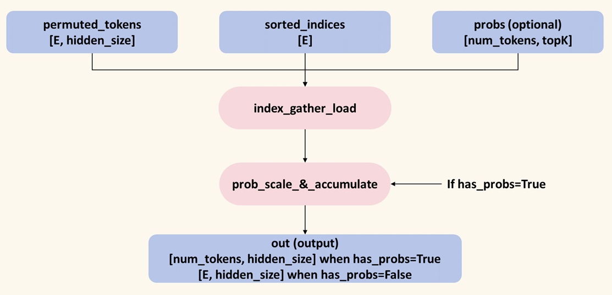
<center>MoeTokenUnPermute computation workflow</center>

In the Mixture of Experts (MoE) architecture, after tokens are processed by different experts, the token features scattered across the output tensors of these experts must be gathered and combined according to their positions in the original sequence. If a Top-K routing strategy is used, the outputs obtained for the same token from multiple experts must also be multiplied by their corresponding Routing Probabilities and combined through a weighted sum (Reduce).

The `MoeTokenUnpermute` class is the NPU operator interface that performs the preceding operation. This operator is developed based on the TileLang framework and is deeply optimized for the underlying hardware's Vector Unit and memory-copy path. During probability weighting, it also enforces a high-precision accumulation strategy with upcasting (Cast to FP32) to ensure numerical stability during model computation.

#### **Interface Parameters**

The complete interface parameter definitions of the `MoeTokenUnpermute` class are as follows:

**1. Initialization parameters (`__init__`):**

- **num_tokens**: `int`, total number of tokens in the original input sequence.
    
- **topK**: `int`, number of experts assigned to each token (that is, the number of experts from which results for the same token must be fetched and aggregated).
    
- **hidden_size**: `int`, hidden-layer vector dimension of a token.
    
- **has_probs**: `bool`, with a default value of `True`. Indicates whether weighted merging based on routing probabilities is required. If it is `True`, the operator performs Gather + Scale + Accumulate. If it is `False`, the operator performs only data gathering (Gather).
    
- **padded_mode**: `bool`, with a default value of `False`. Reserved parameter. Setting it to `True` is not currently supported and raises `NotImplementedError`.
    
- **NUM_CORES**: `int`, number of physical NPU cores to use. The default value is 24.
    
- **TILE_T**: `int`, optional. Block size for partitioning along the on-core token dimension. The default value is `None` (the system dynamically calculates the optimal partition based on the total number of tokens).
    
- **TILE_H**: `int`, optional. Block size for partitioning along the on-core hidden-layer dimension. The default value is `None` (the system automatically derives an aligned size).
    
- **dtype**: `str`, computation data type. The supported values are `"float16"`, `"bfloat16"`, `"float32"`, and `"float"`. The default value is `"float16"`.
    

**2. Call parameters (`__call__`):**

- **permuted_tokens**: `Tensor[E, hidden_size]` (where `E = num_tokens * topK`), collection of token tensors output after processing by the expert layers.
    
- **sorted_indices**: `Tensor[E]`, expert-index mapping recorded during the original permutation operation (that is, the mapping between token positions after permutation and their original positions).
    
- **probs**: `Tensor[num_tokens, topK]`, optional. Top-K routing probabilities corresponding to the tokens. This parameter is required when `has_probs=True`.
    

**3. Return value:**

- **out**: `Tensor`.
    
    - When `has_probs=True`, returns the aggregated and weighted tensor with a shape of `[num_tokens, hidden_size]`.
        
    - When `has_probs=False`, returns only the tensor obtained through Gather without summation-based dimension reduction. Its shape is `[E, hidden_size]`.
        

#### **Algorithm Workflow**

##### 1. Tensor initialization and dimension alignment (Padding)

- The underlying hardware often has minimum dimension requirements for parallel partitioning (for example, `hidden_size` must be at least 64 for `float16`). During initialization, the operator calculates `_compile_hidden_size`. When `__call__` is invoked, the `pad_last_dim` and `pad_first_dim` functions dynamically pad the end of `permuted_tokens` and the beginning of `sorted_indices`, so that the total length and hidden-layer dimension are exact multiples (`padded_E` and `padded_tokens`) required for inter-core parallel distribution on the NPU. After computation, the Padding is removed by slicing the output.
    

##### 2. Partitioning and scheduling strategy (Auto Tiling)

- **Inter-core parallelism:** Based on the state of `has_probs`, the operator uses different parallel distribution strategies. `auto_launch_cores` dynamically calculates the actual number of physical cores to activate (`actual_cores`) and evenly distributes logical token blocks (`n_ttiles` or `n_etiles`) to the corresponding compute cores.
    
- **Intra-core pipeline:** Using the `TILE_H` and `TILE_T` parameters automatically generated by TileLang, each compute core processes data in batches (`BATCH_T`) and partitions the data flow into double buffers within the NPU core for processing by the vector unit.
    

##### 3. Index parsing and data gathering (Index Gather)

- Each NPU compute core loads the corresponding routing probabilities `probs_ub` and inverse-sort indices `idx_ub` from global memory.
    
- Based on the loaded `idx_ub`, the compute core locates the row in `permuted_tokens` where the token resides after expert computation and asynchronously fetches the corresponding feature row into the row buffer (`row_buf`) in the Unified Buffer (UB) through data-copy instructions.
    

##### 4. High-precision probability weighting and accumulation (Scale & Accumulate)

- **If `has_probs=True`:**
    
    - **Type promotion (Cast-Up):** To prevent severe precision truncation caused by repeated accumulation of half-precision floating-point values (FP16/BF16), the operator preallocates a high-precision buffer (`acc_dtype`, typically FP32) in the UB. It uses the `CAST_LOW2HIGH` instruction to promote the precision of the feature data and probabilities `probs`.
        
    - **Multiply-add operation (AXPY):** Expand the inner loop for the Top-K count. Because the Top-K value may not be an optimal multiple for instruction registers, the underlying implementation uses `n_quads` (4-iteration/8-iteration loop unrolling) and `remainder` (remainder handling) to split computation into multiple suboperations. It uses the NPU's `T.tile.axpy` ($Y = aX + Y$) or `T.tile.mul` vector multiplication to multiply the current expert feature row by probability `prob` and accumulate it into the corresponding token accumulation register `acc_buf`.
        
    - **Type demotion (Cast-Down):** After the results from the Top-K experts for the same token are accumulated, use `CAST_HIGH2LOW` to convert them back to the original data type (such as FP16).
        
- **If `has_probs=False`:**
    
    - Skip type conversion and accumulation, and directly write the expert features loaded into `row_buf` back to the result buffer `out_gm` row by row according to the partitioned dimensions.
        

##### 5. Writing the result back to global memory

- Use the underlying `pipe_barrier` to synchronize the scalar and vector instruction streams. After confirming that the current batch has been correctly computed in the registers, flush the data segments that have completed Unpermute (and Reduce) back to global memory. After all cores finish running, the interface slices off the initial Padding and returns a properly shaped output tensor.

### 5. moe_token_unpermute_grad

#### **Overview**

The overall computation workflow of the MoeTokenUnpermuteGrad operator is shown in the following figure:

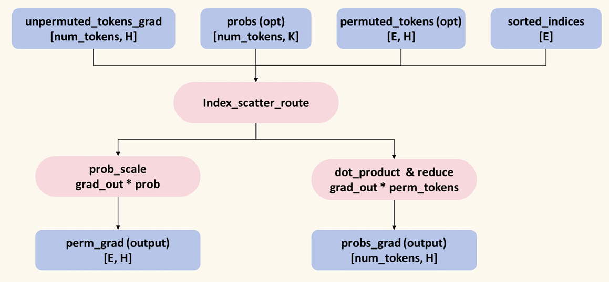
<center>MoeTokenUnPermuteGrad computation workflow</center>


During backpropagation in the Mixture of Experts (MoE) architecture, the gradients of the Token Unpermute (weighted aggregation) operation must be calculated. If Top-K routing and probability weighting (`has_probs=True`) are used during forward propagation, the backward process must calculate gradients in two directions:

1. **Gradient with respect to expert outputs (`perm_grad`)**: According to the chain rule, it equals the gradient propagated from the upper layer multiplied by the corresponding routing probability.
    
2. **Gradient with respect to routing probabilities (`probs_grad`)**: It equals the sum of the dot products between the gradient propagated from the upper layer and the corresponding expert output features (`permuted_tokens`) along the hidden-layer dimension.
    

The `MoeTokenUnpermuteGrad` class is the NPU operator interface that performs the preceding backward-gradient computation. This operator implements efficient data Scatter distribution and also optimizes the underlying multi-core parallelism and independent accumulation by the Dual-Vector Unit for the "dot product and reduction (Reduce Sum)" operation of probability gradients. This maximizes hardware throughput while ensuring high-precision FP32 accumulation.

#### **Interface Parameters**

The complete interface parameter definitions of the `MoeTokenUnpermuteGrad` class are as follows:

**1. Initialization parameters (`__init__`):**

- **num_tokens**: `int`, total number of tokens in the original input sequence.
    
- **topK**: `int`, number of experts assigned to each token.
    
- **hidden_size**: `int`, hidden-layer vector dimension of a token.
    
- **has_probs**: `bool`, with a default value of `True`. Indicates whether probability weighting was used during forward propagation. If it is `True`, the operator calculates and returns `perm_grad` and `probs_grad`. If it is `False`, the operator only performs Scatter distribution of gradients and returns `perm_grad`.
    
- **NUM_CORES**: `int`, number of physical NPU cores to use. The default value is 24.
    
- **TILE_T**: `int`, optional. Block size for partitioning along the on-core token dimension. The default value is `None` (the system automatically calculates the optimal value).
    
- **TILE_H**: `int`, optional. Block size for partitioning along the on-core hidden-layer dimension. The default value is `None` (the system automatically calculates the optimal aligned value).
    
- **dtype**: `str`, computation data type. The supported values are `"float16"`, `"bfloat16"`, `"float32"`, and `"float"`. The default value is `"float16"`.
    

**2. Call parameters (`__call__`):**

- **permuted_tokens**: `Tensor[E, hidden_size]` (where $E = num\_tokens \times topK$), token collection output by expert-layer computation during forward propagation. This parameter is required for calculating probability gradients when `has_probs=True`.
    
- **unpermuted_tokens_grad**: `Tensor[num_tokens, hidden_size]`, gradient corresponding to the output of the Unpermute operation that is propagated back from an upper network layer during backpropagation (that is, $\frac{\partial L}{\partial X_{out}}$).
    
- **sorted_indices**: `Tensor[E]`, global indices that map routing relationships.
    
- **probs**: `Tensor[num_tokens, topK]`, optional. Top-K routing probabilities during forward propagation. This parameter is required when `has_probs=True`.
    

**3. Return value:**

- When `has_probs=True`, returns a tuple `(perm_grad, probs_grad)`:
    
    - **perm_grad**: `Tensor[E, hidden_size]`, feature gradients propagated to the expert layers.
        
    - **probs_grad**: `Tensor[num_tokens, topK]`, probability gradients propagated to the routing network (Router).
        
- When `has_probs=False`, returns only:
    
    - **perm_grad**: `Tensor[E, hidden_size]`.
        

---

#### **Algorithm Workflow**

##### 1. Tensor initialization and dimension alignment (Padding)

- As with the forward operator, the underlying NPU hardware has alignment requirements for parallel block (Tile) sizes. When called on the Python side, the operator uses `_pad_first_dim` and `_pad_last_dim` to dynamically pad the returned gradient `unpermuted_tokens_grad`, expert features `permuted_tokens`, indices, and probabilities at their first and last dimensions to `_padded_E` and `_compile_hidden_size`.
    

##### 2. Backward rearrangement and data distribution loading (Scatter Routing)

- Each NPU compute core loads the corresponding `sorted_idx_gm` and `probs_gm` into the Unified Buffer (UB) based on its assigned token block.
    
- Based on the indices, the core locates the current row of `unpermuted_tokens_grad` (the gradient propagated back from the upper network layer).
    

##### 3. Highly concurrent gradient computation (Gradient Computation)

- **If `has_probs=True`:**
    
    The operator uses a double-buffered pipeline to hide memory latency and divides computation into two paths:
    
    - **Calculate expert-feature gradients (`perm_grad`):** Extract the corresponding routing probability `prob`, promote it to a high-precision type (such as FP32) through `CAST_LOW2HIGH`, and then perform vector multiplication $grad\_f32 \times prob$. Demote the computation result (`CAST_HIGH2LOW`) and write it back to global memory through the asynchronous MTE3 instruction.
        
    - **Calculate routing-probability gradients (`probs_grad`):** Calculate the dot product of the gradient and features. The operator obtains the product for each dimension through vector multiply-add $grad\_f32 \times perm\_f32$, then invokes the `T.reduce_sum` instruction to accumulate it along the hidden-layer dimension into the scalar register `reduce_dst`, and finally accumulates it into `pg_acc`.
        
- **If `has_probs=False`:**
    
    The operator enters a minimal mode (`_build_scatter_kernel_no_probs`). It does not calculate dot products or multiply by probabilities and only performs an index-based Scatter operation to copy segments of `unpermuted_tokens_grad` to specified positions in `perm_grad`.

##### 4. Dual-vector-unit fusion (Dual-Vector Unit Optimization)

- In the NPU architecture, a single core usually contains two independent vector compute units (Vector Unit 0 and 1). To overcome the hardware bottleneck of dot-product Reduce operations, the operator adds a `vid` dimension when allocating `probs_grad_gm` at the underlying layer (changing its shape to `[2, padded_tokens, topK]`).
    
- The two vector units separately perform dot-product accumulation over `HALF_H` (that is, half of the hidden-layer dimension) and retain their own Partial Sums. This design avoids frequent lock synchronization between the two execution units within a core.
    

##### 5. Writing back results and dimension reduction on the Python side

- After the underlying kernel finishes execution, control returns to the Python-side interface.
    
- If probability calculation is enabled, the interface extracts the two `probs_grad_raw` results independently calculated by the NPU's dual vector units and performs `probs_grad_raw[0] + probs_grad_raw[1]` to add the two partial dot-product sums and complete the final Reduce Sum.
    
- Finally, slice all gradient tensors (`perm_grad` and `probs_grad`) to remove the Padding introduced in step 1 and safely return them to the PyTorch computation graph in the original data type `dtype`.


### 6. rms norm 
#### **Overview**
The overall computation workflow of the rms norm operator is shown in the following figure:

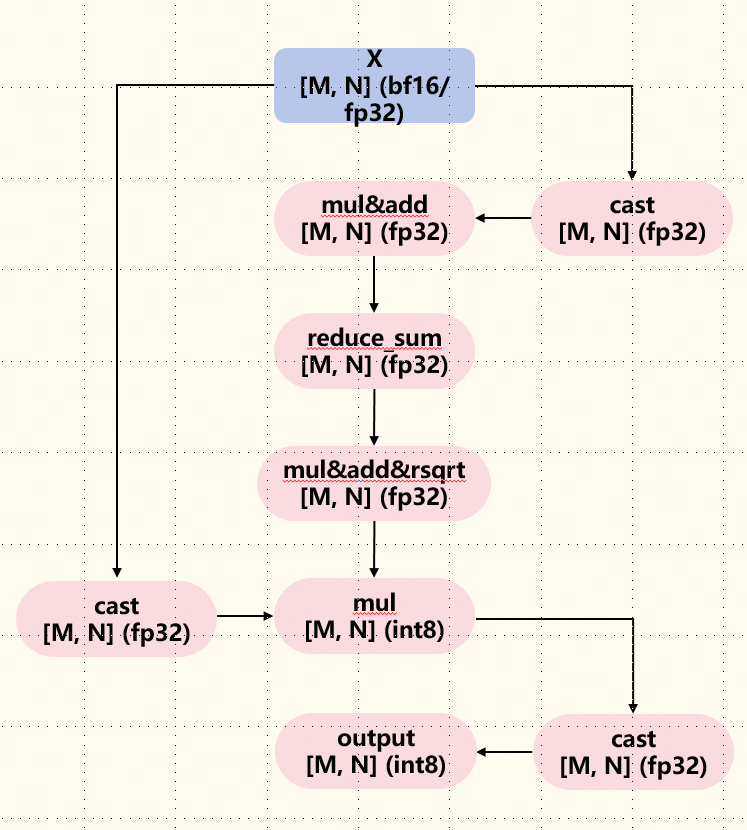
<center>rms_norm computation workflow</center>

Root Mean Square Layer Normalization (RMS Norm) is an efficient normalization operator. It omits the mean-centering operation in LayerNorm and performs normalization using only the variance. 

#### Algorithm Workflow

Analysis of typical input and output tensor dimensions for the operator:

- **A**: [M, N], input feature-matrix tensor.
- **B**: [M, N], normalized output feature-matrix tensor.
- **block_M / block_N**: Hyperparameters that specify row and column sizes for block-wise computation.
- **dtype**: Data type of the input and output.

**Computation workflow:**

##### 1. Precision alignment
- Memory allocation: Allocate the input buffer `a_ub`, computation buffer `a_ub_cast`, and intermediate-variable storage in the Unified Buffer.
- Precision determination: Determine `acc_dtype` based on `dtype` and determine whether precision conversion is required.
##### 2. Sum-of-squares accumulation
- Iterate over the column dimension by `block_N`, and use the `mul` and `add` operators to square feature values and accumulate them into `sum_sq_acc`:
  - `for by in T.serial(n_num): * ​T.tile.mul(a_ub_cast, a_ub_cast, a_ub_cast) * T.tile.add(sum_sq_acc, sum_sq_acc, a_ub_cast)`

##### 3. Reduction
- Perform row reduction (ReduceSum) on the sum-of-squares result to calculate the sum of squares of all column elements in each row. Store the reduction result in `sum_sq_row`.

##### 4. Calculating the reciprocal root mean square
- Mean calculation: Allocate the input buffer `a_ub`, computation buffer `a_ub_cast`, and intermediate-variable storage in the Unified Buffer.
- Numerical stability processing: Add `eps` to prevent a zero value during subsequent square root and division operations.
- Reciprocal square root calculation: Execute the `rsqrt` instruction to obtain the scaling factor `inv_rms_ub` for each row.

##### 5. Applying normalization and writing back the result
- After pre-broadcasting, iterate over the column dimension again and read the original input.
- Vector multiplication: Perform element-wise multiplication of `inv_rms_tile` and the input data to implement normalization:
  - `a_ub_cast = a_ub_cast * inv_rms_tile`
- Precision restoration and result write-back: Convert the computation result back to the original `dtype` and write back the result.


### 7. swiglu

#### **Overview**

SwiGLU (Swish-Gated Linear Unit) is an activation operator commonly used in Transformers and large models. It enhances feature representation through a gating mechanism. The operator splits the input tensor into two parts along a specified dimension. One part passes through the Swish (SiLU) activation function, while the other serves as the gating vector. The two parts are multiplied element-wise to produce the output.

The overall computation workflow of the swiglu operator is shown in the following figure:

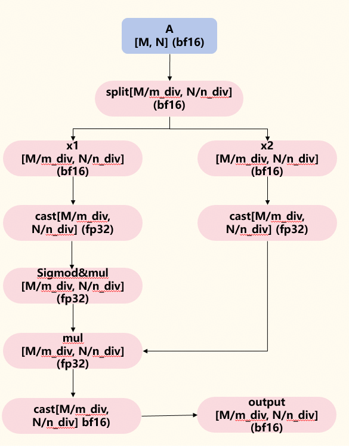
<center>swiglu computation workflow</center>

#### Algorithm Workflow

Analysis of typical input and output tensor dimensions for the operator:

- **A**: [M, N], input feature-matrix tensor.
- **B**: [M/m_div, N/n_div], output feature-matrix tensor.
- **block_M / block_N**: Hyperparameters that specify row and column sizes for block-wise computation.
- **split_dim**: Hyperparameter that specifies the partition dimension. By default, partitioning is performed by column. A value of 0 or -2 specifies row partitioning.
- **dtype**: Data type of the input and output.

**Computation workflow:**

##### 1. Block partitioning and parallel scheduling

- Partition the input tensor into multiple tiles by `(block_M, block_N)`: `block_id → (bx, by)`
- Each tile corresponds to:
   Row start: `row_start = bx * block_M`
   Column start: `col_start = by * block_N`
- Each core processes multiple tiles in a strided manner: `block_id = cid + i * NUM_CORES`
- Within each tile, further partition data along the row direction by `VEC_NUM=2`: `rows_per_vec = block_M / 2`

##### 2. Data loading (Global → UB)

For each tile:

- Load x1: `x1 = A[row_start, col_start]`
- Load x2 (implement the split through an offset): `x2 = A[row_start + m_offset, col_start + n_offset]`
   Column partitioning: `n_offset = N/2`
   Row partitioning: `m_offset = M/2`
- Data type conversion (optional)
   If the input is bf16/float16:
   `x1_ub = cast(x1 → float32)`
   `x2_ub = cast(x2 → float32)`
   Otherwise, directly use the original data.

##### 3. **Swish activation computation**

Swish(x1) = \frac{x1}{1 + e^{-x1}}
  In this stage, Swish is calculated element-wise in the UB.

1. Negate x1: `temp = 0 - x1` (`T.tile.sub`)
2. Calculate the exponential: `temp = exp(temp)` (`T.tile.exp`)
3. Add 1 to construct the denominator: `temp = temp + 1` (`T.tile.add`)
4. Calculate the reciprocal: `temp = reciprocal(temp)` (`T.tile.reciprocal`)
5. Multiply by the original x1: `swish = x1 * temp` (`T.tile.mul`)
    The entire process is completed in the UB without additional memory access.

##### **4. Gating computation (GLU)**

y=Swish(x1)⋅x2
  Multiply the Swish output and x2 element-wise: `result = swish * x2` (`T.tile.mul`)

##### **5. Writing back the result**

- If lower precision is required: float32 → bf16 (`T.tile.cast (CAST_RINT)`)
- Write back the output: `B[row_start, col_start] = result`

### 8. swiglu_grad

#### **Overview**

The SwiGLU Backward operator calculates gradients for the input tensor during forward propagation. Its core operation is differentiating the Swish activation function and combining it with the gating branch to calculate the gradients of the two components (x1 and x2).
The overall computation workflow of the swiglu_grad operator is shown in the following figure:
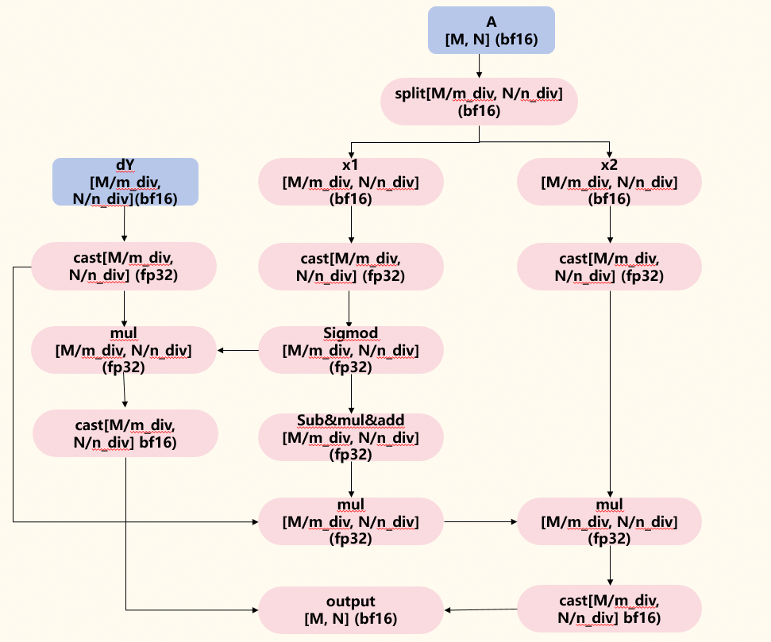
<center>swiglu_grad computation workflow</center>

#### Algorithm Workflow

Analysis of typical input and output tensor dimensions for the operator:

- **A**: [M, N], input feature-matrix tensor.
- **dY**: [M/m_div, N/n_div], upstream gradient.
- **dA**: [M, N], output gradient.
- **block_M / block_N**: Hyperparameters that specify row and column sizes for block-wise computation.
- **split_dim**: Hyperparameter that specifies the partition dimension. By default, partitioning is performed by column. A value of 0 or -2 specifies row partitioning.
- **dtype**: Data type of the input and output.

**Computation workflow:**

##### 1. Block partitioning and parallel scheduling

- Partition the input tensor into multiple tiles by `(block_M, block_N)`: `block_id → (bx, by)`
- Each tile corresponds to:
   Row start: `row_start = bx * block_M`
   Column start: `col_start = by * block_N`
- Each core processes multiple tiles in a strided manner: `block_id = cid + i * NUM_CORES`
- Within each tile, further partition data along the row direction by `VEC_NUM=2`: `rows_per_vec = block_M / 2`

##### 2. Data loading (Global → UB)

For each tile:

- Load x1: `x1 = A[row_start, col_start]`
- Load x2 (implement the split through an offset): `x2 = A[row_start + m_offset, col_start + n_offset]`
   Column partitioning: `n_offset = N/2`
   Row partitioning: `m_offset = M/2`
- Data type conversion (optional)
   If the input is bf16/float16:
   `x1_ub = cast(x1 → float32)`
   `x2_ub = cast(x2 → float32)`
   `dy_ub = cast(dy → float32)`
   Otherwise, directly use the original data.

##### **3. Calculating the Swish derivative**

The Swish calculation is the same as in forward computation:
 Swish(x1) = \frac{x1}{1 + e^{-x1}}
 Where:
 σ(x1​)=\frac{1}{1 + e^{-x1}}
 Swish derivative:
 Swish′(x1)=σ(x1)+x1⋅σ(x1)(1−σ(x1))
 First process x1 element-wise:

1. Calculate the negative value (for the exponential calculation): `temp = 0 - x1`
2. Calculate the exponential: `temp = exp(temp)`
3. Add 1 to construct the denominator: `temp = temp + 1`
4. Calculate the reciprocal to obtain sigmoid: `temp = reciprocal(temp)`. At this point, temp is `sigmoid(x1)`.

- Then multiply it by the original x1 to obtain the Swish output:
   `swish = x1 * sigmoid`
   This process corresponds to consecutive `exp / add / reciprocal / mul` Tile instructions.

##### **4. Calculating dx2**

Formula:
 `dx2=dy⋅Swish(x1)`

- First, multiply the swish result from the preceding step by the upstream gradient dy element-wise: `dx2 = dy * swish`
  This part is an element-wise multiplication corresponding to `T.tile.mul`.

##### **5. Calculating dx1**

Formula:
 `dx1=dy⋅x2⋅Swish′(x1)`

- First, multiply the upstream gradient by gating branch x2: `dx1 = dy * x2`
- Then multiply by the Swish derivative: `dx1 = dx1 * swish_grad`
  This operation is essentially two consecutive element-wise multiplications corresponding to two `T.tile.mul` instructions.

##### **6. Writing back the result**

As in the forward operation, perform data type conversion through `cast` if necessary.

- Write dx1 back to the position corresponding to x1:
   `dA[row_start, col_start] = dx1`
- Write dx2 back to the position corresponding to x2 (with an offset):
   `dA[row_start + m_offset, col_start + n_offset] = dx2`


## Future Plan
### Usability Improvements
- Support a more complete set of NPU operators: Support all common NPU operators (Q4 2025)
### Generalization Enhancements
- Support dynamic shapes and full-network integration (Q4 2025)
- Add more configurable parameters to primitives
### Performance Optimization
- Optimize the performance of key operators: Further optimize the performance of the SparseFlashAttention and LightningIndexer operators so that typical-shape performance surpasses Triton (Q4 2025)
<!-- static-meta
{
  "sidebarTitle": "TileLang Operators",
  "operator": [
    "tilelang"
  ],
  "hardware": [
    "atlas-a3"
  ],
  "frameworks": [
    "cann-recipes",
    "torchtitan"
  ],
  "llmSpeculativeInference": [
    "none"
  ]
}
-->
