# NPU DeepSeek-V4 Ascend C Fused Operator Optimization


For the DeepSeek-V4 architecture, this release introduces two new fused operators, `SparseAttnSharedKV` (SAS) and `Compressor`, and enhances the capabilities of `LightningIndexer` (LI). The `SparseAttnSharedKV` operator is designed for the Attention module in the new DeepSeek architecture. It covers multiple FlashAttention application scenarios with SharedKV, including Sliding Window Attention, Compressed Attention, Sparse Attention, and their combinations. The computation workflow and core functions of the `LightningIndexer` operator remain unchanged. For $KV$ compression scenarios, it adapts the corresponding mask calculation method and uses the histogram API on 950PR/DT to accelerate Top-$k$ computation. The `Compressor` operator targets the complex compression algorithm in the new architecture and implements a series of originally separate operations as an efficient fused operator.

All three operators support both the Atlas-A3 and 950PR/DT platforms and adapt to FP8 quantization mode on 950PR/DT to further improve CANN operator support for different data types.

<figure align = "center">
    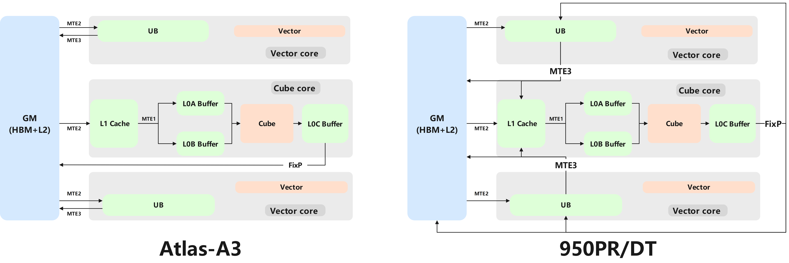
</figure>

## Highlights

- The fused operators are open-sourced for both Atlas-A3 and 950PR/DT, strengthening Ascend chip support for the low-precision FP8 floating-point type.
- Fuse the complex Compressor computation workflow while supporting different compression methods.
- Enhance the `LightningIndexer` operator and use new 950PR/DT instructions to improve operator performance.
- Use a unified interface design so that the `SparseAttnSharedKV` operator covers multiple Attention computation scenarios.
- Separate the value-dependent Scheduler computation into an AICPU Scheduler operator for more flexible use and adaptation to different graph modes.
- Use a staged core-partitioning strategy to fully use hardware computing resources.

## Outline

- [NPU DeepSeek-V4 Ascend C Fused Operator Optimization](#npu-deepseek-v4-ascend-c-fused-operator-optimization)
  - [Highlights](#highlights)
  - [Outline](#outline)
  - [Overall DeepSeek-V4 Attention Architecture](#overall-deepseek-v4-attention-architecture)
  - [Compressor](#compressor)
    - [Formula](#formula)
    - [Tiling Design](#tiling-design)
    - [Offset Write](#offset-write)
  - [LightningIndexer](#lightningindexer)
    - [Formula](#formula-1)
    - [Tiling Design](#tiling-design-1)
    - [Top-k Solution on 950PR/DT](#top-k-solution-on-950prdt)
  - [SparseAttnSharedKV](#sparseattnsharedkv)
    - [Formula](#formula-2)
    - [Tiling Design](#tiling-design-2)
    - [Multi-Scenario Coverage](#multi-scenario-coverage)
  - [AICPU Scheduler](#aicpu-scheduler)
    - [AICPU Scheduler Operator](#aicpu-scheduler-operator)

## Overall DeepSeek-V4 Attention Architecture


<figure align = "center">
    
    <figcaption> DeepSeek-V4 Attention Module </figcaption>
</figure>

DeepSeek-V4 uses a single shared $K,V$ set, that is, Shared Key-Value Attention, adopts Attention Sink, and introduces a complex interleaved Hybrid Attention architecture. Attention modules in different layers use different computation modes and are divided into three categories based on each layer's compress ratio:
- C1A: The first two layers are C1A layers and only involve Sliding Window Attention computation on the original $KV$. Each token is computed only with the original $KV$ cache corresponding to the adjacent 128 tokens.
<figure align = "center">
    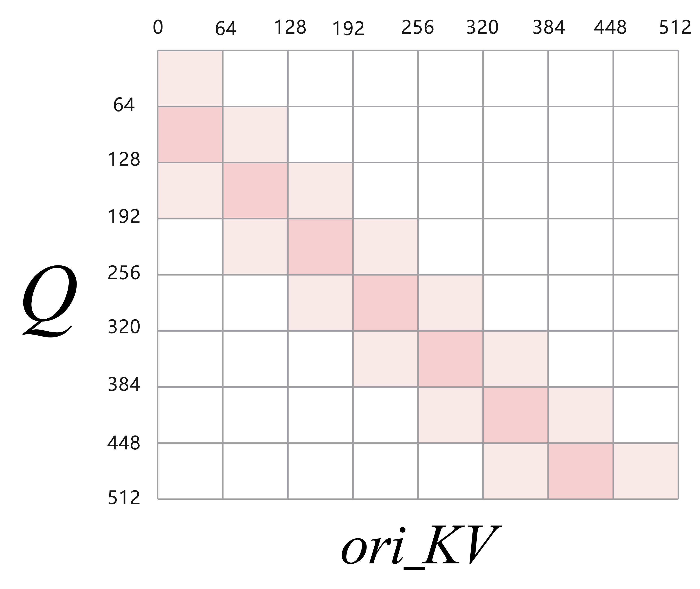
    <figcaption> C1A-Attention </figcaption>
</figure>

- C4A: Odd-numbered layers except the first layer are C4A layers. In addition to Sliding Window Attention computation with a window size of 128 on the original $KV$ (ori_KV), Attention in C4A layers also involves sparse computation with compressed $KV$ (cmp_KV). cmp_KV is compressed based on the semantics of every four tokens and their preceding four tokens.
<figure align = "center">
    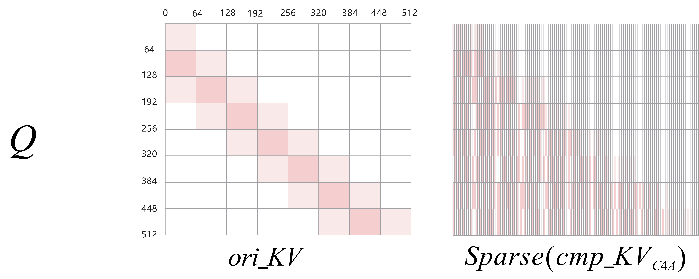
    <figcaption> C4A-Attention </figcaption>
</figure>

- C128A: Even-numbered layers except the second layer are C128A layers. In addition to Sliding Window Attention computation with a window size of 128 on the original $KV$ (ori_KV), Attention in C128A layers also involves dense computation with compressed $KV$ (cmp_KV). cmp_KV is compressed based on the semantics of every 128 tokens.
<figure align = "center">
    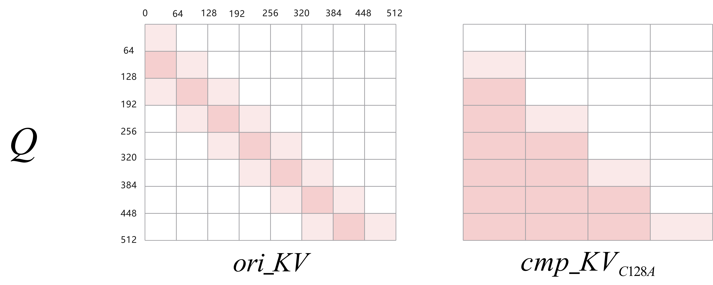
    <figcaption> C128A-Attention </figcaption>
</figure>

In C4A and C128A layers, the input hidden state generates ori_KV and cmp_KV through a series of computations. The cmp_KV computation workflow is complex and differs between the C4A and C128A scenarios. We designed this part of the computation as a `Compressor` fused operator on Atlas-A3 and 950PR/DT, supporting the computation workflows in different scenarios and achieving good performance.

C4A layers further sparsify cmp_KV. Continuing the DeepSeek-V3.2 design, this sparsification is based on `LightningIndexer`. The `LightningIndexer` fused operator released here adapts the staircase-shaped mask calculation logic corresponding to the compress ratio based on the original Atlas-A3 operator and adapts a fully FP8-quantized version on 950PR/DT.

Because Attention computation differs across layers, multiple scenarios are involved. For the core Attention computation in DeepSeek-V4, we designed a new unquantized `SparseAttnSharedKV` operator on Atlas-A3 and a pseudo-quantized `SparseAttnSharedKV` operator on 950PR/DT, both supporting Attention Sink. A single interface covers different functional requirements.


## Compressor

DeepSeek-V4 uses a new attention architecture: Compress-4-Attention (C4A) and Compress-128-Attention (C128A). Specifically, every 4 or 128 tokens in the $KV$ cache are compressed into one, and each token then performs Attention computation with these compressed $KV$ caches. For long sequences, C4A and C128A effectively reduce computation overhead.

### Formula

**C4A Layer**

The Compressor in a C4A layer contains the following series of computation operations. Given input $X\in \mathbb{R}^{s\times h}$, where $s$ is the sequence length and $h$ is the hidden size, first calculate its two corresponding $KV$ inputs $C^a, C^b \in \mathbb{R}^{s \times d}$ and compression weights $Z^a, Z^b \in \mathbb{R}^{s \times d}$, where $d$ is the head dimension. The formulas are as follows:

$$
\begin{aligned}
C^a&=X\cdot W^{aKV}, C^b=X\cdot W^{bKV}, \\
Z^a&=X\cdot W^{aGate}, Z^b=X\cdot W^{bGate},
\end{aligned}
$$

Here, $W^{aKV}, W^{bKV}, W^{aGate}, W^{bGate} \in \mathbb{R}^{h \times d}$ are the KV and compression-weight parameters corresponding to C4A.

Every four KV entries in the KV sequences $C^a, C^b$ of length $s$ are compressed into one
$C^{\text{Comp}} \in \mathbb{R}^{\frac{s}{4} \times d}$. The formula for its $i$-th row $C_{i}^{\text{Comp}} \in \mathbb{R}^{1 \times d}$ is as follows:

$$
\begin{aligned}
C_{i}^{\text{Comp}}
&= \frac{\sum_{j=4i}^{4(i+1)-1}{e^{Z_j^a+B_{j-4i}}} \odot C^a_j + \sum_{j=4(i+1)}^{4(i+2)-1}{e^{Z_j^b+B_{j-4i}}} \odot C^b_j}{\sum_{j=4i}^{4(i+1)-1}{e^{Z_j^a+B_{j-4i}}} + \sum_{j=4(i+1)}^{4(i+2)-1}{e^{Z_j^b+B_{j-4i}}}} \\
&= \left[1\right]_{1\times8} @ (softmax(\left[Z^a_{\left[4(i-1)+1:4i,:\right]} ; Z^b_{\left[4i+1:4(i+1),:\right]}\right] + B) \odot \left[C^a_{\left[4(i-1)+1:4i,:\right]} ; C^b_{\left[4i+1:4(i+1),:\right]}\right])
\end{aligned}
$$

Here, $B \in \mathbb{R}^{8 \times d}$ is the positional biases corresponding to $C^a, C^b$.

<figure align = "center">
    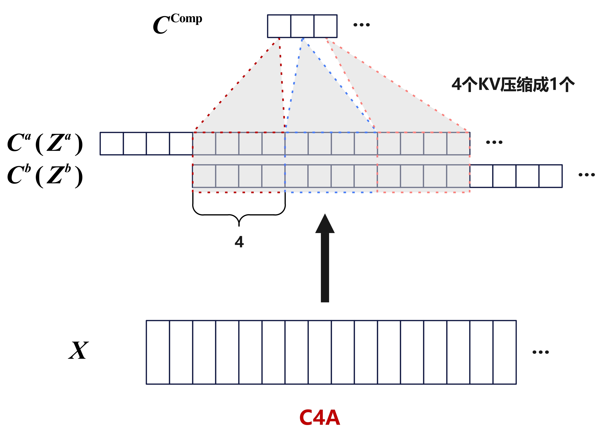
    <figcaption> C4A Diagram </figcaption>
</figure>

**C128A Layer**
Compared with C4A, the Compressor in a C128A layer compresses the KV sequence at a higher compression ratio and depends only on a single KV sequence $C \in \mathbb{R}^{s \times d}$ and compression weight $Z \in \mathbb{R}^{s \times d}$, where:
$$
\begin{aligned}
C&=X\cdot W^{KV}, \\
Z&=X\cdot W^{Gate}
\end{aligned}
$$
$W^{KV}, W^{Z}$ are the KV and compression-weight parameters corresponding to C128A.

Every 128 $KV$ entries in the KV sequence $C$ of length $s$ are then compressed into one $C^{\text{Comp}} \in \mathbb{R}^{\frac{s}{128} \times d}$. Its $i$-th row is:

$$
\begin{aligned}
C_{i}^{\text{Comp}}
&= \frac{\sum_{j=128i}^{128(i+1)-1}{e^{Z_j+B_{j-128i}}} \odot C_j}{\sum_{j=128i}^{128(i+1)-1}{e^{Z_j+B_{j-128i}}}} \\
&= \left[1\right]_{1\times128} @ (softmax(Z_{\left[128(i-1)+1:128i,:\right]} + B) \odot C_{\left[128(i-1)+1:128i,:\right]})
\end{aligned}
$$

$i = 1, \cdots, \frac{s}{128},$ where $B \in \mathbb{R}^{128 \times d}$ is the positional biases corresponding to $C$.

<figure align = "center">
    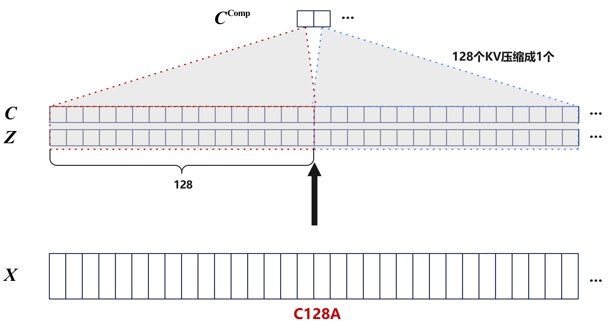
    <figcaption> C128A Diagram </figcaption>
</figure>

**Detailed Computation Workflow**

`Compressor` first compresses $r (r=4 \text{ or } 128)$ $KV$ entries into one and then postprocesses the compressed $KV$ through RMSNorm and Partial RoPE. Each stage is calculated as follows:

Compression stage:
1. Calculate matrix multiplication:
    - C4A: $\left[C^a, Z^a\right] = X @ \left[W^{aKV}, W^{aGate}\right], \left[C^b, Z^b\right] = X @ \left[W^{bKV}, W^{bGate}\right];$
    - C128A: $\left[C, Z\right] = X @ \left[W^{KV}, W^{Gate}\right]$
2. Calculate grouped addition:
    - C4A: $Z_i^\prime = \left[Z_{\left[4(i-1)+1:4i,:\right]}^a; Z_{\left[4i+1:4(i+1),:\right]}^b\right]+B,~i=1,2,\cdots, \frac{s}{4};$
    - C128A: $Z_i^\prime = Z_{\left[128(i-1)+1:128i,:\right]} + B,~i=1,2,\cdots, \frac{s}{128};$
3. Calculate grouped Softmax:
    - C4A: $S_i^\prime = softmax(Z_i^\prime),~i=1,2,\cdots, \frac{s}{4};$
    - C128A: $S_i^\prime = softmax(Z_i^\prime),~i=1,2,\cdots, \frac{s}{128};$
4. Calculate the Hadamard product:
    - C4A: $(S_H)_i = S_i^\prime \odot \left[C^a_{\left[4(i-1)+1:4i,:\right]} ; C^b_{\left[4i+1:4(i+1),:\right]}\right],~i=1,2,\cdots, \frac{s}{4};$
    - C128A: $S_H = S^\prime \odot C;$
5. Sum by group along the compression axis:
    - C4A: $C_{i}^{\text{Comp}} = \left[1\right]_{1\times8} @ (S_H)_i, ~i=1,2,\cdots, \frac{s}{4};$
    - C128A: $C_{i}^{\text{Comp}} = \left[1\right]_{1\times128} @ (S_H)_i, ~i=1,2,\cdots, \frac{s}{128};$

Postprocessing stage:
1. Calculate RMSNorm.
2. Calculate Partial RoPE.

**Fusion Benefits**

<figure align = "center">
    
    <figcaption> Compressor Computation Workflow</figcaption>
</figure>

As shown in the preceding computation workflow, Compressor contains many non-computational vector operations, such as `split` and `slice`. Implementing them as small operators would introduce large amounts of unnecessary repeated data movement in and out, resulting in extremely poor performance. A fused-operator implementation can perform these operations inline during data movement, substantially reducing the latency of the Compressor component.

In the figure, `coff` is 1 in a C128A layer and 2 in a C4A layer. `coff=2` means that the semantics of two adjacent groups of tokens are required for compression. Therefore, the Compressor in a C4A layer introduces a complex data-rearrangement operation:

<figure align = "center">
    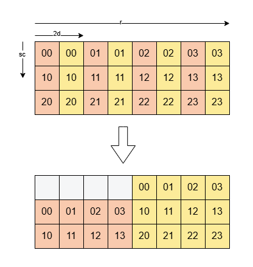
    <figcaption> C4A Compressor Data Rearrangement</figcaption>
</figure>

As shown in the preceding figure, the Compressor in a C4A layer introduces a complex data-rearrangement operation. After each token is mapped to two vectors of size $d$ (the red and yellow blocks in the figure), the yellow-block vectors corresponding to every four tokens and the red-block vectors corresponding to the preceding four tokens are rearranged into contiguous storage. Implementing this operation separately with small operators would also introduce many non-computational vector operations. In this fused operator, this data rearrangement is implemented efficiently. For details, see [Offset Write](#offset-write).

### Tiling Design
**Atlas-A3**
Operator Tiling on Atlas-A3 is as follows:

For C128A:
- L1 space is divided into the following parts:
    - $X$ matrix: $2 \times 256 \times 256 \times 2 \text{ Bytes}=256 \text{ KB}$. The basic L1-level block is $(256, 256)$.
    - $W^{KV}, W^{Gate}$ matrices: $2 \times 256 \times 64 \times 2 \text{ Bytes}=64 \text{ KB}$. The basic L1-level block is $(256, 128)$. Each iteration moves in two $(256, 64)$ matrix blocks for each of $W^{KV}$ and $W^{Gate}$.
- L0A and L0B enable double buffering and are divided into $2\times32\text{ KB}$ and $2\times32\text{ KB}$, respectively. The matrix block moved into each of L0A and L0B at a time has a size of $(128,128)$. L0C enables double buffering and is divided into $2\times64\text{ KB}$ to store the multiplication results of one $X$ block and the $W^{KV}, W^{Gate}$ matrices, which are accumulated in L0C.


For C4A:
- L1 space is divided into the following parts:
    - $X$ matrix: $128 \times 256 \times 2 \text{ Bytes}=64 \text{ KB}$. The basic L1-level block is $(128, 256)$.
    - $W^{KV}, W^{Gate}$ matrices: $4 \times 256 \times 64 \times 2 \text{ Bytes}=128 \text{ KB}$. The basic L1-level block is $(256, 128)$. Each iteration moves in one $(256, 64)$ matrix block for each of $W^{aKV}$, $W^{bKV}$, $W^{aGate}$, and $W^{bGate}$.
- L0A and L0B enable double buffering and are divided into $2\times32\text{ KB}$ and $2\times32\text{ KB}$, respectively. The matrix block moved into each of L0A and L0B at a time has a size of $(128,128)$. L0C enables double buffering and is divided into $2\times64\text{ KB}$ to store the multiplication results of two $X$ blocks and one KV+Gate matrix, which are accumulated in L0C.

<figure align = "center">
    
    <figcaption> On-Core Compressor Tiling on Atlas-A3 </figcaption>
</figure>


After matrix multiplication is completed on this basic block and accumulated along the reduce axis, the data is evenly distributed to two Vector cores for subsequent Vector operations.

**Decode**
During Decode, to resolve the inability to partition cores along the $s$ axis, further partition the $d$ axis from $64$ to $32$ to increase the number of started cores and bandwidth utilization.

**Basic-Block Cost Model**
Selecting the basic block is critical to operator design. An appropriate Tiling strategy must be determined through theoretical calculations based on hardware parameters:

To overlap the time required to move the left or right matrix during one basic-block iteration with the corresponding computation time, the movement time must not exceed the computation time, that is:
$$
\frac{(baseM + baseN) \times baseK \times 2 \text{ Bytes}}{\text{Bandwidth}} \leq \frac{baseM \times baseN \times baseK}{4096}
$$
Cancel $baseK$ from both sides.

- For Atlas-A3, select $(baseM, baseN, baseK)=(256, 128, 512)$ in C128A and $(baseM, baseN, baseK)=(128, 256, 512)$ in C4A. The selection of $baseK$ primarily considers Ascend-friendly Cacheline alignment to improve movement efficiency.
- For 950PR/DT, considering L0A and L0B capacity constraints, $baseM=baseN=baseK=256$ can satisfy the condition.

### Offset Write
When calculating C4A, note that the indices used by $Z^b, C^b$ to calculate $C_{i}^{\text{Comp}}$ overlap the indices used by $Z^a, C^a$ to calculate $C_{i+1}^{\text{Comp}}$. Offset write is used here to implement this processing.

As shown in the following figure, after the preceding matrix multiplication is complete, an additional address offset is specified when the red computation results are written to the destination address. This aligns the red and yellow computation results. The data required from state_cache can then be read into the UB for subsequent vector computation directly.

<figure align = "center">
    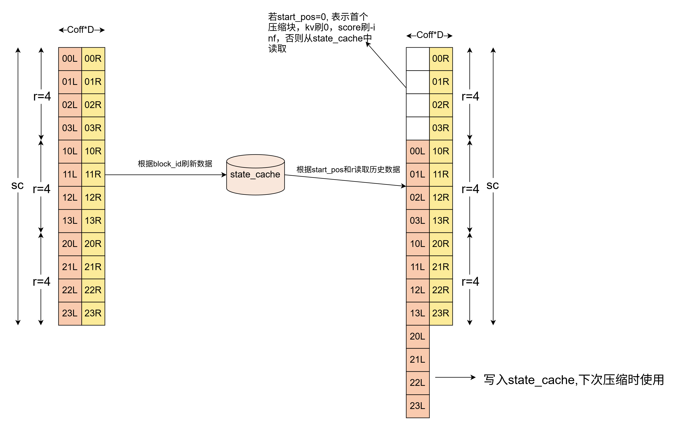
    <figcaption> Offset Write </figcaption>
</figure>

## LightningIndexer

### Formula
`LightningIndexer` obtains the Top-$k$ positions corresponding to each token through a series of operations. Ignoring the batch axis, for Query's $Q_{index}\in\R^{n \times S_q \times d}$, given context Index Key $K_{index}\in\R^{S_{k}\times d},W\in\R^{n \times S_q\times 1}$, where $n$ is the number of heads, $d$ is the dimension of each head, $S_{q}$ is the number of requests, and $S_{k}$ is the context length, the formula for `LightningIndexer` is as follows:
$$
\text{Top-}k\left\{[1]_{1\times n}@_n\left[(W@_{1}[1]_{1\times S_{k}})\odot\text{ReLU}\left(Q_{index}@_{d}K_{index}^T\right)\right]\right\}
$$

Here, $Q_{index}$ and $K_{index}$ are assumed to be quantized FP8 (E4M3) matrices. During quantization, a dequantization coefficient is obtained for each head and each token and is expressed in matrix form as $Scale_q \in\R^{n \times S_q\times 1}$ and $Scale_k \in \R^{S_k \times 1}$.

`LightningIndexer` can be divided into the following computation workflow (where $@_{d}$, $@_{1}$, and $@_{n}$ represent multiplication along the $d$, $1$, and $n$ dimensions, respectively, and $\odot$ represents element-wise multiplication):
1. Calculate matrix multiplication on the quantized matrices: $S = Q_{index}@_{d} K_{index}^T$.
2. Calculate the activation function: $S'=\text{ReLU}(S)$.
3. W absorbs the dequantization coefficient $Scale_q$: $W' = Scale_q \odot W$.
4. Calculate broadcast multiplication: $S_W=(W' @_{1}[1]_{1\times S_{k}})\odot S'$.
5. Perform ReduceSum over the heads: $Score=[1]_{1\times n}@_{n} S_W$.
6. Broadcast and multiply by the dequantization coefficient: $Score = (Scale_k @_{1}[1]_{1\times S_{q}})^T \odot Score$.
7. Perform $\text{Top-}k$ computation on $Score$, obtain the first $k$ results in value order, and return their corresponding Indices.

In Prefill or Decode scenarios with MTP enabled, the $Q_{index}$ values corresponding to multiple tokens are merged for unified computation. The following sections do not distinguish between $Q_{index}$ corresponding to one or multiple tokens.

In actual development, Ascend hardware features must be fully used to achieve better performance. The following sections describe the current solution and implementation in detail.

<div align="center">
    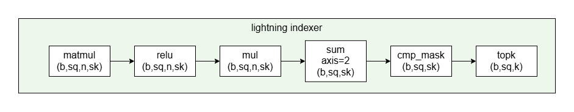
    <figcaption> Lightning Indexer Computation Workflow </figcaption>
</div>

### Tiling Design

**Atlas-A3**
The Tiling of `LightningIndexer` on Atlas-A3 follows the previous design. For details, see [Atlas-A3 LightningIndexer](../../deepseek_v3_2_exp/en/deepseek_v3.2_exp_ascendc_operator_guide.md#lightningindexer).

### Top-k Solution on 950PR/DT
The core function of the `LightningIndexer` fused operator is to efficiently select the $k$ highest-scoring indices, such as 512, for each token from a sequence containing hundreds of thousands of entries (the sequence length is denoted by $S_{k}$). For the operator, Top-$k$ computation must also be exact and cannot use an approximate algorithm.

An Ascend-friendly solution is to use the Histograms instruction on 950PR/DT. This instruction performs histogram statistics on a group of uint8 numbers. In one cycle, it can place 64 numbers into buckets 0-127 or 128-255. Based on this approach and using one Query as an example, the core algorithm for selecting Top-$k$ from $S_{k}$ float-type Scores using the Histograms instruction is summarized as follows:

**Order-Preserving Transformation**
Assume that $x$ is the binary representation of floating-point number $f$, and $\text{convert}(f)$ is the transformed uint32 value. The following order-preserving transformation algorithm can be used:
```c
uint32_t mask = (x&0x80000000)?0xffffffff:0x80000000;
return (f==f)?(x^mask):0x0;
```
This is equivalent to the following piecewise function:
$$
\text{convert}(f) =
\begin{cases}
0 & \text{if}\ f\ \text{is nan}\\
2^{32}-1-x (\equiv \sim x) & \text{if}\ x\ \geq 2^{31} (\text{i.e.}\ f < 0) \\
x + 2^{31} (\equiv x \oplus 2^{31}) & \text{if}\ x < 2^{31} (\text{i.e.}\ f \geq 0)
\end{cases}
$$
If the Score input is of the bfloat16 type, a similar method can convert it to uint16.

**Multi-Level Histogram Bucketing**
Using uint32 as an example, this section describes an Ascend-friendly multi-level histogram bucketing method. First, divide the 32 bits of uint32 from high to low into four 8-bit segments, each treated as uint8. For two uint32 numbers a and b, let the uint8 values formed by their highest 8 bits be a_8 and b_8, respectively. If a_8 < b_8, then a < b. Based on this principle, each 8-bit segment of the Top-$k$ value can be located separately.

<figure align = "center">
    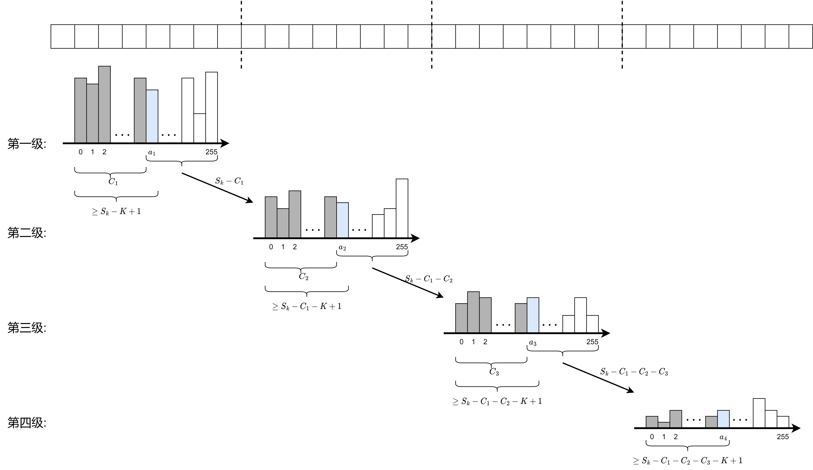
    <figcaption> uint32 Example; uint16 Requires Only Two-Level Histograms</figcaption>
</figure>

As shown in the figure, the multi-level histogram workflow for selecting the Top-$k$ value is as follows:
1. For all uint32 elements, extract the first 8 bits from high to low and use the `hist` instruction to create a histogram. The returned result is an array Array_1 of length 256, where the $i$-th value represents the sum of the numbers in buckets 0 through $i$.
2. Compare the values in Array_1 with the threshold $S_k-k+1$. Positions greater than or equal to $S_k-k+1$ are true. The first true bucket in ascending order is the bucket containing the Top-$k$ element (the blue part in the figure), denoted by $a_1$. Elements whose first 8 bits are less than $a_1$ can now be masked out (the gray part in the figure). These elements are discarded. Let the number discarded in this step be $C_1$ ($C_1 < S_k-k$).
3. For the remaining $S_k - C_1$ elements, extract the second 8-bit segment and create a histogram. Repeat steps 1-2 to select the threshold bucket $a_2$, discard elements whose second 8-bit segment is less than $a_2$, and count the number discarded in this step as $C_2$.
4. For the remaining $S_k - C_1 - C_2$ elements, extract the third 8-bit segment and create a histogram. Repeat steps 1-2 to select the threshold bucket $a_3$, discard elements whose third 8-bit segment is less than $a_3$, and count the number discarded in this step as $C_3$.
5. For the remaining $S_k - C_1 - C_2 - C_3$ elements, extract the fourth 8-bit segment and create a histogram. Repeat steps 1-2 to select the threshold bucket $a_4$.

The $k$-th largest value is therefore:
$$
value_k = a_1 \times 2^{24} + a_2 \times 2^{16} + a_3 \times 2^{8} + a_4
$$

**Vectorized Selection**
The $k$-th largest value, $value_k$, has now been obtained. Only values greater than or equal to $value_k$ need to be considered. The overall workflow is as follows:
1. Values greater than $value_k$: In a vectorized manner, compare the values in the original sequence with $value_k$ in units of 256 B to obtain a mask. Positions greater than $value_k$ are true. Use this mask to select all indices corresponding to values greater than $value_k$ and gather them into $result$. The count is now less than $k$.
2. Values equal to $value_k$: Iterate over all $Score$ values in units of 256 B, locate and select values equal to $value_k$, and exit the loop when the total number of entries in $result$ equals $k$.

**Implementation Instructions and Theoretical Overhead**
Using uint32 as an example, assume that the sequence length is $S_k=16384$ and the selected Top-$k$ is $512$. The implementation instructions and theoretical overhead of the Top-$k$ component are as follows:
1. `hist1`: Use `DeInterleave` to deinterleave and extract the first 8-bit segment, and use the histogram instruction `hist` for bucketing. One `hist` instruction processes 64 numbers per cycle, and two instructions are required to process 0-127 and 128-255 separately. During implementation, process groups of $256$ numbers in a loop. Each group requires 8 cycles for the histogram. Including approximately 10 cycles of initialization and other overhead, the total is $(S_k/256 * 9 + 10)$ cycles.
2. `find1`: For the result of `hist1`, compare each group of 64 buckets with threshold $S_k-k+1$, concatenate the comparison results using the `gather` mode of `squeeze`, and calculate the new threshold. The overhead is approximately $(4*7 + 10)$ cycles.
3. `hist2`: Compared with `hist1`, add one `Compare` in each loop iteration. The total overhead is approximately $(S_k/256 * 10 + 10)$ cycles.
4. `find2`: Same as `find1`, with an overhead of $(4 * 7 + 10)$ cycles.
5. `hist3`: Compared with `hist1`, in addition to adding two `Compare` operations and one `And` operation in each loop iteration, add one `DeInterleave` to deinterleave and extract the third 8-bit segment. Therefore, the total overhead is approximately $(S_k/256 * 13 + 10)$ cycles.
6. `find3`: Same as `find1`, with an overhead of $(4 * 7 + 10)$ cycles.
7. `hist4`: Compared with `hist1`, add one `DeInterleave`, three `Compare` operations, and two `And` operations. The estimated overhead is $(S_k/256 * 15 + 10)$ cycles.
8. `findKth`: Calculate the threshold Top-$k$ value $value_k$. The overhead is essentially the same as `find1`, for a total of $(4 * 7 + 10)$ cycles.
9. `findGTO`: Process groups of 64 uint32 values, perform `Compare` and `squeeze`, and extract the indices corresponding to values greater than $value_k$. The total is approximately $S_k/64*7$ cycles.
10. `findEQ`: Process groups of 64 uint32 values, perform `Compare` and `squeeze`, and sequentially extract the indices corresponding to values equal to $value_k$ until $k$ entries have been selected. The total is $S_k/64*9$ cycles.

Adding all the preceding overhead, using multi-level histograms and vectorized selection on 950PR/DT has an estimated theoretical overhead of $(S_k/256*111+192)$ cycles. When $S_k=16384$, the theoretical overhead is 7296 cycles.

By comparison, for the same $S_k$ and $k$, the Atlas-A3 implementation based on sort32 and mrgsort ([Atlas-A3 LI Top-k Instruction Implementation](../../deepseek_v3_2_exp/en/deepseek_v3.2_exp_ascendc_operator_guide.md#top-k-instruction-implementation)) requires $
(1.36S_k+3.32k+\lceil\frac{max(log_2(k)-5,0)}{2}S_k \rceil)/2
$ cycles of theoretical overhead. When $S_k=16384, k=512$, the overhead is approximately 28375 cycles.

## SparseAttnSharedKV

### Formula
The `SparseAttnSharedKV` operator performs Attention computation in the following form:
$$O = \text{softmax}(Q@\tilde{K}^T \cdot \text{softmax\_scale})@\tilde{V}$$
Here, $\tilde{K}=\tilde{V}$ is the $KV$ that actually participates in computation as controlled by input parameters. Adapted to the new Attention architecture of DeepSeek-V4, this operator supports Sliding Window Attention, Compressed Attention (and sparsification based on it), and combinations of the two.

The `SparseAttnSharedKV` operator is released for both Atlas-A3 and 950PR/DT. Atlas-A3 uses an unquantized version, where the input $Q,KV$ are both half-precision. The operator computation workflow is divided into the following four stages:
- $C_1$：$Q@K^T$；
- $V_1$：online softmax；
- $C_2$：$P@V$；
- $V_2$: rescaling $O$.

950PR/DT uses a pseudo-quantized version, where the input $KV$ has been quantized to 8 bits. A new $V_0$ stage is added at the beginning of the operator computation workflow to dequantize $KV$, resulting in a five-stage workflow.

### Tiling Design

Because Atlas-A3 and 950PR/DT use different chip architectures, different Tiling strategies are used.

**Atlas-A3**

<div align="center">
    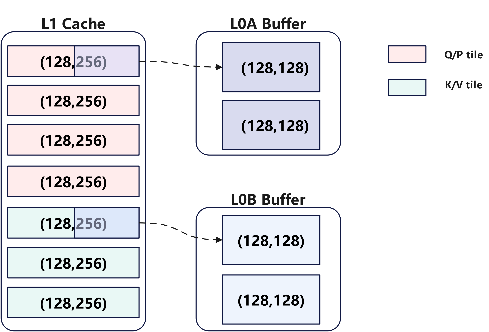
</div>

The basic block size calculated in one iteration is (256,512), which completes computation over length 256 along the $Q$ sequence direction and length 512 along the $KV$ sequence direction. In actual scenarios, such as sparse computation in C4A layers, different $Q$ values cannot be merged along an axis and can only be computed together within one Group. Therefore, the actual basic block size calculated in one iteration may be (64,512), but this does not affect the overall Cache partitioning.

The on-core operator Tiling design is as follows:

- L1 space is divided into the following parts:
  - $Q/P$ matrices use time-division multiplexing ($P$ is the result of softmax computation): 4×128×256×2 Bytes=256 KB. During a $C_1$ or $C_2$ stage, the left matrix is moved into L1 in four batches and remains resident in L1 for one iteration. The movement size of the $Q$ matrix each time is (128,256), and that of the $P$ matrix is (128,256).
  - $K/V$ matrices use cyclic 3-Buffer reuse: 3×128×256×2 Bytes=192 KB. The movement size of the $K$ matrix each time is (128,256), and that of the $V$ matrix is (256,128).
- L0A, L0B, and L0C enable Double Buffering and are divided into $2\times32\text{ KB}$ KB, $2\times32\text{ KB}$, and $2\times64\text{ KB}$, respectively. In the $C_1$ / $C_2$ stage, the matrix blocks moved into L0A and L0B at a time have sizes of (128,128) and (128,128), respectively.

### Multi-Scenario Coverage

The `SparseAttnSharedKV` operator implements Attention computation for different scenarios through multiple input-parameter combinations. The key input parameters are:

- ori_kv: Original $KV$ cache corresponding to SWA.
- ori_win_left, ori_win_right: Range along the sequence axis of the key-value entries participating in sliding window attention. Assume that $t$ is the sequence id of the query. The sequence id range of the participating key/value entries is $t - \text{win\_left}, t - \text{win\_left} + 1, ..., t, ..., t + \text{win\_right}$.
- cmp_kv: Compressed $KV$ cache of C4A and C128A layers.
- cmp_ratio: Compression ratio of $KV$ in cmp_kv.

The preceding input parameters can be combined as follows to perform Attention computation for different scenarios in DeepSeek-V4:
<figure align = "center">
    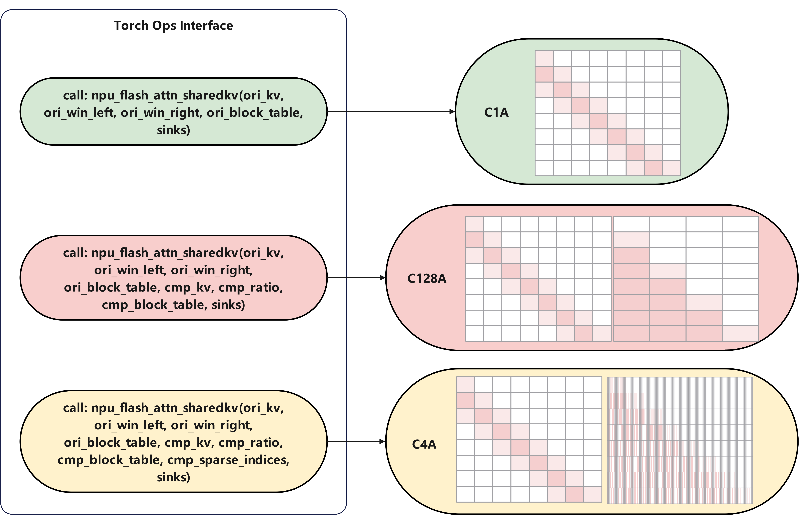
</figure>

## AICPU Scheduler

The Scheduler's core function is to statically simulate and control the execution flow. By preallocating global-memory space, locking execution branches, and optimizing the core-partitioning strategy, this mechanism effectively eliminates runtime overhead, keeps the instruction pipeline saturated, and substantially improves hardware throughput.

### AICPU Scheduler Operator

For value-dependent operators such as Attention and LI, input shape information alone cannot produce a good core-partitioning strategy. The **actual context length** must also be obtained at runtime. A conventional Scheduler implementation must return to the HOST for execution, interrupting the overall execution pipeline. Calculating the core-partitioning strategy directly in the operator kernel prevents this computation latency from being overlapped and introduces substantial initial overhead. Ascend chips contain several ARM compute cores (AICPU). Running this Scheduler computation on AICPU ensures that the operator can be included in a graph and that this latency can be overlapped.

This release also provides AICPU Scheduler operators corresponding to `SparseAttnSharedKV` and `LightningIndexer`: [SAS AICPU Scheduler](https://gitcode.com/cann/ops-transformer/tree/master/experimental/attention/sparse_attn_sharedkv_metadata) and [LI AICPU Scheduler](https://gitcode.com/cann/ops-transformer/tree/master/experimental/attention/quant_lightning_indexer_metadata).

The entire Scheduler process can now be divided into two parts:
- Calculations that require only the input shape:
  - Maximum global-memory usage, max workspace: Used to allocate sufficient device space for the operator in advance.
  - Specific execution path, tiling key: Determines the actual compiled operator template.
  - Number of enabled cores, block dim: Determines the core-start configuration.
  - tiling data: Extracts actual shape information for constant folding to reduce scalar computation at operator runtime.
- Calculations that require the actual context length:
  - Specific core-partitioning strategy: Specifies the actual computation part performed by each core and improves computation-load balance to achieve high compute utilization.

The first part of Scheduler computation is performed by the Host. This operator separately defines the second, value-dependent part of the Scheduler as an AICPU operator. Its output metadata contains core-partitioning information for use by the actual NPU operator:
```python
# run in aicpu
metadata = torch_npu.npu_sparse_attn_sharedkv_metadata(......)
# run in aicore
npu_result, softmax_lse = torch.ops.custom.npu_sparse_attn_sharedkv(...,metadata=metadata,...)
```
This method provides many advantages:
- It is more flexible. The framework does not need to additionally identify these special value-dependent operators, and the operator requires less work to adapt to the framework.
- Users can directly invoke the AICPU operator through a script, making it more friendly to graph modes such as aclgraph.
- For a single inference operation, the AICPU Scheduler operator corresponding to each computation mode only needs to run once and can be reused.

Operators that also require real-time scheduling can implement custom AICPU Scheduler operators to improve full-network performance. For the development method and more information, see [AICPU Operator Development](https://www.hiascend.com/document/detail/zh/CANNCommunityEdition/850alpha001/opdevg/tbeaicpudevg/atlasopdev_10_0001.html)(Chinese).

<div align="center">
    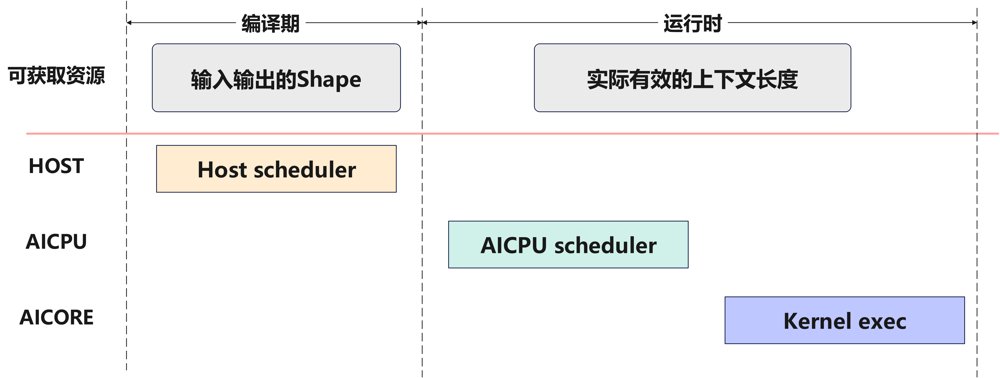
</div>
<!-- static-meta
{
  "sidebarTitle": "Ascend C Fused Operators",
  "operator": ["ascendc"],
  "hardware": ["atlas-a3", "ascend-950"],
  "frameworks": ["cann-recipes"],
  "llmSpeculativeInference": ["mtp"]
}
-->
