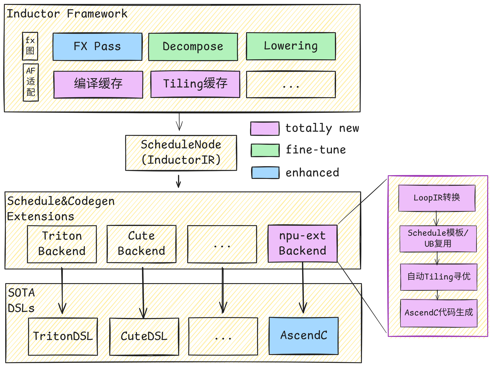
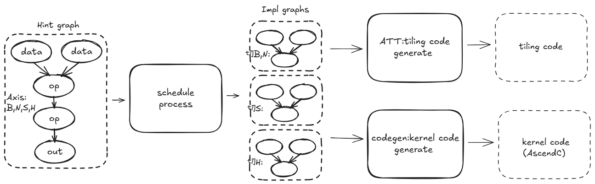
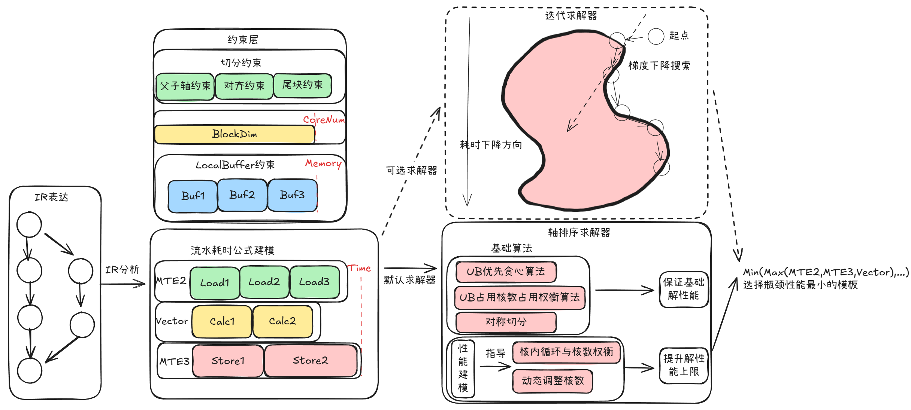
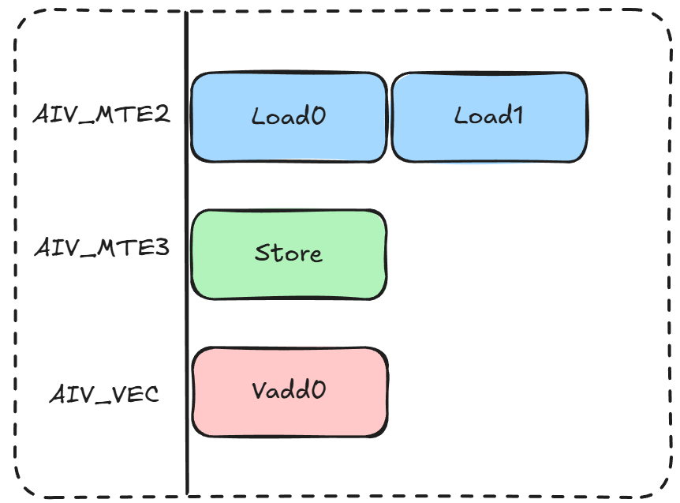
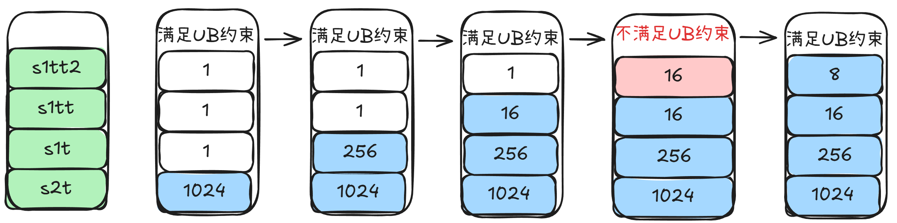
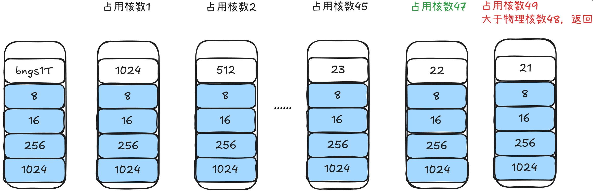

# NPU DeepSeek-V4 AutoFuse Automatic Operator Fusion Optimization

As AI model architectures become increasingly complex, dynamic, fine-grained small-operator combinations have become a mainstream design pattern, especially in MoE (Mixture of Experts) and multimodal architectures. In the latest model released by DeepSeek, hcPre and hcPost use flexible small-operator structures, and similar structures will also become common in future multimodal scenarios. These operator structures are flexible and varied and can be combined in many ways. If optimization depends on conventional manually written fused operators, development efficiency cannot keep pace with rapid model iteration. Therefore, automatic operator fusion is technically necessary and urgent.

The Inductor component of the PyTorch framework provides basic operator-fusion and compilation capabilities in graph mode. Its design is compatible with the existing PyTorch ecosystem and provides good software continuity. However, NPUs and GPUs differ fundamentally in memory architecture, compute units, and parallel mechanisms. Directly reusing GPU-oriented optimization strategies cannot fully use NPU hardware potential.

To implement efficient NPU-specific fusion while retaining the overall Inductor workflow and interfaces, just-in-time (JIT) operator-generation capabilities for NPUs are required. The AutoFuse component integrated into the CANN framework is therefore deeply optimized for NPU architecture features and automatically maps and generates efficient NPU operator code from computation graphs. This component maintains collaboration and compatibility with Inductor and further uses architecture-aware fusion strategies, memory-access optimization, and instruction scheduling to substantially improve operator-fusion efficiency on NPUs, supporting high-performance deployment of complex models on NPU platforms.

This technical report describes automatic Vector-operator fusion for NPUs and integration with Inductor. It also briefly introduces model benefits and enablement methods.

## Highlights

- Easy to use: Add one line of code to the PyTorch frontend to enable the feature.
- Performance improvement: Use NPU-friendly operator-generation technologies to improve out-of-the-box model performance.
  - NPU-friendly, template-normalized schedule technology.
  - Hardware-modeling-based operator Tiling technology with dynamic solving.
  - AscendC operator kernel code-generation technology expressed in AscendLoopIR.
- Generalization and completeness: Currently, 46 of the 152 LoopIR operations are supported. The remaining operations will be added progressively to achieve complete parity with LoopIR.

## Outline

- [NPU DeepSeek-V4 AutoFuse Automatic Operator Fusion Optimization](#npu-deepseek-v4-autofuse-automatic-operator-fusion-optimization)
  - [Highlights](#highlights)
  - [Outline](#outline)
  - [Inductor and AutoFuse Integration](#inductor-and-autofuse-integration)
  - [Operator-Generation Capabilities of AutoFuse JIT](#operator-generation-capabilities-of-autofuse-jit)
    - [NPU-Friendly, Template-Normalized Schedule Technology](#npu-friendly-template-normalized-schedule-technology)
    - [Hardware-Modeling-Based Operator Tiling Technology with Dynamic Solving](#hardware-modeling-based-operator-tiling-technology-with-dynamic-solving)
    - [AscendC Operator Kernel Code-Generation Capabilities Expressed in AscendLoopIR](#ascendc-operator-kernel-code-generation-capabilities-expressed-in-ascendloopir)
    - [Introduction to AscendLoopIR](#introduction-to-ascendloopir)

## Inductor and AutoFuse Integration

We extended Inductor's Codegen backend on NPUs. It converts InductorLoopIR to AscendLoopIR and invokes the AutoFuse module to select Schedule templates, reuse the UB, and tune Tiling, generating an efficient AscendC Kernel implementation.



Reference implementation for Inductor integration with AutoFuse: [inductor_npu_ext](https://gitcode.com/Ascend/torchair/blob/master/experimental/_inductor_npu_ext/)

### Enabling in a Script

1. Import inductor_npu_ext at the beginning of the script to register the AutoFuse-based Inductor compilation-backend extension.

```python
import inductor_npu_ext
```

2. Add the @torch.compile decorator to a function to compile it. Select the Inductor compilation scope based on the following rules:

- The graph structure within the compilation scope is stable and does not contain runtime branch selection, .item() memory synchronization, or similar behavior, preventing excessive Graph Breaks.
- Avoid an excessively large compilation scope. A large compilation scope is more likely to trigger recompilation because dynamo guards accumulate.
- Select a scope containing many Pointwise/Reduce computations. Inductor fuses such computations effectively and provides performance benefits with low compilation cost.

### Benefits for a Typical Code Segment

In the DeepSeek-V4 model, the hc_post segment contains multiple small-operator combinations and is suitable for fusion optimization through AutoFuse. Compiling the hc_post function with the @torch.compile decorator substantially improves its execution performance.

```python
@torch.compile
def hc_post(x: torch.Tensor, residual: torch.Tensor, post: torch.Tensor, comb:torch.Tensor) -> torch.Tensor:
    y = post.unsqueeze(-1) * x.unsqueeze(-2) + torch.sum(comb.unsqueeze(-1) * residual.unsqueeze(-2), dim=2)
    return y.type_as(x)
```

> Performance data was tested on Ascend A3 using typical input shapes for hc_post execution.

| Model Component | Uncompiled Latency | Compiled Latency (dynamic=False) | Performance Improvement | Compiled Latency (dynamic=True) | Performance Improvement |
| -------- | ---------- | ------------------------- | -------- | ------------------------ | -------- |
| hc_post  | 30 us      | 7.5 us                    | 4x       | 10 us                    | 3x       |


## Operator-Generation Capabilities of AutoFuse JIT



The core operator deliverables mainly contain kernel source code and Tiling source code. The AutoFuse module abstracts the operator code-generation process into several stages:

1. AscendLoopIR is the expression IR that abstracts the operator computation process and describes information such as the computation process, partitioning axes, and UB memory.
2. The Schedule component processes the Hint graph. Based on actual hardware capabilities, it provides a complete set of axis-partitioning strategies that cover all shape scenarios. Each specific partitioning strategy is carried by an AscendLoopIR called an impl graph. A set of impl graphs is used as input for the subsequent ATT and Codegen components.
3. The ATT component generates Tiling code for each impl graph. At runtime, the Tiling code evaluates the performance of the kernel template corresponding to each impl graph based on the specific shape, selects the optimal template, calculates partitioning parameters, and passes them to the kernel through tiling_data.
4. The Codegen component generates kernel code for each impl graph. Each impl graph corresponds to a template implementation. At runtime, tiling_data parameters determine the actual template to execute and the specific parameters for looped movement.

The AutoFuse module source code is open-sourced and [available here](https://gitcode.com/cann/ge/tree/master/compiler/graph/optimize/autofuse).

### NPU-Friendly, Template-Normalized Schedule Technology

On an NPU, one hardware-unit operation can complete vector operations on a batch of data. To fully use hardware features, the vector-operation axis must be selected accurately. Given the hardware's multi-core capabilities and limited memory, the axis for inter-core partitioning and the axis for UB partitioning must also be selected. Correct selection of these three axes has a major impact on functionality and execution performance. Incorrect selection can easily cause functional problems such as UB overload or severe performance degradation.

Different input shapes are usually best suited to different partitioning strategies. An operator implementation for a specific partitioning strategy is usually called a template. A general template simplifies the problem but cannot provide optimal performance. A detailed and extensive template library can provide maximum performance for different scenarios but makes template selection and code maintenance difficult.

As a JIT operator-fusion technology, AutoFuse uses a balanced template-design solution. It provides multiple templates but abstracts and normalizes their applicable scenarios to control the template count. A limited number of templates provides excellent performance for most shapes. The Schedule module generates a set of ImplGraphs from the HintGraph, with each ImplGraph corresponding to one template implementation.

#### Reduce Multi-Template Example

Reduce fusion is one of the most common deep-learning scenarios and involves reduction operations such as Sum, Max, Min, Mean, Prod, Any, and All. Its core challenges are:

- Different handling of reduction and non-reduction axes.
- Multi-core load balancing.
- Optimization of subsequent computation after reduction.

To support partitioning strategies for different shapes, the following three primary templates are summarized for different applicable scenarios.

| Template Type | Trigger Condition | Scheduling Characteristics | Applicable Scenario |
| --------------------- | ----------------------------- | ---------------------- | -------------------- |
| **Full-load template** | Nodes after Reduce ≤4 and in AR/ARA mode | Does not need to partition the Reduce axis | Small data volume and simple graph structure |
| **General template** | Default selection | UB partitioning + Block partitioning | Medium-scale general scenarios |
| **R-axis inter-core template** | Large and partitionable data volume | Uses the Reduce axis as the multi-core partitioning axis | Large Reduce axis |

For a large R axis, designing only a general template causes UB overload. For small-data scenarios, selecting a general template affects performance because of high core-launch overhead.

#### AutoSchedule Implementation

The core idea of AutoSchedule is to abstract computation nodes in a fused graph into several ComputeTypes. Based on the NPU-specific partitioning method of each type, AxisGroup semantically groups axes, and Merge rules generate a common AxisGroup applicable to all nodes, ultimately producing multiple candidate partitioning solutions (TilingCases).

**ComputeType Abstraction and NPU Partitioning Methods**

Computation nodes in a fused graph are abstracted into several ComputeTypes, each with an optimal NPU-specific partitioning method:

| ComputeType | Typical Operator | NPU Partitioning Characteristics | Axis-Grouping Characteristics |
| --------------------- | ---------------- | -------------------------- | ---------------------- |
| **Elementwise** | Add, Mul, Relu, and others | Can be partitioned along any dimension and supports vectorization | All axes are assigned to the Y group |
| **Broadcast** | Broadcast operator | Must handle alignment across different shapes | Computation axes are assigned to the Y group |
| **Reduce** | Sum, Max, Min, and others | Reduction axes require special handling | Reduction axes are assigned to the R group; non-reduction axes are assigned to the Y group |
| **Concat** | Concatenation | The concatenation dimension cannot be partitioned | Non-concatenation axes are assigned to the Y group |

**AxisGroup Axis Grouping and Merge Rules**

To support the partitioning requirements of different ComputeTypes, define an AxisGroup structure for semantically grouping axes:

- **X group**: Axes that require complete data, such as a Concat concatenation axis. Data integrity must be preserved after partitioning.
- **Y group**: Primitive-operator computation axes, such as Elementwise, that can be flexibly partitioned in the UB.
- **R group**: Reduce reduction axes that use a dedicated multi-core reduction strategy.

Because a fused graph may contain multiple ComputeTypes, Merge rules generate a common AxisGroup applicable to all nodes:

| Rule Type | Merge Condition | Result | Description |
| -------- | ------------- | ---------- | ------------------------ |
| Y+Y | Both nodes are in the Y group | Keep the Y group | The computation characteristics are the same, so the groups can be merged directly |
| Y+R | A Y group encounters an R group | Upgrade to the R group | Reduce has a higher priority |
| Y+YR | A Y group encounters a YR group | Extend to the YR group | Supports reduction and non-reduction computation |

**Generating TilingCase Candidate Solutions**

Based on the common AxisGroup, generate multiple candidate partitioning solutions (TilingCases). Each TilingCase defines a set of specific partitioning parameters:

- **UB partitioning**: Specifies the axis used to partition the UB Buffer.
- **Block partitioning**: Specifies the axis used for multi-core parallelism.
- **Special Reduce handling**: Specifies whether to enable multi-core partitioning along the R axis.

**Schedule Transformations**

Schedule performs specific scheduling transformations on each TilingCase, converting abstract partitioning solutions into specific scheduling operations:

| Transformation Type | Description | Effect |
| --------------------------- | -------------- | ------------------------ |
| **TileSplit** | UB-level partitioning | Loads data into the UB Buffer in blocks |
| **BlockSplit** | Block-level partitioning | Implements multi-core parallelism |
| **ReduceBlockTiling** | Reduce-specific partitioning | Optimizes multi-core execution of reduction operations |
| **Vectorization** | Identifies vectorizable axes | Improves computation throughput |

### Hardware-Modeling-Based Operator Tiling Technology with Dynamic Solving

At compile time, Schedule technology provides a normalized template set for different shapes. At runtime, supporting technology must correctly select a template and output inter-core and UB partitioning results. Incorrect calculation results directly cause out-of-bounds UB access or severe performance degradation.

In the AutoFuse component, ATT (Auto Tiling) performs this work. Preset performance modeling and multiple solution strategies ensure functional correctness and general performance in generalized scenarios while balancing solution accuracy and solution speed.

#### Automatic Tiling Challenges

1. **Difficulty of performance evaluation**: Different templates output by Schedule vary substantially in `GM discontinuity`, `UB discontinuity`, `whether vectorization-width alignment is used`, `loop count`, `computation bottleneck`, and `movement bottleneck`. Therefore, their performance differs across fusion scenarios and Shapes. Automatic Tiling must accurately evaluate the execution performance of different templates.
2. **Tradeoff between inter-core and block partitioning**: Increasing the number of cores introduces additional `core-launch overhead`, including hardware and software overhead. Reducing the number of cores creates excessive single-core load. Therefore, balancing the `number of cores` and `Tile block size` is a key challenge.

#### Core Functions of Automatic Tiling

Automatic Tiling finds a Tiling strategy that provides `optimal Kernel execution performance`. Its core functions include:

1. **Find the optimal partitioning result**: Find the optimal partitioning result for each ImplGraph, determining the number of cores used during Kernel execution, the amount of data moved from GM to UB each time, the number of loops in the UB, the amount of data calculated in the UB each time, and the number of movements from UB to GM.
2. **Select the optimal template**: Based on the optimal partitioning solution of each ImplGraph, evaluate Kernel execution performance as accurately as possible and `select the optimal template`.

#### Core Workflow of Automatic Tiling

<p align="center">
  
</p>

Kernel execution logic is expressed in IR. Automatic Tiling extracts key information from the IR graph expression, including:

- **Symbolic expression of constraints**:

  - **LocalBuffer usage constraint**: During Automatic Tiling solving, the usage of each LocalBuffer level must remain within the hardware-permitted range. For example, the total size of TQue/TBuf and temporary Buffers requested by the Kernel cannot exceed the hardware UB limit. IR expresses each Tensor's location (GM or UB) and reuse relationships between Tensors. Automatic Tiling uses this information to symbolically express constraints for each LocalBuffer level.
  - **Core-usage constraint**: Automatic Tiling generates a symbolic expression for the actual number of cores based on axis-partitioning methods. At Tiling runtime, it determines whether the constraint is satisfied based on actual hardware constraints and determined symbolic values.
  - **Partitioning constraints**: For example, constraints that ensure a child-axis size is no greater than the parent-axis size and that a partitioning axis is aligned to 32 B.
- **Symbolic expression of each pipeline's latency**

  - Automatic Tiling performs `performance modeling` for each API and symbolically expresses the performance of these APIs on each pipeline. It determines the number of API invocations from the loop axes expressed in IR and derives the total latency of all APIs in the IR on each pipeline. Here, execution of the bottleneck pipeline is assumed to effectively overlap execution of non-bottleneck pipelines (`simplified bottleneck-pipeline theory`). Therefore, total task-execution latency is mainly the bottleneck-pipeline latency. The following figure contains three pipelines. AIV_MTE2 is the bottleneck pipeline. During execution, AIV_MTE2 overlaps AIV_MTE3 and AIV_VEC, so total task-execution latency is represented by AIV_MTE2 execution latency.

  <p align="center">
    
    <br>
    <span style="color: #7f8c8d; font-size: 0.9em;">Pipeline Diagram</span>
  </p>

Automatic Tiling generates Tiling solver code from the extracted key information and generates an `axis-ordering Tiling solver` by default. This solver uses "storage usage during operator implementation does not exceed physical storage at each NPU level" as a constraint. Based on different IR expressions, it selects the most appropriate Tiling algorithm to `ensure baseline-solution performance`. It then uses "minimize the latency of the bottleneck execution unit" as the optimization objective and solves through performance modeling to `improve the solution's performance ceiling`.

The system also provides an optionally configured `heuristic iterative solver`. This solver uses a heuristic solving method. Starting from an initial solution, it searches the solution space that satisfies memory requirements within the feasible region that meets constraints, following the gradient-descent direction of performance-formula modeling. When the modeled formula value reaches its minimum, the optimization process exits and returns the optimal Tiling.

#### Key Technologies

**Performance formula modeling**:

**Purpose**: The simulation accuracy of the performance formula determines:

- Accuracy of template selection from Schedule output.
- Accuracy of core-count adjustment through axis ordering and intra-core loop selection.
- Accuracy of heuristic iterative solving.

Therefore, each type of API must be modeled as accurately as possible.

**Movement API modeling implementation**:

1. **Identify the primary factors that affect movement performance**.

   - Examples include `data volume`, `GM discontinuity`, `UB discontinuity`, `whether vectorization-width alignment is used`, `number of cores`, `Pipe initial overhead`, `API initial overhead`, and `API invocation count`.
2. **Design a performance formula based on the primary factors that affect movement performance and their impact on performance**.

   - For example, assume that MTE2 overhead is Cost(MTE2), where `API initial overhead` is h, `data volume` is DataSize, `API invocation count` is Count, `Pipe initial overhead` is H, and `bandwidth` is T:

     ```
     Cost(MTE2) = ((DataSize / T + h) * Count) + H
     ```

     Here, `bandwidth` is a dependent variable related to `whether vectorization-width alignment is used`, `number of cores`, `GM discontinuity`, and `UB discontinuity`.
3. **Based on the assumed performance model, experimentally verify actual movement performance as different primary factors change**.
4. **Establish the relationship between movement performance and primary factors and express it through symbolic technology**.

**Computation API modeling implementation**:

1. For AscendC `stable basic APIs`, the Automatic Tiling module collects performance data for different inputs, obtains the `relationship between performance and input`, establishes a performance model, and expresses it symbolically.
2. For AscendC `variable APIs`, the Automatic Tiling module calculates their `invocation parameters` and `invocation count` based on `API invocation logic` and generates a complete performance model for the API, producing relatively accurate performance modeling.

Based on `movement API modeling`, `computation API modeling`, and the simplified `bottleneck-pipeline` theory, the two core problems of Automatic Tiling can be simplified to:

1. How to adjust Tiling to minimize the bottleneck-pipeline formula value.
2. Select the template with the minimum bottleneck-pipeline formula value as the optimal template.

**Axis-ordering solver**:

**Purpose**:
The Tiling solver determines appropriate inter-core and block partitioning sizes based on the input Shape to provide the best possible Kernel performance. The heuristic priority-ordering rules supported by the axis-ordering solver (`priority` means an axis that should preferably not be partitioned) and basic algorithms, such as the `UB-usage/core-usage tradeoff algorithm`, `UB-first greedy algorithm`, and `symmetric partitioning`, effectively ensure baseline-solution performance. Combining them with performance-modeling expressions also improves the Kernel performance ceiling.

**Implementation**:

- **Determine partitioning-axis priorities**: First, determine the `priority` of each partitioning axis based on the API in the following order:

  - A parent axis has a higher priority than a child axis (hard functional constraint).
  - A reduction-type axis has a higher priority than a non-reduction-type axis (heuristic rule).
  - A broadcast axis has a higher priority than a non-broadcast axis (heuristic rule).
  - A non-innermost axis has a higher priority than the innermost axis (heuristic rule).
  - The last axes of movement APIs have equal priority (heuristic rule).
- **Inter-core and intra-core partitioning**: Next, partition in two parts: `intra-core Tiling` and `inter-core Tiling`. The `UB-first greedy algorithm` is used as an example and is suitable for scenarios with high initial API overhead:

  - **Intra-core Tiling**: Traverse in reverse axis order, first adjust a variable to its maximum value, and determine whether it satisfies hardware constraints. If not, use binary search to adjust the variable until it meets hardware constraints. Then adjust the next intra-core Tiling variable until all variables satisfy hardware constraints. For example, s1tt2, s1tt, s1t, and s2t are Tiling-related axes. Their partitioning workflow is shown as follows:

    <p align="center">
      
    </p>
  - **Inter-core Tiling**: Identify multi-core-related variables and traverse them in descending order to locate records that use more cores. Return if the physical-core count is exceeded. In the following figure, bngs1T is the multi-core partitioning axis, and its partitioning workflow is shown. The selection strategy is to prefer the record that uses more cores when the core usages differ. Based on this strategy, the final selected core usage is 47.

    <p align="center">
      
    </p>

    The specific workflow is as follows: First traverse s2t and adjust it to the maximum value 1024, which satisfies hardware constraints. Then traverse s1t and adjust it to the maximum value 256, which also satisfies hardware constraints. Then sequentially adjust the next variables s1tt>s1tt2 until all variables satisfy hardware constraints.
- **Other algorithms**:

  - `UB-usage/core-usage tradeoff algorithm`: Suitable for scenarios that require fine-grained control of core usage and UB usage (with a preset value; the number of cores can be dynamically adjusted based on the performance formula).
  - `Symmetric partitioning`: Suitable for last-axis transpose scenarios. It ensures that multiple last axes used by movement APIs can be partitioned with equal priority.

### AscendC Operator Kernel Code-Generation Capabilities Expressed in AscendLoopIR

Codegen parses the impl_graph generated by Schedule and generates host_code and kernel_code for the fused operator. host_code includes tiling_func, infer_shape, and get_kernel code, while kernel_code includes kernel and tiling_data code. The code is then compiled.

#### Main Codegen Workflow

Codegen's core function is to generate kernel code that runs on the device. Its input is the impl_graph generated by Schedule, which carries the basic elements required for code generation, such as shape, node, and axis information. An impl_graph example is shown as follows:


The specific information in the graph is as follows:

```C++
Sizes:
  z0z1t_size: VAR
  z0z1Tb_size: VAR
Axis:
  z0(0) : 200, ORIGINAL, align: -1, allow_oversize_axis: 0, allow_unaligned_tail: 1  // Axis information
  z1(1) : 200, ORIGINAL, align: -1, allow_oversize_axis: 0, allow_unaligned_tail: 1
  z0z1(2) : 40000, ORIGINAL, align: -1, allow_oversize_axis: 0, allow_unaligned_tail: 1  // Information after merging the z0 and z1 axes
  z0z1T(3) : Ceiling((40000 / (z0z1t_size))), TILE_OUT, from: {z0z1, }, align: 1, allow_oversize_axis: 0, allow_unaligned_tail: 1  // z0z1T corresponds to the outer axis of Tile partitioning and the total number of UB for loops on all cores
  z0z1t(4) : z0z1t_size, TILE_IN, from: {z0z1, }, align: 1, allow_oversize_axis: 0, allow_unaligned_tail: 1  // z0z1t corresponds to the inner axis of Tile partitioning and the amount of data processed by the AscendC API each time
  z0z1TB(5) : Ceiling((Ceiling((40000 / (z0z1t_size))) / (z0z1Tb_size))), BLOCK_OUT, from: {z0z1T, }, align: 1, allow_oversize_axis: 0, allow_unaligned_tail: 1  // z0z1TB corresponds to the outer axis of Block partitioning and the required number of cores
  z0z1Tb(6) : z0z1Tb_size, BLOCK_IN, from: {z0z1T, }, align: 1, allow_oversize_axis: 0, allow_unaligned_tail: 1  // z0z1Tb corresponds to the inner axis of Block partitioning and the number of UB for loops on one core
Nodes:
......
  abs_test/load_0: Load (1)
......
  abs_test/abs_0: Abs (2)
    .axis = {z0z1TB, z0z1Tb, z0z1t, }  // All axis information of the Abs node
    .loop_axis = z0z1Tb  // Boundary loop axis of the Abs node; preceding axes are loop axes, and subsequent axes are vectorized axes corresponding to the amount of data processed by the API at a time
    .api:
      .compute_type = elewise  // Computation type
      .type = Compute
      .unit = Vector  // Compute unit
    .x = abs_test/gather_0.y
    .y.dtype = float32  // Data type
    .y.axis = {z0z1TB, z0z1Tb, z0z1t, }  // Axis information of the output Tensor
    .y.repeats = {(40000 / (z0z1Tb_size * z0z1t_size)), z0z1Tb_size, z0z1t_size, }  // Axis sizes
    .y.strides = {(z0z1Tb_size * z0z1t_size), z0z1t_size, 1, }  // Axis strides
    .y.vectorized_axis = {z0z1t, }  // Vectorized axes
    .y.vectorized_strides = {1, }  // Strides of vectorized axes
    .y.mem:
      .tensor_id = 3  // ID of the output Tensor
      .alloc_type = Queue  // Allocation type; Queue indicates memory allocated in a TQueue in the UB
      .hardware = UB  // Hardware type; UB indicates memory allocated in the UB
      .position = TPosition::VECOUT  // Memory position; VECOUT indicates the memory position of the output Tensor
    .y.que:
      .id = 1  // queue_id corresponding to the Tensor
      .depth = 2  // Queue depth
      .buf_num = 2  // Number of Buffers in the Queue
      .reuse_id = 1  // Indicates whether the Queue can be reused; 1 means reusable
  abs_test/store: Store (3)
......
```

Based on impl_graph parsing, the following is example code for the DataCopy API generated by Codegen. The core workflow parses the partitioning strategy in the graph, assembles API input parameters, and generates code that runs on the device.

```C++
ss << "DataCopyPadExtend(" << ub << ", " << gm << "[" << gm_offset << " + " << tpipe.tiler.Size(api_attr.offset)
   << "], " << dma_param.block_count << ", " << dma_param.block_len << ", " << dma_param.src_stride << ", "
   << dma_param.dst_stride << ");" << std::endl;
```

As with conventional operator code, Schedule generates multiple templates corresponding to different impl_graphs for different partitioning strategies. Codegen parses them in sequence and generates template functions. At the kernel-function entry, it invokes different template functions based on tiling_key. An example is as follows:

```C++
extern "C" __global__ __aicore__ void abs_test(GM_ADDR abs_test_Data_0, GM_ADDR abs_test_Output_0, GM_ADDR workspace, AutofuseTilingData param) {
  const AutofuseTilingData t;
    if (TILING_KEY_IS(0)) {
      abs_test_0_general_0_nil_2_nil(abs_test_Data_0, abs_test_Output_0, workspace, t);
    } else if (TILING_KEY_IS(1)) {
      abs_test_0_general_0_nil_2_nil_unaligned(abs_test_Data_0, abs_test_Output_0, workspace, t);
    }
}
```

The kernel code generated by Codegen is based on AscendC APIs. Different template functions generate different for loops and process different amounts of data each time. Examples are shown as follows:

**tiling_key=0**
Partition the z1 axis. The vectorized axis calculated in the UB each time is z1t.

```C++
for (int z0z1Tb = 0; z0z1Tb < z0z1Tb_loop_size; z0z1Tb++) {
    Abs(y_local[0], xlocal[0], z1t_actual_size);
}
```

**tiling_key=1**
Partition the z0 axis. The vectorized axes calculated in the UB each time are z0t and z1.

```C++
for (int z0Tb = 0; z0Tb < z0Tb_loop_size; z0Tb++) {
    Abs(y_local[0], xlocal[0], z0t_actual_size * z1_axis_size);
}
```

Overall, Codegen generates kernel code based on impl_graph. However, continual improvements to kernel-code performance still require ongoing optimization of both the Codegen framework and internal APIs.

### Introduction to AscendLoopIR

AscendLoopIR in the AutoFuse component is an IR defined based on Loops. Its type maps to explicit Vector computations, such as Add and Mul.

A DAG composed of multiple AscendLoopIR instances is called an AscGraph and expresses multi-step computation in multi-level operator loops. Each computation step corresponds to a node in the graph, and each node is instantiated from AscendLoopIR. Directed edges between nodes represent data-transfer relationships. Each node also contains attributes that specify the loop level at which computation occurs.

In an AscGraph, nodes are usually nested in multiple loop levels and run repeatedly. For example, assume that the scheduling information and output 0 information of the Foo node are as follows:

```C++
  Foo.sched.axis = [z0, z1, z2, z3];
  Foo.output[0].axis = [z0, z1, z2, z3];
  Foo.output[0].repeats = [s0, s1, s2, s3];
  Foo.output[0].stride = [s1 * s2 * s3, s2 * s3, s3, 1];
```

This means that the Foo node has four associated axes, z0, z1, z2, and z3, whose sizes are s0, s1, s2, and s3. The stride indicates contiguous output. The Foo node runs over s0\*s1\*s2\*s3 iterations, equivalent to the following C++ code:

```C++
  for (uint64_t i0 = 0; i0 < s0; i0++) {
    for (uint64_t i1 = 0; i1 < s1; i1++) {
      for (uint64_t i2 = 0; i2 < s2; i2++) {
        for (uint64_t i3 = 0; i3 < s3; i3++) {
          // Execute Foo computation
        }
      }
    }
  }
```

In the preceding code, each axis is expanded into a loop, so Foo performs a scalar computation in the innermost layer. If the innermost axis s3 is vectorized and Foo is lifted by one loop, Foo performs one vector computation at a time. Flexible combinations of the sched and output axes can express complex
computation forms such as broadcasting, reduction, and non-contiguous movement.
<!-- static-meta
{
  "sidebarTitle": "AutoFuse Optimization",
  "operator": ["autofuse"],
  "hardware": ["atlas-a3"],
  "llmSpeculativeInference": ["none"]
}
-->
