# NPU DeepSeek-V4 Inference Optimization Practice

The DeepSeek team released the latest DeepSeek-V4 model series, which includes the DeepSeek-V4 Flash and DeepSeek-V4 Pro specifications. Building on DeepSeek Sparse Attention in DeepSeek-V3.2, the model further uses a KV Cache sliding window (Window Cache) and compression algorithm (KV Cache Compress) across different layers to reduce Attention computation and memory-access overhead, substantially improving computation efficiency for long sequences and reducing inference costs. This practice provides Day-0 support for DeepSeek-V4 model inference deployment, adapts to multiple generations of Ascend chips, including `Atlas-A3 Pod` and `950PR/DT`, and provides high-performance inference for sequences of up to 1M tokens.

Based on the new model structure, this practice provides a low-latency, high-throughput deployment solution and innovatively designs high-performance NPU fused kernels and a multi-stream parallelism solution to substantially improve inference performance. For quantization, this practice adapts the W8A8C16 (Int8) quantization solution on the `Atlas-A3 Pod` platform. On the `950PR/DT` platform, it supports the native Hybrid FP8-MXFP4 mixed-quantization mode and the hardware-friendly Hybrid MXFP8-MXFP4 and Hybrid HiF8-MXFP8-MXFP4 modes to fully use the computing capabilities of different hardware. This practice also open-sources TileLang and PyPTO implementations, providing directly reusable examples for efficient operator development. Complex fused kernels can be developed with only a few hundred lines of code.
For the new DeepSeek-V4 model structure, this open-source release provides a series of high-performance fused operators, including:

- A unified SparseAttnSharedKV (SAS) interface for Window/Sparse/Compress Attention interleaved across multiple layers, supporting multiple Attention computations.

- Compressor and CompressEpilog fused operators for different Compress Ratios, enabling efficient Cache compression and updates.

- Enhanced LightningIndexer (LI) functionality with support for the Compress Ratio feature.

- HCPre and HCPost fused operators for the mHC [(Manifold-Constrained Hyper-Connections)](https://arxiv.org/pdf/2512.24880) architecture.

The **AscendC** implementations of these fused operators were all open-sourced on Day 0. This release also provides **PyPTO** and **TileLang** implementations as directly reusable examples for efficient operator development. Complex fused kernels can be developed with only a few hundred lines of code.

## Highlights
- The overall deployment strategy follows DeepSeek's EP parallelism solution. Based on the structural features of the new model, this practice designs and implements an NPU-friendly parallelism strategy, supports deployment on multiple generations of Ascend chips, including `Atlas-A3 Pod` and `950PR/DT`, and provides high-performance inference for sequences of up to 1M tokens. The [model inference code](https://gitcode.com/cann/cann-recipes-infer/blob/master/models/deepseek_v4/README.md)(Chinese) is open-sourced in cann-recipes-infer, and mainstream open-source inference frameworks vLLM and SGLang are also adapted.
- AscendC-based HC Pre and HC Post fused operators are open-sourced to efficiently compute the preprocessing and postprocessing workflows of mHC. The AscendC kernel [technical document](./deepseek_v4_mHC_guide.md) and [code](https://gitcode.com/cann/cann-recipes-infer/blob/master/ops/ascendc/README.md)(Chinese) are open-sourced.
- Self-developed PyPTO-based HC Pre and MLAProlog fused operators are released to improve fused-operator programmability. The operator frontend does not need to be aware of chip-generation differences. The backend distinguishes them through pass IR and PTO_ISA instructions to provide cross-generation compatibility. The PyPTO kernel [technical document](./deepseek_v4_pypto_operator_guide.md), PTO ISA [user guide](https://gitcode.com/cann/pto-isa/blob/master/README.md), and [code](https://gitcode.com/cann/cann-recipes-infer/blob/master/ops/pypto/README.md)(Chinese) are open-sourced.
- The TileLang open-source community also supports development of all new operators in DeepSeek-V4. These operators correspond to the Expert and Developer development modes of TileLang-Ascend and provide two integration levels, AscendC basic instructions and PTO AS, offering multi-level open interfaces for various programming frontend languages and compilers. They are released in the TileAI open-source community. The TileLang kernel [technical document](./deepseek_v4_tilelang_operator_guide.md) and [code](https://gitcode.com/cann/cann-recipes-infer/blob/master/ops/tilelang/README.md)(Chinese) are also open-sourced.
- The NpuGraphEx backend combines unique features such as the dynamo compilation cache and static compilation to fully use Ascend computing power and deliver maximum graph-mode acceleration.
- `950PR/DT` supports the native Hybrid FP8-MXFP4 mixed-quantization mode, enabling smooth and lossless weight migration. This practice also supports replacing native FP8 computation with MXFP8 to further improve computation efficiency in high-throughput Prefill or Decode scenarios.
- Based on the preceding optimizations, CANN provides Day-0 support for DeepSeek-V4 inference deployment. Reference Decode performance: For DeepSeek-V4 Flash on `950DT`, TPOT is less than 10 ms with 16 cards and a 128K sequence. On `Atlas-A3 Pod`, single-card Decode throughput is 4388 TPS@30 ms with 64 cards and an 8K sequence.


## Outline

- [Model Architecture](#model-architecture)
- [Fused Kernels](#fused-kernels)
- [Parallelism Strategy](#parallelism-strategy)
- [MTP](#mtp)
- [Quantization Strategy](#quantization-strategy)
- [Multi-Stream Parallelism Optimization](#multi-stream-parallelism-optimization)
- [Benchmark](#benchmark)
- [Future Plan](#future-plan)

## Model Architecture

Each DeepSeek-V4 layer contains three modules: mHC, Attention, and Mixture of Experts (MoE). Compared with DeepSeek-V3.2, DeepSeek-V4 retains the LI sparse attention mechanism in the Attention component and adds Window Attention and KV Cache compression. These additions keep overall Attention computation and memory access low compared with a Full Cache, substantially improving performance for long sequences.

The DeepSeek-V4 model architecture is shown in the following figure:
<p align="center">
  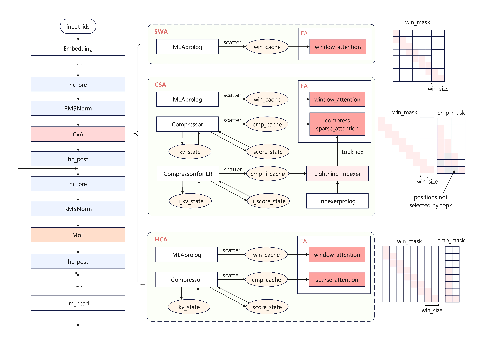
</p>

> Due to space limitations, the figure provides a simplified representation of some structures.

#### Attention Sparsity and Compression

- In the first two model layers, DeepSeek-V4 Flash uses Window Attention (SWA) with a KV Cache of `sliding_window=128`, effectively reducing Attention computation and KV Cache memory usage. DeepSeek-V4 Pro uses a Compress Ratio of 128 and compresses the Full Cache by 128 times through Compressor (HCA).
- In subsequent layers, Compressed Sparse Attention (CSA) and Heavily Compressed Attention (HCA) are used alternately. Compressor compresses the Full Cache by 4 times (CSA) or 128 times (HCA).
- In CSA layers, LI applies KV Cache sparsity on the compressed Cache and selects the Top 512 KV pairs for Attention computation, further improving performance for long sequences.

- Attention computation uses MQA (Multi-Query Attention) instead of MLA. It no longer distinguishes between the Prefill and Decode computation flows (`naive` or `absorb`) and introduces the `attention_sink` parameter.

#### MoE Experts

| Model Specification | Routed Experts | Shared Experts | Activated Parameters of Routed Experts per Token |
|-------|----------|---------|-------------------------|
| 285B  | 256      |  1      |  6G                     |
| 1.6T  | 384      |  1      |  22.5G                  |

In the MoE component, the parameters of the DeepSeek-V4 MoE module are shown in the preceding table. Six routed experts and one shared expert are activated each time. For expert selection, the first three layers use `hash routing`, while the subsequent 40 layers use learnable `soft routing`.

#### mHC (Manifold-Constrained Hyper-Connections)
mHC extends conventional residual connections. It expands `hidden_state` from one path to multiple paths and merges them back into one path through Pre Mapping before Attention/MoE computation, leaving the Attention/MoE computation process unchanged. The Attention and MoE outputs are then expanded back into multiple paths through Post Mapping. Meanwhile, the multi-path residuals are fused through Res Mapping. The fused result is added to the Post Mapping result to produce the mHC output.

<p align="center">
  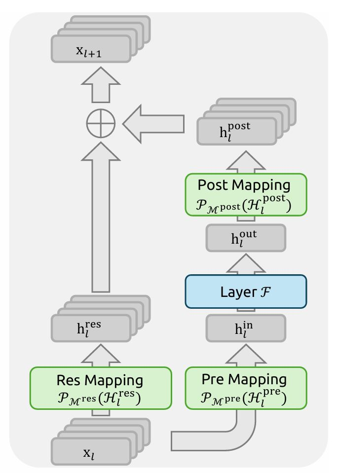
</p>

> The image is from the mHC paper [Manifold-Constrained Hyper-Connections (Xie et al., 2026)](https://arxiv.org/pdf/2512.24880).

#### KV Cache Memory Analysis

- In DeepSeek-V4, multiple algorithms effectively reduce the memory occupied by the KV Cache. SWA only needs to retain a KV Cache of size `sliding_window`. In layers with Cache compression, the KV Cache stores compressed KV data, and its memory size is:
  $$
    \mathrm{batch\_size}\times (\mathrm{kv\_length} // \mathrm{compress\_ratio} ) \times \mathrm{head\_dim} \times \mathrm{storage\_bytes} \times \mathrm{num\_compress\_layers}
  $$
- `kv_state` data that has not reached the required compression length and therefore has not yet been compressed, together with the corresponding `score_state`, is retained in `remainder`. Therefore, the maximum size of `remainder` is:
    $$
    \mathrm{batch\_size}\times (\mathrm{compress\_ratio - 1}) \times \mathrm{compress\_dim} \times \mathrm{storage\_bytes} \times \mathrm{num\_compress\_layers}
  $$
- In layers with a compression ratio of 4 (CSA), LI further sparsifies the KV Cache. Therefore, as in DeepSeek-V3.2, LI must retain the corresponding Indexer Cache. To match KV Cache compression, the Compressor module also compresses LI data by 4 times. Therefore, the amount of data stored in the Indexer Cache is also the compressed length. If the current `kv_length` does not meet the compression length, data is temporarily retained in `indexer_kv_state` and `indexer_score_state`.

Overall, because of the sliding window and high-ratio compression, not retaining the Full Cache substantially reduces the total amount of data stored in the KV Cache. For example, for a 128K sequence, only 1K KV data must be retained after 128x compression (HCA), and 32K KV data is retained after 4x compression (CSA), significantly relieving memory pressure for long sequences.

Based on these differences and model characteristics, this practice designs an NPU-friendly parallelism strategy and implements fused kernels such as SAS, Compressor, LI, GatingTopK, and mHC. For details, see the following sections.


## Fused Kernels

Fused kernels provide optimization benefits such as inter-operator data-flow optimization, pipeline parallelism, and reduced operator scheduling overhead. In DeepSeek-V4, the open-sourced fused operators cover modules such as Attention, MoE, and mHC.

The fused operators in the Attention component include Compressor, LI, KvCompressEpilog, IndexerCompressEpilog, and SAS. Their overall structure is shown in the following figure:

<p align="center">
  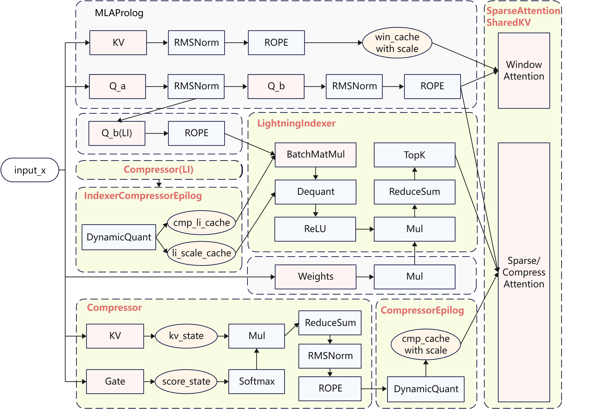
</p>


> The LI Compressor has the same structure as the KV Compressor. It is simplified in the figure.

- Compressor: Includes KV/Gate Linear computation and `kv_state`/`score_state` updates, selects the corresponding data (with Overlap in the CSA scenario), and computes and outputs compressed KV data.
- KvCompressEpilog: Includes quantization of compressed KV data, concatenation of the quantized compressed KV data and its Scale, and refresh of the KV Cache.
- IndexerCompressEpilog: Includes Indexer Cache quantization and refresh operations.
- LightningIndexer: Includes operations such as `score_batchmatmul`, `re_lu`, `reduce_sum`, and `topk`. In long-sequence scenarios, the `topk` operation becomes a bottleneck. The `topk` computation time can overlap other operations in the pipeline to provide pipeline-computation benefits.
- SparseAttentionSharedKV: Includes Sparse Attention, Compress Attention, and Window Attention computation.
- The fused operators in the mHC module consist of `hc_pre` and `hc_post`. The `hc_pre` fused operator provides both AscendC and PyPTO implementations. The fusion scope is shown in the following figure:

<p align="center">
  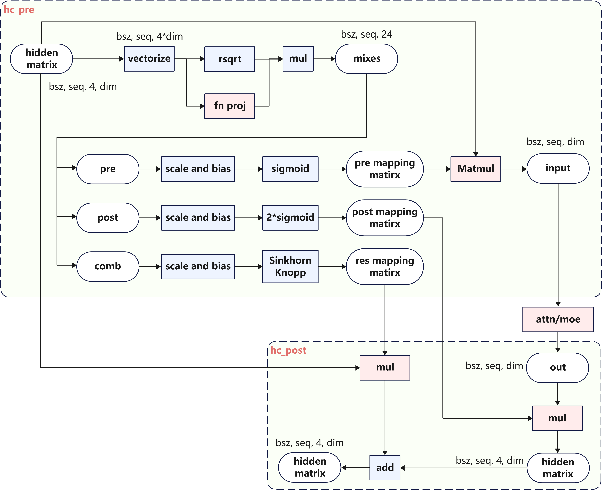
</p>

The preceding NPU fused kernels are open-sourced. For usage, see the [fused-kernel execution guide](https://gitcode.com/cann/cann-recipes-infer/blob/master/ops/ascendc/README.md)(Chinese).

## Parallelism Strategy

For Decode scenarios, 8-card or 16-card deployment can be used on the `950DT` platform to achieve extremely low single-user latency. On the `Atlas-A3 Pod` platform, 64-card large-scale EP deployment provides high-throughput performance benefits. For Prefill scenarios on the `950PR` platform, 8-card or 16-card deployment can be used. DP or CP parallelism can be selected for short or long sequences, respectively, to improve TTFT.

### Prefill Parallelism Strategy

DeepSeek-V4 primarily targets long-sequence inference scenarios. Memory usage and TTFT during Prefill pose major challenges, so optimizing memory usage and TTFT is the main objective of the parallelism strategy. If the Attention DP (Data Parallel) strategy is used, each rank must infer an ultra-long sequence, resulting in a large total computation volume, high TTFT, and a poor user experience. Therefore, for long-sequence scenarios, Context Parallel (CP) parallelism is used in the Attention component. Multiple ranks share the computation and memory-access overhead to improve overall performance.

Because LI uses `causal_mask`, later Context Chunks require more memory access and computation. During CP partitioning, the `zig_zag` partitioning method previously used by Recipes for DeepSeek-V3.2 can be reused. It places the first and last sequence blocks on the same rank, making the computation load across cards relatively balanced after CP partitioning.

<p align="center">
  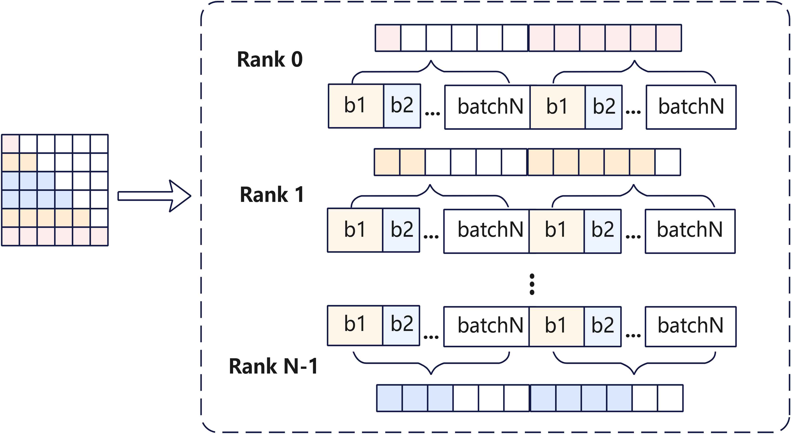
</p>


In addition, Window Attention and KV Cache compression in the Attention module must be considered when partitioning the sequence.
- During SWA-layer computation, each chunk must obtain KV data of length `win_size=128` from the preceding sequence.
- In HCA layers, partitioning can align the sequence on the preceding rank to 128. No additional tokens then need to be transferred to the rank containing a subsequent `chunk`, and no `chunk` except the last one needs to process `remainder`.
- In CSA layers, the Compressor must process Token Overlap information, so it must obtain the preceding four tokens to implement Overlap compression. If the sequence length of the preceding `chunk` is aligned to 128, no rank except the rank containing the last `chunk` has a `remainder`.

Therefore, when the Attention module runs, the maximum token length that must be obtained from the preceding sequence is 128 to satisfy the Window Cache. Each `chunk` transfers 128 tokens to the subsequent `chunk`. A global `all_gather` communication operator obtains the last 128 tokens from all ranks, and the corresponding `receive_idx` slices out the data required by each `chunk`. The first sequence block, `chunk_0`, does not need additional tokens.

<p align="center">
  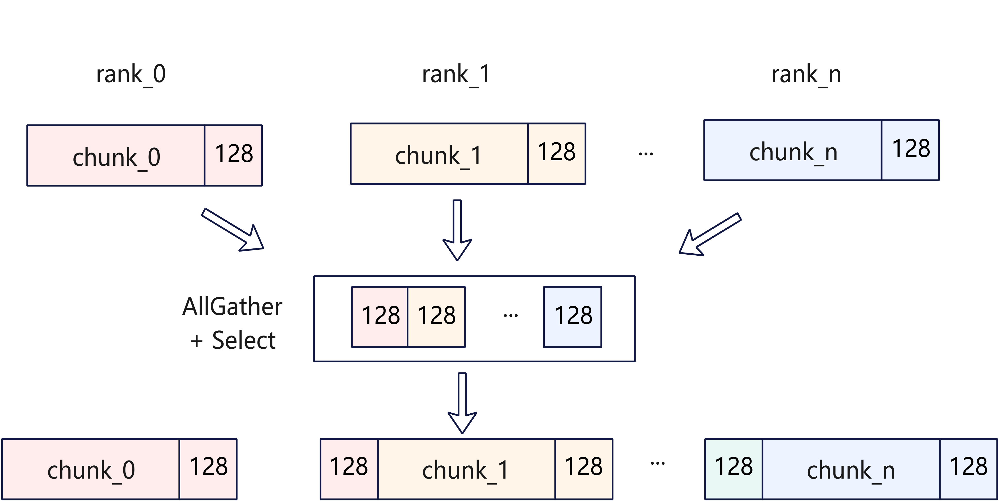
</p>

Therefore, the Attention module introduces two communication operations:
- One communication operation is performed at the beginning of the MQA module to communicate `hidden_states` of size 128. MLAProlog performs slightly redundant computation in this case, but the implementation is simpler.
- After Compressor computation, Query has been partitioned by CP, so `all_gather` must be performed on the Compress Cache in the CP domain to obtain the complete compressed Cache for LI and SAS computation. In the `zig_zag` scenario, the Cache must be reordered after `all_gather`.

    The CSA implementation is shown in the following figure:

<p align="center">
  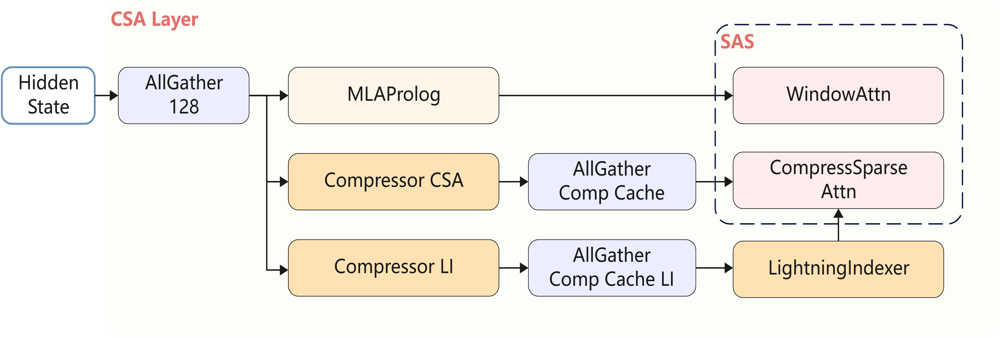
</p>

The two Compressors can run in parallel, and the CSA Compressor only requires the information of four Overlap tokens. Therefore, the data required by Window Attention and Compressor can also be communicated separately to overlap computation with communication while introducing little redundant computation. After Compressor, `all_gather` communication must also be performed on the Compressed Cache in the CP domain. The CSA implementation is shown in the following figure:
<p align="center">
  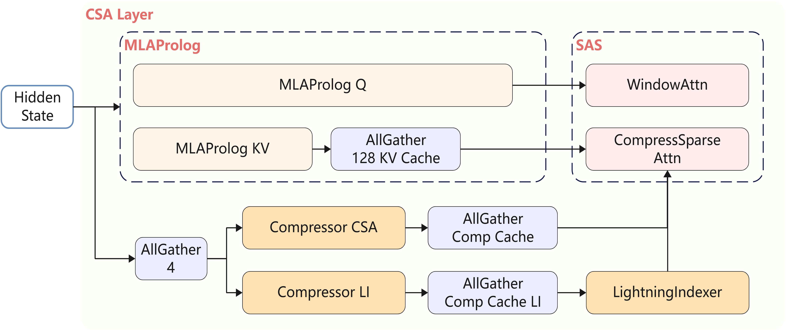
</p>


### Decode Parallelism Strategy
During Decode, the parallelism strategy follows the solutions used for DeepSeek-R1 and DeepSeek-V3.2:
- Attention uses Data Parallel (DP) parallelism.
- MoE uses Expert Parallel (EP) parallelism.
- LM_head uses Tensor Parallel (TP) parallelism.
- In the Output Projection after Attention, `o_a_proj` has a large weight and long memory-access latency. In low-latency scenarios, TP partitioning can be used selectively so that multiple ranks share the memory-access overhead in parallel. The `all_to_all` and `reduce_scatter` communication operators convert between DP and TP, as shown in the following figure:

<p align="center">
  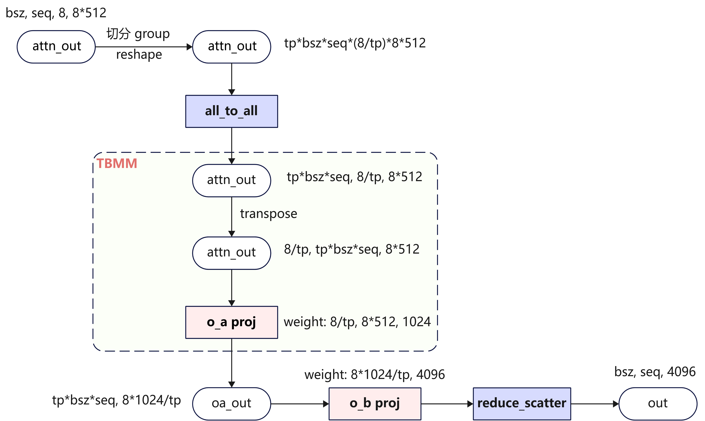
</p>


## MTP

DeepSeek-V4 continues to provide a native Multi-Token Prediction (MTP) mechanism. MTP allows multiple tokens to be calculated and verified during one main-model inference operation. Before the computation bottleneck is reached, more output tokens may be obtained with only a small increase in latency, reducing the inference latency per token. The sliding-window/compression/sparsity Hybrid Attention algorithm in DeepSeek-V4 is highly complex, presenting new challenges for MTP adaptation.

### Main Model Solution

- Cache design: This model implements a Ring Buffer for Window KV and the `kv_state`/`score_state` of the Compressor module. `block_table` and `slot_mapping` enable memory reuse across a small number of Cache blocks. Memory for the remaining KV Cache is allocated based on the maximum compressed length.

A comparison of the two Cache-management implementations is shown in the following figure:

<p align="center">
  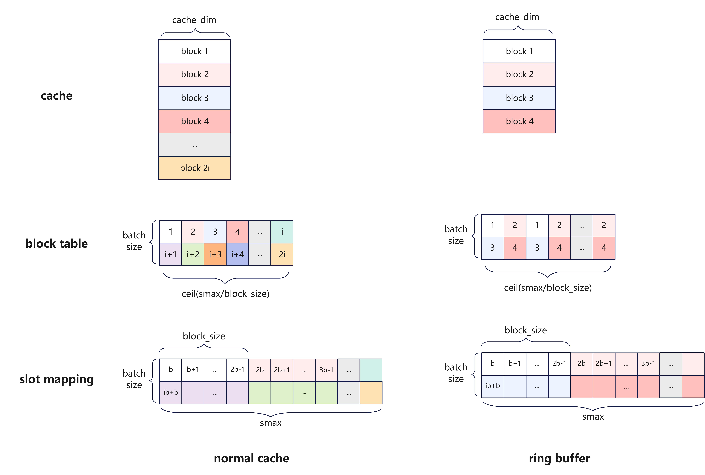
</p>

- MTP scenario adaptation: Assume that during Decode, the main model must additionally verify `next_n` tokens for each batch in each step. During inference in each step, operators advance normally along the `kv_length` dimension and perform compression when the CSA/HCA compression condition is met. This scenario must continue using the trapezoidal masks built into the LI and SAS operators to ensure that the compressed Cache of tokens to be verified does not participate in computation for the main-model token. If an MTP token is not accepted during verification, the token must be inferred again in the next step. Reinference requires an additional cache for the Compressor's `kv_state`/`score_state`. In the following figure, the left side shows the `kv_state`/`score_state` cache range, and the right side shows the trapezoidal mask used for Indexer/Attention computation.
<p align="center">
  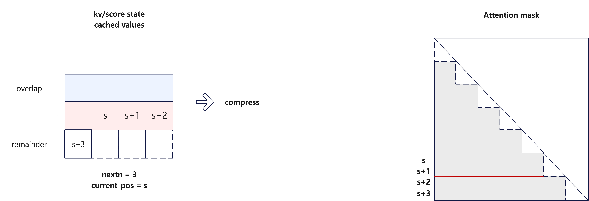
</p>

With this model's Ring Buffer design, additional caching can be implemented naturally by allocating a larger Buffer in advance. The required Cache size can be counted in groups of `compress_ratio` tokens. The formula for calculating the number of token groups is:
$$
\mathrm{num\_ratio\_group} = (1 \ \mathrm{if} \ \mathrm{next\_n}\  == 0 \ \mathrm{else}\ 2) + \mathrm{overlap}
$$

Here, `overlap` equals 1 in CSA and 0 in HCA. `num_ratio_group` reserves space for remainder tokens and preceding tokens that may need to be compressed again. The number of Cache Blocks required by each batch is:
$$
\mathrm{ceil}(\mathrm{num\_ratio\_group} * \mathrm{ratio} \ / \ \mathrm{block\_size})
$$

### MTP Spec Model Solution

- Model structure: The MTP model uses only Window Attention (SWA).
- Cache structure: In the current implementation, `next_n` Draft Tokens share one set of MTP weights and KV Cache.

### Performance Analysis

MTP allows Decode to batch-verify `next_n` tokens speculated by the small model during one main-model inference operation. With a similar amount of data movement, more predicted tokens may be obtained, improving the computation-to-memory-access ratio during Decode inference.
- Attention component: In the MTP scenario, under extreme conditions, CSA FA computation must move `next_n + 1` times as much KV Cache data as in the non-MTP scenario, increasing discrete memory-access overhead to some extent. However, the Cache movement volume of SWA/HCA/LI is almost the same as in the non-MTP scenario, naturally improving the computation-to-memory-access ratio.
- Other operators, such as Matmul, can reuse weight movement under MTP to achieve a better computation-to-memory-access ratio. Therefore, MTP provides a considerable speedup.
- In high-throughput scenarios, using multiple Draft Tokens can easily reach the computation bottleneck, so MTP1 can be used for acceleration. In low-latency scenarios, computation density is lower, so MTP3 can provide a larger speedup.


## Quantization Strategy
### Atlas-A3 Pod
#### Int8 (Recommended for the DeepSeekV4-Flash Model)

Based on the native Hybrid FP8-MXFP4 weights, this practice supports Int8 W8A8 quantization. Compared with BF16 inference, W8A8 quantization effectively reduces end-to-end latency and improves system throughput. The quantization strategy is as follows:

<p align="center">
  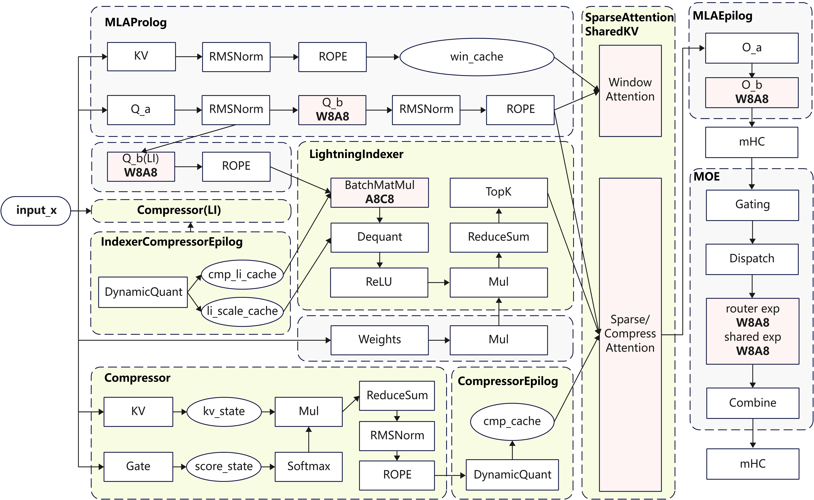
</p>

- MLAProlog: `q_b_proj` uses W8A8 quantization. Other Linear operations are not quantized. The KV Cache uses C16.
- IndexerProlog: `q_b_proj` uses W8A8, while `indexer_weight` is not quantized. `indexer_q` uses A8 quantization. The Indexer Cache uses C8 quantization.
- LightningIndexer: `batch_matmul` uses Int8 computation.
- Compressor: Linear operations are not quantized.
- MLAEpilog: `o_a_proj` is not quantized, while `o_b_proj` uses W8A8 quantization.
- MoE: Linear operations of routed and shared experts use W8A8 quantization.
- LMHead: Not quantized.

> Note:
W8A8: W8 indicates that weights use static Per-Channel Int8 quantization, and A8 indicates that data uses dynamic Per-Token Int8 quantization.
A8C8: A8 indicates that Q in LI uses dynamic Per-Token-Head Int8 quantization, and the Indexer Cache uses dynamic Per-Token-Head Int8 quantization.

For performance considerations, only some Linear modules with a large number of parameters are quantized. Therefore, among the Linear modules, only MLA's `q_b_proj` and `o_b_proj` and Indexer's `q_b_proj` are quantized. The KV Cache temporarily retains BF16 storage and computation. LI uses A8C8 quantization to further reduce computation latency and optimize both TTFT and TPOT.

#### Hybrid INT8-INT4 (Recommended for the DeepSeekV4-Pro Model)

Because the DeepSeekV4-Pro model has a large number of parameters, using W8A8 inference in the MoE component creates major memory and memory-access bottlenecks. This practice designs Hybrid INT8-INT4 quantization for the `DeepSeekV4-Pro` model. The overall quantization strategy is the same as described previously, but INT4 quantization is primarily used for the `MoE` component. Compared with the pure INT8 quantization strategy, Hybrid INT8-INT4 significantly reduces storage and memory-access overhead in the MoE component. The difference from the INT8 quantization strategy is:
- MoE: Linear operations of routed experts use W4A8 quantization, while Linear operations of shared experts use W8A8 quantization.

> Note:
W4A8: W4 indicates that weights use static Per-Channel Int4 quantization, and A8 indicates that data uses dynamic Per-Token Int8 quantization.

### Ascend 950PR/DT
#### Hybrid MXFP8-MXFP4 (Recommended for the DeepSeekV4-Flash/Pro Models)

This practice supports the native Hybrid FP8-MXFP4 quantization method. It also supports replacing Linear modules in the native FP8 format with MXFP8 or HiF8, which can further improve compute utilization and overall performance in high-throughput Prefill and Decode scenarios. The overall Hybrid MXFP8-MXFP4 quantization strategy is as follows:

<p align="center">
  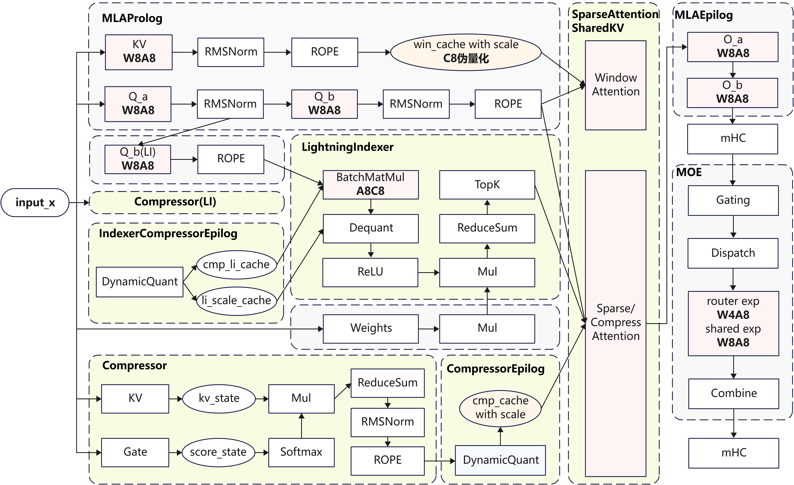
</p>

- MLAProlog: `q_a_proj`, `q_b_proj`, and `kv_proj` use W8A8 quantization. The KV Cache uses C8 pseudo-quantization.
- IndexerProlog: `q_b_proj` uses W8A8, while `indexer_weight` is not quantized. `indexer_q` uses A8 quantization. The Indexer Cache uses C8 quantization.
- LightningIndexer: `batch_matmul` uses FP8 computation.
- Compressor: Linear operations are not quantized.
- MLAEpilog: `o_a_proj` and `o_b_proj` use W8A8 quantization.
- MoE: Linear operations of routed experts use W4A8 quantization, while Linear operations of shared experts use W8A8 quantization.
- LMHead: Not quantized.

> Note:
> W8A8: W8 and A8 indicate MXFP8 quantization.
> LI A8C8: A8 indicates that Q in LI uses dynamic Per-Token-Head FP8 quantization with FP32 Scale. The Indexer Cache uses dynamic Per-Token-Head FP8 quantization with FP32 Scale.
> KV Cache C8: Indicates that the KV Cache uses dynamic Per-Group-64 FP8 quantization with E8M0 Scale.

The MLAProlog KV Cache quantization strategy uses dynamic 8-bit storage and 16-bit computation. For ultra-long sequences, the C8 KV Cache reduces memory usage by 2 times. LI uses A8C8 for computation benefits, reducing LI computation latency and optimizing both TTFT and TPOT.

#### Hybrid HiF8-MXFP8-MXFP4 (Recommended for the DeepSeekV4-Flash/Pro Models)

This practice also supports Hybrid HiF8-MXFP8-MXFP4. The overall quantization strategy is as follows:

<p align="center">
  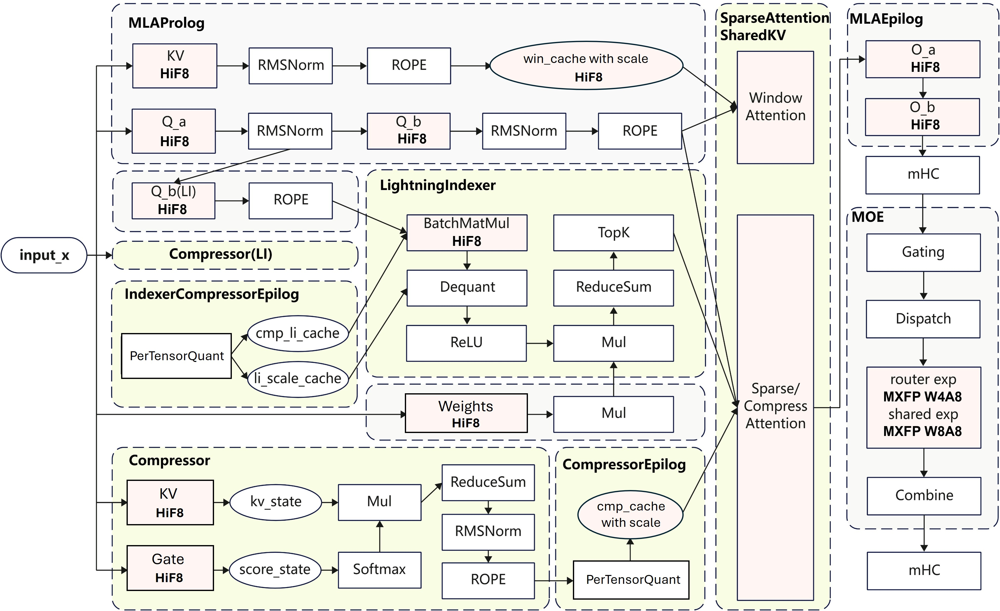
</p>

- MLAProlog: `q_a_proj`, `q_b_proj`, and `kv_proj` use HiF W8A8 quantization. The KV Cache uses HiF A8 quantization.
- IndexerProlog: `q_b_proj` and `indexer_weight` use HiF W8A8 quantization. `indexer_q` and the Indexer Cache use HiF A8 quantization.
- LightningIndexer: `batch_matmul` uses HiF8 computation.
- Compressor: `wkv` and `wgate` use HiF W8A8 quantization.
- MLAEpilog: `o_a_proj` and `o_b_proj` use HiF W8A8 quantization.
- MoE: Linear operations of routed experts use MXFP W4A8 quantization, while Linear operations of shared experts use MXFP W8A8 quantization.
- LMHead: Not quantized.

> Note:
> HiF W8A8: A8 indicates that activations use Per-Tensor HiF8 quantization, W8 indicates that weights use offline Per-Channel HiF8 quantization, and the Scale format is FP32.
> MoE MXFP W4A8/W8A8: Uses the same MoE quantization strategy as Hybrid MXFP8-MXFP4.


## Multi-Stream Parallelism Optimization

#### Attention Multi-Stream Parallelism
In the MLAProlog module before Attention computation, the Query computation flow and KV computation flow can run in parallel. In CSA, LI and CSA Compressor have no data dependency and can also run in parallel. Therefore, the operator core-control and multi-stream parallelism technologies provided by the CANN software stack can provide fine-grained computation-flow control for the Attention module and improve inference performance. For CSA, the following solution can be implemented:

<p align="center">
  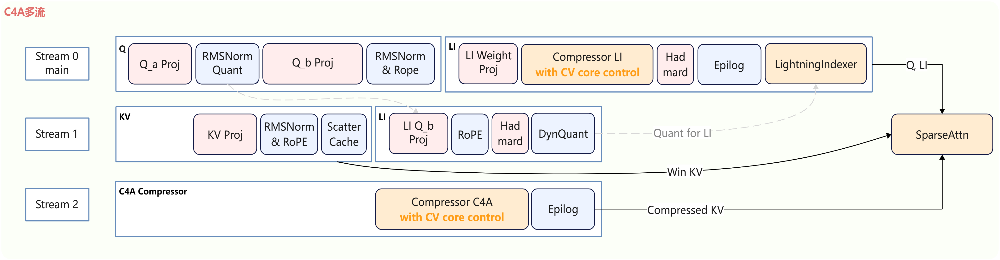
</p>

- Matmul operations such as `kv_proj` and `q_b_proj` in MLAProlog are computed on Cube cores and can run in parallel with operators such as `q_rms_norm` that are computed on Vector cores.
- `rms_norm` and `rope` after `q_b_proj` can run in parallel with LI's `li_q_b_proj`.
- For LI and the CSA Compressor module, CV core control ensures that operators are assigned appropriate numbers of Cube and Vector cores. This reduces the performance impact of competition for computing resources during multi-stream parallelism and fully overlaps the CSA Compressor.
- HCA does not contain LI, so MLAProlog computation can directly overlap part of the Compressor.
> Some logic is represented in simplified form. The length of an operator box does not represent its actual execution time and is used only for illustration.

#### Multi-Stream Parallelism for Shared and Routed MoE Experts
In the MoE module, shared and routed experts also provide opportunities to parallelize computation with computation and computation with communication. Multi-stream parallelism can overlap the computation latency of shared experts with almost no impact on routed experts. This practice implements expert multi-stream parallelism for Int8 and MXFP8 quantization scenarios and provides significant benefits. The implementation is shown in the following figure:
<p align="center">
  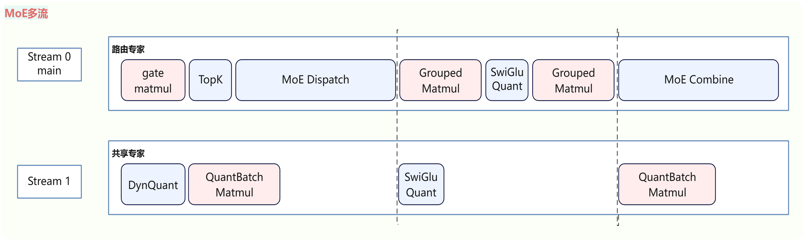
</p>


#### Multi-Stream Parallelism for AICPU Scheduler Operators
Operators such as Attention and LI depend on the actual context length during computation. This practice provides corresponding AICPU Scheduler operators that calculate the core-partitioning strategy before operator execution, reducing the execution burden and improving performance.
Using SparseAttnSharedkv as an example, the following interfaces are provided:
- npu\_sparse\_attn\_sharedkv\_metadata: Obtains Tiling containing key load-balancing information based on operator inputs such as `cu_seqlens_q`, `seqused_kv`, and `cmp_ratio`.
- npu\_sparse\_attn\_sharedkv: Performs Attention computation based on the tiling information output by `npu_sparse_attn_sharedkv_metadata`.

During one full-network inference iteration, the AICPU Scheduler operator on which each SAS (SWA, CSA, or HCA) and LI operator depends only needs to run once, and Tiling information can be reused across operators in different layers. Therefore, Tiling computation can run in parallel with Embedding and MLAProlog computation. Multi-stream parallelism effectively overlaps the Tiling computation latency. For SWA, the reference pseudocode is as follows:

```python
# prepare metadata
metadata_stream = torch.npu.Stream()
event_0, event_1 = torch.npu.Event(), torch.npu.Event()
input_tensor.record_stream(metadata_stream)
event_0.record()
with torch.npu.stream(metadata_stream):
    event_0.wait()
    attn_metadata = torch.ops.custom.npu_sparse_attn_sharedkv_metadata(input_tensor, ..., cmp_ratio=1)
    event_1.record()

# input embedding calculation (skip details)

for layer in model_layers:
    # attention forward
    event_1.wait()
    attn_output = torch.ops.custom.npu_sparse_attn_sharedkv(input_tensor, ..., metadata=attn_metadata)

    # moe forward (skip details)

```

A single full-network inference iteration invokes AICPU Scheduler operators four times. The multi-stream parallelism solution is shown in the following figure.
<p align="center">
  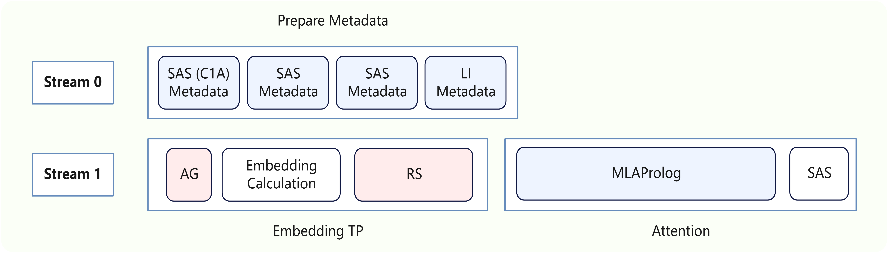
</p>

## Benchmark

The following Benchmark data is collected in Offline inference mode and excludes the effects of Serving scheduling and framework load balancing.

#### 950DT

[profile_data](https://cann-ai.obs.cn-north-4.myhuaweicloud.com/cann-quantization/DeepSeek/profile_data/trace_view_950DT_decode.json)

On the `950DT` platform, this practice deploys the model on 16 cards with Attention Data Parallel (DP) and MoE Expert Parallel (EP). For DeepSeek-V4 Flash with an 8K sequence, Hybrid MXFP8-MXFP4 quantized Decode provides single-card throughput of 1821 TPS@10 ms. The corresponding Profile data is open-sourced at the preceding link. Benchmark results for different Batch Sizes and sequence lengths are as follows:

**950DT Deepseek-V4 Flash Benchmark**

| Global Batch Size | Chips | MTP | DataType | Seq Length | TPOT (ms) | Throughput (Tokens/p/s) |
| ----------------- | ---------|----------  | ----- | ----------------- | ----------------- |----------------- |
| 16   | 16  | 3   | Hybrid MXFP8-MXFP4    | 8192     | 6.55      | 152.79  |
| 256  | 16  | 3   | Hybrid MXFP8-MXFP4    | 8192     | 8.78      | 1821.75 |
| 1536 | 16  | 1   | Hybrid MXFP8-MXFP4    | 8192     | 16.46     | 5830.65 |
| 2880 | 16  | 1   | Hybrid MXFP8-MXFP4    | 8192     | 25.54     | 7047.44 |
| 256  | 16  | 3   | Hybrid MXFP8-MXFP4    | 131072   | 9.66      | 1655.64 |
| 768  | 16  | 1   | Hybrid MXFP8-MXFP4    | 131072   | 10.50     | 4569.64 |
| 16   | 16  | 3   | Hybrid MXFP8-MXFP4    | 1048576  | 8.04      | 124.36  |
| 64   | 16  | 3   | Hybrid MXFP8-MXFP4    | 1048576  | 9.46      | 422.88  |
| 16   | 16  | 3   | Hybrid HiF8-MXFP8-MXFP4    | 8192     | 6.27      | 159.49  |
| 256  | 16  | 3   | Hybrid HiF8-MXFP8-MXFP4    | 8192     | 8.41      | 1902.50 |
| 1536 | 16  | 1   | Hybrid HiF8-MXFP8-MXFP4    | 8192     | 15.95     | 6017.70 |
| 16   | 16  | 3   | Hybrid HiF8-MXFP8-MXFP4    | 131072   | 6.45      | 155.03  |
| 256  | 16  | 3   | Hybrid HiF8-MXFP8-MXFP4    | 131072   | 9.22      | 1735.36 |
| 16   | 16  | 3   | Hybrid HiF8-MXFP8-MXFP4    | 1048576  | 7.71      | 129.70  |
| 64   | 16  | 3   | Hybrid HiF8-MXFP8-MXFP4    | 1048576  | 9.11      | 439.08  |
| 256  | 16  | 3   | Hybrid FP8-MXFP4      | 8192     | 11.06     | 1447.00 |
| 1536 | 16  | 1   | Hybrid FP8-MXFP4      | 8192     | 24.28     | 3953.49 |

Benchmark results for DeepSeek-V4 Pro Decode with different Batch Sizes and sequence lengths are as follows:

**950DT Deepseek-V4 Pro Benchmark**

| Global Batch Size | Chips | MTP | DataType | Seq Length | TPOT (ms) | Throughput (Tokens/p/s) |
| ----------------- | ---------|----------  | ----- | ----------------- | ----------------- |----------------- |
| 16   | 16  | 3   | Hybrid MXFP8-MXFP4    | 8192     | 17.64      | 56.7   |
| 64   | 16  | 3   | Hybrid MXFP8-MXFP4    | 8192     | 19.03      | 210.16 |
| 128  | 16  | 3   | Hybrid MXFP8-MXFP4    | 8192     | 20.61      | 388.23 |
| 3072 | 64  | 1   | Hybrid MXFP8-MXFP4    | 8192     | 27.79      | 1727.24|
| 16   | 16  | 3   | Hybrid MXFP8-MXFP4    | 131072   | 19.46      | 51.38  |
| 64   | 16  | 3   | Hybrid MXFP8-MXFP4    | 131072   | 21.23      | 188.42 |
| 16   | 16  | 3   | Hybrid HiF8-MXFP8-MXFP4    | 8192     | 16.33      | 61.24   |
| 64   | 16  | 3   | Hybrid HiF8-MXFP8-MXFP4    | 8192     | 17.23      | 232.22 |
| 128  | 16  | 3   | Hybrid HiF8-MXFP8-MXFP4    | 8192     | 18.68      | 428.16 |
| 16   | 16  | 3   | Hybrid HiF8-MXFP8-MXFP4    | 131072   | 16.55      | 60.44  |
| 64   | 16  | 3   | Hybrid HiF8-MXFP8-MXFP4    | 131072   | 18.22      | 219.57 |

> Note: The performance data was collected with MTP speculation and forced EPLB configuration. In the MTP3 scenario, the average number of Accepted Tokens among three Draft Tokens is 1.44. In the MTP1 scenario, the average number of Accepted Tokens among one Draft Token is 0.7. Users can convert the benchmark performance based on the actual acceptance rate of their dataset.

> Note: Hybrid FP8-MXFP4 means that some Matmuls in the converted weights use FP8 quantization and the MoE module uses MXFP4 quantization. Hybrid MXFP8-MXFP4 means that some Matmuls in the converted weights use MXFP8 quantization and the MoE module uses MXFP4 quantization. Hybrid HiF8-MXFP8-MXFP4 means that some Matmuls in the converted weights use HiF8 quantization and the MoE module uses MXFP4 quantization. For details, see [Quantization Strategy](#quantization-strategy).

#### Atlas-A3 Pod

[profile_data](https://cann-ai.obs.cn-north-4.myhuaweicloud.com/cann-quantization/DeepSeek/profile_data/trace_view_a3_decode.json)

On the `Atlas-A3 Pod` platform, this practice deploys the W8A8C16 model on 64 cards with Attention Data Parallel (DP) and MoE Expert Parallel (EP). For DeepSeek-V4 Flash with an 8K sequence, single-card Decode throughput reaches 4388 TPS@30 ms. The corresponding Profile data is open-sourced at the preceding link. Benchmark results for different scenarios are as follows:

**Atlas-A3 Pod Deepseek-V4 Flash Benchmark**

| Global Batch Size | Chips | MTP  | Seq Length | TPOT (ms) | Throughput (Tokens/p/s) |
| ----------------- | ----- | ---- | ---------- | --------- | ----------------------- |
| 7168              | 64    | 1    | 8192       | 27.82     | 4025                    |
| 8192              | 64    | 1    | 8192       | 29.17     | 4388                    |

> Note: The LI Cache uses Int8 quantization, and the KV Cache uses BF16 computation. The performance data was collected with MTP1 and forced EPLB configuration. The average number of Accepted Tokens among one Draft Token is 0.7. Users can convert the benchmark performance based on the actual acceptance rate of their dataset.

## Future Plan
- **SuperKernel**: Enable Super Kernel to further reduce operator launch overhead and scheduling gaps and improve computation efficiency.
- **Fused-kernel performance optimization**: Use technologies such as Flash Decode to optimize LI/SAS performance in long-sequence scenarios.
<!-- static-meta
{
  "sidebarTitle": "Inference Optimization",
  "quantization": [
    "int8",
    "int4",
    "fp8",
    "mxfp8",
    "hif8",
    "mxfp4"
  ],
  "parallelism": [
    "data-parallel",
    "tensor-parallel",
    "context-parallel",
    "expert-parallel"
  ],
  "operator": [
    "ascendc",
    "pypto",
    "tilelang"
  ],
  "cannFeatures": [
    "multi-stream"
  ],
  "hardware": [
    "atlas-a3",
    "ascend-950"
  ],
  "frameworks": [
    "cann-recipes"
  ],
  "llmSpeculativeInference": [
    "mtp"
  ]
}
-->
