# mHC Fused Operator Implementation
Paper: [https://arxiv.org/abs/2512.24880](https://arxiv.org/abs/2512.24880)

For the mHC structure in the paper, this release introduces two new fused operators, `HcPre` and `HcPost`, which process the computations before and after mHC, respectively. Their fusion scopes are shown in the following figure:

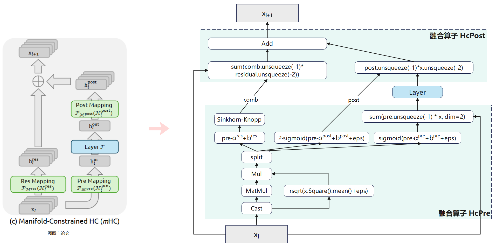

Fusing the entire HcPre operation into one large operator enables maximum performance optimization while exposing a single, easy-to-use interface to scripts. Scripts are unaware of the intermediate outputs produced by these extreme optimizations.

Fusing HcPost into one large operator eliminates the memory-wall issue caused by small operators.

Appendix:

A3 uses a separated architecture: The ratio of Cube cores to Vector cores is 1:2. Each Cube core and two Vector cores form an AICore core group. The following figure shows the structure of a core group. L1, L0A, L0B, and L0C are on-chip Buffers of the Cube core, and UB is the on-chip Buffer of the Vector core. For details, see [Basic Architecture](https://www.hiascend.com/document/detail/zh/canncommercial/82RC1/opdevg/Ascendcopdevg/atlas_ascendc_10_0008.html#ZH-CN_TOPIC_0000002336176974__section349312501823)(Chinese).

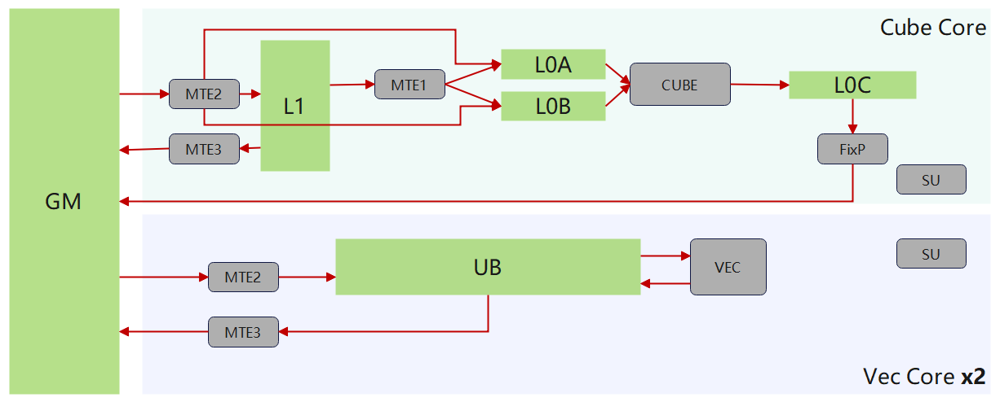

## Highlight

* Fusion eliminates the memory wall.

* CV pipeline parallelism.

* Highly optimized Tiling and pipelines.

## Outline

[HcPre Fused Operator Implementation](#hcpre-fused-operator-implementation)

[HcPost Fused Operator Implementation](#hcpost-fused-operator-implementation)

## HcPre Fused Operator Implementation

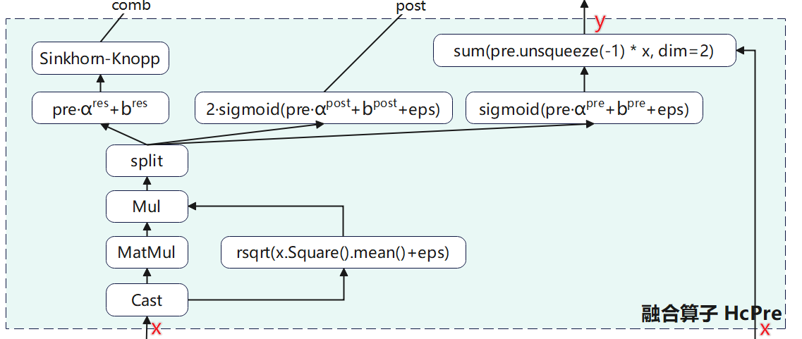

### A3 Implementation Design

A3 uses a separated architecture, so CV data exchange must use HBM (workspace). Based on Tiling differences across shapes, two templates are implemented on A3: a Decode-scenario template (multi-core K-partitioning template) and a Prefill-scenario template.

#### Decode-Scenario Implementation Design

In the Decode scenario, because m is small, multi-core partitioning along the K axis is required to improve performance.

##### Overall Computation Flow and Buffer Usage Design:

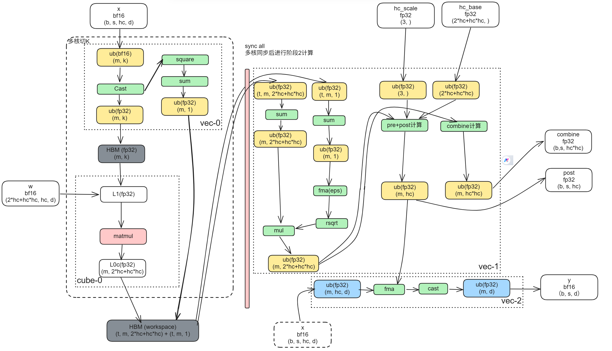

##### Tiling and Pipeline Design:

**Stage 1 pipeline design:**

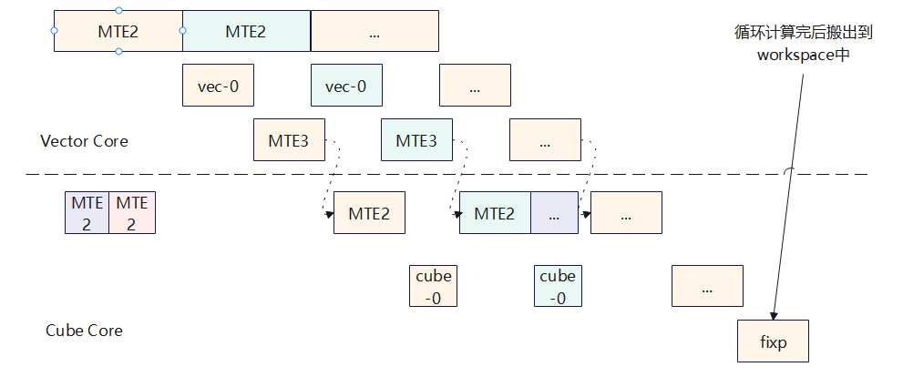

Data movement \-> type conversion \-> Cube computation forms a CV pipeline. Intermediate memory is small, generally hits L2, and improves pipeline efficiency.

**Stage 2 pipeline design:**

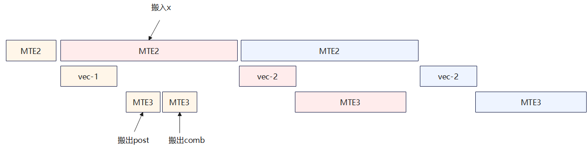

Move x in advance to overlap the Vector computation overhead of pre, post, and combine.

##### Performance Test Results:

| Specification              | Performance (us) |
| --------------------- | ---------- |
| b*s=16; hc=4; d=4096  |  32.8      |
| b*s=32; hc=4; d=4096  |  37        |
| b*s=64; hc=4; d=4096  |  44        |
| b*s=128; hc=4; d=4096 |  60        |

#### Prefill-Scenario Implementation Design

In the Prefill scenario, partition cores by token to form a CV pipeline.

##### Overall Computation Flow and Buffer Usage Design

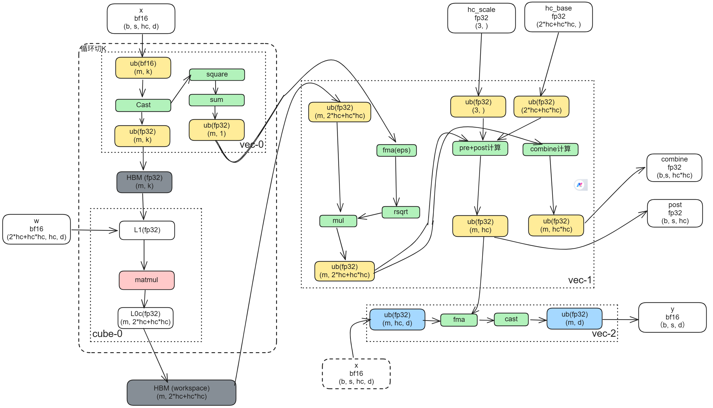

##### **Tiling and Pipeline Design:**

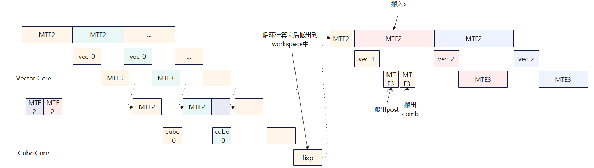

For stage 1 pipeline execution, stage 1 and stage 2 computation run serially. (For further optimization, the two V cores can be assigned separately: one performs Vector computation for stage 1, and the other performs stage 2 computation in a pipeline to further overlap overhead.)

##### Performance Test Results:

| Specification              | Performance (us) |
| --------------------- | ---------- |
| b*s=4K; hc=4; d=4096  |  1254.916  |
| b*s=16K; hc=4; d=4096 |  4784.204  |
| b*s=64K; hc=4; d=4096 |  18545.39  |

## HcPost Fused Operator Implementation

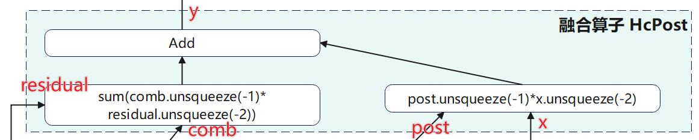

For small operators, the bottleneck of post is the memory wall. Fusion keeps data in the UBuffer (on-core Buffer), reduces HBM access, and substantially improves performance.

### A3 Implementation Design

#### **Overall Computation Flow and Buffer Usage Design:**

On A3, intermediate Vector computation results are stored in the UBuffer.

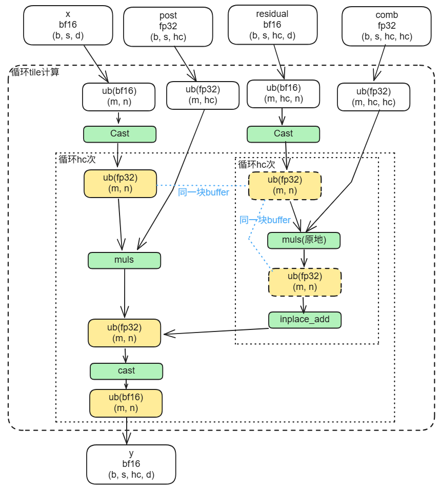

#### **Tiling and Pipeline Design**

Partition cores along the b, s, and d axes. Merge b and s into one bs axis, and partition tile blocks along bs and d. Each tile block has a size of \(m, n\). For very small cases using multi-core partitioning, balance launch overhead and processing overhead after enabling multiple cores. Each core must move at least 4 KB of data, and the data volume along n must be at least 1 KB and aligned to 512 B.

Balance Buffer usage and pipeline overlap to determine whether to perform pipelined movement in a loop along the hc axis. Consider templates for the following scenarios:

1)For cases with a small hc, the residual tile block (m, hc, n) can be moved in at once. (As shown in the "HcPost Computation Step Diagram.")

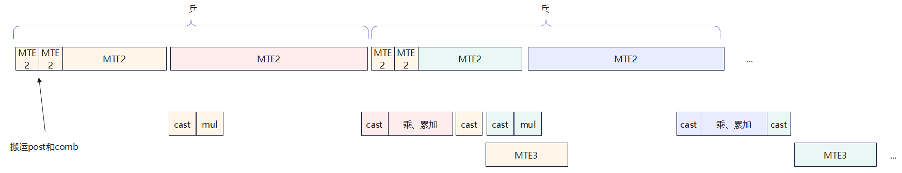

2)For generalized hc cases, the UB may be insufficient. Start a loop along the residual hc axis for pipelined movement and move in t items each time:

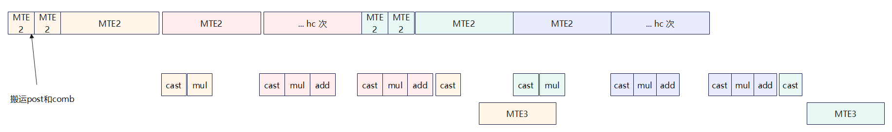

  The computation step diagram is shown in the following figure:

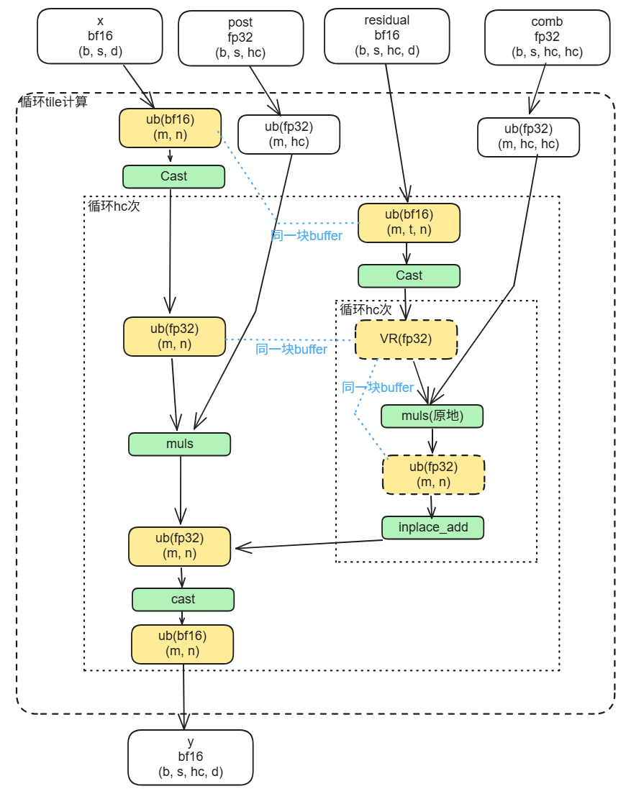

#### Performance Test Results:

| Specification                | Performance (us) |
| ----------------------- | ---------- |
| b*s=8; hc=4; d=4096     |   5.09     |
| b*s=16; hc=4; d=4096    |   5.37     |
| b*s=32; hc=4; d=4096    |   6.99     |
| b*s=64; hc=4; d=4096    |   9.16     |
| b*s=128; hc=4; d=4096   |   13.85    |
| b*s = 4K; hc=4; d=4096  |   319.86   |
| b*s = 16K; hc=4; d=4096 |   1264.68  |
| b*s = 64K; hc=4; d=4096 |   5044.53  |
<!-- static-meta
{
  "sidebarTitle": "mHC Fused Operators",
  "operator": ["ascendc"],
  "hardware": ["atlas-a3"],
  "llmSpeculativeInference": ["none"]
}
-->
