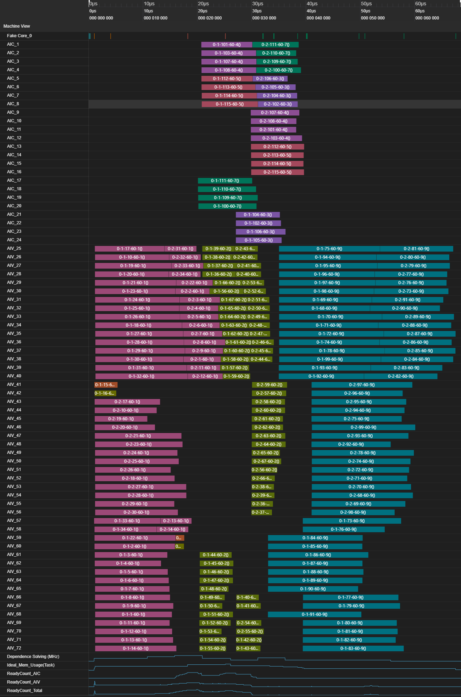
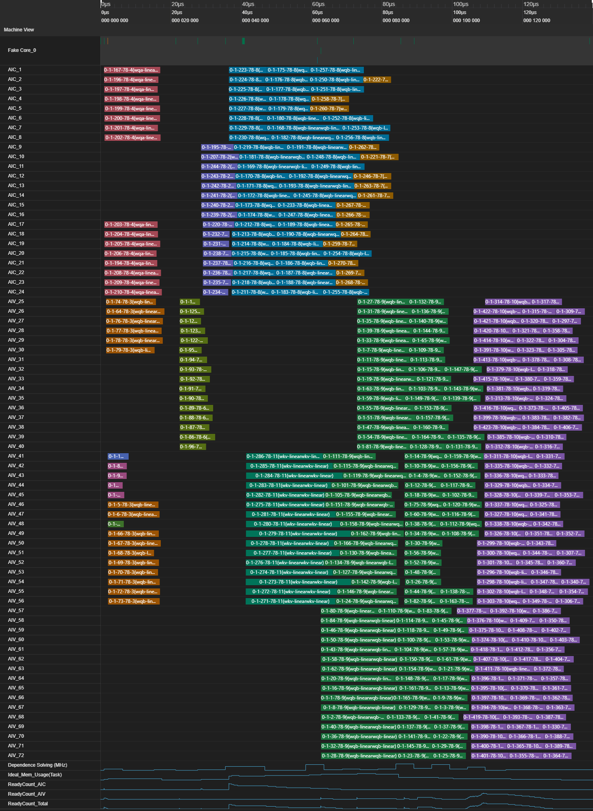
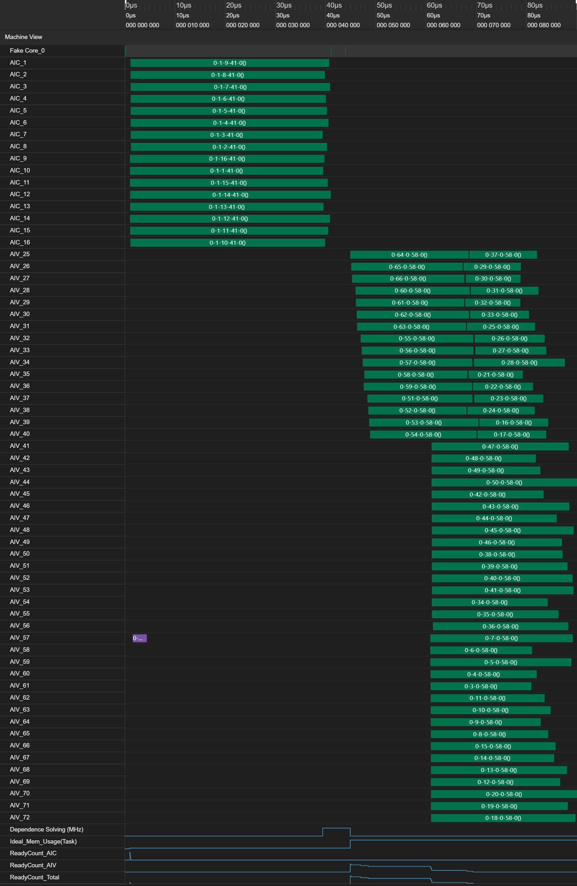
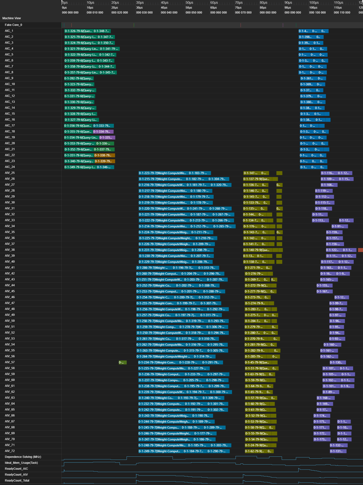
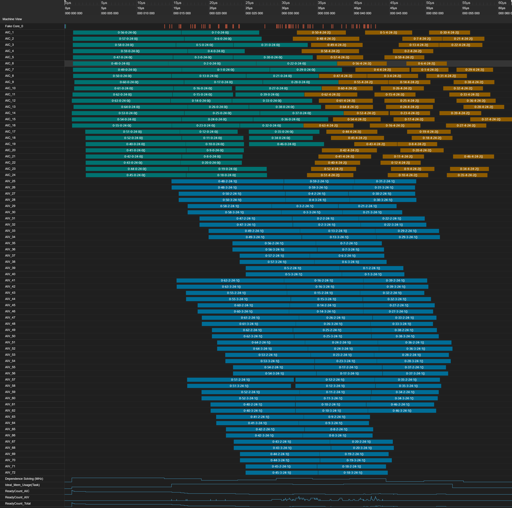
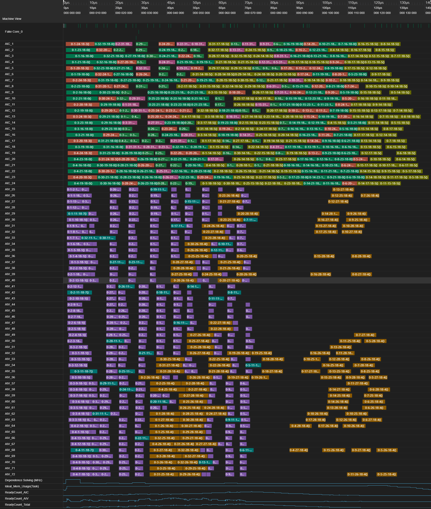
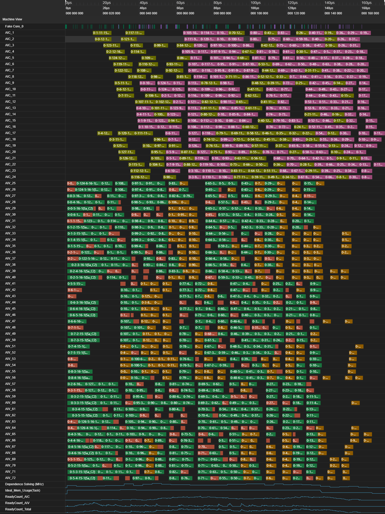

# NPU DeepSeek-V4 PyPTO Fused Operator Optimization

For the DeepSeek-V4 architecture, this release introduces multiple new fused operators: `hc_pre`, `Compressor`, and three FA operators, `SWA`, `CFA`, and `SCFA`. `MlaProlog` and `IndexerProlog` are also adapted to the new architecture. `hc_pre` is part of the `Manifold-Constrained Hyper-Connections` (mHC) in the new DeepSeek architecture.

This technical report provides an overview of the implementation and optimization of these fused operators in PyPTO. It also describes how PTO-ISA (the PTO virtual instruction set) helps PyPTO provide cross-generation compatibility. For the PyPTO high-performance programming framework code, see the PyPTO repository: [Cann-PyPTO](https://gitcode.com/cann/pypto).

The following table shows measured performance data and code size for each operator on a single die with 64 batches, MTP1, and an 8K sequence. PyPTO can develop complex fused operators with a small amount of code and high development efficiency (3-7 days), while achieving good baseline performance:

<table style="width:99%; border-collapse:collapse; margin:20px 0;">
    <tr>
        <th style="border:1px solid #ddd; padding:10px; text-align:center;">Operator</th>
        <th style="border:1px solid #ddd; padding:10px; text-align:center;">Lines of Code (KLOC)</th>
        <th style="border:1px solid #ddd; padding:10px; text-align:center;">B</th>
        <th style="border:1px solid #ddd; padding:10px; text-align:center;">S1</th>
        <th style="border:1px solid #ddd; padding:10px; text-align:center;">S2</th>
        <th style="border:1px solid #ddd; padding:10px; text-align:center;">D</th>
        <th style="border:1px solid #ddd; padding:10px; text-align:center;">cmp_ratio</th>
        <th style="border:1px solid #ddd; padding:10px; text-align:center;">coff</th>
        <th style="border:1px solid #ddd; padding:10px; text-align:center;">start pos</th>
        <th style="border:1px solid #ddd; padding:10px; text-align:center;">Duration(us)</th>
    </tr>
    <tr>
        <td style="border:1px solid #ddd; padding:10px; text-align:center;">sliding_window_attention</td>
        <td style="border:1px solid #ddd; padding:10px; text-align:center;">0.3</td>
        <td style="border:1px solid #ddd; padding:10px; text-align:center;">64</td>
        <td style="border:1px solid #ddd; padding:10px; text-align:center;">2</td>
        <td style="border:1px solid #ddd; padding:10px; text-align:center;">8192</td>
        <td style="border:1px solid #ddd; padding:10px; text-align:center;">512</td>
        <td style="border:1px solid #ddd; padding:10px; text-align:center;">N/A</td>
        <td style="border:1px solid #ddd; padding:10px; text-align:center;">N/A</td>
        <td style="border:1px solid #ddd; padding:10px; text-align:center;">N/A</td>
        <td style="border:1px solid #ddd; padding:10px; text-align:center;">65</td>
    </tr>
    <tr>
        <td style="border:1px solid #ddd; padding:10px; text-align:center;">compressed_flash_attention</td>
        <td style="border:1px solid #ddd; padding:10px; text-align:center;">0.2</td>
        <td style="border:1px solid #ddd; padding:10px; text-align:center;">64</td>
        <td style="border:1px solid #ddd; padding:10px; text-align:center;">2</td>
        <td style="border:1px solid #ddd; padding:10px; text-align:center;">8192</td>
        <td style="border:1px solid #ddd; padding:10px; text-align:center;">512</td>
        <td style="border:1px solid #ddd; padding:10px; text-align:center;">128</td>
        <td style="border:1px solid #ddd; padding:10px; text-align:center;">N/A</td>
        <td style="border:1px solid #ddd; padding:10px; text-align:center;">N/A</td>
        <td style="border:1px solid #ddd; padding:10px; text-align:center;">90</td>
    </tr>
    <tr>
        <td style="border:1px solid #ddd; padding:10px; text-align:center;">sparse_compressed_flash_attention</td>
        <td style="border:1px solid #ddd; padding:10px; text-align:center;">0.2</td>
        <td style="border:1px solid #ddd; padding:10px; text-align:center;">64</td>
        <td style="border:1px solid #ddd; padding:10px; text-align:center;">2</td>
        <td style="border:1px solid #ddd; padding:10px; text-align:center;">8192</td>
        <td style="border:1px solid #ddd; padding:10px; text-align:center;">512</td>
        <td style="border:1px solid #ddd; padding:10px; text-align:center;">4</td>
        <td style="border:1px solid #ddd; padding:10px; text-align:center;">N/A</td>
        <td style="border:1px solid #ddd; padding:10px; text-align:center;">N/A</td>
        <td style="border:1px solid #ddd; padding:10px; text-align:center;">160</td>
    </tr>
    <tr>
        <td style="border:1px solid #ddd; padding:10px; text-align:center;">compressor_c4li</td>
        <td rowspan="6" style="border:1px solid #ddd; padding:10px; text-align:center;">0.9</td>
        <td style="border:1px solid #ddd; padding:10px; text-align:center;">64</td>
        <td style="border:1px solid #ddd; padding:10px; text-align:center;">2</td>
        <td style="border:1px solid #ddd; padding:10px; text-align:center;">N/A</td>
        <td style="border:1px solid #ddd; padding:10px; text-align:center;">128</td>
        <td style="border:1px solid #ddd; padding:10px; text-align:center;">4</td>
        <td style="border:1px solid #ddd; padding:10px; text-align:center;">2</td>
        <td style="border:1px solid #ddd; padding:10px; text-align:center;">8192</td>
        <td style="border:1px solid #ddd; padding:10px; text-align:center;">55</td>
    </tr>
    <tr>
        <td style="border:1px solid #ddd; padding:10px; text-align:center;">compressor_c4a</td>
        <td style="border:1px solid #ddd; padding:10px; text-align:center;">64</td>
        <td style="border:1px solid #ddd; padding:10px; text-align:center;">2</td>
        <td style="border:1px solid #ddd; padding:10px; text-align:center;">N/A</td>
        <td style="border:1px solid #ddd; padding:10px; text-align:center;">512</td>
        <td style="border:1px solid #ddd; padding:10px; text-align:center;">4</td>
        <td style="border:1px solid #ddd; padding:10px; text-align:center;">2</td>
        <td style="border:1px solid #ddd; padding:10px; text-align:center;">8192</td>
        <td style="border:1px solid #ddd; padding:10px; text-align:center;">80</td>
    </tr>
    <tr>
        <td style="border:1px solid #ddd; padding:10px; text-align:center;">compressor_c128a</td>
        <td style="border:1px solid #ddd; padding:10px; text-align:center;">64</td>
        <td style="border:1px solid #ddd; padding:10px; text-align:center;">2</td>
        <td style="border:1px solid #ddd; padding:10px; text-align:center;">N/A</td>
        <td style="border:1px solid #ddd; padding:10px; text-align:center;">512</td>
        <td style="border:1px solid #ddd; padding:10px; text-align:center;">128</td>
        <td style="border:1px solid #ddd; padding:10px; text-align:center;">1</td>
        <td style="border:1px solid #ddd; padding:10px; text-align:center;">8192</td>
        <td style="border:1px solid #ddd; padding:10px; text-align:center;">55</td>
    </tr>
    <tr>
        <td style="border:1px solid #ddd; padding:10px; text-align:center;">compressor_c4li</td>
        <td style="border:1px solid #ddd; padding:10px; text-align:center;">64</td>
        <td style="border:1px solid #ddd; padding:10px; text-align:center;">2</td>
        <td style="border:1px solid #ddd; padding:10px; text-align:center;">N/A</td>
        <td style="border:1px solid #ddd; padding:10px; text-align:center;">128</td>
        <td style="border:1px solid #ddd; padding:10px; text-align:center;">4</td>
        <td style="border:1px solid #ddd; padding:10px; text-align:center;">2</td>
        <td style="border:1px solid #ddd; padding:10px; text-align:center;">8191</td>
        <td style="border:1px solid #ddd; padding:10px; text-align:center;">75</td>
    </tr>
    <tr>
        <td style="border:1px solid #ddd; padding:10px; text-align:center;">compressor_c4a</td>
        <td style="border:1px solid #ddd; padding:10px; text-align:center;">64</td>
        <td style="border:1px solid #ddd; padding:10px; text-align:center;">2</td>
        <td style="border:1px solid #ddd; padding:10px; text-align:center;">N/A</td>
        <td style="border:1px solid #ddd; padding:10px; text-align:center;">512</td>
        <td style="border:1px solid #ddd; padding:10px; text-align:center;">4</td>
        <td style="border:1px solid #ddd; padding:10px; text-align:center;">2</td>
        <td style="border:1px solid #ddd; padding:10px; text-align:center;">8191</td>
        <td style="border:1px solid #ddd; padding:10px; text-align:center;">95</td>
    </tr>
    <tr>
        <td style="border:1px solid #ddd; padding:10px; text-align:center;">compressor_c128a</td>
        <td style="border:1px solid #ddd; padding:10px; text-align:center;">64</td>
        <td style="border:1px solid #ddd; padding:10px; text-align:center;">2</td>
        <td style="border:1px solid #ddd; padding:10px; text-align:center;">N/A</td>
        <td style="border:1px solid #ddd; padding:10px; text-align:center;">512</td>
        <td style="border:1px solid #ddd; padding:10px; text-align:center;">128</td>
        <td style="border:1px solid #ddd; padding:10px; text-align:center;">1</td>
        <td style="border:1px solid #ddd; padding:10px; text-align:center;">8191</td>
        <td style="border:1px solid #ddd; padding:10px; text-align:center;">125</td>
    </tr>
    <tr>
        <td style="border:1px solid #ddd; padding:10px; text-align:center;">mla_prolog</td>
        <td style="border:1px solid #ddd; padding:10px; text-align:center;">0.5</td>
        <td style="border:1px solid #ddd; padding:10px; text-align:center;">64</td>
        <td style="border:1px solid #ddd; padding:10px; text-align:center;">2</td>
        <td style="border:1px solid #ddd; padding:10px; text-align:center;">N/A</td>
        <td style="border:1px solid #ddd; padding:10px; text-align:center;">N/A</td>
        <td style="border:1px solid #ddd; padding:10px; text-align:center;">N/A</td>
        <td style="border:1px solid #ddd; padding:10px; text-align:center;">N/A</td>
        <td style="border:1px solid #ddd; padding:10px; text-align:center;">N/A</td>
        <td style="border:1px solid #ddd; padding:10px; text-align:center;">130</td>
    </tr>
    <tr>
        <td style="border:1px solid #ddd; padding:10px; text-align:center;">hc_pre</td>
        <td style="border:1px solid #ddd; padding:10px; text-align:center;">0.4</td>
        <td style="border:1px solid #ddd; padding:10px; text-align:center;">64</td>
        <td style="border:1px solid #ddd; padding:10px; text-align:center;">2</td>
        <td style="border:1px solid #ddd; padding:10px; text-align:center;">N/A</td>
        <td style="border:1px solid #ddd; padding:10px; text-align:center;">N/A</td>
        <td style="border:1px solid #ddd; padding:10px; text-align:center;">N/A</td>
        <td style="border:1px solid #ddd; padding:10px; text-align:center;">N/A</td>
        <td style="border:1px solid #ddd; padding:10px; text-align:center;">N/A</td>
        <td style="border:1px solid #ddd; padding:10px; text-align:center;">70</td>
    </tr>
    <tr>
        <td style="border:1px solid #ddd; padding:10px; text-align:center;">lightning_indexer_prolog</td>
        <td style="border:1px solid #ddd; padding:10px; text-align:center;">0.3</td>
        <td style="border:1px solid #ddd; padding:10px; text-align:center;">64</td>
        <td style="border:1px solid #ddd; padding:10px; text-align:center;">2</td>
        <td style="border:1px solid #ddd; padding:10px; text-align:center;">N/A</td>
        <td style="border:1px solid #ddd; padding:10px; text-align:center;">N/A</td>
        <td style="border:1px solid #ddd; padding:10px; text-align:center;">N/A</td>
        <td style="border:1px solid #ddd; padding:10px; text-align:center;">N/A</td>
        <td style="border:1px solid #ddd; padding:10px; text-align:center;">N/A</td>
        <td style="border:1px solid #ddd; padding:10px; text-align:center;">101</td>
    </tr>
</table>


## hc_pre

`hc_pre` is invoked twice in each layer, before attention and ffn computation.

### Computation Workflow

1. Calculate the denominator of RMSNorm.

$$
rsqrt = \sqrt{\frac{1}{\frac{1}{n}\sum_{i=1}^n x_i^2 + \epsilon}}
$$

2. Calculate mixes.

$$
mixes = (x @ hc\_fn) \odot rsqrt
$$

3. Apply the Sinkhorn-Knopp algorithm.

$$
pre, post, comb = sinkhorn(mixes, hc\_scale, hc\_base, hc\_mult, hc\_sinkhorn\_iters)
$$

In each iteration, the Sinkhorn-Knopp algorithm performs row-wise normalization followed by column-wise normalization. hc_sinkhorn_iters controls the number of iterations.

4. Use pre and x to calculate y.

$$
y = rowsum(pre \odot x)
$$

In actual development, Ascend hardware features must be fully used to achieve better performance. The following sections describe the current solution and implementation in detail.

### Pipeline Parallelism

The first step in the computation workflow is Vector computation, while $x @ hc\_fn$ in the second step is Cube matrix-multiplication computation. The two operations have no dependency. The PyPTO framework supports simultaneous execution of the two tasks without manually inserting synchronization.

### Instruction Optimization

The Sinkhorn-Knopp algorithm contains many repeated reduction operations chained with element-wise multiplication and division. In element-wise computation, pass optimizations and PTO instructions avoid explicit broadcasting and provide high-performance computation.

```
pypto.experimental.set_operation_config(combine_axis=True)

```

### MatMul Optimization

In the Decode scenario, the K axis of matmul computation is long (16K), while the M\N axes are small. Therefore, split K to partition data across different cores and fully use computing resources.

```
pypto.set_cube_tile_shapes([16, 16], [512, 2*1024], [128, 128], \
						enable_multi_data_load=True, enable_split_k=True)
mm_res = pypto.matmul(x_fp32, hc_fn, pypto.DT_FP32, b_trans=True)

```

### Computation Optimization

The main difference between Prefill and Decode is the size of axis 0 of input x. In the Prefill scenario, t is usually large. In the Sinkhorn-Knopp algorithm, the reduction axis is small, with hc_mult=4. The row reduction uses axis -1, and the column reduction uses axis -2. Here, a mathematically equivalent computation technique directly calculates the transpose during matrix multiplication in the second step:

$$
hc\_fn^T @ x^T
$$

As a result, when entering the Sinkhorn-Knopp algorithm, t is placed on the last axis and the reduction axes are -2 and -3, improving computation efficiency.

### Swimlane Diagram

For a single die with 64 batches and MTP1, the on-device execution result is as follows:

<p align="center">
  
  <center>hc_pre Swimlane Diagram</center>
</p>

## MlaProlog

This operator is the Multi-Head Latent Attention computation that processes hidden states into query and kv.

### Computation Workflow

1. Query computation<br>
   Includes two projections and RmsNorm (the weight of the second RmsNorm is always 1), followed by inplace interleaved rope computation on the last rope\_dim dimensions of axis -1:

$$
c^Q = RmsNorm(x @ wq\_a)
$$

$$
q = RmsNorm(c^Q @ wq\_b)
$$

$$
q[..., -rope\_dim:] = ROPE(q[..., -rope\_dim:])
$$

2. Kv computation<br>
   Includes one projection and RmsNorm, followed by inplace interleaved rope computation on the last rope\_dim dimensions of axis -1:

$$
k = RmsNorm(x @ wkv)
$$

$$
k[..., -rope\_dim:] = ROPE(k[..., -rope\_dim:])
$$

### Pipeline Parallelism

PyPTO uses MPMD scheduling. In the Decode scenario, operations such as `x@wq_a` and `x@wkv` do not use all cores and can therefore run in parallel. Similarly, the subsequent RmsNorm operations for query and kv can also run in parallel.

### Unrollist Expands Dynamic Execution into a Static Graph

In Prefill and Decode scenarios, t often differs substantially. In general, it is difficult for one set of code Tile partitions to achieve good performance in different scenarios. By dividing dynamic value t into multiple ranges and using a static tTile for Tile partitioning, good performance is achieved across different scenarios.

```
unroll_list = [128, 64, 32, 16, 1]
for tIdx, unrollLength in pypto.loop_unroll(0, t, 1, name="MLA_BS_LOOP", idx_name="bs_offset",
                                            unroll_list=unroll_list, ):
	...
```

### Graph-Merging Optimization

Setting graph-merging parameters merges subgraphs with the same structure, prevents an excessive number of same-structure subgraphs, avoids repeated movement, and increases opportunities for on-core pipeline scheduling, providing good performance.

```
pass_options={
    "cube_nbuffer_mode": 1,
    "vec_nbuffer_mode": 2,
    "vec_nbuffer_setting": {-1: 2}
}
```

### MatMul Optimization

Based on the shape of the input tensor participating in matmul computation, set an appropriate tile_shape to evenly distribute matmul tasks across AIC cores. When the K axis is too large, enable split K or manually split K to reduce the movement volume of a single task. For large shapes, enable large-block movement to improve bandwidth utilization. These methods improve matmul task efficiency.

```
# x_tile.shape=[128, 4096], wkv_shape=[4096, 512]
pypto.set_cube_tile_shapes([tile_bs, tile_bs], [256, 512], [128, 128], enable_split_k=True, enable_multi_data_load=True)
kv = pypto.matmul(x_tile, wkv, pypto.DataType.DT_FP32)
```

### Swimlane Diagram

For a single die with 64 batches and MTP1, the on-device execution result is as follows:

<p align="center">
  
  <center>mla_prolog Swimlane Diagram</center>
</p>

## Compressor

The new model introduces the `Compressor` module, which PyPTO implements.

### Computation Workflow

$$kv = X@W^{KV}$$
$$score = X@W^{Gate}+ape$$
Use kv and score to refresh kv_state and score_state. In inference scenarios, when start_pos+1 is a multiple of `compress_ratio`, generate compressed kv through the following computation:
$$kv=(kv\_state * score\_state.\text{softmax(dim=1)).sum(dim=1)}$$
$$kv=\text{ROPE}(\text{RMSNorm}(kv))$$
When `rotate`=true, perform a Hadamard transform on kv.

### Different Optimizations for Multiple Scenarios

Parameters used by the `Compressor` module, such as compression ratio `compress_ratio` and `rotate`, differ across layers. For different scenario configurations, PyPTO uses different branches within the same operator and optimizes each branch separately, providing good performance in different usage scenarios. The following example describes optimization methods when `compress_ratio`=4 and `rotate`=false.

### MatMul Optimization

```
b = 64
b_loop = (bsz + b - 1) // b
for b_idx in pypto.loop(b_loop, name="LOOP_COMP_1", idx_name="b_idx"):
	x_view = pypto.view(x, [b*s1, h], [b_idx*b*s1, 0])
        ## Matmul
        pypto.set_cube_tile_shapes([128, 128], [256, 512], [128, 128], True)
        kv_t = pypto.matmul(x_view, wkv, pypto.DT_FP32, b_trans=True)
	score_t = pypto.matmul(x_view, wgate, pypto.DT_FP32, b_trans=True)
```

In this scenario, the shapes of the left and right matrices in the two matrix multiplications are [batchsize*s1, 4096] and [4096, 1024]. batchsize is dynamic.

1. If batch is directly unrolled in a loop, the shape of the M axis of matrix multiplication in the static graph is s1. This causes the right matrix to be moved repeatedly many times across the operator, resulting in poor performance. Therefore, the dynamic batch axis is partitioned with b=64.
2. Enable large-block movement on the K axis: cube_tile_shapes([128, 128], [256, 512], [128, 128], True) means that the L0 and L1 movement tilesizes on the K axis are set to 256 and 512, respectively. Moving a larger amount of data into L1 at a time improves bandwidth utilization.

### Vector Operation Optimization

```
b_valid = (bsz-b_idx*b).min(b)
for c_idx in pypto.loop(b_valid, name="LOOP_COMP_2", idx_name="c_idx"):
            pypto.set_pass_options(pg_skip_partition=True)
```

Because the start_pos values of different batches differ, their Vector processing may enter different branches. The addresses of kv_state and score_state updated by different batches also differ. Therefore, loop over batches and process each batch's Vector operations separately. Set ''pg_skip_partition=True'' so that the Vector processing of one batch remains in one subgraph. This is because:

1. When the graph is split, intermediate data moves between GM and UB, degrading performance.
2. Vector processing includes Softmax+ReduceSum and RMSNorm+RoPE. The former operates along axis 1, while the latter operates along the last axis, making effective multi-core parallelism difficult. In high-throughput, large-batchsize scenarios, operations across batches are independent. Therefore, using each batch as one subgraph enables multi-core parallelism and good performance.

```
index = cache_index[:,pos:pos+1]
kv_state = scatter_update_3d(kv_state, index, kv) ## b,4,2d
score_state = scatter_update_3d(score_state, index, score)
```

When updating kv_state and score_state for subsequent Vector operations, use the scatter_update OP to avoid repeatedly moving kv_state and score_state into the UB and to avoid performance degradation caused by concat operations.

### Swimlane Diagram

For a single die with 64 batches and MTP=1, where each batch performs compression, the on-device result is as follows:

<p align="center">
  
  <center>compressor Swimlane Diagram</center>
</p>

## IndexerProlog

Unlike DeepSeekV3.2, IndexerProlog appears only in layers where compress_ratio = 4 and provides input q, weight, and q_scale for subsequent LightningIndexer computation.

### Computation Workflow

1. Query computation
   The formulas for calculating q and q_scale are as follows:

$$
q\_tmp = \text{qr}@{idx\_wq\_b} \cdot \text{qr\_scale} \cdot \text{idx\_wq\_b\_scale}
$$

$$
q\_hadamard = \text{Cat}(\{q\_tmp[:, :nope\_dim], Rope(q\_tmp[:, nope\_dim:])\}, -1)@hadamard
$$

$$
q, q\_scale = Quant(q\_hadamard)
$$

Here, Rope represents rotary position encoding computation, and Quant represents quantization computation.

2. Weights computation
   The formula for calculating Weights is as follows:

$$
weights = x@\text{weights\_proj} \cdot {\frac{1}{\sqrt{\text{idx\_nq} \cdot \text{head\_dim}}}}
$$

### Swimlane Diagram

For a single die with 64 batches and MTP=1, the on-device result is as follows:

<p align="center">
  
  <center>indexer_prolog Swimlane Diagram</center>
</p>


## FA Operators: SWA, CFA, and SCFA

A notable feature of the new model is that different Attention computation methods are used across layers based on their compression ratios. PyPTO fully uses its development flexibility and implements attention for different layers as three different attention operators:

### SWA

SWA is short for sliding window attention. This operator is used when compress_ratio = 1. Masks provide efficient implementation during Prefill and under different MTP configurations.

#### Swimlane Diagram

For a single die with 64 batches, MTP1, and kv_len=8k, the on-device result is as follows:

<p align="center">
  
  <center>swa Swimlane Diagram</center>
</p>


### CFA

CFA is short for compressed flash attention. This operator is used when compress_ratio = 128. The CFA kv cache comes from two sources, ori_kv and cmp_kv. ori_kv is the original kv cache, while cmp_kv is the kv_cache compressed by the `compressor` module. A sliding window is used to select Ori_kv, while cmp_kv must satisfy the causal attention mechanism.

#### Swimlane Diagram

For a single die with 64 batches, MTP, and kv_len=8k, the on-device result is as follows:

<p align="center">
  
  <center>cfa Swimlane Diagram</center>
</p>


### SCFA

SCFA is short for sparse compressed flash attention. This operator is used when compress_ratio = 4. Unlike CFA, SCFA uses cmp_sparse_indices to discretely select specified kv cache entries from cmp_kv. The UB contiguously gathers discrete tokens so that subsequent Attention computation is efficient.

#### Swimlane Diagram

For a single die with 64 batches, MTP1, and kv_len=8k, the on-device result is as follows:

<p align="center">
  
  <center>scfa Swimlane Diagram</center>
</p>


## PTO-ISA Support for Operator Compatibility Across Chip Generations

At the operator level, except for capabilities such as MXFP8 quantization that are unsupported by certain chip generations, the operator frontend does not need to be aware of chip-generation differences. One set of operator code can run on different chip generations. The capabilities of different chip generations are distinguished through pass IR and subsequent PTO instructions.

### PTO-ISA

The PyPTO backend is built on the PTO virtual instruction set (PTO ISA). PTO ISA supports both old and new core architectures (A2/A3/950D) while providing compatibility without performance degradation. It uses a unified instruction interface across chip generations and highly adapts to each microarchitecture. For performance, it encapsulates DSA custom optimizations and combines them with the powerful VF fusion capability of the BiSheng PTO compiler to better perform micro-kernel-level fusion and fully use the computing power of next-generation chips. To meet rapid algorithm-update requirements, PTO ISA and the supporting BiSheng compiler also provide powerful DFX capabilities, including TPRINT (printing a Tile or GlobalTensor) and operator-fusion information statistics, facilitating precision debugging and software optimization.

### hc_post

hc\_post is calculated as follows:

```
y = post.unsqueeze(-1) * x.unsqueeze(-2) + torch.sum(comb.unsqueeze(-1) * residual.unsqueeze(-2), dim=2)
```

Only Vector cores are used. Building on other optimizations, PTO-ISA combines with the powerful VF fusion capability of the BiSheng PTO compiler. Automatic fusion improves performance by 22.7% compared with automatic fusion disabled.
<!-- static-meta
{
  "sidebarTitle": "PyPTO Fused Operators",
  "operator": ["pypto"],
  "hardware": ["atlas-a2", "atlas-a3", "ascend-950"],
  "llmSpeculativeInference": ["mtp"]
}
-->
