# NPU DeepSeek SHMEM Communication Optimization Practice

## Introduction

As modern large language models (LLMs) evolve, efficient parallel computing and memory-management technologies are becoming key factors in improving model performance and deployment efficiency. As model parameter scales continue to increase, conventional communication and storage methods increasingly expose performance bottlenecks in high-concurrency, high-throughput scenarios.

OpenSHMEM is a parallel programming model based on a shared address space that supports efficient data exchange in multi-threaded and multi-node environments. Through a minimal interface, it provides extremely low-latency, highly scalable remote-memory access and is ideal for building next-generation supercomputing applications. To address the shortcomings of conventional communication methods, the CANN open-source community provides CANN SHMEM programming interfaces based on OpenSHMEM concepts and CANN's global-memory interaction capabilities. By encapsulating Host-side and Device-side interfaces, it provides model and operator developers with efficient, easy-to-use cross-device memory communication, simplifying inter-card data synchronization and the development of communication-computation fused operators.

Its core benefits are:

- Simplifies inter-card communication logic in distributed scenarios and reduces the operator-development barrier.
- Integrates high-performance communication engines such as MTE and xDMA, supports D2D/D2H communication, and improves multi-device collaboration efficiency.
- Deeply integrates with the CANN ecosystem and supports rapid deployment of communication-computation fused operators.

This document primarily describes the process of enabling SHMEM on Ascend NPUs and practices for developing high-performance operators with it. For more information, see the SHMEM [open-source repository](https://gitcode.com/cann/shmem).

<p align = "center">
    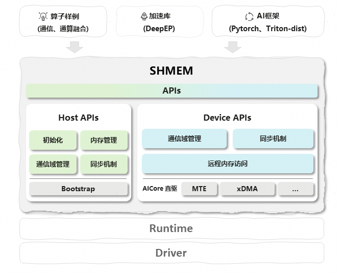
</figure>

This technical report describes in detail how to use and optimize SHMEM programming APIs on Ascend platforms. It uses typical scenarios such as dispatch&combine/kvoffload to describe SHMEM interface invocations in detail.

## Highlights

- The SHMEM API supports hybrid addressing of NPU HBM and CPU DDR to optimize KVoffload throughput.
- HIXL supports the SHMEM API and provides pooled rH2D and d2RH data-access and communication capabilities.
- CANN SHMEM enables communication-computation fused programming and optimizes communication invocations for dispatch&combine in DeepEP.
- Tilelang and PyPTO enable SHMEM communication-computation fused programming and improve its programmability.


## KVCache Offload Optimization with SHMEM

Offload moves the KV Cache in LLM inference to Host memory, relieving Device memory pressure. Combined with sparse attention, it addresses memory and computation bottlenecks in long-sequence LLM inference, increases batch size, and improves inference throughput.

During Offload, moving the KV Cache between Host and Device is critical. SHMEM provides unified memory management so that the model does not need to distinguish between Host and Device memory. It only invokes the corresponding torch interface to move data through H2D and D2H. SHMEM also enables low-latency, high-bandwidth communication within a cluster, reducing KV Cache H2D latency during Offload and playing a key role in improving full-network inference latency and throughput.

Using DeepSeek V3.2 as an example:

- During model initialization, invoke the SHMEM torch interface to allocate Host-side memory for the KV Cache to offload and map its address to the Device. During model inference, this memory can be used directly as a Device Tensor.

```
cache_nope_bytes = cache_nope_tensor.untyped_storage().nbytes()
cache_nope_data_ptr = aclshmem_malloc(cache_nope_bytes, MemType.HOST_SIDE)
metadata = {
    "data_ptr": cache_nope_data_ptr,
    "device": cache_device,
    "nbytes": cache_nope_bytes,
    "dtype": dtype,
    "size": cache_nope_shape,
    "stride": cache_nope_tensor.stride(),
    "storage_offset": cache_nope_tensor.storage_offset(),
}
storage = torch_npu._C._construct_storage_from_data_pointer(
    metadata["data_ptr"], metadata["device"], metadata["nbytes"]
)
cache_nope = torch_npu._C._construct_NPU_Tensor_From_Storage_And_Metadata(metadata, storage)
```

- During Prefill, the KV Cache generated by model inference is asynchronously offloaded to this memory.
- During Decoding, after Lightning Indexer generates topk ids for sparse attention, invoke the GatherSelectionKVCache operator to select the KV Cache of the corresponding tokens from Host memory based on the topk ids. During this process, the operator directly accesses the mapped Device Tensor without needing to know its Host-side memory layout, simplifying the algorithm workflow.

```
# kv cache constructed by shmem and mapped into device tensor
full_kv_cache = k_nope.squeeze(2)
full_k_rope = k_pe.squeeze(2) if not self.kv_cache_c8 else offload_cache.empty_rope

selection_kv_actual_seq = torch_npu.npu_gather_selection_kv_cache(
    selection_k_rope, selection_kv_cache,
    selection_kv_block_table, selection_kv_block_status,
    topk_indices, full_k_rope, full_kv_cache,
    block_table, actual_seq_lengths_kv,
    actual_seq_qlen, selection_topk_block_size=1)
```

After Offload + SHMEM is enabled, DeepSeek V3.2 provides significant inference-memory benefits: In an Atlas A3 environment with 64 cards and a 64K sequence length, the maximum batch size supported by model inference increases from 1024 to 2048.

To further improve inference throughput through Offload, ByteDance proposed ShadowKV (3x throughput improvement), Baidu proposed the ESS system (123% throughput improvement), and Tsinghua University proposed the NOSA architecture. Based on these solutions, future Offload + SHMEM optimization directions include:

(1) Cache more frequently accessed Token Cache entries on the Device side to fully use SHMEM's high-bandwidth D2D capability, relieve H2D pressure during Decoding, and combine parallel-overlap technology to hide Gather latency in forward computation, potentially doubling throughput.

(2) Refer to architectures such as NOSA and innovate at the algorithm level to overcome the DeepSeek V3.2 limitation that requires real-time Topk calculation and repeated Gather in every iteration. (3) Use SHMEM's cross-node rH2D and D2rH capabilities to implement cross-node Gather during Decoding at the framework level, avoiding H2H transfer of the entire KV Cache and further reducing inference latency.

## Implementing HIXL One-Sided Communication with SHMEM and Integrating It into the Mooncake Community

As LLM context windows continue to expand to 128K or even millions of tokens, the core bottleneck for ultra-long sequences in advanced scenarios such as long-document analysis, complex multi-turn conversations, and code generation has shifted from conventional computing-power constraints to the dual challenges of the storage subsystem and data-transfer efficiency.
The KV Cache grows linearly with sequence length. In ultra-long-sequence scenarios, its capacity can reach tens of GB, far exceeding the HBM capacity of a single NPU card and requiring some or all KV Cache data to be offloaded to CPU-side DRAM. This architectural adaptation overcomes the "global-memory wall" and increases concurrent-request processing capacity, but it also introduces frequent data interaction between the NPU and DRAM. High-performance transfer requirements for PUT D2rH (Device to Remote Host) and GET rH2D (Remote Host to Device) become the core technical bottleneck that limits overall inference throughput and latency.

### HIXL Introduction

HIXL (Huawei Xfer Library) is a flexible and efficient Ascend one-sided communication library that provides simple, reliable, and efficient point-to-point data transfer in cluster scenarios through an easy-to-use API. Based on SHMEM, HIXL efficiently addresses high-performance transfer requirements for PUT D2rH and GET rH2D, providing a targeted solution to storage and transfer bottlenecks in ultra-long-sequence LLM inference. HIXL provides three core advantages:

1. Supports One-Sided Zero-Copy communication.
2. Shields hardware differences and supports multiple links for high-speed cross-device interconnection.
3. Uses a minimal API design and deeply adapts to open-source ecosystem frameworks.
   HIXL is deeply integrated with the Mooncake community and supports typical service scenarios such as low-latency KV Cache transfer and pooled reuse. For more information, see the HIXL open-source repository: https://gitcode.com/cann/hixl.

### HIXL Integration with SHMEM

HIXL integrates SHMEM to implement unified global addressing across processes. With SHMEM's memory-sharing mechanism, each process can directly access the DRAM memory space of other processes without kernel-mode data copies, providing high-performance transfer. The technical implementation is as follows:

1. Memory allocation: Each process independently requests a private memory segment from local DRAM and obtains its virtual and local physical addresses.
2. Address exchange: Each process synchronizes the physical-address information of its memory segment, including the base address, length, and permissions, to all participating processes in the cluster, constructing a global physical-address pool.
3. Cross-process page-table mapping: Each process maps the received physical memory addresses of other processes to its own virtual-address space, forming a globally unified virtual-to-physical address mapping and enabling "address once, access globally."
4. SDMA data access: Based on globally unified addressing, the SDMA engine initiates remote-memory reads and writes and directly accesses the DRAM of any process without explicit inter-process interaction.
<p align = "center">
    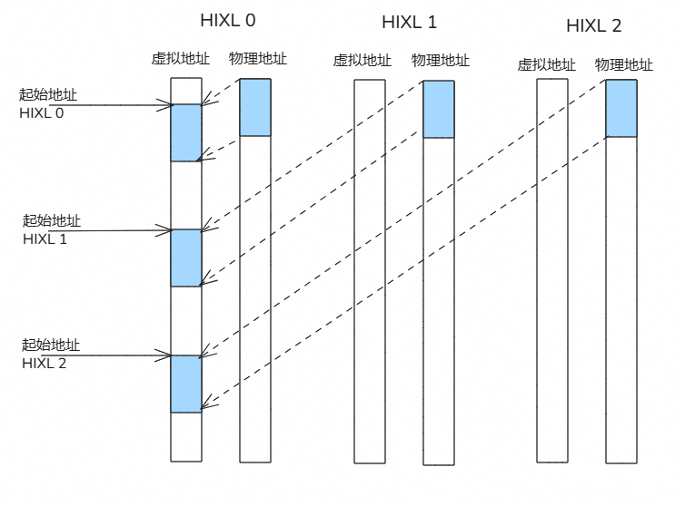
</figure>

HIXL can configure OPTION_ENABLE_USE_FABRIC_MEM: 1 enables SHMEM mode, and 0 disables SHMEM mode.

### Performance Test Results

The HIXL (SHMEM) performance data tested on an A3 SuperPod is as follows:

1. Two nodes, one card per node, one-to-one; data volume of one block: Simulate DeepSeek-R1 KV size, that is, 61x128K + 61x16K = 8784 KB. Run 100 transfers and average the results, excluding the first transfer that establishes the link. (The same applies below.)
<p align = "center">
    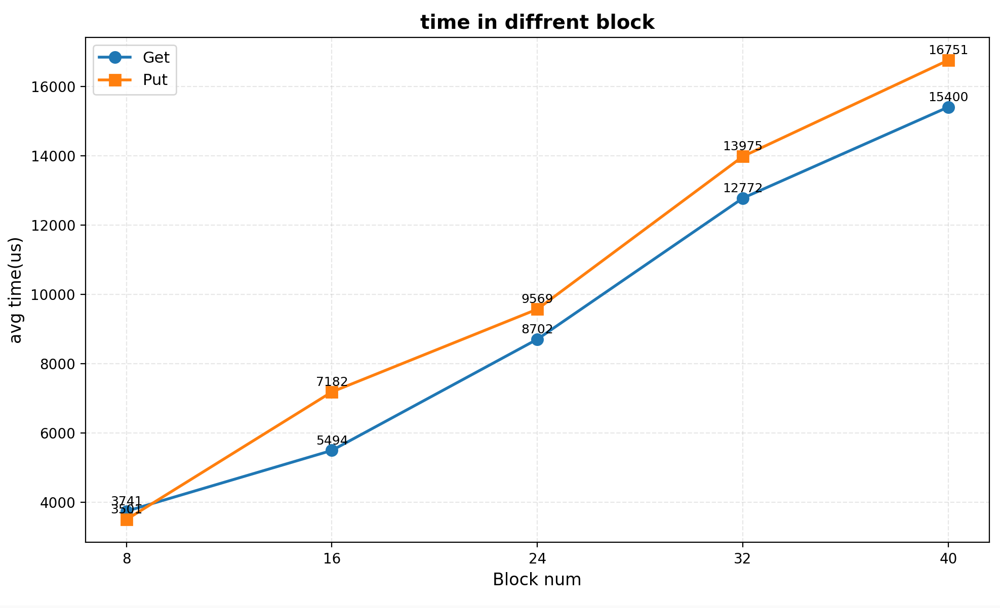
</figure>

2. Two nodes, 16 cards per node, one-to-one.
 <p align = "center">
    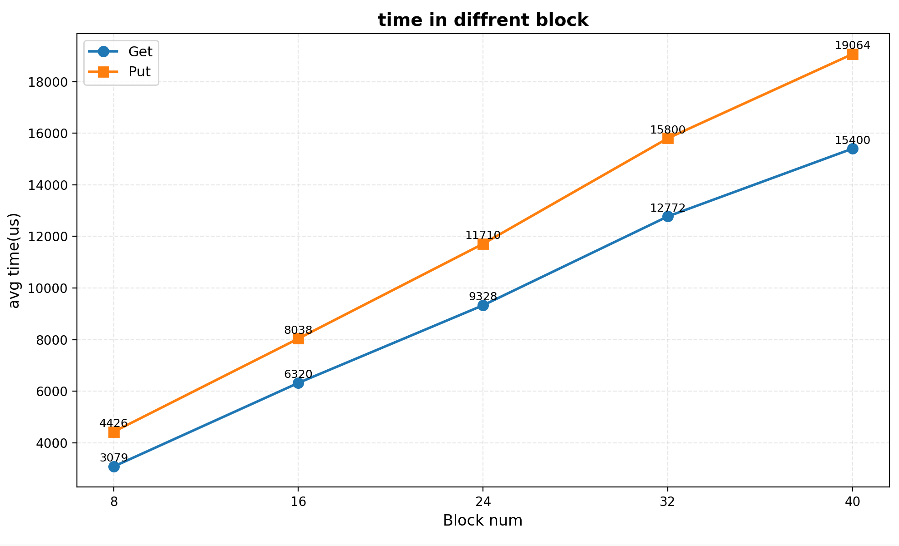
</figure>

3. Large-block data-volume test with two nodes, one card per node, one-to-one.
<p align = "center">
    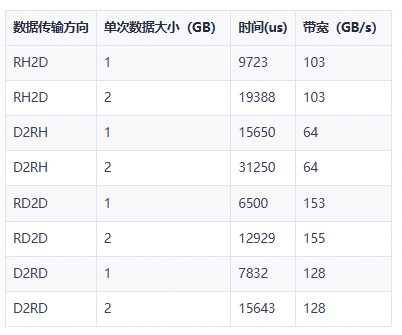
</figure>

## Implementing Dispatch&Combine with SHMEM and Integrating It into DeepEP

### Dispatch&Combine Introduction

DeepEP Dispatch and Combine are the core All-to-All communication operations in Mixture of Experts (MoE) Expert Parallel (EP). They are responsible for task distribution and result aggregation, respectively, support the two major scenarios of high-throughput training and low-latency inference, and are critical to performance.

#### Dispatch

- Required inputs include x and expertIds.
  x is the original token representation to distribute. Each token is sent to one or more experts based on the routing result.
  expertIds contains expert-assignment indices generated by the Router. expertIds[i, j] represents the j-th selected expert ID for the i-th token (0 ≤ expertId < num_experts).

- Primary outputs include expandXOut, assistInfoForCombineOut, expertTokenNumsOut, and epRecvCountsOut.
  expandXOut is the input token Tensor received by the current rank from other ranks and rearranged in expert order.
  assistInfoForCombineOut is tuple information containing the source rank, source token, and the k-th transmission from that token.
  expertTokenNumsOut represents the number of tokens received by each expert.
  epRecvCountsOut represents the number of tokens received from each card in the EP communication domain (corresponding to epSendCounts in the CombineV2 operator series).

- Operator execution workflow:
  Send data ——> send status ——> wait for status ——> copy local win-region data

1. Send data:
   Assume that the current shape of x is [Bs, H] and the shape of expertIds is [Bs, K]. Each of the Bs tokens is sent K times to different experts, distributing tokens to different experts on different ranks, which is Dispatch.
2. Send status:
   The status region marks the transmission status of data that the current rank must receive from other ranks (that is, whether transmission is complete). It primarily contains two values: flag and cnt. When flag is 1, data from a rank to an expert has been completely sent and flag is set to 1. cnt indicates the number of data entries sent from a rank to an expert.
<p align = "center">
    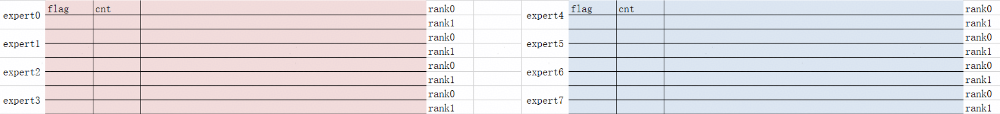
</figure>

3. Wait for status:
   Because the current rank also receives data dispatched from other cards, a loop must continually check whether all data for the current rank has been received. In the status region of the current rank, a while loop obtains the sum of flags. If the current sum meets the corresponding requirement, the loop exits, indicating that the current rank has received all tokens sent from other ranks.
4. Copy local win-region data:
   After status waiting ends, data can be copied from the win-region data area of the current rank to the UB of the current rank. The UB then moves the received data to the GM of the current rank to produce the final Dispatch output.
   The approximate win-region data-area structure is as follows:
<p align = "center">
    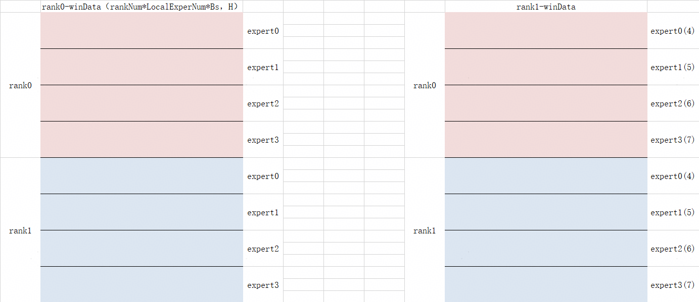
</figure>

   The left side is rank0's win data region. The red part represents data received by rank0 from rank0, and the blue part represents data received by rank0 from rank1. Because status waiting has ended, only the red and blue data need to be moved to rank0's UB and then moved out to rank0's win region. The same applies to rank1 on the right.
   Each row in the win data region contains token information, quantization-parameter information, and tuple information. Moving the corresponding data through slicing forms outputs such as expandXOut and assistInfoForCombineOut.


#### Combine

After Dispatch, tokens are sent to different experts for processing. Combine returns the processed data from these experts to the ranks to which the tokens originally belonged. Combine and Dispatch are essentially inverse mappings.

- Combine inputs include expandX, assistInfoForCombine, and epSendCounts.
  expandX represents data sent to the current rank through Dispatch and then processed by experts (that is, data to return to the original rank).
  assistInfoForCombine contains tuple information for data to return to the corresponding rank. It identifies the rank and token from which a token originated and the transmission number for that token.
  epSendCounts represents the number of tokens received from each card in the EP communication domain and corresponds to the epRecvCounts output of MoeDistributeDispatchV2.

- Combine outputs xOut, that is, after Combine, data originally sent from the current card after processing by experts on different ranks.

The Combine execution workflow includes: send data ——> send status ——> wait for status ——> copy local data

1. Send data:
   Tuple information is already stored in assistInfoForCombine. Based on the rank, expert, and transmission number it describes, a for loop processes the tokens to return from the current card one by one and returns each token to the correct position in the corresponding rank's win data region.
<p align = "center">
    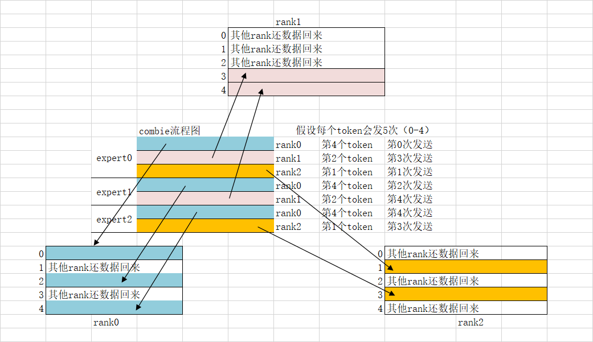
</figure>

2. Send status:
   Status can be sent while data is sent, with one status sent for each data entry. Unlike Dispatch, sending status directly fills the entire status region corresponding to the token with 1.

3. Wait for status:
   After the current rank sends data and status through the for loop, it must also continually wait for status through a while loop. For example, if the current rank had A tokens during Dispatch and each token was sent K times, the current rank should theoretically receive A*K tokens returned through Combine. The while loop checks whether the sum of the status regions corresponding to these tokens equals the target value. When it does, all data sent by the current rank has been returned and status waiting is complete.

4. Copy and process local data:
   The A*K tokens required by the current rank are now in its win data region. They must be moved to the UB for processing and then moved out to the current rank's win region. Process data in batches of K for A iterations corresponding to the original A tokens on the rank. The K tokens in each batch are the K returned data entries after the current token was sent K times. These K entries are results from different experts on different ranks processing the same token. Fuse the K entries to obtain the token after processing by K experts. Then move this one token fused from K entries to the UB. Repeating this process A times produces the XOut result of the Combine operator.
   The following figure shows rank1 fusing its win data region to obtain the final processed data. The same applies to other ranks.
<p align = "center">
    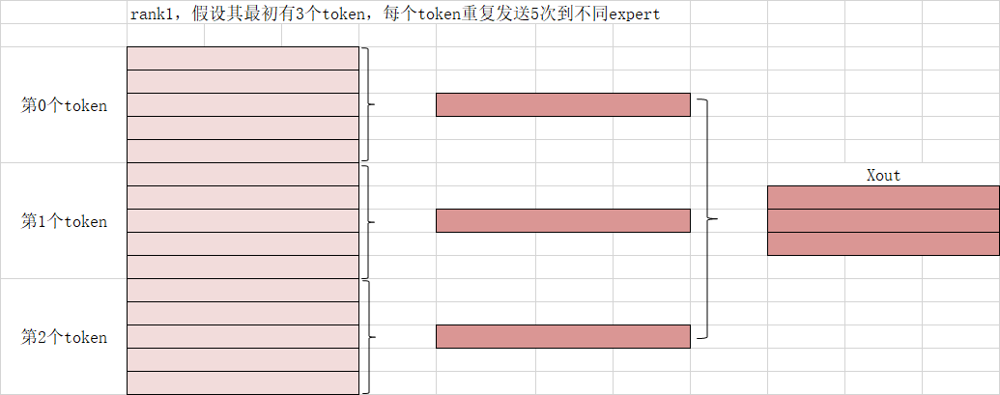
</figure>

### Implementing Dispatch&Combine Operators with SHMEM APIs

Based on the symmetric-memory mechanism, SHMEM efficiently supports development of communication-computation fused operators. The following figure shows the basic principle of SHMEM symmetric memory.
<p align = "center">
    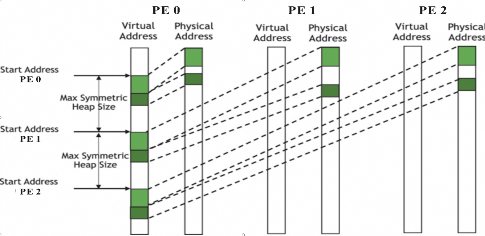
</figure>

#### Operator Development Workflow

##### SHMEM Initialization

   1. "***_pyshmem.MoeDistributeCppBuffer(30010241024, 1)***" specifies the memory space allocated for the current die in bytes. The data and status regions share this area. Total memory usage cannot exceed the allocated memory size.

   2. "***ret = dc_buffer.ShmemInit(16, rank, t)***" specifies the rank_id of the current die and the total number of dies in the current communication domain.

   3. "***shmem_context = dc_buffer.InitAndGetMC2CommContext()***" encapsulates shared-memory information in shmem_context and passes it to the operator as an input parameter.
<p align = "center">
    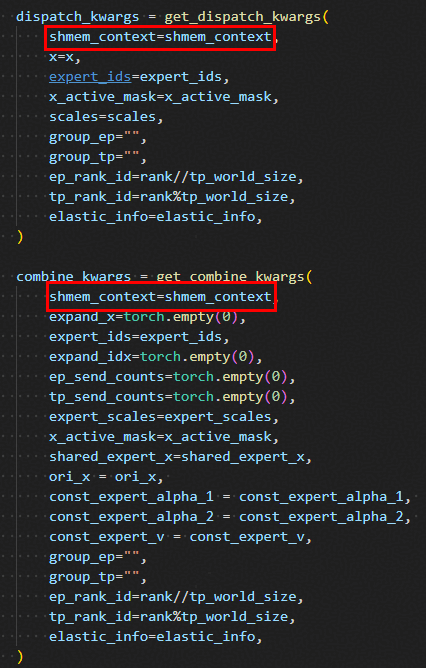
</figure>

##### Enabling SHMEM

   - Within an operator, use the GetShmemDataAddr and GetShmemSignalAddr interfaces to obtain the starting memory addresses of the data and status regions on the target remote card.
   - In the SHMEM solution, the status region immediately follows the data region. context->shmem_addr corresponds to the starting SHMEM memory address of the current card.
   - A die cluster shares one global virtual address. The memory stride between dies is set to 1 GB. Users can determine the number and size of memory allocations as required, but total memory allocated per die cannot exceed 1 GB.
<p align = "center">
    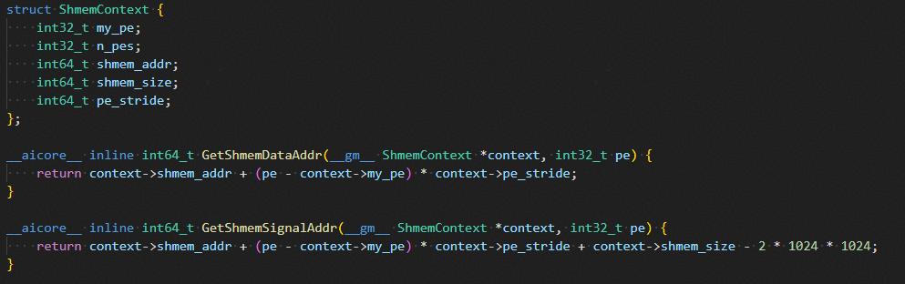
</figure>

#### Full-Network Integration and Results

1. In the directory containing modeling_deepseek.py, place the libcommshmem.so and _pyshmem.cpython-311-aarch64-linux-gnu.so dynamic libraries compiled from the SHMEM repository to support invocations of encapsulated SHMEM API interfaces.

2. Encapsulate the init_shmem_once function to ensure that SHMEM memory initialization is invoked only once during full-network execution. When invoked more than once, the function returns automatically (initializing SHMEM memory more than once in the full network causes an error). Place this function under the __init__ function of the DeepseekV3ForCausalLM class.
<p align = "center">
    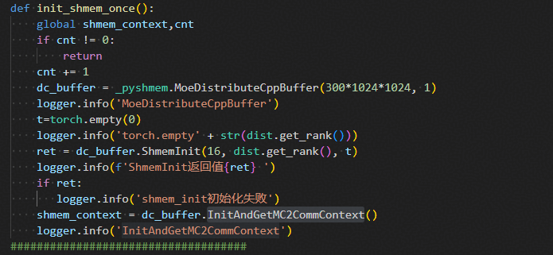
</figure>

3. Add the shmem_context input parameter to both Dispatch and Combine. This parameter contains the starting address and size information of the memory allocated for the current die and is obtained through the SHMEM interface shmem_get_context.
<p align = "center">
    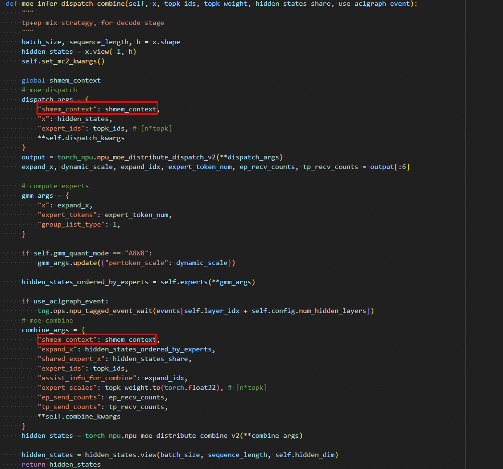
</figure>

4. Replace the native torch_npu Dispatch and Combine with the SHMEM versions.


### Implementing Dispatch&Combine Operators with SHMEM-Integrated Programming Frameworks


In addition to native SHMEM APIs, CANN SHMEM supports integration with multiple programming frameworks, such as Tilelang and PyPTO. The following sections describe how to develop Dispatch&Combine operators with Tilelang-SHMEM and PyPTO-SHMEM.

#### Implementing Dispatch&Combine Operators with Tilelang-SHMEM

##### Tilelang Introduction

TileLang is a tile-level programming DSL that uses Python-like syntax and builds its underlying compiler infrastructure on TVM. It optimizes code for specific hardware, allowing developers to express and optimize underlying kernel behavior at a high level. TileLang allows developers to explicitly control memory allocation, data movement, layout, and parallel execution. It also encapsulates a rich set of APIs to simplify operator development.

##### Tilelang-SHMEM Operator Implementation Workflow

The following figure shows the Dispatch&Combine operator implementation workflow.

1. Load the environment required for Tilelang and SHMEM.
2. Use Tilelang primitives to write the Dispatch operator.
3. Use Tilelang primitives to write the Combine operator.
4. Enable multiple threads, construct the input data required by Dispatch, use SHMEM to allocate the required Win-region space, and invoke the Dispatch and Combine operators. Pass the constructed data to the operators to provide cross-card or cross-node functionality.
<p align = "center">
    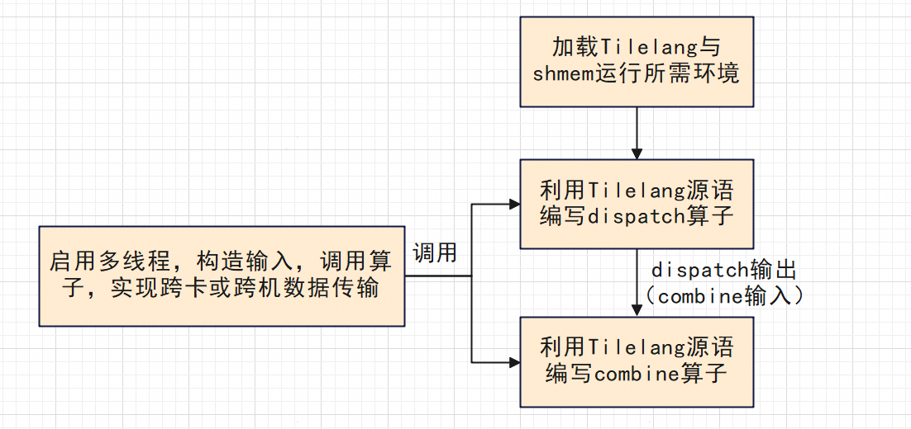
</figure>

##### Dispatch Operator Implementation

The operator implementation includes parameter input, sending data, sending status, waiting for status, and copying local Win-region data.

```
@tilelang.jit(out_idx=[4,5,6,7],
def moe_dispatch_kernel(
    Bs,
    H,
    K,
    ep_world_size,
    local_expert_num,
    rank,
    ub_size,
    ai_core_num,
):
    aiv_num = ai_core_num * 2
    total_expert_num = ep_world_size * local_expert_num
    ub_align = 32
    status_per_core = (total_expert_num + aiv_num - 1) // aiv_num
    @T.prim_func
    def main_dispatch(
        x: T.Tensor([Bs, H], "bfloat16"),
        expert_ids: T.Tensor([Bs, K], "int32"),
        win_data: T.Tensor([total_expert_num * Bs, ub_size], "bfloat16"),
        win_status: T.Tensor([total_expert_num, 8], "float"),
        expandXOut: T.Tensor([ep_world_size * Bs * local_expert_num, H], "bfloat16"),
        expand_ids: T.Tensor([ep_world_size * Bs * local_expert_num, 3], "int32"),
        ep_receive_count: T.Tensor([total_expert_num], "int32"),
        expert_token_nums_out: T.Tensor([local_expert_num], "int64"),
        workspace: T.Tensor([aiv_num,8], "int32"),
    ):
        with T.Kernel(ai_core_num, is_npu=True) as (cid, vid):
            x_ub = T.alloc_ub([H + (32 + 12) // 2], "bfloat16")
            ...
            with T.Scope("C"):
                T.sync_all()
                ...
            with T.Scope("V"):
                send_token_num = cur_send_token_cnt // aiv_num
                remainder_token_num = cur_send_token_cnt % aiv_num
                start_send_token_id = send_token_num * true_vid
                ...
                # Send data
                for cur_send_token_id in range(start_send_token_id, start_send_token_id + send_token_num):
                    ...
                    T.shmem_ub_put_nbi_new(x_ub, win_data, ub_size, dest_rank_id, (rank * Bs * local_expert_num + dest_expert_id * Bs + token_repeat_num[0]) * ub_size)
                # Send status
                for cur_expert_id in range(start_expert_id, start_expert_id + aiv_expert_num):
                    ...
                    T.shmem_ub_put_nbi_new(win_status_ub_single, win_status, 8, dest_rank_id, local_expert_id * ep_world_size * 8 + rank * 8)
                # Wait for status in a loop
                while (sum_of_flag[0] != aiv_expert_fp_num):
                    ...
                # Copy local Win-region data
                for i in range(status_num_per_core):
                    ...
    return main_dispatch
```

**Basic Parameter Settings**

* **moe_dispatch_kernel**: Function name that defines the Dispatch operator and is used for subsequent invocations.
* **Bs**: Number of tokens per card.
* **H**: Token length.
* **K**: Number of MoE experts to which each token is sent.
* **ep_world_size**: Total number of enabled cards.
* **local_expert_num**: Number of MoE experts per card.
* **rank**: Current card ID.
* **ub_size**: Requested Win-region size.
* **ai_core_num**: Number of enabled AI cores.

**Input and Output Tensor Settings**

* **x**: Original tokens to distribute (input).
* **expert_ids**: Expert-ID Tensor (input).
* **win_data**: Requested data-region memory of the input Win region (input).
* **win_status**: Requested status-region memory of the Win region (input).
* **expandXOut**: Input token Tensor received by the current card from other cards and rearranged in expert order (output).
* **expand_ids**: Tuple information (output).
* **ep_receive_count**: Number of tokens received from each card in the EP communication domain (output).
* **expert_token_nums_out**: Number of tokens received by each expert (output).

**Using the APIs**
Tilelang encapsulates many APIs. The preceding code shows several examples:

* **T.alloc_ub**: Allocates memory space in the UB. Example: T.alloc_ub(shape, dtype).
* **T.sync_all()**: Performs inter-core synchronization.
* **T.shmem_ub_put_nbi*_new***: SHMEM interface encapsulated in Tilelang that transfers UB data from the current card to the Win region. Example: T.shmem_ub_put_nbi_new(x_ub, win, ub_size, dest_rank_id, stride), where x_ub is the UB data on the current card, win is the requested Win region, ub_size is the UB size, dest_rank_id is the remote-card ID, and stride is the offset.

##### Combine Operator Implementation

The operator implementation includes parameter input, sending data, sending status, waiting for status, and copying local Win-region data.

```
@tilelang.jit(out_idx=[5],
def moe_combine_kernel(
    Bs,
    M,
    H,
    K,
    ep_world_size,
    local_expert_num,
    rank,
    ai_core_num,
):
    aiv_num = 2 * ai_core_num
    assist_size = 3
    token_per_core = (M + aiv_num - 1) // aiv_num
    float_align_ub = 8
    @T.prim_func
    def main_combine(
        expandX: T.Tensor([M, H], "bfloat16"),
        assistInfoCombine: T.Tensor([M, assist_size], "int32"),
        epSendCounts: T.Tensor([local_expert_num * ep_world_size], "int32"),
        winData: T.Tensor([Bs * K, H], "bfloat16"),
        winStatus: T.Tensor([Bs * K, 8], "float"),
        combineOut: T.Tensor([Bs, H], "bfloat16")
    ):
        with T.Kernel(ai_core_num, is_npu=True) as (cid, vid):
            x_ub = T.alloc_ub([H], "bfloat16")
            ...
            with T.Scope("V"):
                T.tile.fill(statusUb, 1.0)
                ...
                # Send data and status
                for loop in range(sendTokenNum[0]):
                    ...
                    T.shmem_ub_put_nbi_new(x_ub, winData, H, toRankId, winGM * H)

                    T.shmem_ub_put_nbi_new(statusUb, winStatus, 8, toRankId, winGM * 8)
                for curIdx in range(startTokenId[0], startTokenId[0] + tokenNum[0]):
                    sumOfFlag[0] = -1.0
                    stateGM = curIdx * K
                    calCnt = compareTarget
                    # Wait for status
                    while((sumOfFlag[0] < targetMin) or (sumOfFlag[0] > targetMax)):
                        ...
                    # Copy local Win-region data
                    T.copy(winData[tokenIndexOffset, 0], winData_ub_bfloat)
                    T.copy(winData_ub_bfloat, combineOut[curIdx,0])
    return main_combine
```

**Basic Parameter Settings** (***Extract as common content and describe Tilelang differences separately***)

* **moe_combine_kernel**: Function name that defines the Combine operator and is used for subsequent invocations.
* **Bs**: Number of tokens sent by Dispatch on each card.
* **M**: Total number of tokens received by the current card.
* **H**: Token length.
* **K**: Number of MoE experts to which each token is sent.
* **ep_world_size**: Total number of enabled cards.
* **local_expert_num**: Number of MoE experts per card.
* **rank**: Current card ID.
* **ai_core_num**: Number of enabled AI cores.

**Input and Output Tensor Settings**

* **expandX**: Data sent to the current card through Dispatch (input).
* **assistInfoCombine**: Tuple information for data to return to the corresponding card (input).
* **epSendCounts**: Number of tokens received from each card in the EP communication domain (input).
* **winData**: Requested data-region memory of the Win region (input).
* **winStatus**: Requested data-region memory of the Win region (input).
* **combineOut**: Operator output (output).

**Using the APIs**
The operator implementation also requires many APIs, used in the same way as in Dispatch.

##### Enabling Multiple Threads and Invoking Dispatch&Combine Operators

```
G_IP_PORT = "tcp://100.102.180.145:8666"
g_ash_size = 1024 * 1024 * 1024
num_processes = 16
def worker(rank, barrier, x, expert_ids):
    ...
    # Initialize aclshmem
    ret = aclshmem_module.aclshmem_init(attributes)
    if ret == 0:
        ...
        # Request the Win region
        tensorData_dispatch = aclshmem_module.aclshmem_create_tensor([epWorldSize * localExpertNum * Bs, ub_size], dtype=torch.bfloat16,
                                                    device_id=rank)
        tensorStatus_dispatch = aclshmem_module.aclshmem_create_tensor([epWorldSize * localExpertNum , 8], dtype=torch.float,
                                                    device_id=rank)
        tensor_combine = aclshmem_module.aclshmem_create_tensor([Bs * K, H], dtype=torch.bfloat16, device_id=rank)
        tensorStatus_combine = aclshmem_module.aclshmem_create_tensor([Bs * K, 8], dtype=torch.float, device_id=rank)
        Win_dispatch = tensorData_dispatch.fill_(0)
        winStatus_dispatch = tensorStatus_dispatch.fill_(0)
        Win_combine = tensor_combine.fill_(0)
        winStatus_combine = tensorStatus_combine.fill_(0)
        workspace_1 = torch.zeros((aivNum, 8), dtype=torch.int32).npu()
        # Invoke the Dispatch operator
        func_dispatch = moe_dispatch_kernel(Bs, H, K, epWorldSize, localExpertNum, rank, ub_size, aiCoreNum)
        expand_x, expand_idx, ep_recv_counts, expert_token_nums = func_dispatch(x, expert_ids, Win_dispatch, winStatus_dispatch, workspace_1)
        # Invoke the Combine operator
        expand_x = expand_x[:ep_recv_counts[-1].item(),:]
        expand_idx = expand_idx[:ep_recv_counts[-1].item(),:]
        func_combine = moe_combine_kernel(Bs, ep_recv_counts[-1].item(), H, K, epWorldSize, localExpertNum, rank, aiCoreNum)
        x_out = func_combine(expand_x, expand_idx, ep_recv_counts, Win_combine, winStatus_combine)
        ...
    else:
        print(f"Rank {rank}: Initialization failed with code {ret}")
    # Clean up
    aclshmem_module.aclshmem_finialize()
    print(f"Rank {rank}: Finalized")

for rank in range(num_processes):
    x, expert_ids = init_input(rank, Bs, H, K, epWorldSize, localExpertNum)
    p = mp.Process(target=worker, args=(rank, barrier, x, expert_ids))
    p.start()
    processes.append(p)
for p in processes:
    p.join()
```

* **G_IP_PORT**: IP address of the local node.
* **g_ash_size**: Maximum Win space that can be requested, 1 GB.
* **num_processes**: Number of enabled processes.

First initialize through aclshmem_module.aclshmem_init. Then use aclshmem_module.aclshmem_create_tensor to request the required Win-region space and invoke the operators by the previously defined Dispatch and Combine operator names. The Dispatch output is passed as the Combine input, and Combine produces the final result.

#### Implementing Dispatch&Combine Operators with PyPTO-SHMEM

##### PyPTO Introduction:

PyPTO (pronounced "pai p-t-o") is a high-performance programming framework for AI accelerators. It simplifies the development of complex fused operators and even complete model networks while maintaining high-performance computing capabilities. The framework uses the innovative **PTO (Parallel Tensor/Tile Operation) programming paradigm**, with a **Tile-based programming model** as its core design principle. Through a multi-level intermediate representation (IR) system, it progressively compiles AI model applications built by users through APIs from high-level Tensor graphs into hardware instructions, ultimately generating executable code that runs efficiently on the target platform.


##### PyPTO-SHMEM API Introduction

PyPTO implements some OPENSHMEM communication semantics and encapsulates them as APIs for users:

* **shmem_put**: Sends local data (local Tensor) to a specified position in symmetric memory (SHMEM Tensor).
* **shmem_get**: Obtains data from a specified position in symmetric memory (SHMEM Tensor) and stores it in a local Tensor.
* **shmem_signal**: Sends a signal to another card.
* **shmem_wait**: Waits for the signal on the current card until the specified signal equals the specified value.
* **shmem_barrier_all**: Synchronizes cards in the communication domain. Execution continues only after all cards reach this synchronization point.

It also implements some non-standard OPENSHMEM semantics:

* **create_shmem_tensor**: Creates a Tensor representing symmetric memory in a specified communication domain.
* **shmem_clear_data**: Clears data in the SHMEM Tensor.
* **shmem_signal_data**: Clears the SHMEM signal.
* **my_symbolic_pe**: Symbolic rank ID of the current card.

##### PyPTO-SHMEM Operator Implementation Workflow

###### Dispatch Operator Implementation

In PyPTO, the Dispatch operator is described as three subgraphs:

* **send_token**: Uses SHMEM APIs to send tokens and their corresponding token information to shared memory according to the expert table and notifies other ranks after transmission is complete.
* **send_signal**: Notifies other cards after token transmission is complete.
* **receive_token**: Receives tokens from other cards.

The main implementation code is as follows:

```
LOOP("send_token_col", FunctionType::DYNAMIC_LOOP, rowIndex, LoopRange(batchSize)) {
    LOOP("send_token_col", FunctionType::DYNAMIC_LOOP, colIndex, LoopRange(topK)) {
        Tensor moeSendMsg(DataType::DT_INT32, moeSendMsgShape, "moeSendMsg");
        Tensor tensorTile = View(x, {1, hiddenSize}, {rowIndex, 0});
        TileShape::Current().SetVecTile({1, infoSize});
        SetTensorData(thisRank, {0, 0}, moeSendMsg);
        SetTensorData(rowIndex, {0, 1}, moeSendMsg);
        SetTensorData(colIndex, {0, 2}, moeSendMsg);
        SymbolicScalar remoteExpertId = GetTensorData(expertIds, {rowIndex, colIndex});
        SymbolicScalar tokenOffset = GetTensorData(offsetTable, {rowIndex, colIndex});
        SymbolicScalar remoteExpertOffset = remoteExpertId % expertNumPerRank;
        SymbolicScalar remoteRankId = remoteExpertId / expertNumPerRank;
        Tensor shmemDataTile = View(shmemData, {1, 1, 1, hiddenSize}, std::vector<SymbolicScalar>{remoteRankId, remoteExpertOffset * epWorldSize + thisRank, tokenOffset, 0});
        Tensor shmemInfoTile = View(shmemInfo, {1, 1, 1, infoSize}, std::vector<SymbolicScalar>{remoteRankId, remoteExpertOffset * epWorldSize + thisRank, tokenOffset, 0});
        TileShape::Current().SetVecTile({1, hiddenSize});
        Tensor shmemDataPutOut = ShmemPut(tensorTile, tensorTile, shmemDataTile);
        TileShape::Current().SetVecTile({1, infoSize});
        Tensor shmemInfoPutOut = ShmemPut(moeSendMsg, moeSendMsg, shmemInfoTile);
        shmemSendOut = Nop({shmemDataPutOut, shmemInfoPutOut});
    }
}

Tensor shmemCountOut(DT_INT32, {1, 1}, "shmemCountOut");
LOOP("send_signal", FunctionType::DYNAMIC_LOOP, expertId, LoopRange(moeExpertNum)) {
    TileShape::Current().SetVecTile({1, 1});
    SymbolicScalar remoteRankId = expertId / expertNumPerRankScalar;
    SymbolicScalar remoteExpertOffset = expertId % expertNumPerRankScalar;
    Tensor shmemCountTile = View(shmemCount, {1, 1, 1, 1}, {remoteRankId, 0, remoteExpertOffset * epWorldSize + thisRank + 1, 0});
    Tensor totalOffsetTile = View(totalOffset, {1, 1}, {expertId, 0});
    Tensor shmemPutOut = ShmemPut(shmemSendOut, totalOffsetTile, shmemCountTile);
    TileShape::Current().SetVecTile({1, signalCol});
    Tensor shmemSignalTile = View(shmemSignal, {1, 1, 1, 1, signalCol}, {remoteRankId, 0, 0, 0, 0});
    shmemCountOut = ShmemSignal(shmemPutOut, shmemSignalTile, AtomicType::ADD);
}

LOOP("receive_token", FunctionType::DYNAMIC_LOOP, i, LoopRange(1)) {
    (void) i;
    TileShape::Current().SetVecTile({1, signalCol});
    Tensor shmemSignalLocalTile = View(shmemSignal, {1, 1, 1, 1, signalCol}, {thisRank, 0, 0, 0, 0});
    Tensor waitUntilOut = WaitUntil(shmemCountOut, shmemSignalLocalTile, moeExpertNum, true);
    TileShape::Current().SetVecTile({expertNumPerRank * epWorldSize + 1, 1});
    Tensor shmemCountTile = View(shmemCount, {1, 1, expertNumPerRank * epWorldSize + 1, countSize}, std::vector<SymbolicScalar>{1, 1, expertNumPerRank * epWorldSize, 1},{thisRank, 0, 0, 0});
    Tensor shmemGetOut = ShmemGet(waitUntilOut, shmemCountTile);
    Tensor cumSumCurrent = CumSum(shmemGetOut, 0);
    Tensor cumSumResult = Cast(cumSumCurrent, DT_INT32, CAST_TRUNC);
    for (uint32_t index = 0; index < expertNumPerRank * epWorldSize; ++index) {
        TileShape::Current().SetVecTile({1, countSize});
        Tensor shmemReceiveCountTile = View(shmemCount, {1, 1, 1, countSize}, {thisRank, 0, index, 0});
        Tensor localExpertRecvCount = ShmemGet(cumSumResult, shmemReceiveCountTile);
        SymbolicScalar curCount = GetTensorData(localExpertRecvCount, {0, 0}); // Number of data entries obtained by the current card for the current expert
        SymbolicScalar offset = GetTensorData(cumSumResult, {index, 0}); // Starting offset in expandX of the current card's data for the current expert
        // Obtain valid tokens
        Tensor curShmemDataTile = View(shmemData, {1, 1, batchSize, hiddenSize}, std::vector<SymbolicScalar>{1, 1, curCount, hiddenSize},
            {thisRank, index, 0, 0});
        TileShape::Current().SetVecTile({1, hiddenSize});
        Tensor localDataRecvCount = ShmemGet(localExpertRecvCount, curShmemDataTile);
        Assemble(localDataRecvCount, std::vector<SymbolicScalar>{offset, 0}, expandX);
        auto curShmemInfoTile = View(shmemInfo, {1, 1, batchSize, infoSize}, std::vector<SymbolicScalar>{1, 1, curCount, infoSize},
            {thisRank, index, 0, 0});
        TileShape::Current().SetVecTile({1, infoSize});
        Tensor localInfoRecvCount = ShmemGet(localExpertRecvCount, curShmemInfoTile, std::vector<SymbolicScalar>{curCount, infoSize});
        Assemble(localInfoRecvCount, {offset, 0}, assistInfoForCombine);
    }
}

```

###### Combine Operator Implementation

In PyPTO, the Combine operator is mainly described as two subgraphs:

* **send**: Uses assistInfoForCombine to return tokens along the original path to the shared-memory region.
* **receive**: Receives processed tokens and calculates a weighted average based on expert weights.

The main code is as follows:

```
LOOP("send", FunctionType::DYNAMIC_LOOP, rowIndex, LoopRange(recvCountsScalar), unrollList) {
    SymbolicScalar rankId = GetTensorData(assistInfoForCombine, {rowIndex, 0});
    SymbolicScalar tokenId = GetTensorData(assistInfoForCombine, {rowIndex, 1});
    SymbolicScalar kOffset = GetTensorData(assistInfoForCombine, {rowIndex, 2});

    Tensor expandXTile = View(expandX, {1, hiddenSize}, {rowIndex, 0});
    Tensor shmemDataTile = View(shmemData, {1, 1, 1, hiddenSize}, {rankId, 0, topK * tokenId + kOffset, 0});
    TileShape::Current().SetVecTile({1, hiddenSize});
    Tensor predToken(DT_INT32, {1, 1}, "predToken");
    Tensor shmemPutOut = ShmemPut(predToken, expandXTile, shmemDataTile);

    Tensor shmemSignalTile = View(shmemSignal, {1, 1, 1, 1, hiddenSize}, {rankId, 0, 0, tokenId, 0});
    Tensor shmemSignalOut = ShmemSignal(shmemPutOut, shmemSignalTile, AtomicType::ADD);
    Assemble(shmemSignalOut, {rowIndex, 0}, sendOut);
}

SymbolicScalar thisRank = GetHcclRankId(group);
LOOP("receive", FunctionType::DYNAMIC_LOOP, tokenId, LoopRange(batchSize)) {
    Tensor shmemSignalTile = View(shmemSignal, {1, 1, 1, 1, hiddenSize}, {thisRank, 0, 0, tokenId, 0});
    TileShape::Current().SetVecTile({1, hiddenSize});
    Tensor waitUntilOut = WaitUntil(sendOut, shmemSignalTile, topK);

    TileShape::Current().SetVecTile({topK, hiddenSize});
    Tensor shmemDataTile = View(shmemData, {1, 1, topK, hiddenSize}, {thisRank, 0, topK * tokenId, 0});
    Tensor shmemGetOutFp16 = ShmemGet(waitUntilOut, shmemDataTile);

    TileShape::Current().SetVecTile({topK / 2, hiddenSize});
    Tensor shmemGetOutFp32 = npu::tile_fwk::Cast(shmemGetOutFp16, DT_FP32);

    Tensor expertScalesTile = View(expertScales, {1, topK}, {tokenId, 0});
    int64_t kTileShape = AlignUp(topK, 16);
    int64_t l0bSize = 65536;
    ASSERT((BytesOf(DT_FP32) != 0) && (kTileShape != 0));
    int64_t nTileShape = l0bSize / BytesOf(DT_FP32) / kTileShape;
    TileShape::Current().SetCubeTile({1, 1}, {kTileShape, kTileShape}, {nTileShape, nTileShape});
    Tensor matmulOutFp32 = Matrix::Matmul(DT_FP32, expertScalesTile, shmemGetOutFp32);

    Tensor matmulOutFp16 = npu::tile_fwk::Cast(matmulOutFp32, DT_BF16);

    Assemble(matmulOutFp16, {tokenId, 0}, out);
}

```

##### Running Dispatch&Combine

See [How to Run the Dispatch and Combine Operators in PyPTO](https://gitcode.com/cann/pypto/blob/master/framework/tests/st/distributed/ops/docs/Dispatch%20and%20Combine%20Testcase%20User%20Guide.md).
<!-- static-meta
{
  "sidebarTitle": "SHMEM Optimization",
  "parallelism": ["expert-parallel"],
  "operator": ["tilelang", "pypto"],
  "hardware": ["atlas-a3"],
  "llmSpeculativeInference": ["none"]
}
-->
