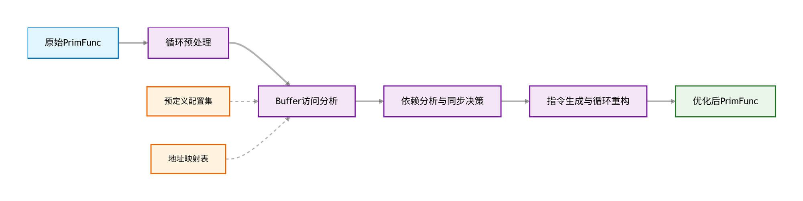
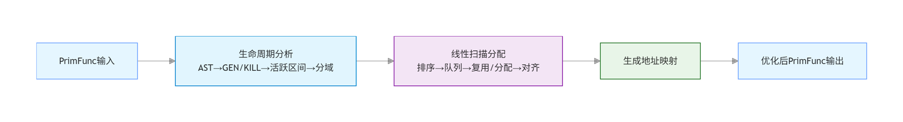
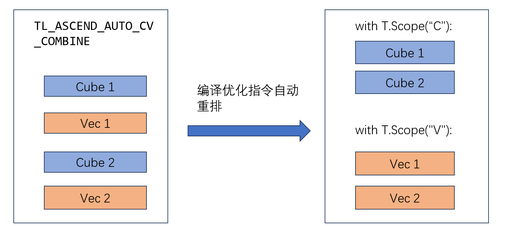
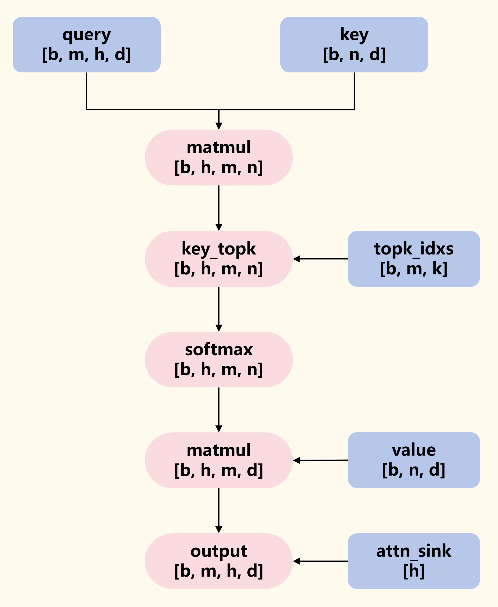
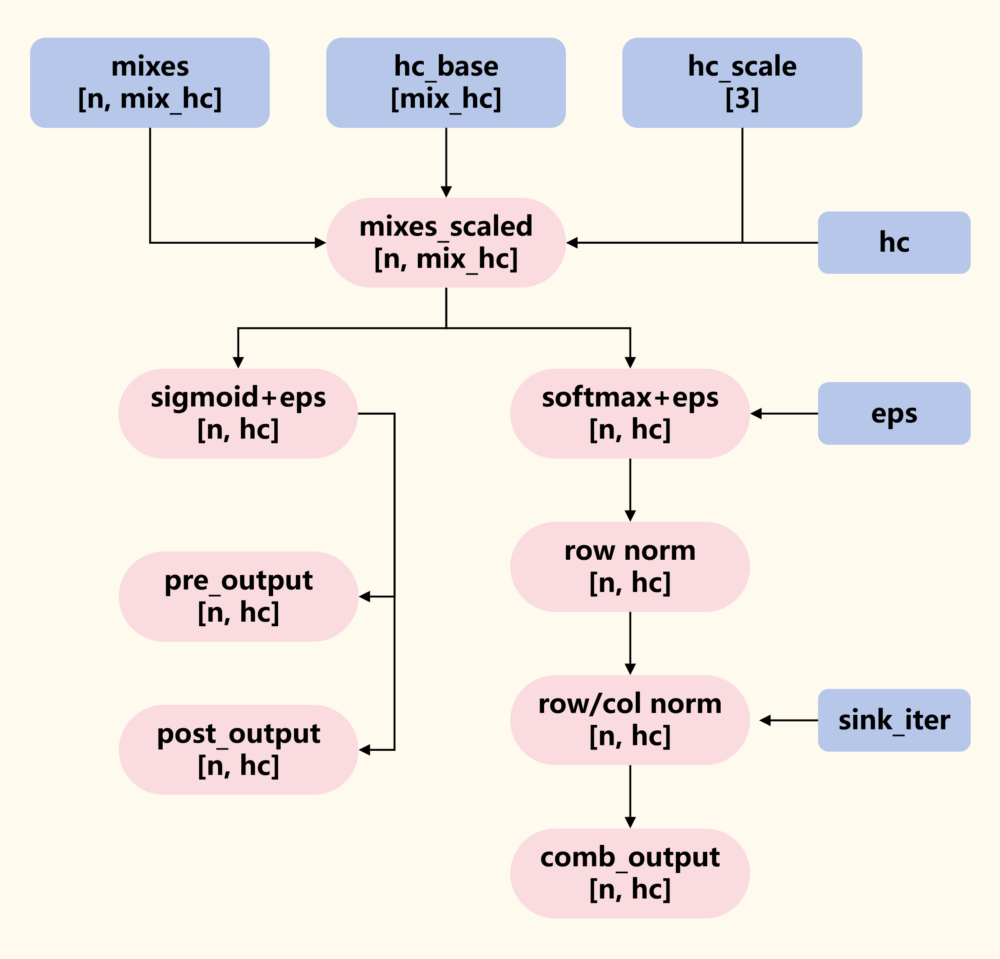
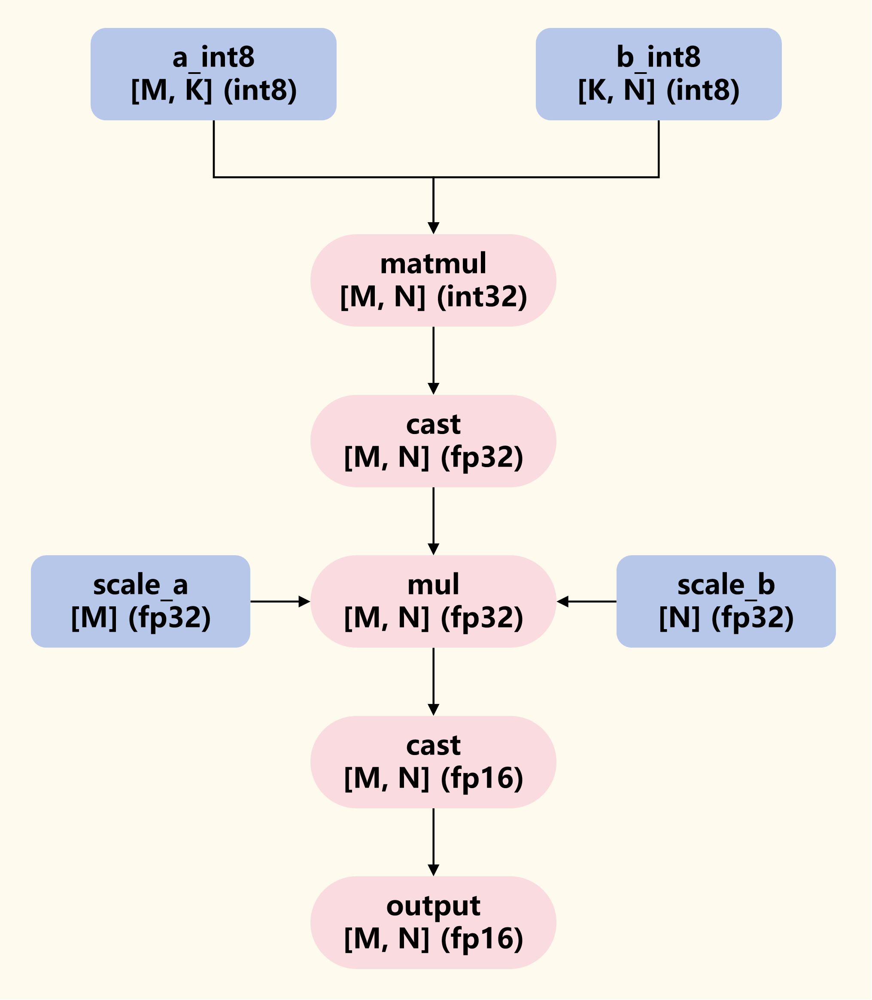
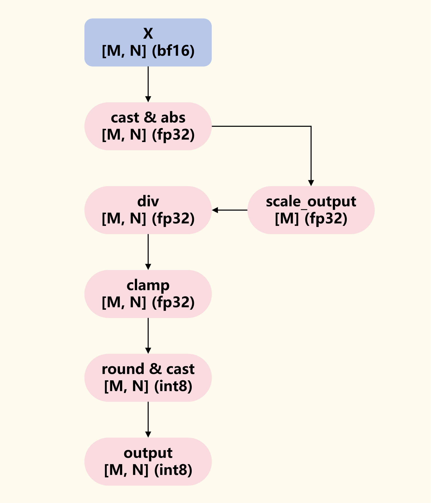

# NPU DeepSeek-V4 TileLang Operator Development Practice
## Introduction

As heterogeneous computing for large models evolves, mature GPU models and new operators must be migrated across platforms to Ascend NPUs. Tilelang-Ascend, a native operator development framework in the Ascend CANN ecosystem, closely matches Ascend NPU hardware architecture features and uses a declarative programming paradigm to substantially reduce the development barrier. The framework provides rich hardware primitives and performance optimization strategies to fully use NPU computing power. It can also rapidly adapt new operators, efficiently migrate and refactor GPU operator logic, and complete operator development and optimization without requiring detailed knowledge of the underlying hardware, substantially shortening the migration cycle. The [Tilelang-Ascend code repository](https://github.com/tile-ai/tilelang-ascend) helps developers quickly begin operator development on Ascend platforms. This work also covers the mhc operator in [TileKernels](https://github.com/deepseek-ai/TileKernels).


## HighLights

Tilelang-Ascend provides significant advantages for large-model development.

For ease of development, Tilelang-Ascend provides a concise and clear programming model that implements complex, high-performance operators with simple code:

- **Easy to use.** It provides high performance and a low development barrier, allowing developers to focus on algorithm logic and ignore underlying synchronization, memory, and other details.
- **Flexible backend languages.** It can flexibly switch backend languages, providing both a stable AscendC programming path and a high-performance PTO programming path with cross-generation compatibility, and automatically adapting to different levels and hardware scenarios.
- **Rapid operator development.** Tilelang-Ascend implemented complex fused operators such as SFA/MHC in the new DeepSeek model within an extremely short time. Developers can quickly use Tilelang abstractions to build operator models and choose from multiple optimization paths.

For functional support, Tilelang-Ascend also focuses on improving framework convenience and efficiency. New framework features in Developer mode include:

- **Automatic pipeline synchronization.** Hardware pipelines automatically synchronize CV cores. Tilelang-Ascend automatically analyzes and generates precise synchronization instructions to ensure correct and efficient operator execution.
- **Automatic memory reuse.** Tilelang-Ascend automatically performs memory planning and reuse, analyzes lifecycles, and uses linear-scan allocation to improve NPU memory utilization and execution efficiency.
- **Automatic splitting of cross-core instructions.** The Tilelang-Ascend compiler automatically identifies CV core operations, supports mixed instruction authoring, and automatically performs synchronization scheduling and dependency management.
- **Pipeline-parallelism syntax sugar.** The T.Pipelined feature performs static analysis and code transformation at compile time to overlap computation and memory access, maximize hardware utilization, and substantially improve compute-intensive task performance.
- **Data-parallelism syntax sugar.** The T.Parallel feature expresses vectorized Tile-element computation with intuitive syntax and implements data parallelism without exposing underlying hardware details, improving the programming experience and efficiency.


## Tilelang-Ascend Framework Features

Tilelang-Ascend continually works to improve development usability and reduce development difficulty and code volume. This framework upgrade supports the Developer feature-development mode, including automatic hardware-pipeline synchronization (inter-core and intra-core synchronization), automatic memory-address reuse, automatic CV instruction splitting, and core primitive operations such as T.Parallel, simplifying operator development from the underlying layer. Primitives automatically perform complex operations that previously required manual implementation, such as inter-core synchronization, memory planning, and compute allocation. Developers do not need in-depth knowledge of underlying hardware details, substantially reducing the hardware-knowledge barrier. T.Parallel and T.Pipelined also efficiently support parallel-computing development and automate the complete workflow from compute scheduling to resource reuse, substantially reducing development difficulty and code volume and allowing developers to focus on core algorithm design to improve operator development efficiency and implementation speed.

#### 1. Automatic Hardware-Pipeline Synchronization

The Cube, Vector, and other compute units integrated into Ascend NPU chips execute asynchronously. Inter-core CV synchronization automatically aligns the execution pace of each core through the hardware pipeline, avoiding manual barriers and waits. For intra-core synchronization, primitives insert dependencies and ordering controls at the instruction level to ensure data readiness and consistent memory access. Developers only need to declare parallel and pipeline boundaries to achieve stable and efficient execution across multi-core collaboration and single-core pipelines.

Through automated analysis, Tilelang-Ascend **precisely generates synchronization instructions while ensuring operator correctness and runtime performance**. The following figure shows the implementation logic for automatically inserting hardware-pipeline synchronization:

<p align="center">
  
  <center>Automatic Hardware-Pipeline Synchronization Workflow</center>
</p>

- **Loop handling:** Recursively unroll the for loop into two copies to accurately analyze dependencies in nested loops.

- **Buffer access analysis:** Combine predefined configuration sets to determine the hardware pipeline to which an instruction operation belongs and parse Buffer read and write operations.

- **Dependency analysis and synchronization decisions:** Identify data dependencies, select the synchronization type based on hardware features, and remove redundant instructions through the synchronization graph.
  - Identify three types of data dependencies: RAW (read after write), WAW (write after write), and WAR (write after read).
  - Select the synchronization type based on dependencies and hardware features: Use PipeBarrier within the same pipeline and EventPair (SetFlag/WaitFlag) across pipelines.

- **Instruction generation and loop reconstruction:** Reconstruct the unrolled loops into the original nested structure and generate instruction code.

**Enabling automatic hardware-pipeline synchronization:**

```python
pass_configs = {
    tilelang.PassConfigKey.TL_ASCEND_AUTO_CV_SYNC: True, # Automatic inter-core CV pipeline synchronization
    tilelang.PassConfigKey.TL_ASCEND_AUTO_SYNC: True,    # Automatic intra-core pipeline synchronization
}
```


#### 2. Memory Planning and Reuse

The framework automatically performs memory planning and reuse, so developers do not need to manually allocate and release memory. Conventional manual memory planning and reuse present many challenges: Development is inefficient, offsets at each level must be calculated manually, operator iteration is costly, errors occur easily during development, and debugging is difficult. Based on operator dependencies and lifecycle analysis, Tilelang-Ascend **intelligently lays out buffers and intermediate tensors to reduce fragmentation and redundant copies**. It also **reuses free memory through address reuse and double-buffering strategies while maintaining data consistency, substantially reducing peak usage**. Combined with pipeline parallelism and compute scheduling, memory access becomes more contiguous, improving overall bandwidth utilization and execution efficiency.

The following figure shows the implementation logic for automatic memory planning and reuse:

<p align="center">
  
  <center>Memory Planning and Reuse Workflow</center>
</p>

Developer mode in Tilelang-Ascend provides memory planning and reuse that completely replaces manual Offset calculation and substantially improves development efficiency. Dimension/type changes require no manual adaptation. It automatically prevents address overlap and alignment errors, eliminating human factors that cause memory-limit violations or execution exceptions. Automatic memory reuse reduces total usage and maximizes the use of limited shared-memory resources on Ascend NPUs. This feature is a core memory-optimization component for Ascend NPUs. Through precise buffer-lifecycle analysis and an efficient linear-scan memory-allocation algorithm, it allocates memory space for each Buffer and improves Ascend NPU memory utilization.

- **Buffer lifecycle analysis:**
  - Traverse the TIR abstract syntax tree (AST) to collect all access behavior for Ascend NPU shared-memory Buffers.
  - Mark the GEN (creation)/KILL (destruction) event of each Buffer to precisely determine its active interval [start, end] (execution stages from first use to last use).
  - Group Buffers by Ascend hardware memory domain to adapt to memory-capacity constraints in different partitions.
- **Linear-scan allocation algorithm:**
  - Sort Buffers by the start positions of their active intervals to construct a linear execution sequence.
  - Maintain an active queue and free-memory-block pool, and process each Buffer allocation request in a loop.
  - Intelligent allocation strategy: Prefer reusing released free memory blocks. Allocate new memory when no block is available. All operations follow the 32-byte hardware-alignment rule.
  - Finally, generate a mapping table from Buffers to physical-address Offsets (address_map) and store it in function attributes to guide execution.

**Enabling automatic memory planning and reuse:**

```python
pass_configs = {
    tilelang.PassConfigKey.TL_ASCEND_MEMORY_PLANNING: True, # Automatic memory planning and reuse
}
```


#### 3. Automatic CV Instruction Splitting

When programming Ascend NPUs, developers face an unnatural constraint. Because the hardware architecture separates CV units, developers must explicitly mark whether each code segment belongs to the Cube or Vector unit. Such explicit scope declarations cause development difficulties: Fragmentation disrupts code continuity, frequent CV switching fragments code and development logic, and the resulting duplicated code structures and abrupt debugging flow make problems difficult to locate. For example, in a Flash Attention fused operator, Softmax computation on Vector cores and matrix-multiplication computation on Cube cores repeatedly reuse synchronization logic. Manual splitting is not developer-friendly.

The CV code-separation optimization pass resolves these issues. Its core principle is to let developers focus on algorithm logic while the compiler handles hardware adaptation. **Developers write code naturally according to algorithm logic, and the pass automatically identifies which operations belong to Cube and which belong to Vector**.

<p align="center">
  
  <center>Automatic CV Instruction Splitting</center>
</p>

As shown in the preceding figure, Developer mode in Tilelang-Ascend allows users to ignore instruction and hardware differences between the underlying CV cores and write code that follows normal algorithm logic.

Automatic CV synchronization builds a Cube/Vector dependency graph at compile time, identifies cross-core reads/writes and data-ready points, automatically inserts synchronization instructions and wait mechanisms, and performs pipeline reordering and double-buffering optimization to ensure inter-core data consistency and correct ordering. Developers only describe the algorithm, and the compiler performs inter-core scheduling and intra-core dependency management, reducing manual splitting and synchronization code.

**Enabling automatic CV instruction splitting:**

```python
pass_configs = {
    tilelang.PassConfigKey.TL_ASCEND_AUTO_CV_COMBINE: True, # Automatically split CV instructions
}
```


#### 4. T.Parallel

In the Tilelang-Ascend programming model, T.Parallel is the core primitive for expressing vectorized computation of elements within a Tile. At the IR layer, it describes data parallelism as a "parallel loop" without directly exposing underlying hardware-instruction details. It **allows users to implement high-performance Tile-level parallel operations in hardware through element-wise programming syntax that follows natural programming logic**, substantially improving the operator-programming experience.

Currently supported scenarios include binary operators, unary operators, multi-operation scenarios, 1D/2D scenarios, binary "vector + scalar" scenarios, row-partitioning scenarios, Buffer + scalar broadcast operations, and copy scenarios.

**Code usage examples:**

- **Computation operations:**

```python
# 1D computation scenario
for i in T.Parallel(v_block):
    m_i[i] = T.max(m_i[i], m_i_prev[i])
```

```python
# 2D computation scenario
for (i, j) in T.Parallel(v_block, d):
	acc_o_ub[i, j] /= T.exp(attn_sink_ub[i] - scores_max[i])
```

- **Copy operations:**

``` python
# GM -> UB copy and computation scenario
for i, j in T.Parallel(block_M // VEC_NUM, block_N):
	C[bx * block_M + vid * block_M // VEC_NUM + i, by * block_N + j] = T.exp(a_ub[i, j])
```


## Main Operator Implementations

This chapter describes four operator examples implemented by Tilelang-Ascend for Day-0 support of DeepSeek-V4.

### Tilelang Operator Advantages

Multiple fused operators have been successfully adapted and integrated into the DeepSeek model. In fine-grained Tile programming, Tilelang-Ascend provides concise syntax and native adaptation to the NPU multi-level storage model. Developers can quickly and concisely develop Tilelang operators. Combined with the preceding new Developer-mode features, the code volume can be reduced to approximately 20% of the original backend implementation while maintaining similar performance, allowing developers to implement high-performance complex operators with concise code.

### 1. Sparse Flash Attention

#### **Overview**

The overall computation workflow of the SparseFlashAttention operator is shown in the following figure:

<p align="center">
  
  <center>SparseFlashAttention Computation Workflow</center>
</p>

In the DeepSeek-V4 model, as the context length grows and sequences become ultra-long, the attention mechanism becomes the model's main computation bottleneck. To calculate attention efficiently, SFA (Sparse Flash Attention) improves the computation workflow while retaining the original sparse-index selection function and integrates the C4A (Compress-4-Attention) and C128A (Compress-128-Attention) sparse-attention compression architectures, substantially reducing attention computation costs in long-text scenarios. The new SFA operator also introduces a learnable Attention sink mechanism that adjusts the attention scores of each query head to preserve the stability of model output sequences.

#### Detailed Algorithm Workflow

The implementation details are described from the NPU block-level execution perspective using specific dimensions. Typical input and output tensor dimensions are:

- **query**: [b, m, h, d], collection of query vectors.
- **key/value**: [b, n, d], collection of key/value vectors.
- **topk_idxs**: [b, m, k], topk index vector.
- **attn_sink**: [h], attn sink attention-anchor vector.
- **output**: [b, m, h, d], attention-weight output vector.

**Computation workflow:**

##### 1. Query Block Loading

- **Data-parallel strategy:** Use batch and m (sequence length) as inter-core parallel partitioning dimensions and run them on separate cores. Set the C:V core ratio to 1:2, and use `[head // 2, block=64]` as the basic block size for fine-grained intra-core partitioning and tensor-parallel execution.
- **Data-partitioning details:** Use the two-level parallel strategy of inter-core parallelism and intra-core partitioning.
  - Use batch*m as the logical core_id count and evenly distribute tasks across AiCores.
  - The main block size is dim=512 (`Shape -> [32, 512]`), and the intra-core partition block size is block=64 (`Shape -> [32, 64]`).


##### 2. Building Mask Blocks from Sparse Key/Value Indices

- **Index-driven loading:** Based on mask rules, use the topk_idxs tensor to select and calculate the idxs_ub index tensor associated with key/value for each data position in the basic block:

  - `for i in T.serial(block):`

    `idxs_ub[i] = topk_idxs[by, bx, t * block + i] if t * block + i < topk else -1`

- **Building mask blocks:** Based on the idxs_ub index tensor, select key values (kv_ub) that participate in attention computation and build a mask matrix (acc_s_ub) that stores attention-score computation results.


##### 3. Attention Score Computation

- **Matrix multiplication:** Use the gemm_v0 interface on a Cube core to calculate the attention-score matrix-multiplication result and accumulate it in the L0C Buffer. The computation logic is:
  - `attn_tile = query @ key.T  Shape -> [64, 64]`

- **Attention mask accumulation:** Accumulate the mask matrix into the matrix-multiplication attention-score result, obtain the masked attention-score value, and multiply it by scaling factor scale.


##### 4. Online Softmax

- Perform online softmax on the attention-score result in blocks.

- **Data parallelism:** Use the new T.Parallel feature of the Tilelang framework to express Tile-block-level data-parallel computation with element-wise computation code:

  - `for (i, j) in T.parallel(v_block, block):`

    ​	`acc_s_ub[i, j] -= scores_max[i]`

- During computation, dynamically maintain the intermediate statistics maximum (score_max) and exponential sum (score_sum) through reduction to ensure numerical stability.


##### 5. Context Vector Computation

- Complete matrix multiplication of the attention weights and value in the computation graph:
  - `attn_tile = score @ value  Shape -> [64, 512]`


##### 6. Result Accumulation and Rescaling

- **Result accumulation:** Loop over basic Tile blocks with block=64 and accumulate computation results into the acc_o_ub Buffer.
- **Online rescaling:** After the loop, use the statistics maintained by Online Softmax (score_max and score_sum) to globally rescale the accumulated result through vectorized operations and correct deviations introduced by block-wise computation.


##### **7. Attention Anchor Computation**

- **attn sink attention anchor:** Apply the attn sink anchor operation to the accumulated result, retain the attention weights and KV cache of the first s tokens, and preserve global context in the output. This prevents the result from depending only on recent tokens, which can cause semantics to become trapped locally or be lost:

  - `for (i, j) in T.Parallel(v_block, d):`

    ​	`acc_o_ub[i, j] /= T.exp(attn_sink_ub[i] - scores_max[i])`


##### 8. Writing Back Results

- **Result storage:** Write the attention-weight result after scaling and anchor processing back to global memory in blocks.


### 2. Manifold-Constrained Hyper-Connections

#### **Overview**

The overall computation workflow of the Manifold-Constrained Hyper-Connections operator is shown in the following figure:

<p align="center">
  
  <center>Manifold-Constrained Hyper-Connections Computation Workflow</center>
</p>

Manifold-Constrained Hyper-Connections (Mhc) is a general residual-architecture optimization solution that combines manifold constraints and structured mapping. The Mhc operator mainly contains three types of learnable mappings: pre-transformation mapping pre, post-transformation mapping post, and cross-stream connection mapping comb. It constrains the multi-path residual cross-stream mappings of Hyper-Connections (HC) to a doubly stochastic matrix manifold, preserving multi-stream representation capabilities while restoring identity-mapping properties and resolving numerical instability and uncontrolled signals in large-scale training.

#### Detailed Algorithm Workflow

Analysis of typical input and output tensor dimensions for the operator:

- **mixes**: [n, mix_hc], multi-stream feature input tensor.
- **hc_scale**: [3], stream-level scaling-coefficient vector.
- **hc_base**: [mix_hc], initial matrix vector for cross-stream mapping.
- **hc**: Hyperparameter specifying the number of streams.
- **sinkhorn_iters**: Hyperparameter specifying the number of Sinkhorn-Knopp iterations.
- **eps**: Hyperparameter, numerical-stability epsilon.
- **pre**: [n, hc], pre-transformation output tensor after stream-level scaling of mixes.
- **post**: [n, hc], post-transformation output tensor after stream-level scaling of residual-fusion features.
- **comb**: [n, hc], cross-stream connection-mapping output tensor.

**Computation workflow:**

##### 1. Multi-Stream Feature Scaling

- **Scaling-value calculation:** First, construct scaling value hc_scale_shared corresponding to each stream vector based on the stream-level scaling-coefficient vector and the number of streams.
- **Scaled multi-stream feature calculation:** By basic block size, multiply the multi-stream features by the scaling value and add the initial cross-stream matrix to obtain:
  - `mixes_shared = mixes_shared * hc_scale_shared + hc_base_shared`


##### 2. Calculating the Pre-Transformation Tensor

- The pre-transformation tensor controls the input intensity of each stream.

- Based on the multi-stream feature scaling value, calculate the pre-transformation tensor through Sigmoid scaling and stream-level parameter fusion. For each basic-block Tile, multiplication by the scale value controls the input dimension of each stream, sigmoid constrains the result to a stable range, and eps is added to prevent zero values. The computation workflow is as follows:
  - `pre = mixes ⊙ sigmoid(scale) + eps`


##### 3. Calculating the Post-Transformation Tensor

- The post-transformation tensor controls the output amplitude of each stream.
- Similar to the pre-transformation workflow, after Sigmoid scaling and stream-level parameter fusion, multiply the postprocessing tensor by 2 to appropriately increase the output dimension:
  - `post= (mixes ⊙ sigmoid(scale)) * 2`


##### 4. Exponential Normalization

- Read the cross-stream fused tensor comb by basic block. This tensor is the scaled multi-stream feature tensor described previously. Prepare to calculate the doubly stochastic projection of the cross-stream mapping matrix.
- Use operation interfaces such as reduce, sub, and exp to implement softmax exponential normalization for each basic block. Also add eps to prevent zero values and stabilize the feature-output range:
  - `comb = comb.softmax(-1) + eps`


##### 5. Row and Column Normalization

- **Row normalization:** First normalize the exponentially normalized comb basic block as a whole along the row direction:

  - `comb = comb / (comb.sum(-2) + eps)`

- **Iterative row and column normalization:** Based on the Sinkhorn-Knopp algorithm, perform a total of sink_iter row and column normalizations on comb by basic block:

  - `for i in range(sink_iter):`

    ​	`comb = comb / (comb.sum(-1) + eps)`

    ​	`comb = comb / (comb.sum(-2) + eps)`

- Finally, obtain the normalized comb cross-stream connection-mapping output tensor.


##### 6. Writing Back Results

- **Result storage:** Write the cross-stream connection-mapping output tensor back to global memory in blocks.


### 3. Int8 General Matrix Multiplication

#### **Overview**

The overall computation workflow of the Int8 General Matrix Multiplication operator is shown in the following figure:

<p align="center">
  
  <center>Int8 General Matrix Multiplication Computation Workflow</center>
</p>

Int8_gemm (Int8 General Matrix Multiplication) is a MatMul operator with quantized activation inputs. It dequantizes the matrix-multiplication result of int8 input values to fp32, scales it by scaling factors, requantizes it to the target data type, and stores the output result.

#### Detailed Algorithm Workflow

Analysis of typical input and output tensor dimensions for the operator:

- **a_int8**: [M, K], int8 activation vector.
- **a_scales**: [M, 1], activation scaling factor.
- **b_int8**: [N, K], int8 weight vector.
- **b_scales**: [N, 1], weight scaling factor.
- **output**: [M, N], quantized gemm output vector.

**Computation workflow:**

##### 1. int8 Matrix Multiplication

- **Matrix multiplication:** Read data in blocks and use the gemm_v0 interface to calculate the matrix-multiplication result. The input values are int8, and intermediate results are stored as int32:
  - `C_tile = A_tile @ B_tile.T  Shape -> [64, 64]`
- **Computation result transfer:** Use GM workspace to write the computation result into the c_ub Buffer.


##### 2. Data Type Conversion

- **int32->fp32 conversion:** Use the cast interface to perform data type conversion:
  - `T.tile.cast(c_scale, c_ub)  Type: int32 -> float32`


##### 3. Dequantization Scaling

- **Loading scaling factors:** Copy the activation and weight scaling factors to the UB Buffer based on the basic block size.

- **Scaling converted data:** Multiply the converted data by the scaling factors, also using data-parallel computation at the Tile level:

  - `for (i, j) in T.Parallel(block_M_2, block_N):`

    ​	`c_scale[i, j] *= scale_a_ub[i]`

    ​	`c_scale[i, j] *= scale_b_ub[j]`


##### 4. Result Conversion and Write-Back

- Data type conversion: Use cast again to convert the scaled result to the target output data type (using fp16 as an example):
  - `T.tile.cast(c_out, c_scale)  Type: float32-> float16`
- **Result storage:** Write the result after data type conversion and dequantization scaling back to global memory in blocks.


### 4. Activation Quantization

#### **Overview**

The overall computation workflow of the Activation Quantization operator is shown in the following figure:

<p align="center">
  
  <center>Activation Quantization Computation Workflow</center>
</p>

Act_quant (Activation Quantization) processes activation quantization. It converts activations dynamically generated during model forward inference from high precision (FP32/FP16) to low precision (INT8/INT4), primarily completing quantization after model backpropagation or inference.

#### Detailed Algorithm Workflow

Analysis of typical input and output tensor dimensions for the operator:

- **x_bf16**: [M, N] / [batch, seq, N], input tensor to process.
- **round_scale**: False, bool indicating whether the scaling factor is rounded to a power of 2.

**Computation workflow:**

##### 1. Maximum-Value Calculation

- **Data preprocessing:** First convert the read data to fp32 and then obtain its absolute values.
- **Maximum value:** Perform maximum reduction along the column direction to obtain the maximum value in each column of the input data and store it in the max_ub Buffer.


##### 2. Calculating the Scaling Factor

- Divide the maximum value calculated for each column by 127, the maximum int8 value. Based on round_scale, determine whether to round it to a power of 2, and obtain the scaling factor for each element:

  - `for i in T.Parallel(block_M_2):`

    ​	`scale_ub[i] = max_ub[i] / int8_abs_max`


##### 3. int8 Symmetric Quantization

- **Data scaling:** Divide the data processed in step 1 by the scaling factor and use the clamp interface to constrain it to the range [-127, 127].
- **Symmetric quantization:** Round the preceding data and then quantize it to fp16 and int8 in sequence to obtain the quantized output.
- The overall computation workflow can be summarized as:
  - `y = round(clamp(x / scale, -127, 127)).to(float16).to(int8)`


##### 4. Writing Back Results

- Write the calculated scaling-factor vector scale_ub and quantized activation y_ub back to global memory.
<!-- static-meta
{
  "sidebarTitle": "TileLang Operators",
  "quantization": ["int8"],
  "operator": ["tilelang"],
  "llmSpeculativeInference": ["none"]
}
-->
