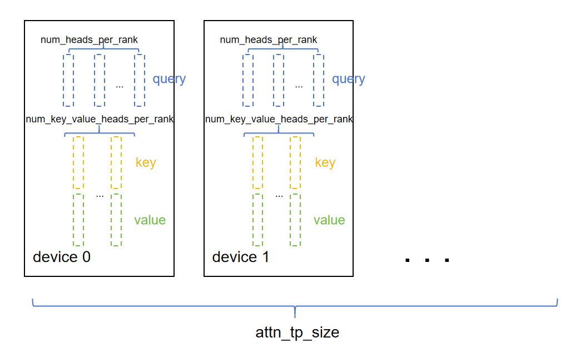

# GPT-OSS Inference Performance Optimization on Atlas A2
## Overview
This document describes NPU-based inference optimization methods for the GPT-OSS model series. On Atlas A2 series products, the GPT-OSS-120B model can be deployed on eight cards, while the GPT-OSS-20B model can be deployed on a single device.

## Performance Optimization
### Attention Tensor Parallel (TP) Optimization
The tensor partitioning strategy for Attention can be divided into QKV head partitioning and linear layer partitioning.
When QKV heads are partitioned, the multi-head computation mechanism of attention makes tensor partitioning convenient. Each head is computed independently first, and the results are then concatenated. Assume that the attention layer of the model needs to partition `num_heads` query heads by the partition count `tp_size`. `num_heads` must be divisible by `tp_size`, and the number of query heads placed on each card is `num_heads_per_rank = num_heads // tp_size`. The numbers of key and value heads are equal and may be less than or equal to the number of query heads (they are smaller in MQA and GQA scenarios). To ensure that at least one key and one value head are placed on each card, calculate the number of key or value heads placed on each card as follows:
`num_key_value_heads_per_rank = max(num_key_value_heads // tp_size, 1)`. The following figure shows the arrangement of QKV heads on cards.



The three linear layers `q_proj`, `k_proj`, and `v_proj` can be further merged into one linear layer, `qkv_proj`. This replaces three matrix multiplications with one matrix multiplication during inference and maximizes the use of NPU computing capability to improve performance. Then, partition the result to obtain Q, K, and V, perform attention computation, and finally generate the output through the `o_proj` layer.

### MoE Tensor Parallel Optimization
Assume that the partition count of the model's MoE layer is `tp_size` and the number of experts is expert_num. When the MoE layer is tensor-partitioned, apply column partitioning to `gate_proj` and `up_proj`, and row partitioning to `down_proj`. `gate_proj` and `up_proj` can use merged matmul optimization to obtain `gate_up_proj`, improving computation performance.

### Fix the KV Cache Size
- First, allocate a fixed-size KV Cache tensor to avoid the performance loss caused by dynamic memory allocation in the source code. The KV Cache size is `(batch * seq_len * num_key_value_heads_per_rank * head_dim)`, where `seq_len` is at least the maximum sum of input and output lengths to ensure that KV Cache updates do not go out of bounds during inference.
- After Q, K, and V are computed, use the `scatter_update` operator to update the KV Cache at specified positions. For details, see the [torch_npu.scatter_update](https://www.hiascend.com/document/detail/zh/Pytorch/710/apiref/torchnpuCustomsapi/context/torch_npu-scatter_update.md)(Chinese) API.

### Enable Fused Operators
#### RMSNorm Fusion and AddRMSNorm Fusion
Replace the `forward` function of `GptOssRMSNorm` and use the fused operator APIs [torch_npu.npu_rms_norm](https://www.hiascend.com/document/detail/zh/Pytorch/710/apiref/torchnpuCustomsapi/context/%EF%BC%88beta%EF%BC%89torch_npu-npu_rms_norm.md)(Chinese) and `torch_npu.npu_add_rms_norm` to replace the computation of multiple operators with a fused kernel and improve performance.

#### Enable GMM and Optimize Routing
In the MoE expert module of GPT-OSS, enable fused operators to further improve performance. For details, see the implementation in the `GptOssMLP` class.

### Flash Attention Fused Operator Optimization
Enable the [torch_npu.npu_fused_infer_attention_score_v2](https://www.hiascend.com/document/detail/zh/Pytorch/720/apiref/torchnpuCustomsapi/context/torch_npu-npu_fused_infer_attention_score_v2.md)(Chinese) FlashAttention operator, which supports graph mode in inference scenarios and supports both full computation and incremental computation scenarios.

- Fast expert selection: When calculating the routing scores between experts and tokens, use the [torch_npu.npu_moe_gating_top_k_softmax](https://www.hiascend.com/document/detail/zh/Pytorch/710/apiref/torchnpuCustomsapi/context/torch_npu-npu_moe_gating_top_k_softmax.md)(Chinese) fused operator instead of the original multi-operator operation that performs topk before softmax. This calculates the scores between tokens and experts more quickly.
- Efficient sorting and token routing:
    - Enable the [torch_npu.npu_moe_init_routing](https://www.hiascend.com/document/detail/zh/Pytorch/710/apiref/torchnpuCustomsapi/context/torch_npu-npu_moe_init_routing.md)(Chinese) fused operator to perform MoE routing computation and obtain the expert ordering.
    - Enable the [torch_npu.npu_moe_compute_expert_tokens](https://www.hiascend.com/document/detail/zh/Pytorch/710/apiref/torchnpuCustomsapi/context/torch_npu-npu_moe_compute_expert_tokens.md)(Chinese) fused operator to obtain the number of tokens that each expert needs to compute.
    - Enable the [torch_npu.npu_moe_finalize_routing](https://www.hiascend.com/document/detail/zh/Pytorch/710/apiref/torchnpuCustomsapi/context/torch_npu-npu_moe_finalize_routing.md)(Chinese) fused operator to rearrange and calculate the weighted sum of the tokens after expert computation, obtaining the final output.
- High-performance expert computation: Enable the [torch_npu.npu_grouped_matmul](https://www.hiascend.com/document/detail/zh/Pytorch/710/apiref/torchnpuCustomsapi/context/torch_npu-npu_grouped_matmul.md)(Chinese) fused operator to perform matrix multiplication for multiple experts and improve computation and data movement efficiency.

### Enable AIV Expansion for Collective Communication
Use the Device's Vector Core compute units to accelerate AllReduce operations. Enable AIV through the [HCCL_OP_EXPANSION_MODE](https://www.hiascend.com/document/detail/zh/CANNCommunityEdition/83RC1alpha002/maintenref/envvar/envref_07_0096.html)(Chinese) environment variable as follows:

```shell
export HCCL_OP_EXPANSION_MODE=AIV
```

## Appendix
[Environment Deployment and Sample Execution](https://gitcode.com/cann/cann-recipes-infer/blob/master/models/gpt_oss/README.md)(Chinese)

<!-- static-meta
{
  "sidebarTitle": "Inference Optimization",
  "parallelism": ["tensor-parallel"],
  "hardware": ["atlas-a2"],
  "frameworks": ["cann-recipes"],
  "llmSpeculativeInference": ["none"]
}
-->
