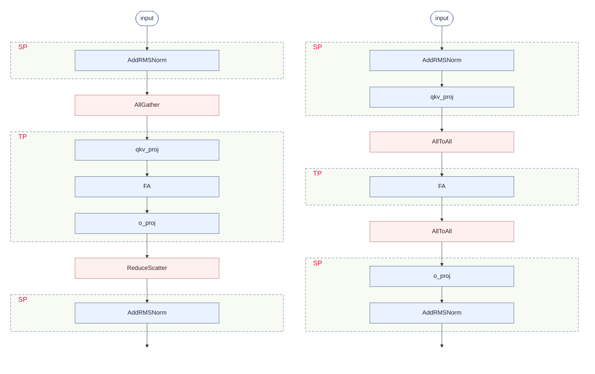
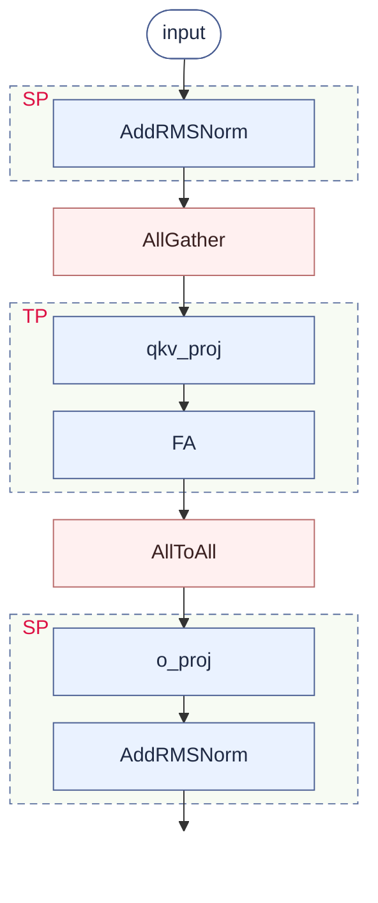
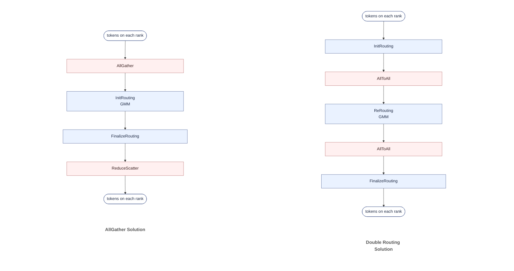
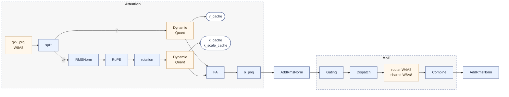
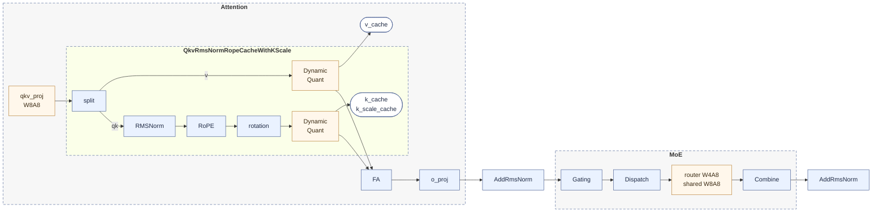
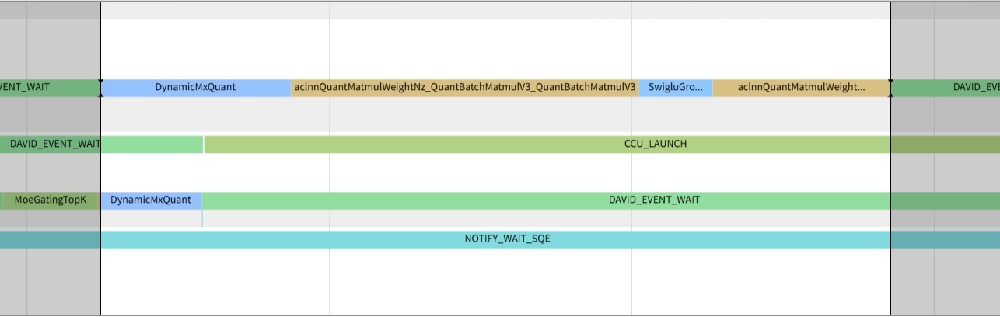

# Hy3 Day-0 Adaptation on Ascend: High-Performance Inference Optimization with CANN
The official version of Hy3 has been released and refined for real-world business scenarios. It uses an architecture with 295B total parameters and 21B activated parameters, natively supports a 256K context, and provides multiple thinking modes: no_think (ultra-fast response), think_low (fast thinking), and think_high (deep reasoning). These modes balance response speed, complex reasoning, and invocation cost.

Inference deployment samples for Hy3 on both Ascend 950PR/DT and Atlas A3 have been open-sourced. This document primarily describes Prefill inference optimization for the Hy3 model in a multi-card Ascend 950PR environment. It first analyzes the Hy3 model architecture and model parallel strategies, and then introduces multi-card deployment and fused Kernel optimization solutions adapted to Ascend. With the complete optimization solution, this practice completed Hy3 model deployment on day 0, supports native FP8 weights, **further supports the Ascend-friendly MXFP8/MXFP4 quantization formats, and is also compatible with the C8 quantization solution**. The complete optimized model and fused Kernels have been open-sourced.

For the GQA inference architecture of the Hy3 model, this work focuses on **fully FP8-quantized FA optimization**. It implements and integrates two fused operators, a **QKV preprocessing fused operator** and **fully FP8-quantized GQA**, further improving long-sequence inference throughput and latency. This open-source release includes the model deployment implementation and a high-performance Ascend C implementation.

## Highlights

- Design and implement an NPU-friendly parallel strategy that supports deployment on multiple generations of Ascend chips, including `Ascend 950PR/DT` and `Atlas-A3`. The [model inference code](https://gitcode.com/cann/cann-recipes-infer/blob/master/models/hy3/README.md)(Chinese) is open-sourced in cann-recipes-infer.
- Open-source the QKV preprocessing fused operator and fully FP8-quantized GQA fused operator based on Ascend C for high-performance GQA preprocessing.
- Use the NpuGraphEx backend together with features such as the dynamo compilation cache and multi-stream parallelism to unlock Ascend compute power and achieve highly optimized graph-mode acceleration.
- `Ascend 950PR/DT` supports native FP8 quantization, enabling smooth weight migration without loss. This practice also supports replacing native FP8 computation with MXFP8 and further supports MXFP4 quantization.
- Based on the preceding optimizations, CANN supports Hy3 inference deployment on day 0.

## Model Architecture

Hy3 uses a hybrid GQA+MoE architecture and natively supports a 256K context.


| Attribute | Value |
|:---|:---|
| Architecture | Mixture of Experts (MoE) |
| Total parameters | 295B |
| Activated parameters | 21B |
| MTP layer parameters | 3.8B |
| Layers (excluding the MTP layer) | 80 |
| MTP layers | 1 |
| Attention heads | 64 (GQA, eight KV heads, head dim 128) |
| Hidden dimension | 4096 |
| FFN intermediate dimension | 13312 |
| Context length | 256K |
| Vocabulary size | 120832 |
| Number of experts | 192 experts, top-8 activated |

## Parallel Strategy: Prefill Optimization (Attention SP+TP, MoE EP)

### Overview

In the Prefill inference scenario, the model processes the complete input sequence at once and is compute-bound. To maximize throughput under TTFT latency constraints, use a combination of Attention sequence parallelism (SP), tensor parallelism (TP), and MoE expert parallelism (EP). MXFP8/MXFP4 quantization and multi-operator fusion significantly reduce computation and communication overhead in the Prefill stage. To reduce the memory occupied by the LM Head and Embedding Table, LM Head and Embedding computations also use TP.

### Attention SP+TP Optimization

#### Parallel Strategy Selection

The parallel methods available for the Attention component include DP, TP, and SP. Because of TTFT latency requirements, the Attention parallel strategy primarily considers TP and SP. The Hy3 model uses a GQA architecture (q_head:kv_head=64:8), making TP a natural choice. Add SP to the operators before and after FA on top of TP to further reduce overall latency.

Two solutions are generally used:

- **Solution 1 (AllGather + ReduceScatter)**: Before FA, use AllGather to aggregate the sequence shards on all Ranks into a complete sequence for attention. After FA and o_proj, use ReduceScatter to sum the results and partition them back into sequence shards.
- **Solution 2 (AlltoAll + AlltoAll)**: Use AlltoAll before and after FA to switch between the sequence-shard and attention-head-shard layouts. Each card always holds only one shard, without copying the complete sequence to every card as AllGather does, resulting in a smaller communication volume.

The following figure shows the differences between the two solutions:

<div style="max-width: 100%; overflow-x: auto;">
<div style="width: 1120px; max-width: 100%; margin: 0 auto;">



</div>
</div>

Considering communication volume, data type, and fused operator compatibility, the Prefill-stage Attention uses **a combination of the preceding two SP+TP solutions**:

- **Communication before FA**: Use AllGather to aggregate the subsequences on all Ranks into a complete sequence, and use FP8/MXFP8 quantization to reduce the communication volume.
- **Communication after FA**: Use AlltoAll to redistribute the attention output on all Ranks along the sequence dimension, further reducing communication time compared with ReduceScatter in pure TP.

The AllGather and AlltoAll communications use a quantized 8-bit data format, effectively reducing the total communication volume.

#### Partitioning Strategy

The final partitioning strategy is as follows:

<div style="width: fit-content; max-width: 100%; margin: 0 auto; overflow-x: auto;">



</div>

### MoE EP Optimization

#### Parallel Strategy Selection

The MoE component supports both TP and EP. TP partitions the K or N axis of GMM too finely, reducing computation performance. With EP, each Rank holds some experts and uses InitRouting to match tokens with experts. Communication overhead remains controllable when `ep_size` is small.

EP is further divided into the AG-RS (AllGather-ReduceScatter) solution and the Double Routing (AlltoAll) solution:

| Parallel Strategy | Communication Operators | Communication Volume | Applicable Scenario |
| ------------------- | ------------------------- | ------------------------- | -------------------------------------------- |
| EP (AG-RS)          | AllGather + ReduceScatter | (B,S,H) × 2               | Smaller volume when `ep_size` is small and `top_k > ep_size` |
| EP (Double Routing) | AlltoAll + AlltoAll       | (BS×top_k/ep_size, H) × 2 | Large-EP scenarios; smaller volume when `ep > top_k` |

> Note: In the table, `S` and `BS` both indicate the global complete sequence length. In AG-RS, this is the complete sequence held by each card after AllGather.

For the current model, `top_k=8`. When `ep_size=4`, `top_k > ep_size`, so the AG-RS solution has a smaller communication volume and is the preferred default.

#### AG-RS Solution

EP AG-RS solution: Each rank first obtains all sequence tokens through AllGather. InitRouting routes and computes only local experts. After GMM, FinalizeRouting applies weights and masks non-local experts. Finally, ReduceScatter sums the results and partitions them back into subsequences. This solution exchanges redundant communication of (B,S,H)×2 for regular collective communication and is suitable for small-EP scenarios where top_k > ep_size.


#### Double Routing Solution

EP Double Routing (AlltoAll) solution: Each rank first uses InitRouting to expand and group local tokens by expert. The outbound AlltoAll then accurately sends tokens to the rank containing the target expert. After ReRouting rearranges the tokens and GMM performs computation, the inbound AlltoAll returns the GMM output to the source rank along the original route. Finally, FinalizeRouting multiplies the output by routing weights and combines it. Two precise AlltoAll transfers provide zero redundant communication and zero redundant computation. The data volume, (BS×top_k/ep_size,H)×2, decreases as EP increases, making this solution suitable for large-EP scenarios where ep > top_k.

<div style="max-width: 100%; overflow-x: auto;">
<div style="width: 1120px; max-width: 100%; margin: 0 auto;">



</div>
</div>

## Quantization Strategy

This practice supports native FP8 quantization. It also supports replacing Linear modules that use the native FP8 format with MXFP8 and replacing the MoE component with MXFP4 to further improve overall performance.
The overall Hybrid MXFP8-MXFP4 quantization strategy is as follows:



- Attention: q_proj, k_proj, v_proj, and o_proj use W8A8 quantization, and KV Cache uses C8 quantization.

- MoE: The Linear layers of routed experts use W4A8 quantization, and the Linear layers of shared experts use W8A8 quantization.

- LMHead: Not quantized.

  Note: In W8A8, W8 and A8 indicate MXFP8 quantization. In W4, W4 indicates MXFP4 quantization. For C8, QK uses dynamic Per-Token-Head FP8 quantization with an FP32 Scale, and V Cache uses dynamic Per-Head FP8 quantization with an FP32 Scale.

## Fused Kernels

The following figure shows the fused Kernels:



- QKV preprocessing fused operator: Includes operations such as QKV split, RMSNorm, RoPE, rotation, dynamic quantization, and Cache write-back, providing memory-access and computation-pipeline benefits.
- Flash Attention: Includes the fully FP8-quantized flash attention computation process.

CANN has implemented and open-sourced [**qkv_rms_norm_rope_cache_with_k_scale**](https://gitcode.com/cann/ops-transformer/pull/8093) and the fully FP8-quantized GQA version of [**fused_infer_attention_score**](https://gitcode.com/cann/ops-transformer/tree/master/attention/fused_infer_attention_score) in the ops-transformer repository.

## Enable the Graph Compilation Cache
In model inference scenarios, enabling the graph compilation cache stores compiled static graphs and prevents the model from being recompiled for every inference operation, improving inference performance.

```mermaid
%%{init: {"themeVariables": {"lineColor": "#999999"}}}%%
block-beta
    columns 16
    header_label[" "]:2 header_first["<div style='font-size:18px'>First Execution</div>"]:9 header_sep((" ")) header_second["<div style='font-size:18px'>Subsequent Execution</div>"]:4
    original_label["<div style='font-size:18px;line-height:1.2'>Original Inference Task</div>"]:2 original_compile["<div style='font-size:18px;padding:10px 4px'>Dynamo Compilation</div>"]:5 original_guards_1["<div style='font-size:17px;padding:10px 2px'>Guards</div>"] original_capture_1["<div style='font-size:17px;line-height:1.2;padding:8px 2px'>aclgraph<br/>Capture</div>"] original_input_1["<div style='font-size:17px;line-height:1.2;padding:8px 2px'>Input<br/>Processing</div>"] original_replay_1["<div style='font-size:17px;padding:10px 2px'>Replay</div>"] original_sep((" ")) original_guards_2["<div style='font-size:17px;padding:10px 2px'>Guards</div>"] original_capture_2["<div style='font-size:17px;line-height:1.2;padding:8px 2px'>aclgraph<br/>Capture</div>"] original_input_2["<div style='font-size:17px;line-height:1.2;padding:8px 2px'>Input<br/>Processing</div>"] original_replay_2["<div style='font-size:17px;padding:10px 2px'>Replay</div>"]
    cache_label["<div style='font-size:18px;line-height:1.2'>Enable Model Compilation Cache</div>"]:2 cache_save_1["<div style='font-size:18px;padding:10px 4px'>Time save</div>"]:6 cache_capture_1["<div style='font-size:17px;line-height:1.2;padding:8px 2px'>aclgraph<br/>Capture</div>"] cache_input_1["<div style='font-size:17px;line-height:1.2;padding:8px 2px'>Input<br/>Processing</div>"] cache_replay_1["<div style='font-size:17px;padding:10px 2px'>Replay</div>"] cache_sep((" ")) cache_save_2["<div style='font-size:17px;line-height:1.2;padding:8px 2px'>Time<br/>save</div>"] cache_capture_2["<div style='font-size:17px;line-height:1.2;padding:8px 2px'>aclgraph<br/>Capture</div>"] cache_input_2["<div style='font-size:17px;line-height:1.2;padding:8px 2px'>Input<br/>Processing</div>"] cache_replay_2["<div style='font-size:17px;padding:10px 2px'>Replay</div>"]
    space:11 bottom_sep((" ")) space:4

    header_sep -.- bottom_sep

    style header_label fill:transparent,stroke:transparent,color:transparent
    style header_first fill:transparent,stroke:transparent,color:#202124
    style header_second fill:transparent,stroke:transparent,color:#202124
    style header_sep fill:transparent,stroke:transparent,color:transparent
    style original_label fill:transparent,stroke:transparent,color:#202124
    style cache_label fill:transparent,stroke:transparent,color:#202124
    style original_compile fill:#4d73ff,stroke:#2f4ab3,color:#ffffff
    style original_guards_1 fill:#ffe9b8,stroke:#d0a044,color:#3a2a12
    style original_guards_2 fill:#ffe9b8,stroke:#d0a044,color:#3a2a12
    style original_capture_1 fill:#ffe8e8,stroke:#d28f8f,color:#3a2020
    style original_input_1 fill:#ffe8e8,stroke:#d28f8f,color:#3a2020
    style original_replay_1 fill:#ffe8e8,stroke:#d28f8f,color:#3a2020
    style original_capture_2 fill:#ffe8e8,stroke:#d28f8f,color:#3a2020
    style original_input_2 fill:#ffe8e8,stroke:#d28f8f,color:#3a2020
    style original_replay_2 fill:#ffe8e8,stroke:#d28f8f,color:#3a2020
    style cache_save_1 fill:#a7eee6,stroke:#48a79e,color:#153936
    style cache_save_2 fill:#a7eee6,stroke:#48a79e,color:#153936
    style cache_capture_1 fill:#ffe8e8,stroke:#d28f8f,color:#3a2020
    style cache_input_1 fill:#ffe8e8,stroke:#d28f8f,color:#3a2020
    style cache_replay_1 fill:#ffe8e8,stroke:#d28f8f,color:#3a2020
    style cache_capture_2 fill:#ffe8e8,stroke:#d28f8f,color:#3a2020
    style cache_input_2 fill:#ffe8e8,stroke:#d28f8f,color:#3a2020
    style cache_replay_2 fill:#ffe8e8,stroke:#d28f8f,color:#3a2020
    style original_sep fill:transparent,stroke:transparent,color:transparent
    style cache_sep fill:transparent,stroke:transparent,color:transparent
    style bottom_sep fill:transparent,stroke:transparent,color:transparent
```



The related API invocation is as follows:

```python
if enable_cache_compile:
    compiled = torch.npu.npugraph_ex.inference.cache_compile(model_forward, cache_dir=cache_dir,
                                                             dynamic=True, options=compile_options)
```
## MoE Shared Expert Multi-Stream Parallelism (Prefill)

In each MoE layer of Hy3, every token passes through a shared expert in addition to the top-8 routed experts. The shared expert depends only on the MoE input and not on the Gating result, so it has no data dependency on the dispatch and grouped GMM of the routed experts. In the Prefill stage, split them into two streams accordingly. The **main stream** sequentially performs Gating, the routed-expert path (the default AG-RS solution: AllGather → InitRouting → grouped GMM → FinalizeRouting → ReduceScatter), and the final combine addition. The shared expert is delivered to the **secondary stream**, whose start synchronization point is placed after Gating on the main stream. The routed-expert path is the time-consuming part of the MoE block. The shared expert runs concurrently with it and is masked by it, adding almost no latency.

The following figure shows the profiling timeline for shared-expert multi-stream parallelism.

<div align="center"></div>

## Benchmark

The following Benchmark data was collected in Offline inference mode and excludes the effects of Serving scheduling and framework load balancing.

#### **Ascend950PR Hy3 Benchmark**

| Global Batch Size | Chips | Seq Length | TTFT (ms) |
| ----------------- | ----- | ---------- | --------- |
| 1                 | 4     | 32K        | 2330.23   |
| 1                 | 4     | 64K        | 7023.11   |
<!-- static-meta
{
  "sidebarTitle": "Inference Optimization",
  "quantization": [
    "fp8",
    "mxfp8",
    "mxfp4"
  ],
  "parallelism": [
    "tensor-parallel",
    "sequence-parallel",
    "expert-parallel"
  ],
  "operator": [
    "ascendc"
  ],
  "cannFeatures": [
    "multi-stream",
    "npugraph"
  ],
  "hardware": [
    "atlas-a3",
    "ascend-950"
  ],
  "frameworks": [
    "cann-recipes"
  ],
  "llmSpeculativeInference": [
    "none"
  ]
}
-->
