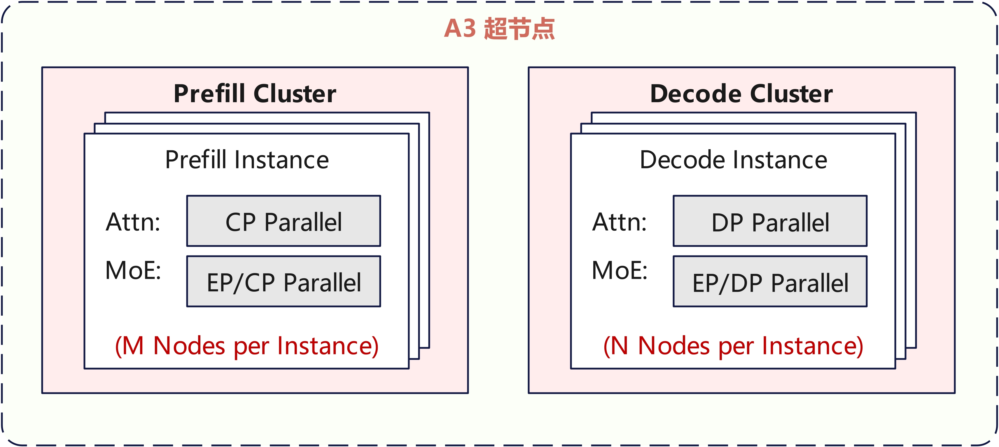
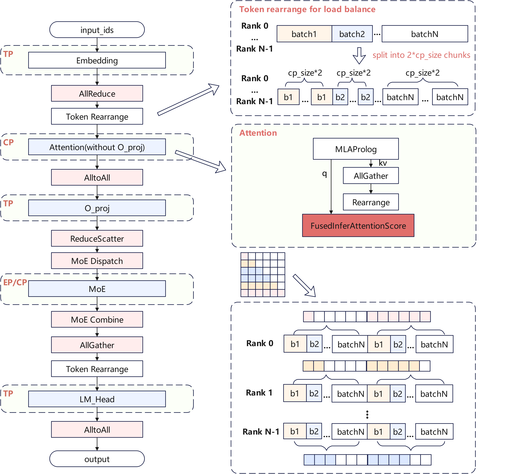
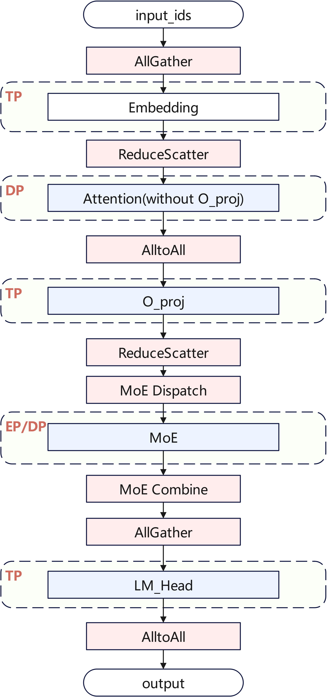
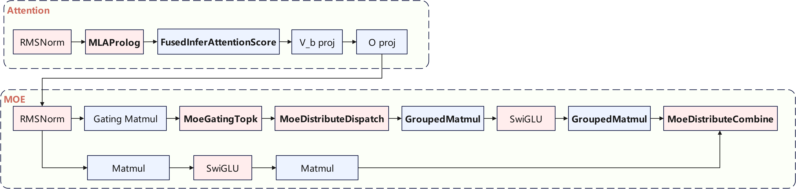

# NPU Kimi-K2-Thinking Inference Optimization

On November 6, Moonshot AI released its latest thinking model, Kimi-K2-Thinking. It excels at deep reasoning and achieves new record benchmark performance. Its model architecture is consistent with Kimi-K2 and natively supports the mixed-precision mode of MOE W4A16 + Attention BF16, balancing inference performance and accuracy.

This document primarily describes inference optimization for the Kimi-K2-Thinking model on an A3 cluster. Because its architecture is essentially consistent with Kimi-K2, the [basic optimizations](../../deepseek_r1/en/deepseek_r1_decode_optimization.md) can be inherited smoothly. This practice adapted the MOE W4A16 quantization involved in this model on day 0 and provides a recommended deployment strategy for A3 clusters. Performance optimization will continue in the future.

## Highlights
- CANN supports Kimi-K2-Thinking inference deployment with a 256K sequence on day 0. The [model inference code](https://gitcode.com/cann/cann-recipes-infer/blob/master/models/kimi_k2_thinking/README.md)(Chinese) is open-sourced, and the mainstream open-source inference framework [SGLang](https://github.com/sgl-project/sglang/pull/12759) is also supported.
- This practice supports the native Kimi-K2-Thinking quantization mode. MOE GroupedMatmul uses W4A16 computation, while Attention retains BF16 precision, balancing inference performance and accuracy. The corresponding GroupedMatmul [operator implementation](https://gitcode.com/cann/ops-transformer/tree/master/gmm/grouped_matmul) is fully open-sourced.
- For typical inference scenarios such as small batch sizes and long-sequence production, Decode MLA implements the Flash Decode acceleration mechanism, effectively reducing latency and improving compute utilization. The corresponding FusedInferAttentionScore [operator implementation](https://gitcode.com/cann/ops-transformer/tree/master/attention/fused_infer_attention_score) is fully open-sourced.
- The minimum deployment unit in this practice is a single server, which supports inference tasks with a 4K sequence length. Multi-server large-EP deployment is also supported. Collaborative deployment on a multi-server cluster meets the inference requirements of ultra-long 256K sequences.

## Outline

- [Parallel Strategy](#parallel-strategy)
- [Fused Kernels](#fused-kernels)
- [MTP](#mtp)
- [Future Plan](#future-plan)

## Parallel Strategy
The following figure shows the recommended deployment strategy for Atlas A3. Prefill uses M nodes, and Decode uses N nodes. Each node contains eight cards. Adjust M and N dynamically from 1 to 24 based on constraints such as the available resources and SLA.

  

### Prefill Parallel Strategy

For long-sequence scenarios, Prefill Attention uses Context Parallel (CP). Multiple ranks share the long-sequence computation, so each rank has a smaller computation volume and activation memory footprint. TTFT is more controllable, improving the user experience. The MoE module continues to use the EP parallelism of DeepSeek-V3.1 to balance throughput and latency.

  

### Decode Parallel Strategy

The Decode stage continues to use the DeepSeek V3.1 deployment strategy with Attention DP + MoE EP.

In particular, because the O_proj and LM_Head weights occupy substantial memory and present a clear memory-access bottleneck during Decode, this practice uses local TP. The Embedding layer is also partitioned with TP to reduce device memory usage. To minimize the communication overhead introduced by TP, the TP domain is kept within a single server.

  

## Fused Kernels
The following figure shows the full-network computation flow. This practice uses fused Kernels such as MLAProlog, FusedInferAttentionScore, MoeDistributeDispatch, MoeDistributeCombine, and GroupedMatmul, providing a practical reference for efficient deployment of similar models on the Ascend platform.

  

## MTP

Compared with DeepSeek V3.1, Kimi-K2-Thinking reduces the number of Attention Heads from 128 to 64, significantly reducing Attention computation and making it more favorable for MTP scenarios. The Decode stage of LLM inference is typically bottlenecked by memory access. MTP can reduce memory-access pressure at a small computation cost. Because Kimi-K2-Thinking has a lighter Attention computation load, it is less likely to reach the computation bottleneck in MTP mode and achieves better performance.

The code for this practice supports multi-head MTP. If trained MTP weights are available, enable this feature directly to accelerate inference.

## Future Plan

- Quantization: MOE W4A16 inference is currently supported. A low-bit quantization version can be developed for Attention in the future to further reduce system memory usage and latency.
- Long-sequence performance optimization: TTFT in long-sequence scenarios still has room for improvement. Future work will explore more suitable deployment solutions and specifically optimize fused Kernel performance to comprehensively improve the response speed and operating efficiency of long-sequence inference.

<!-- static-meta
{
  "sidebarTitle": "Inference Optimization",
  "quantization": [
    "bf16",
    "int4"
  ],
  "parallelism": [
    "data-parallel",
    "tensor-parallel",
    "context-parallel",
    "expert-parallel"
  ],
  "hardware": [
    "atlas-a3"
  ],
  "frameworks": [
    "cann-recipes"
  ],
  "llmSpeculativeInference": [
    "none"
  ]
}
-->
