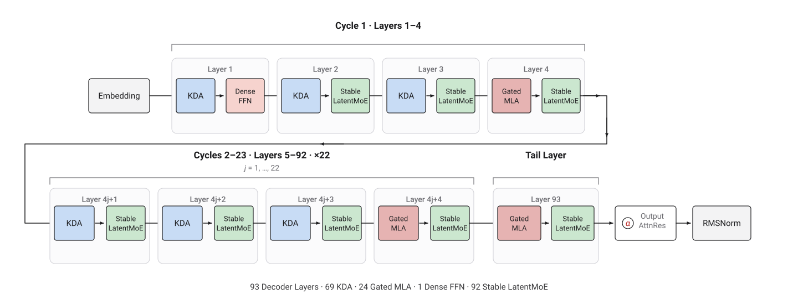
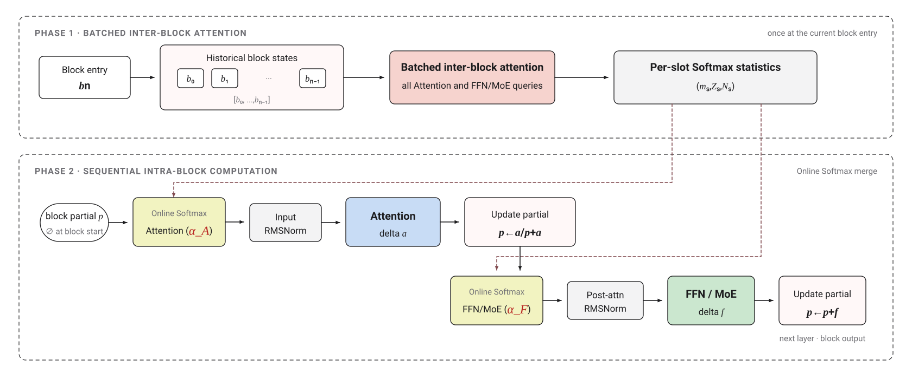
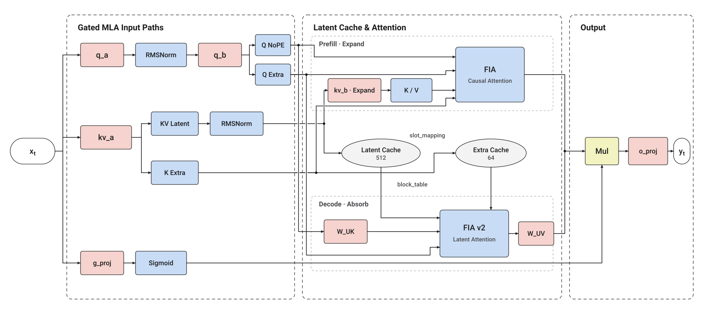

# Kimi K3 Inference Optimization on Ascend NPU

Kimi K3 uses a 2.8T-parameter hybrid-attention MoE architecture that interleaves Kimi Delta Attention (KDA) and Gated MLA and introduces Attention Residuals (AttnRes) and Stable LatentMoE. The model natively supports a 1M context. KDA maintains a fixed-size sequence state, AttnRes aggregates historical representations along the network depth, and Stable LatentMoE performs Routed Expert computation in the latent space.

cann-recipes-infer provides an implementation reference for Kimi K3 on a four-server, 32-card Ascend 950PR/DT cluster. It uses a combined deployment strategy of Embedding TP, Attention TP, Dense TP, Prefill SP, Decode DP, and Routed Expert EP. KDA, MLA, and MoE all use fused operators. Mamba Cache allocates storage and maps requests for `conv_state` and the KDA ssm state. Stable LatentMoE supports native MXFP4 weights, dynamic MXFP8 activations, and Decode Shared Expert multi-stream execution. The two-phase/fused AttnRes optimization and Decode `npugraph_ex` can be enabled as needed; DSpark-based speculative decoding significantly improves Decode throughput.

For complete execution instructions, see the [model README](https://gitcode.com/cann/cann-recipes-infer/blob/master/models/kimi_k3/README.md).

## Highlights

- **Block AttnRes**: Attention and FFN independently calculate Softmax weights for cross-layer representations. In addition to the naive implementation, recipes provides a two-phase computation strategy, implemented through the `block_attn_res_prepare` / `block_attn_res_update` fused operators.
- **Stable LatentMoE and SiTU**: Routed Experts compute in the 3584-dimensional latent space, while Shared Experts retain the 7168-dimensional backbone path. Both use SiTU activation. recipes provides reference implementations for Routed Expert EP deployment and Shared Expert TP deployment and supports native MXFP4/MXFP8 Expert computation.
- **Hybrid parallel strategy**: recipes uses Embedding TP, Attention TP, Dense TP, Routed Expert EP, Prefill SP, and Decode DP to balance model memory constraints and inference performance.
- **KDA fused operators**: Prefill uses the flash_kda fused operator, which fuses L2 normalization, gate activation, and beta sigmoid into the operator. Decode uses the fused_recurrent_kda operator, fully fusing L2 norm, gate, and beta during token-by-token recurrence to reduce Python-side preprocessing overhead and intermediate tensor reads and writes.
- **MegaMoE**: Routed Expert computation in both Prefill and Decode can switch to the `mega_moe` fused operator, which completes Dispatch, GMM1, SiTU, GMM2, and Combine in a single operator, reducing communication and scheduling overhead in large-EP scenarios.
- **DSpark speculative decoding**: The DSpark draft model proposes multiple tokens based on the main model's hidden states. The main model then verifies all draft positions in parallel and commits tokens via acceptance-rate sampling, significantly improving Decode throughput. The draft model and the main model each compile their own Decode graph.

## Outline

- [Model Architecture](#model-architecture)
  - [Overall Architecture](#overall-architecture)
  - [Core Parameters](#core-parameters)
  - [Layer-Type Arrangement](#layer-type-arrangement)
  - [Attention Residuals](#attention-residuals)
  - [Hybrid Attention: KDA and Gated MLA](#hybrid-attention-kda-and-gated-mla)
  - [Stable LatentMoE](#stable-latentmoe)
- [Parallel Strategy](#parallel-strategy)
  - [HBM Usage Analysis](#hbm-usage-analysis)
  - [Prefill and Decode Data Flows](#prefill-and-decode-data-flows)
- [Quantization Strategy](#quantization-strategy)
- [npugraph_ex Graph Mode](#npugraph_ex-graph-mode)
- [KDA Fused Operators](#kda-fused-operators)
  - [Prefill: flash_kda Fused Operator](#prefill-flash_kda-fused-operator)
  - [Decode: fused_recurrent_kda Fused Operator](#decode-fused_recurrent_kda-fused-operator)
- [DSpark Speculative Decoding](#dspark-speculative-decoding)
- [Running and Configuration](#running-and-configuration)
- [Known Limitations](#known-limitations)
- [Future Plan](#future-plan)

## Model Architecture

### Overall Architecture

Kimi K3 uses a 93-layer Decoder backbone. The first 92 layers consist of 23 groups of `KDA - KDA - KDA - Gated MLA`, and the 93rd layer uses Gated MLA. Layer 1 uses a Dense FFN, and layers 2 through 93 use Stable LatentMoE. Each Decoder Layer contains two groups of AttnRes to construct the Attention and FFN inputs. Before the model output, an independent Output AttnRes aggregates representations along the depth.

  

### Core Parameters

| Property | Kimi K3 Configuration |
|:---|:---|
| Total parameters | 2.8T (approximately 2.78T by structural statistics) |
| Native model context | 1M tokens |
| Decoder layers | 93 |
| Hidden size | 7168 |
| Vocabulary size | 163840 |
| Attention arrangement | 69 KDA layers + 24 Gated MLA layers |
| KDA | 96 heads, head dim 128, ShortConv kernel 4 |
| Gated MLA | Q LoRA rank 1536, KV LoRA rank 512, QK dim `128 + 64`, V dim 128 |
| AttnRes | Block size of 12 Decoder Layers, 8 resident block slots in total |
| Dense FFN | Layer 1, intermediate size 33792 |
| MoE | Remaining 92 layers, 896 Routed Experts, Top-16, sigmoid routing |
| LatentMoE | Backbone width 7168, routed latent width 3584, expert intermediate size 3072 |
| Shared Expert | 2 experts |
| Activation | SiTU |
| Routed Expert quantization | MXFP4 weight, group size 32; dynamic MXFP8 activation |
| DSpark draft model | Lightweight GQA model proposing from the main model's hidden states, deployed with TP8 |

### Layer-Type Arrangement

Each Decoder Layer serially executes one Attention sublayer and one FFN sublayer in the order `Attention → FFN`. Attention selects either KDA or Gated MLA. Layer 1 is followed by a Dense FFN, and layers 2 through 93 are followed by Stable LatentMoE.

KDA and Gated MLA use an approximately `3:1` periodic arrangement. Counting from layer 1, the first 92 layers consist of 23 groups of `KDA - KDA - KDA - MLA`, and the 93rd layer uses one more MLA layer:

  

### Attention Residuals

AttnRes selects historical representations of the same token along the network depth. Each Attention and FFN sublayer uses an independent learnable pseudo-query to score the RMSNorm results of candidate representations, performs Softmax along the depth direction, and then computes a weighted sum of the raw candidate representations:

$$
\ell_i=\mathbf{w}^{\mathsf T}\operatorname{RMSNorm}(\mathbf{z}_i),\qquad
\alpha_i=\frac{e^{\ell_i}}{\sum_j e^{\ell_j}},\qquad
\mathbf{h}=\sum_i\alpha_i\mathbf{z}_i
$$

The pseudo-query itself does not depend on the input, but candidate representations change with the token, so the depth weights still vary with the input. RMSNorm is used only to generate scores; the weighted sum uses the raw representations without normalization.

#### Block AttnRes and Two-Phase Computation

Kimi K3 uses Block AttnRes (block attention residuals) as a scalable variant of Full AttnRes. This mechanism aggregates cross-layer representations in blocks and uses block-level representations instead of all historical sublayer outputs as candidate states, reducing the number of candidate states and their memory overhead while preserving cross-layer selection capability.

Specifically, Kimi K3 divides the 93 Decoder Layers into 8 Blocks, each containing about 12 layers. For the $n$-th Block, the historical block-state set is denoted $\mathcal{B}_n=[\mathbf{b}_0,\mathbf{b}_1,\ldots,\mathbf{b}_{n-1}]$, which includes the initial word embedding and the aggregated outputs of all previous Blocks. AttnRes selectively aggregates these states between Blocks; within a Block, a dynamic representation $\mathbf{p}$, called the partial, is maintained by layer-by-layer accumulation.

When entering a Block, the partial has not been generated yet, so the first Attention sublayer performs AttnRes aggregation only on the historical block-state set $\mathcal{B}_n$ and uses the aggregated result as the sublayer input. The output of this sublayer initializes the partial. Afterward, each Attention or FFN/MoE sublayer appends the current partial as a new candidate state, concatenating it with $\mathcal{B}_n$ as $[\mathbf{b}_0,\mathbf{b}_1,\ldots,\mathbf{b}_{n-1}, \mathbf{p}]$ for AttnRes aggregation. The sublayer output is then accumulated into the partial. Attention and FFN/MoE use independent pseudo-queries and therefore have independent depth weights.

To reduce repeated computation within a Block, Block AttnRes can be equivalently split into the following two phases:

  

- **Phase 1 (batch computation of inter-block attention)**: At the Block entrance, compute the scores between the pseudo-queries of all sublayers in the Block and the historical block-state set $\mathcal{B}_n$ in batch. For each AttnRes position, generate the maximum score $m$, the normalized exponential sum $Z$, and the unnormalized weighted sum $\mathbf{N}$ required by Softmax. In the following equations, $\mathbf{b}_i$ denotes the $i$-th historical block state and $\ell_i$ its score:

$$
m=\max_i\ell_i,\qquad
Z=\sum_i e^{\ell_i-m},\qquad
\mathbf{N}=\sum_i e^{\ell_i-m}\mathbf{b}_i
$$

- **Phase 2 (sequential computation of intra-block attention)**: Execute the forward computation inside the Block layer by layer. For each sublayer, compute the score $r$ of the current partial $\mathbf{p}$ with its pseudo-query, and merge $(\mathbf{p},r)$ into the statistics generated in Phase 1 through Online Softmax to obtain the AttnRes output $\mathbf{h}$ of that sublayer:

$$
\begin{aligned}
M &= \max(m,r), \\
Z' &= e^{m-M}Z+e^{r-M}, \\
\mathbf{N}' &= e^{m-M}\mathbf{N}+e^{r-M}\mathbf{p}, \\
\mathbf{h} &= \mathbf{N}'/Z'.
\end{aligned}
$$

Shifting the exponential terms by the merged maximum score $M$ reduces the risk of exponential overflow and improves numerical stability. Under exact arithmetic, the two-phase computation is strictly equivalent to directly performing Softmax aggregation over all candidate states; under finite-precision arithmetic, the two may differ slightly due to different operation orders. The statistics of each Block are independent and used only for the current forward computation of the corresponding Block.

#### Original Implementation, Two-Phase Optimization, and Fused Operators

- **Kimi original implementation**: AttnRes is updated layer by layer along the Decoder Layers, performing depth-wise Softmax aggregation between the effective inter-block historical states and the current block representation to generate Attention and FFN/MoE inputs. The core aggregation is completed by `_apply_attn_res` in `KimiDecoderLayer.forward`.
- **Two-phase optimization**: `KimiLinearModel._forward_attn_res_block` moves the computation of inter-block historical states reused within a Block forward, generates statistics in batch, and merges the dynamic partial through Online Softmax within each layer. This path is mathematically equivalent to the Kimi original implementation and is enabled by `attn_res_mode: two_phase`; the Output AttnRes keeps the original implementation.
- **Fused operators**: `attn_res_mode: fused` keeps the same two-phase schedule, and Phase 1/Phase 2 call `block_attn_res_prepare` and `block_attn_res_update` respectively. The fused operators complete anchor scoring and statistical reduction, partial scoring, and Online Softmax merging, reducing intermediate tensor reads and writes and scheduling overhead. The default value is `original`.

### Hybrid Attention: KDA and Gated MLA

#### Kimi Delta Attention

KDA is a Delta Rule linear attention with per-key-channel decay. Its input is the Output of the Input RMSNorm of the Decoder Layer. The Q/K/V dimension of each head is 128, and KDA maintains a fixed `128 × 128` KDA SSM State. The state is updated token by token: the old state is first decayed by the key channel, K reads the prediction of the current V from it; β scales the difference between the actual V and the prediction and writes the correction back to the state along the corresponding K direction; Q finally reads the updated state. Before entering the KDA core, Q/K undergo L2Norm, Q is additionally scaled by the inverse square root of the key dimension, and V is not normalized.

The per-head, per-key-channel `gk` is generated by `f_a_proj`, `f_b_proj`, `dt_bias`, and the 128-dimensional `A_log` shared by all heads. The K3 configuration sets `gate_lower_bound` to -5, so `gk` is in `(-5, 0)`. Both Prefill and Decode use this log-decay; Decode passes it as the `gk` parameter to the fused operator, and the old state is multiplied by the retention factor corresponding to its exponential. `b_proj` generates β through sigmoid. The KDA output first performs per-head RMSNorm, then multiplies the per-value-channel sigmoid output gate, and finally enters `o_proj`. The three gates control state decay, state write, and output respectively.

The long-term state size of KDA is independent of the sequence length. For each request and each KDA layer, only the following needs to be saved:

- `conv_state`: concatenated along the Q/K/V channels, storing the inputs of the last 3 tokens of the three ShortConv branches;
- KDA SSM State: a `128 × 128` matrix for each local head.

  

`qkv_proj` generates Q/K/V by channel. The fused QKV ShortConv calls [`causal_conv1d_fn`](https://gitcode.com/cann/ops-transformer/blob/master/torch_extension/cann_ops_transformer/docs/zh/causal_conv1d_fn.md) in Prefill and [`causal_conv1d_update`](https://gitcode.com/cann/ops-transformer/blob/master/torch_extension/cann_ops_transformer/docs/zh/causal_conv1d_update.md) in Decode to complete the per-channel causal convolution and SiLU before splitting into three branches. The three channel groups use their own convolution weights and share one concatenated `conv_state`.

`conv_state` and the KDA SSM State are registered as `MambaCacheEntry` respectively, and the framework uniformly allocates and maintains the mapping from requests to state blocks. Prefill clears the corresponding state rows, `causal_conv1d_fn` updates `conv_state`, and the Torch chunk KDA computes per request and writes back the KDA SSM State. Decode reuses the same block id and advances the two types of state in place through `causal_conv1d_update` and [`npu_recurrent_gated_delta_rule`](https://gitcode.com/Ascend/op-plugin/blob/master/docs/zh/custom_APIs/torch_npu/torch_npu-npu_recurrent_gated_delta_rule.md) respectively.

#### Gated MLA

Gated MLA follows MLA's low-rank Q/KV projection and adds per-head, per-value-channel gating after the Attention output.

  

recipes provides reference implementations of Prefill native and Decode absorb. Both Prefill and Decode use `npu_kv_rmsnorm_rope_cache_v2` (interface reference: [`npu_kv_rmsnorm_rope_cache`](https://gitcode.com/Ascend/op-plugin/blob/26.1.0/docs/context/torch_npu-npu_kv_rmsnorm_rope_cache.md)) to fuse the RMSNorm of the KV latent and write the normalized latent and the extra K features into two Paged Caches according to `slot_mapping`.

In Prefill, `kv_b_proj` temporarily expands the current latent into per-head K/V, and `npu_fused_infer_attention_score` is called with the `NTD_TND` layout and `sparse_mode=3` to complete causal Attention over variable-length sequences. In Decode, the K matrix of the KV up-projection is absorbed into the Query side, and [`npu_fused_infer_attention_score_v2`](https://gitcode.com/Ascend/op-plugin/blob/26.1.0/docs/zh/custom_APIs/torch_npu/torch_npu-npu_fused_infer_attention_score_v2.md) is called to directly read the NZ-layout latent Paged Cache and complete the absorb Attention. The absorbed V projection then restores the operator output to the value space of each Attention head.

### Stable LatentMoE

Layers 2 through 93 of Kimi K3 use Stable LatentMoE. The input enters three branches: the Sigmoid Router, Latent Down, and Shared Expert. The Routed branch computes in the 3584-dimensional latent space, and the aggregated result is restored to 7168 dimensions through RMSNorm and Latent Up, then added to the Shared Expert branch. When `enable_multi_streams` is enabled in Decode, the Shared Expert runs on an independent stream in parallel with the MC2 path of the Routed Expert and is synchronized before the results are added; Prefill executes on the main stream.

  

The Router selects 16 experts for each token from 896 experts. `correction_bias` participates only in expert selection. The aggregation weights are obtained by normalizing the sigmoid scores without bias among the selected experts and then multiplying by `routed_scaling_factor`:

$$
\begin{aligned}
r &= \operatorname{sigmoid}(W_r x), \\
\mathcal{I} &= \operatorname{TopK}(r+b_{\mathrm{corr}},16), \\
p_i &= s\frac{r_i}{\sum_{j\in\mathcal{I}}r_j},\quad i\in\mathcal{I},
\end{aligned}
$$

where `s` denotes `routed_scaling_factor`.

A single Routed Expert has the structure `3584 -> gate/up 3072 each -> 3584`; the Shared Expert computes at the backbone width with the structure `7168 -> gate/up 6144 each -> 7168`.

Dense, Shared, and Routed FFNs all use SiTU as the activation function.

In this practice, the Router uses [`npu_moe_gating_top_k`](https://gitcode.com/Ascend/op-plugin/blob/26.1.0/docs/zh/custom_APIs/torch_npu/torch_npu-npu_moe_gating_top_k.md) to complete Top-16 expert selection based on sigmoid routing scores and `correction_bias`, and outputs the expert indices and aggregation weights used for subsequent routing.

Prefill uses the AG–EP–RS path. Routed latent is first dynamically quantized to MXFP8, and then AllGather aggregates the activations, scales, and routing results of each SP shard. [`npu_moe_init_routing_v2`](https://gitcode.com/Ascend/op-plugin/blob/26.1.0/docs/zh/custom_APIs/torch_npu/torch_npu-npu_moe_init_routing_v2.md) expands and reorders activations and their scales by expert. Expert computation uses two [`npu_grouped_matmul`](https://gitcode.com/Ascend/op-plugin/blob/26.1.0/docs/zh/custom_APIs/torch_npu/torch_npu-npu_grouped_matmul.md) calls to complete the MXFP4 gate/up projection and down projection respectively. After SiTU, dynamic MXFP8 quantization is performed again before the second GMM. Finally, [`npu_moe_finalize_routing`](https://gitcode.com/Ascend/op-plugin/blob/26.1.0/docs/zh/custom_APIs/torch_npu/torch_npu-npu_moe_finalize_routing.md) restores the token order and aggregates by routing weights, and ReduceScatter returns to the SP layout.

Decode uses the MC2 EP path. [`npu_moe_distribute_dispatch_v2`](https://gitcode.com/Ascend/op-plugin/blob/26.1.0/docs/zh/custom_APIs/torch_npu/torch_npu-npu_moe_distribute_dispatch_v2.md) dispatches tokens to the corresponding Expert ranks according to the Top-16 results. Local experts continue to use two `npu_grouped_matmul` calls to complete MXFP4 Expert computation. [`npu_moe_distribute_combine_v2`](https://gitcode.com/Ascend/op-plugin/blob/26.1.0/docs/zh/custom_APIs/torch_npu/torch_npu-npu_moe_distribute_combine_v2.md) completes cross-EP aggregation, routing-weight weighting, and token-order recovery. When multi-stream is enabled, the Shared Expert runs on an independent stream in parallel with the Routed Expert MC2 path above.

**MegaMoE path**: When `enable_mega_moe=True` and `moe_ep_size > 1`, Routed Expert computation in both Prefill and Decode switches entirely to the `mega_moe` fused operator. This operator completes Dispatch, GMM1, SiTU, GMM2, and Combine in a single operator and requires a symmetric communication buffer pre-allocated through `get_symm_buffer_for_mega_moe`, using `megamoe_ep_group` as the communication domain. Compared with calling the MC2/AG–EP–RS path operator by operator, MegaMoE reduces communication and operator scheduling overhead in large-EP scenarios.

## Parallel Strategy

The following parallel configurations apply to a four-server, 32-card Ascend 950PR/DT cluster with all 93 layers and 896 Experts. The framework-level model replica DP is 1; Decoder inter-layer representations use Prefill SP and Decode DP. The recommended parallel configuration is `attn_tp_size=32` (full Attention TP), `moe_tp_size=1` (deriving `moe_ep_size=world_size` locally), `oproj_tp_size=attn_tp_size`, `embed_tp_size=16`, `lmhead_tp_size=8`, `dense_tp_size=8`, and `cp_size=1`.

### HBM Usage Analysis

#### Major HBM Usage

The following table summarizes the major per-card parameter usage under this sharding strategy by module, without expanding the computation of every projection matrix. Routed Experts use MXFP4 weights with E8M0 scales; the remaining major weights are stored in BF16 or FP32.

Routed Expert EP shares Routed Expert parameters only along the Expert dimension. Shared Experts are fixed-activated for all tokens and do not belong to the expert set managed by the Router. The KDA/Gated MLA `g_proj/o_proj` also lies outside the MoE EP. If these parameters remain replicated, the Shared Experts and the `g_proj/o_proj` of the 93 Attention layers occupy about 53.2 GiB/card, and the per-card usage is about 110.00 GiB, which still needs further sharding. The Shared Experts and the first-layer Dense FFN use Dense TP, and `g_proj/o_proj` use Column TP and Row TP respectively, reducing the per-card usage of the major items above to 58.51 GiB.

| Module | Main Contents | Sharding | GiB/card |
|:---|:---|:---|---:|
| Embedding + LM Head | Input and output vocabulary weights | Vocab TP | 0.136 |
| Gated MLA (24 layers) | Q/KV low-rank projections, output gate, and output projection | Partial replication + Attention TP | 2.752 |
| KDA (69 layers) | Q/K/V, gating, and output projections | Head / Column / Row TP | 1.769 |
| MoE Router (92 layers) | Router gating weights | Replicated | 2.201 |
| Shared Expert (92 layers) | `gate_up_proj` and `down_proj` | Dense TP | 0.708 |
| Routed Expert (92 layers) | MXFP4 `w13/w2` weights and scales | Expert EP | 42.097 |
| Routed latent projections (92 layers) | latent down/up projections | Replicated | 8.805 |
| Dense FFN (1 layer) | `gate_up_proj` and `down_proj` | Dense TP | 0.042 |
| **Total** | — | — | **58.51** |

### Prefill and Decode Data Flows

The KDA/MLA deployment strategy used in this practice is as follows:

  

The Attention / MoE deployment strategies for Prefill and Decode are as follows:

  

- **Prefill (mini-batch cycles)**: The fixed batch is split into multiple mini cycles according to `prefill_mini_batch_size` (default 1, i.e., 32 Prefill mini cycles). Each cycle is participated in by the complete Attention TP communication group: prompt tokens perform Sequence Parallel across `attn_tp_size` ranks, and Attention performs TP along the head dimension. Before Attention, AllGather aggregates the SP shards; after the output gate and `o_proj`, ReduceScatter restores the SP layout. Routed Experts use AG–EP–RS or MegaMoE, and Shared Experts use AG–TP–RS. All cycles share the same set of pre-allocated cache tensors and switch directly to request-DP + Attention TP Decode with the complete batch afterward, without cache merging, copying, or reallocation.
- **Decode**: KDA uses DP–TP–DP. The Q/KV projections and Attention core of Gated MLA remain DP; the Attention output and gating input are converted to TP before the output gate, and ReduceScatter restores the DP layout after `o_proj`. Routed Experts use MC2 Dispatch–EP–MC2 Combine or MegaMoE, and Shared Experts use AG–TP–RS.

The KDA SSM State is sharded with Head TP, and each request holds one state row on every Attention TP rank. The Gated MLA latent Cache is replicated to each TP rank by request during Prefill, and in Decode only the Decode owner rank of the request writes to its local paged blocks. The first-layer Dense FFN and Shared Experts both use AG–TP–RS.

## Quantization Strategy

The `w13/w2` of the Kimi K3 Routed Experts use MXFP4 weights and dynamic MXFP8 activations. The remaining checkpoint weights are mainly BF16; the KDA ShortConv, `A_log`, `dt_bias`, `o_norm`, and Router correction bias remain FP32 in the checkpoint. After loading, the fused `qkv_conv1d.weight` is converted to BF16 for computation. The quantization format of Routed Experts is:

- Weight elements: MXFP4 E2M1, with every two 4-bit elements packed into one byte;
- Weight scales: one E8M0 scale shared by every 32 input elements;
- Activations: dynamically quantized to MXFP8 E4M3FN per token and per group, with runtime scales of E8M0FNU;
- After SiTU, dynamic quantization is performed again before entering the `down_proj` GMM.

The DSpark draft model supports BF16 weights only and does not participate in MXFP4 quantization. The main model and the draft model use independent loading paths.

## npugraph_ex Graph Mode

`npugraph_ex` captures the Decode stage of Kimi K3. Prefill remains eager to handle variable-length packed sequences and establish the initial Cache. Decode uses a fixed token count, fixed Cache addresses, and fixed AttnRes slots for capture/replay.

When DSpark is enabled, the main model and the draft model compile independent Decode graphs:

- **Main model**: compiles `model.decode` (normal path) or the Verify path (parallel Decode with width `verify_size = next_n + 1`) using `torch.compile(..., dynamic=True, backend="npugraph_ex")`, with `frozen_parameter` and `static_kernel_compile` enabled.
- **Draft model**: compiles `model.forward_spec_decode` with the `npugraph_ex` backend and a fixed graph structure.

The `first_verify` metadata-alias design of DSpark guarantees that the first Verify and subsequent Verify rounds reuse the same compiled main-model graph. When `enable_profiler=True`, the two-stage profiling writes to `prof/prefill` and `prof/decode` respectively.

## KDA Fused Operators

The Prefill and Decode stages of KDA use different fused operators to fuse preprocessing operations such as L2 normalization, gate activation, and beta sigmoid into the NPU operators, reducing intermediate tensor reads and writes and Python-side operator scheduling overhead. The two switches control the Prefill and Decode paths respectively:

| Switch | Default | Function |
|:---|:---|:---|
| `enable_flash_kda` | `True` | Select the flash_kda fused operator or the torch reference implementation in Prefill |
| `enable_fused_recurrent_kda` | `True` | Select the fused_recurrent_kda fused operator or the gdr operator in Decode |

### Prefill: flash_kda Fused Operator

The Prefill stage computes chunk KDA in blocks of 64 tokens per request. When `enable_flash_kda=True`, the flash_kda operator is called; otherwise, the pure Python reference implementation (`_torch_chunk_kda`) is used. When `gate_lower_bound is None` (softplus gate form), flash_kda does not support this gate formula and automatically falls back to the torch reference implementation.

**Fusion range comparison:**

| Operation | flash_kda (fused operator) | torch reference implementation |
|:---|:---|:---|
| L2 normalization | Fused inside the operator, eps=1e-6 | Python-side `_l2_normalize` |
| Gate activation | Computes `lower_bound * sigmoid(exp(A_log) * (g + dt_bias))` inside the operator | Same formula on the Python side |
| Beta sigmoid | `1/(1+exp(-beta))` inside the operator | Python-side `.sigmoid()` |
| Chunk loop | Inside the operator | Python for loop |

**Input conventions:** flash_kda receives raw bf16 Q/K/g/beta (without preprocessing) and requires the bfloat16 dtype; `initial_state`/`A_log`/`dt_bias` are fp32. The operator completes L2 norm and converts Q/K to fp32 for computation. The output state is fp32 `[B, H, D, D]`, and the output is bf16 `[B, S, H, D]`.

**Padding strategy:** When the request token count is not a multiple of 64, Q/K/V are padded with zeros (still zero after L2 norm, contributing zero to the output), and g/beta are padded with `-inf` (`sigmoid(-inf)=0`, so a zero gate activation keeps the state undecayed and a zero beta keeps the delta from updating the state), ensuring that padded tokens have no side effects on the recurrent state. After computation, `output[:, :tokens]` is trimmed to remove the padding.

### Decode: fused_recurrent_kda Fused Operator

The Decode stage updates the KDA SSM State token by token. When `enable_fused_recurrent_kda=True` and `gate_lower_bound is not None`, the fused_recurrent_kda operator is called; otherwise, it falls back to the `npu_recurrent_gated_delta_rule` (gdr) operator.

**Fusion range comparison:**

| Operation | fused_recurrent_kda (fused operator) | gdr (baseline operator) |
|:---|:---|:---|
| L2 normalization | Fused inside the operator, eps=1e-6 | Python-side `_l2_normalize` |
| Gate activation | `lower_bound * sigmoid(exp(A_log) * (g + dt_bias))` inside the operator | Precomputed in the Python-side forward |
| Beta sigmoid | `1/(1+exp(-beta))` inside the operator | Python-side `.sigmoid()` |
| Input dtype | Raw bf16 BSND 4D | Preprocessed bf16 TND 3D |
| State update | In-place update of `recurrent_state_cache` | Same |
| Return value | `(state, out)` tuple; state discarded | Single value `out` |

**Input conventions:** fused_recurrent_kda receives raw bf16 Q/K/g/beta in the BSND `[B, S, H, D]` layout; beta needs a trailing dimension padded to `[B, S, H, 1]`; `A_log`/`dt_bias` are fp32; `lower_bound` is a float in the range `[-5, 0]`. `ssm_state_indices` must be passed (the values are dynamically allocated block ids and the default `arange` cannot be used), and `num_accepted_tokens` is passed as `None` (the default `ones(batch)` matches the actual value for standard decode with seq=1).

**State layout:** The state layout of both paths is `[pool, H, Dv, Dk]` fp32, with row indices corresponding to the value dimension (Dv) and column indices to the key dimension (Dk). The state returned by fused_recurrent_kda is the same tensor object as the passed-in `recurrent_state_cache` (updated in place), so the returned state can be discarded directly without writing back to the cache.

## DSpark Speculative Decoding

DSpark (Draft-Speculative) is the speculative decoding solution provided by this sample. With `draft_model_type: dspark` enabled, Kimi K3 loads a lightweight draft model (Kimi-K3-DSpark, BF16) in addition to normal Decode. Each iteration proposes `next_n` draft tokens in parallel, and the main model verifies and commits them at once, improving Decode throughput.

### Draft Model Architecture

The draft model constructs a proposal distribution from the intermediate-layer outputs of the main model. It is a lightweight GQA structure deployed with a fixed TP8 (`dspark_tp_group`, requiring `world_size % 8 == 0`):

- **fc projection**: projects the hidden states of the specified layers of the main model (`context_width = target_hidden_size × len(target_layer_ids)`) to the draft model hidden size as the context representation of the draft;
- **GQA Attention (non-causal)**: performs non-causal attention over the committed context and the current draft positions. KV is written to the draft model's own Paged Cache (allocated by `init_dspark_cache_data`, independent of the main model's caches). RoPE supports YaRN long-sequence extrapolation;
- **Markov Head**: a two-layer Markov head composed of `markov_w1/markov_w2` outputs the vocabulary distribution for each draft position as the proposal distribution.

The draft model and the main model share some weights through shared target modules (`set_shared_target_modules`). Only BF16 weights are supported during loading (`Kimi K3 DSpark supports BF16 weights only`).

### Inference Flow

DSpark inference maintains a draft proposal chain outside the main-model Decode graph:

1. **Prefill**: the main model completes Prefill cycle by mini cycle and routes the target hidden states of each request to the corresponding Decode owner rank through `_route_prefill_target_hidden`;
2. **First Verify**: runs one main-model Decode in parallel with width `verify_size = next_n + 1` (`first_verify=True`), samples anchor tokens, and updates `kv_len`;
3. **Propose**: the draft model generates `next_n` draft tokens and their proposal distribution step by step from the anchor tokens, owner-local target hidden states, and context positions (`_dspark_propose`; draft positions after eos are filled with pad);
4. **Verify & Commit**: the main model verifies the draft positions in parallel with a fixed `verify_size` width. When `temperature <= 0`, the argmax of the draft and target at each position is compared; otherwise, acceptance is sampled by the acceptance rate `min(1, target_p / draft_p)`. Accepted sequences are committed as generation results, and the first rejected position is committed with a target-sampled token;
5. **Context update**: the committed tokens and their hidden states of the current round are merged into the draft model's context cache (`_committed_context`), the active mask is updated, and the next Propose/Verify round begins.

After each round, the average acceptance length, the acceptance length distribution, and the acceptance rate of each draft position are collected and printed uniformly at the end of inference. The Decode graphs of the main model and the draft model are compiled separately (see [npugraph_ex Graph Mode](#npugraph_ex-graph-mode)). The `first_verify` metadata-alias design of DSpark guarantees that the first and subsequent Verify rounds reuse the same compiled graph.

## Running and Configuration

### Environment Requirements

- Ascend 950PR/DT series products, four servers with 32 cards;
- CANN 9.2.0 (weekly version); all nodes use the same CANN, driver, and firmware versions;
- `torch_npu 2.10.0.post4` (Python 3.12) and `torch 2.10.0`;
- CANNBot-DSL operator dependency package (`pip install cannbot-dsl`; `ninja==1.13.0` is listed in requirements.txt).

### Weights and Data

- Main model weights: download from [ModelScope Kimi-K3](https://www.modelscope.cn/models/moonshotai/Kimi-K3/files) and load the native MXFP4 checkpoint directly (no weight-conversion script is provided in this directory); all nodes must use the same path;
- DSpark draft weights: download from [RadixArk/Kimi-K3-DSpark](https://huggingface.co/RadixArk/Kimi-K3-DSpark);
- Dataset: InfiniteBench `longbook_qa_eng`, placed in the `dataset/InfiniteBench` directory on each node; alternatively, set `dataset` to `"default"` in the YAML to use the short-prompt example.

### Key Configuration

The default configuration files are `config/kimi_k3_rank_32_mxfp4_npugraph_ex.yaml` (normal path) and `config/kimi_k3_rank_32_mxfp4_npugraph_ex_dspark.yaml` (DSpark path). Core parameters are as follows:

| Parameter | Type | Example Value | Description |
| --- | --- | --- | --- |
| `exe_mode` | str | `npugraph_ex` | Execution mode; `eager` or `npugraph_ex` |
| `enable_online_split_weight` | bool | `True` | Shard and load weights from the complete checkpoint by rank at startup |
| `enable_profiler` | bool | `False` | Whether to collect Prefill/Decode performance data |
| `enable_static_kernel` | bool | `True` | Enable the static kernel optimization path |
| `enable_cache_compile` | bool | `False` | Whether to enable operator compilation caching |
| `enable_weight_nz` | bool | `False` | Whether to load weights in NZ format; must match the weight format and platform |
| `draft_model_type` | str | `none` | DSpark switch; `none` for normal Decode, `dspark` to enable DSpark speculative decoding |
| `next_n` | int | `0` | Number of DSpark speculative tokens; must be `0` when `none` |
| `skip_warm_up` | bool | `True` | Whether to skip warm-up; when enabled, the first formal inference includes graph compilation overhead |
| `prefill_mini_batch_size` | int | `1` | Number of requests per Prefill mini cycle; `0` prefills the entire fixed batch at once |
| `pa_block_size` | int | `128` | MLA Paged Cache block size; must be a multiple of 16 |
| `attn_res_mode` | str | `fused` | AttnRes backend; `original`, `two_phase`, or `fused`; `fused` is recommended |
| `enable_multi_streams` | bool | `True` | Decode uses multi-stream to overlap Shared Experts and Routed Experts |
| `enable_flash_kda` | bool | `True` | Enable the Prefill `flash_kda` fused operator; when disabled, the Python small-operator implementation is used |
| `enable_fused_recurrent_kda` | bool | `True` | Enable the Decode `fused_recurrent_kda`; when disabled, the GDR fused operator is used |
| `enable_mega_moe` | bool | `True` | Enable the MegaMoE fused operator |
| `enable_moe_bf16_mode` | bool | `True` | Whether MoE routing post-processing and SiTU use BF16 |
| `moe_chunk_max_len` | int | `12800` | Upper bound of the token chunk length on the MoE path |

Parallel configuration: `attn_tp_size=32`, `moe_tp_size=1`, `embed_tp_size=16`, `lmhead_tp_size=8`, `dense_tp_size=8`, `oproj_tp_size=32`, and `cp_size=1`. The current implementation requires a fixed `batch_size` divisible by `attn_tp_size`; `attn_tp_size` must be `1` or cover the complete `world_size`; `oproj_tp_size=attn_tp_size` and `cp_size=1`. `enable_online_split_weight` only means that weights are loaded from the complete checkpoint by rank at startup and does not imply online request scheduling.

Startup: enter the `models/kimi_k3` directory, set `YAML_FILE_NAME`, and run `bash infer.sh` (for the DSpark path, fill in both `model_path` and `draft_model_path` in the YAML).

## Known Limitations

- Fixed-batch generation is supported; Prefill mini batches are static multi-cycles and do not support online request join, exit, or dynamic scheduling;
- Chunked Prefill, MTP, PD separation, and Context Parallel are not supported; speculative decoding supports only explicitly configured DSpark;
- The `CacheInfo`, `ForwardMetaData`, and scheduler step states of the unified executor are neither created nor relied upon;
- `prefill_mini_batch_size > 0` must divide `batch_size_per_rank`;
- The DSpark draft model supports BF16 weights only, and `world_size` must be divisible by 8.

## Future Plan

- **Weight prefetch**: evaluate the benefit of prefetching MXFP4 expert weights for the memory-bound Routed Expert GMM and large linear layers.
- **DSpark performance tuning**: further optimize the draft model structure and proposal length (`next_n`) selection to improve the average acceptance length.
<!-- static-meta
{
  "sidebarTitle": "Inference Optimization",
  "quantization": [
    "bf16",
    "mxfp4"
  ],
  "parallelism": [
    "data-parallel",
    "tensor-parallel",
    "sequence-parallel",
    "expert-parallel"
  ],
  "cannFeatures": [
    "multi-stream",
    "npugraph"
  ],
  "hardware": [
    "ascend-950"
  ],
  "frameworks": [
    "cann-recipes"
  ],
  "llmSpeculativeInference": [
    "dspark"
  ]
}
-->
