# NPU LongCat-2.0 Inference Optimization

Meituan released the latest LongCat-2.0 model. Architecturally, it adds Sink Sliding Window Attention and DeepSeek Sparse Attention (DSA) to the ShortCut MOE (SC-MOE) architecture of LongCat-Flash, while supporting Over Embedding and the zero-expert mechanism. These features substantially improve the model's ability to process ultra-long contexts. The related team supported service deployment of LongCat-2.0 on Ascend Atlas A2 in the [LongCat-2.0 NPU Inference](https://gitcode.com/cann/cann-recipes-infer/blob/master/models/longcat-2.0/README.md)(Chinese) practice, providing high-performance inference for sequences up to 1M.

In model scale, compared with the previously released LongCat-Flash, LongCat-2.0 increases the number of layers from 28 to 38, the number of routed experts from 512 to 768, and the hidden dimension from 6144 to 8192, while the model parameter count still reaches 1.6T. Even with native Int8 quantization in the MOE component, memory usage remains as high as 2.1 TB. The improved model capabilities introduce new challenges for inference deployment and performance optimization, which this practice addresses with targeted optimizations.

- The LongCat inference team uses mature PD-disaggregated deployment, with 64 cards for Prefill and 128 cards for Decode. Both support Context Parallel (CP), while hierarchical Cache transfer between PD releases the memory pressure introduced by many experts and ultra-long sequences.
- Prefill uses a targeted design that combines Pipeline Parallel (PP) and CP. Decode uses MC2 Dispatch/Combine operators with a fused zero-expert optimization pipeline and overlaps them with the MLP through multi-stream scheduling, reducing the communication overhead of large-instance deployment.
- At the model execution layer, enabling fused operators such as Lightning Indexer, MlaProlog, and Sparse Flash Attention, together with multi-stream scheduling and the GE static graph, substantially reduces scheduling overhead and unlocks Ascend compute power.


## Outline

- [Model Architecture](#model-architecture)
- [Fused Operators](#fused-operators)
- [Deployment Strategy](#deployment-strategy)
- [Performance Optimization](#performance-optimization)
- [Future Plan](#future-plan)


## Model Architecture


### Shortcut MOE Architecture
LongCat-2.0 retains the SC-MOE architecture of LongCat-Flash. Each Layer contains two rounds of Attention and FFN computation, and the number of MOE experts is further increased.

<p align="center">
  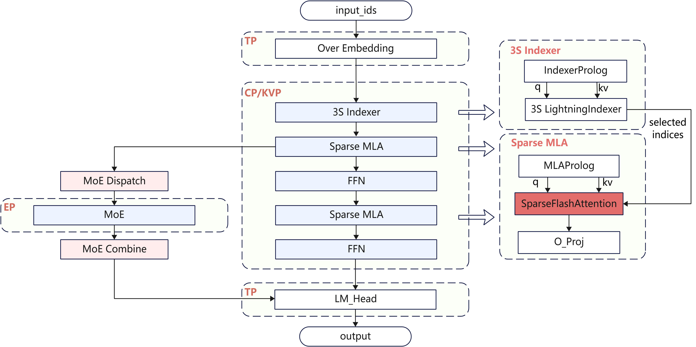
</p>

> Note: Because of space limitations, the figure appropriately simplifies the model information and computation flow.


The following table lists the parameters of the MoE component in LongCat-2.0. It contains 768 routed experts and 128 zero experts. Each `token` activates 12 experts at a time, averaging eight routed experts and four zero experts. In this open-source LongCat-2.0 practice, the MOE and MLP components natively use Int8 quantization, effectively reducing model storage overhead and improving computation efficiency compared with Bfloat16.


|Module|Number of Experts|Intermediate Size|Activated Parameters per Expert|BF16 Weight Size|Int8 Weight Size|Activated Weight Size per Token|
|----|-------|-----------------|---------------|-----------|-----------|--------------|
|MLP|1|12288|288M|42.8GB|21.4GB|21.3GB|
|MOE|768|2048|48M|2.67TB|1.34TB|14.3GB|


### Attention Sparsity and Sliding Window

- LongCat-2.0 enables the [DSA sparse architecture](../../deepseek_v3_2_exp/en/deepseek_v3.2_exp_inference_guide.md). Before Attention computation, Lightning Indexer selects `topk=2048` KV groups for each `token`, substantially reducing Attention computation time. In the SC-MOE architecture, the two Sparse Flash Attention (SFA) operations in each layer share one set of `topk_indices`. According to the [DSA computation analysis](../../deepseek_v3_2_exp/en/deepseek_v3.2_exp_inference_guide.md#deepseek-v32-exp-vs-v31), both Prefill and Decode in this open-source practice use `absorb` mode, which is favorable for DSA performance.
- On top of DSA, LongCat-2.0 additionally uses the Sink Sliding Window (3S) design. Among the reserved `topk=2048` KV groups, it always selects `init 16`, the first 16 KV groups along the sequence dimension corresponding to `sink`, and `local 1024`, the last 1024 KV groups corresponding to `sliding_window`. It then selects `top 1008` KV groups from the middle section, further improving model capabilities. The following figure shows an example of how 3S LI filters KV Pairs.

<p align="center">
  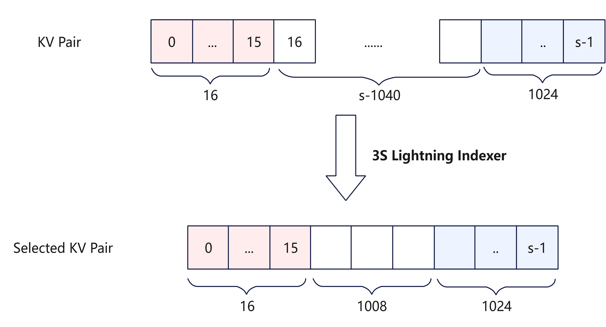
</p>


### Over Embedding

LongCat-2.0 supports Over Embedding based on the Meituan technical report. It slightly increases computation in the Embedding stage at the start of inference to improve model quality. The following figure shows the OE computation steps.


<p align="center">
  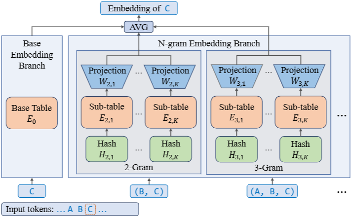
</p>

Each `token` is computed with the preceding `oe_n - 1` `token` to obtain `(oe_n - 1)` `n-gram` containing preceding Token information, after which Ngram Embedding is performed on each. Ngram Embedding computation is divided into `oe_k` subtables, each with its own Embedding and Projection. Increasing the number of subtables reduces the probability that different `n-gram` map to the same row in the vocabulary and increases the freedom of `n-gram` representation. From the computation-flow perspective, OE computation uses `oe_k` subtables and hashes each `token` with its preceding `oe_n - 1` `token` to obtain `(oe_n - 1) * oe_k` `oe_token`. OE Embedding and OE Projection are then performed on the `oe_token`. Finally, the resulting `oe_hidden_states` and the `hidden_states` from the original Embedding computation are averaged with weights and used as the input to subsequent Layer computation. See the following formula for the computation steps.
$$
e_i =\frac{1}{(N-1)K + 1}\left(E_0(t_i)+\sum_{n=2}^{N}\sum_{k=1}^{K}W_{n,k}E_{n,k}\left(H_{n,k}(t_{i-n+1}, \ldots, t_i)\right)\right)
$$


The following formula shows the Ngram hash computation, where $\mathrm{t_i}$ indicates a Token and $\mathrm{V}$ indicates a hash parameter.
$$ \mathrm{H_{nk}} = (\mathrm{\sum_{j=0}^{n-1}} \mathrm{t_{i-j}} * \mathrm{V_{k}^j} ) \% \mathrm{V_n} $$


### MTP Speculative Inference

LongCat-2.0 continues to provide a native Multi-Token Prediction (MTP) mechanism. MTP allows multiple Tokens to be computed and verified simultaneously during one main-model inference operation. Before reaching the computation bottleneck, a small latency increase can potentially produce more output Tokens, reducing the average inference time per Token. Because LongCat-2.0 uses the new 3S DSA architecture, MTP acceleration is more complex than in LongCat-Flash.

- In Full Attention scenarios, enabling MTP barely increases MLA KV Cache movement, so MTP can improve the compute-to-memory-access ratio and compute utilization. For the Sparse Flash Attention operator, each `q_token` selects `topk=2048` KV groups. In the extreme case, the KV selected by `mtp_token` does not overlap with the KV selected by `main_token`, increasing the cost of discrete memory access instead.

- In long-sequence scenarios, the Lightning Indexer operator takes longer than the SFA operator. Its required K Cache movement is similar to dense MLA, so the MTP mechanism can improve the compute-to-memory-access ratio. DSA sparse computation substantially reduces long-sequence Attention computation, while the remaining operators, such as Matmul, achieve a better compute-to-memory-access ratio after MTP is enabled. Therefore, MTP provides considerable acceleration for the entire inference process.

- This open-source practice supports MTP 3. In each inference Step, the MTP model performs three additional inference operations, effectively reducing the average inference latency per Token.


## Fused Operators


### Attention

As shown in the following figure, the DSA computation process consists of MLAProlog, IndexerProlog, Lightning Indexer, Sparse Flash Attention, and MLAEpilog.

<p align="center">
  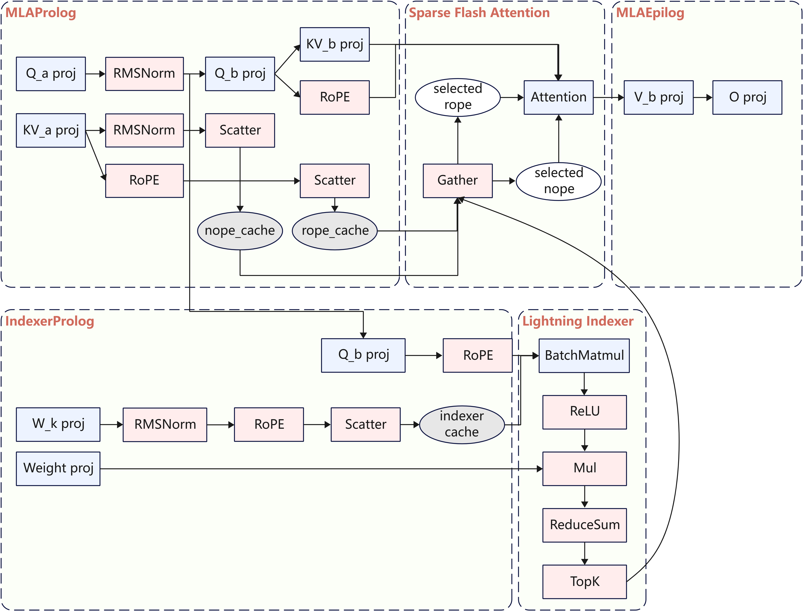
</p>

> Note: Because of space limitations, the figure appropriately simplifies model information and does not show MLP/MOE or the second Attention computation group.

- Lightning Indexer: Includes operations such as Score Batchmatmul, ReLU, ReduceSum, and TopK. In long-sequence scenarios, TopK becomes a bottleneck. Pipeline the TopK computation time to mask the time of other operations and obtain computation-pipeline benefits.
- Sparse Flash Attention: Selects TopK-related Tokens from the complete KVCache and performs sparse Flash Attention. The main bottleneck is discrete gather memory access. Use this time to mask other operations and accelerate them through pipeline parallelism.
- MLAProlog and IndexerProlog: Include operations such as Q/KV LoRA, RoPE, Norm, and KVCache update, providing substantial space for Cube/Vector parallel pipelines.
- MLAEpilog: Includes O_proj and V dimension expansion.

In this open-source sample, MLAProlog, Lightning Indexer, and Sparse Flash Attention use NPU fused operators to improve computation performance. The following operators are open-sourced in the CANN/ops-transformer repository: [**lightning_indexer**](https://gitcode.com/cann/ops-transformer/tree/master/attention/lightning_indexer) and its quantized version [**quant_lightning_indexer**](https://gitcode.com/cann/ops-transformer/tree/master/attention/quant_lightning_indexer), and [**sparse_flash_attention**](https://gitcode.com/cann/ops-transformer/tree/master/attention/sparse_flash_attention) and its quantized version [**kv_quant_sparse_flash_attention**](https://gitcode.com/cann/ops-transformer/tree/master/attention/kv_quant_sparse_flash_attention).


### MOE

Because the MOE component of LongCat-series networks includes special zero experts, the [**moe_distribute_combine**](https://gitcode.com/cann/ops-transformer/blob/9.0.0/mc2/moe_distribute_combine_v2/docs/aclnnMoeDistributeCombineV3.md) operator used by Decode supports the zero-expert feature. It can use the pipeline inside the fused operator to mask zero-expert computation time and improve MOE performance.


### Over Embedding

This open-source practice implements two fused operators for the Over Embedding feature of LongCat-2.0 to improve computation efficiency in key steps.

- Update Token Table: Over Embedding needs to hash the current `token` with preceding `token`. To quickly obtain historical `token` information during Decode, all historical `token` are maintained in a Token Table data structure. When a new request is input or a new `token` is derived or accepted, the new `token` information must be written to the Token Table. For discrete update operations in multi-request scenarios, this practice implements the `update_token_table` operator, which efficiently writes `token` from multiple requests to specified positions in the Token Table.
- Compute N-Gram Ids: During Embedding computation in each Step, each `token` must be hashed with its preceding `(oe_n - 1)` `token` for the `oe_k` subtables to generate new `oe_token`. This generates `(oe_n - 1) * oe_k` `oe_token` for each `token` as the input to subsequent OE Embedding computation. The `compute_n_gram_ids` operator implemented in this practice generates these `oe_token`. For the computation flow, see [OE parallelism](#over-embedding).

The related operator implementations are open-sourced in [LongCat-2.0 NPU Inference](https://gitcode.com/cann/cann-recipes-infer/blob/master/models/longcat-2.0/README.md)(Chinese).


## Deployment Strategy

This open-source release is a PD-disaggregated serving framework sample. Prefill is deployed on 64 Atlas A2 cards, and Decode is deployed on 128 Atlas A2 cards.


### Prefill

LongCat-2.0 has up to 1.6T parameters, occupies more than 2 TB of memory during inference, and supports long-sequence requests of 1M through features such as 3S DSA. The Prefill stage therefore has a high risk of device memory OOM, while TTFT also presents a major challenge during inference-service deployment. Optimizing memory usage and TTFT is therefore the primary goal of the parallel strategy. This open-source practice uses Context Parallel Pipeline deployment, dividing 64 Atlas A2 cards into `m` x `n` groups. Pipeline parallelism is applied along dimension `m`, and Context Parallel (CP) is applied along dimension `n`.

<p align="center">
  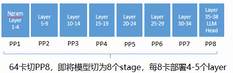
</p>

The preceding figure shows Pipeline parallelism, which partitions the model by Layer for parallel execution.

<p align="center">
  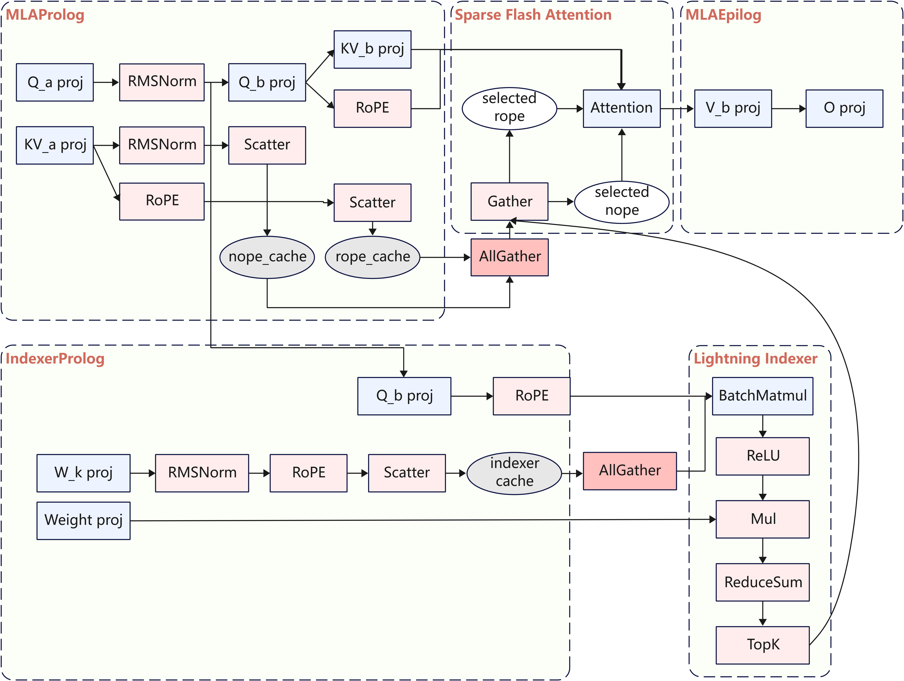
</p>

> Note: Because of space limitations, the figure appropriately simplifies model information and does not show MLP/MOE or the second Attention computation group.

As shown in the preceding figure, CP partitions input requests in parallel along the sequence dimension. Before Indexer and SFA computation, perform `all_gather` communication for the Indexer Key Cache and KV Cache, respectively. During LI and SFA computation, each `rank` has part of `q` and the complete Cache.

#### MLA Naive Vs Absorb

In the Prefill stage, using 1 Batch 64K inference as an example, Lightning Indexer selects TopK=2048 `kv_token` for each `q_token`. The MLA computation flow has three options:

  **Solution 1:** MLA Naive + Sparse Mask. Prefill MLA uses Naive mode. Each `q_token` computes Attention with all historical `kv_token`, and an Attention Mask filters out `token` outside TopK only before `softmax`. The two `batch_matmul` Shapes in Attention are as follows:

  | Solution 1 | Batch |  M   |  K   |  N   |
  | :---------: | :---: | :--: | :--: | :--: |
  | BMM1(Q*K^T) | 1*128 | 64K  | 192  | 64K  |
  |  BMM2(P*V)  | 1*128 | 64K  | 64K  | 128  |

  This solution has the same computation volume as the original Full Attention but cannot obtain DSA sparse-computation benefits, resulting in poor performance in long-sequence scenarios.

  **Solution 2:** MLA Naive + Sparse Attention. Prefill MLA uses Naive mode, and each `q_token` computes Attention with TopK=2048 `kv_token`. Because each `q_token` independently selects the 2048 KV groups to compute, the 64K sequence length must be moved to the Batch axis, and the M-axis size is 1.

  | Solution 2 | Batch |  M   |  K   |  N   |
  | :---------: | :--------: | :--: | :--: | :--: |
  | BMM1(Q*K^T) | 1\*64K*128 |  1   | 192  | 2048 |
  |  BMM2(P*V)  | 1\*64K*128 |  1   | 2048 | 128  |

  Solution 2 has a smaller BMM computation volume, reduced to 2048/64K=1/32 of the original Full Attention computation volume, but has the following problems:

  - The BMM M axis is 1, resulting in low matrix-multiplication efficiency.
  - Compared with the original Full Attention, BMM increases HBM access to kv by `topk=2048` times, causing a memory-access bottleneck.

  **Solution 3:** MLA Absorb + Sparse Attention. Prefill MLA uses Absorb mode, consistent with Decode. Similarly, each `q_token` computes Attention with TopK=2048 `kv_token`.

  | Solution 3 | Batch  |  M   |  K   |  N   |
  | :---------: | :----: | :--: | :--: | :--: |
  | BMM1(Q*K^T) | 1\*64K | 128  | 576  | 2048 |
  |  BMM2(P*V)  | 1\*64K | 128  | 2048 | 512  |

  The comparison between Solution 3 and Solution 2 is as follows:

  - Solution 3 increases computation by approximately three times, reflected in the K axis of BMM1 and the N axis of BMM2. However, its BMM M axis is 128, which is more suitable for matrix multiplication.

  - Solution 3 benefits from reduced memory access in Absorb mode compared with Naive mode. KV HBM access is tens of times lower than in Solution 2, resulting in less execution time.


Considering computation and memory-access time and long-sequence application scenarios, this practice selects Solution 3, MLA Absorb + Sparse Attention, for Prefill deployment, unifying the MLA computation flows of Prefill and Decode.


### Decode

LongCat-2.0 3S DSA uses Lightning Indexer to select `topk=2048` KV groups for each `token`, so subsequent SFA computation is no longer the bottleneck. In long-sequence scenarios, the Lightning Indexer (LI) operator becomes the new computation bottleneck. Under Decode DP, different requests in real-world business scenarios have different sequence lengths. KV must be partitioned in parallel to effectively balance the LI computation load among Ranks. Therefore, this open-source practice uses KV Parallel deployment, storing the Indexer Key Cache and KV Cache of different requests on different `rank`. Each `rank` computes with complete `q` and part of the Cache, and `all_gather` then aggregates the computation results. The following figure shows the complete computation flow.

<p align="center">
  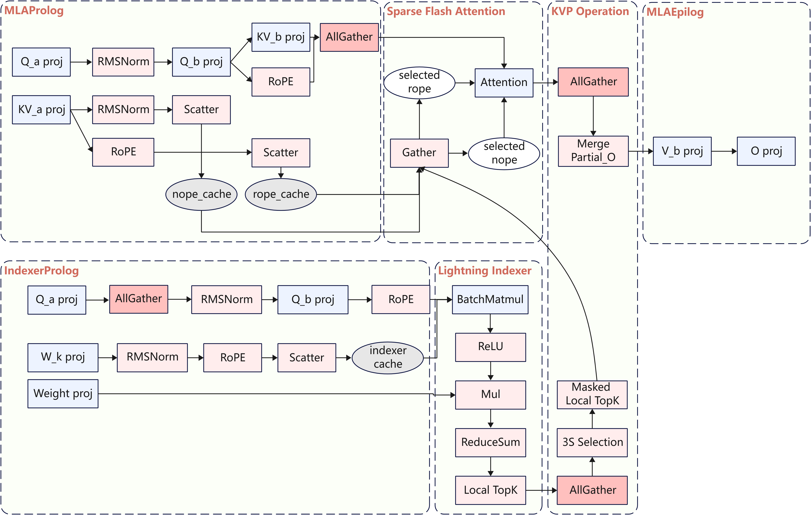
</p>

> Note: Because of space limitations, the figure appropriately simplifies model information and does not show MLP/MOE or the second Attention computation group.


### MOE

Because intra-node communication bandwidth in an Atlas A2 cluster is higher than inter-node bandwidth, this practice specifically optimizes the conventional Attention DP - AllToAll - MOE EP - AllToAll solution. It limits low-bandwidth inter-node communication to the original Tokens before `topk=12` expansion. At this point in the model, each Token corresponds to one `hidden_states`; this section uses Token to refer to it. The new solution consists of the following steps.
- Before MOE computation, perform `all_gather` among cards with the same `local_rank_id` on different nodes to aggregate Tokens, so each node contains all Tokens.
- After `topk_gating` is performed on the aggregated Tokens, perform EP-domain `all_to_all` communication and expert computation within each node. Each node contains only local experts.
- After MOE computation, perform `reduce_scatter` among cards with the same `local_rank_id` on different nodes to aggregate expert information from different nodes and return each Token.

Assume that four Ranks form a complete EP domain and each Rank deploys one expert. `rank_1` and `rank_2` are on one node, while `rank_3` and `rank_4` are on another node. The following figure shows an example of the communication and computation flow.
<p align="center">
  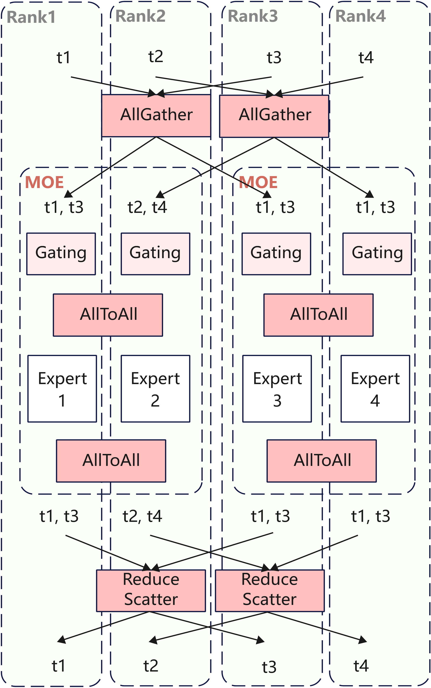
</p>

> Note: Because of space limitations, the figure appropriately simplifies the model information and computation flow.


### Over Embedding

To reduce the memory occupied by the Over Embedding Table, Over Embedding computation uses TP, while other computations are not parallelized. Therefore, after the `compute_n_gram_ids` operator produces `oe_token`, perform `all_gather` to aggregate the `oe_token` from all DP Ranks. Because the Over Embedding weights are partitioned into TP parts, after Over Embedding computation, perform `reduce_scatter` on `oe_hidden_states` to aggregate Over Embedding information and restore the DP distribution of requests.

Using `oe_n=5`, `oe_k=4`, and `n_gram=(oe_n - 1) * oe_k=16` as an example, the computation flow is as follows.
<p align="center">
  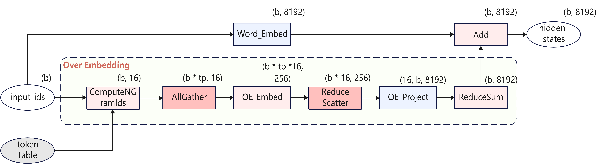
</p>


## Performance Optimization


### Enable Graph Mode
Specifying the static graph `ge_graph` as the `backend` for `torch.compile` reduces operator delivery overhead in the Decode stage and improves inference performance. GE is the graph-mode implementation of the CANN platform and corresponds to Torch-TensorRT. Its core advantage is compilation optimization of static computation graphs. Code is not executed immediately. Instead, all computation steps, including operations and variable dependencies, are first defined as a static computation graph, similar to a flowchart. The framework then optimizes the complete graph, such as through operator fusion and memory planning, and finally submits the optimized graph to the NPU for execution.


#### Enable the Graph Compilation Cache
`torch.compile` is a Just-In-Time compiler. Initial graph compilation usually takes a long time. In latency-sensitive model inference scenarios, enabling the graph compilation cache stores compiled static graphs and effectively reduces the latency of the first inference operation after service startup, improving inference performance. In the following example, after the cache path is configured, subsequent compilation loads from the configured path by default without additional calls.

```python
if self.enable_cache_compile:
    case_name = "compile_cache/" + os.getenv("CASE_NAME")
    cache_model = self.model.decode
    if self.is_mtp:
        case_name += "_spec"
        cache_model = self.model.mtp_compile_decode
    cache_dir = os.path.join(os.path.dirname(os.path.abspath(__file__)), case_name)
    self.model.decode = tng.inference.cache_compile(cache_model, cache_dir=cache_dir,
                        config=compiler_config, dynamic=False, fullgraph=True, ge_cache=True)
```
The default cache path of the main model is `./compile_cache/CASE_NAME`, and the default cache path of the mtp model is `./compile_cache/CASE_NAME_spec`.


### Multi-Stream Parallelism and Core Control
In large-model inference scenarios, divide parallelizable scenarios into multiple streams for parallel computation. Computations on multiple streams overlap, reducing overall execution time. For details about multi-stream parallelism, see the [official documentation](https://www.hiascend.com/document/detail/zh/Pytorch/720/modthirdparty/torchairuseguide/torchair_00026.html)(Chinese).

In multi-stream scenarios, one stream may occupy all Cores, reducing operator execution parallelism. Therefore, allocate cores to different streams to ensure the benefits of parallel operator execution. For details about core control, see the [official documentation](https://www.hiascend.com/document/detail/zh/Pytorch/720/modthirdparty/torchairuseguide/torchair_00044.html)(Chinese).

The original [LongCat-Flash model](https://arxiv.org/abs/2509.01322) paper provides a four-stage parallel strategy, shown in the following figure.

<div align="center">
    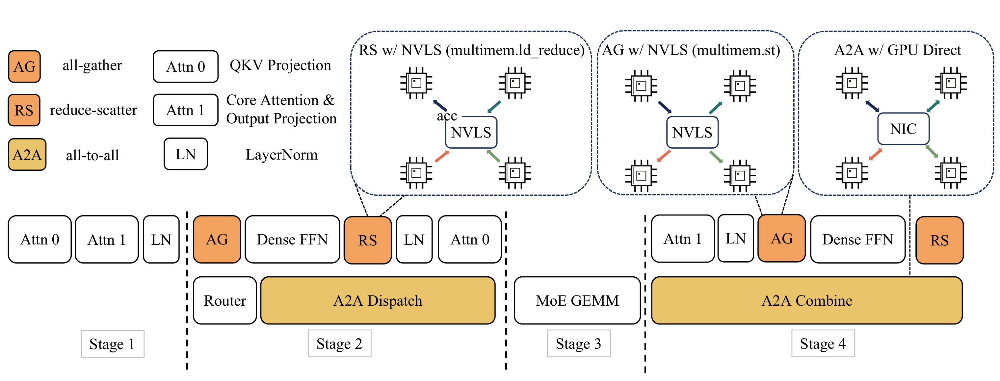
</div>

We adjusted the parallel strategy. The following figure shows the adjusted multi-stream parallelism and core-control solution. Execute the second Attention and FFN experts earlier and control the number of Cube and Vector cores on multiple streams so the execution times of the two streams are close, with no significant tail, improving performance. Stage1 does not use core control and occupies all Cube and Vector cores by default. In Stage2, both `stream0` and `stream1` use the `c12v24` core-control solution.

<div align="center">
    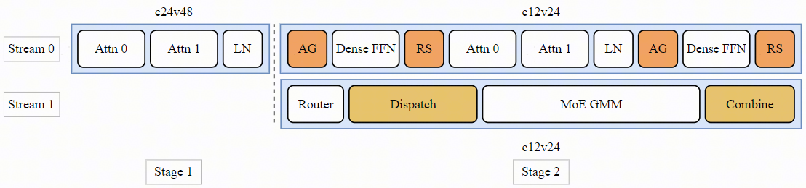
</div>

See the following pseudocode for implementing multi-stream parallelism and core control.
```python
attn
layernorm
with npu_stream_switch(True, "1"):
    with limit_core_num(True, "12", "24"):
        router
        dispatch
        gmm
        combine
with limit_core_num(True, "12", "24"):
    dense
    attn
    layernorm
    dense
```


### Weight Prefetch
This optimization provides network Weight prefetch. While preceding operators compute, it uses idle bandwidth to move the weights of some memory-Bound operators from HBM to L2 Cache in advance, improving operator performance. For details about `npu_prefetch`, see the [official documentation](https://www.hiascend.com/document/detail/zh/Pytorch/730/apiref/torchnpuCustomsapi/docs/context/torch_npu-npu_prefetch.md)(Chinese).

In the following example, Matmul weights are 20 MB. The preceding RmsNorm operator has a low memory-bandwidth requirement and executes for 10 us. Prefetch can write the Matmul weights to L2 Cache in advance. Ideally, the maximum prefetch size is `HBM_bandwidth * time_available`. The actual prefetch size varies with the bandwidth used by the network and preceding operators. Assume that 10 MB can be prefetched and executes in parallel with RmsNorm. When the Matmul operator executes, it only needs to additionally read 10 MB of weights, substantially reducing memory-access time.
<div align="center">
    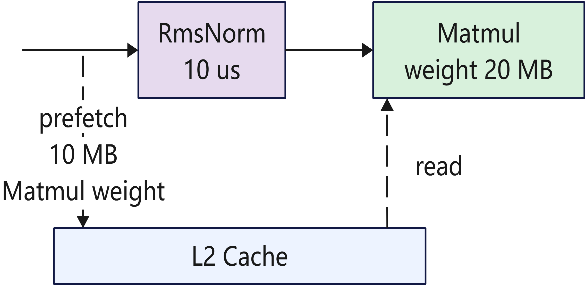
</div>

Use Profiling to analyze whether the prefetch size and position are appropriate. If the performance of an operator running in parallel with prefetch degrades significantly, further adjust the prefetch position by starting prefetch earlier or moving it away from the degraded operator. If the position cannot be adjusted, reduce the prefetch size so that the parallel operator degrades as little as possible. To maximize prefetch benefits, adjust the configuration through comparative experiments. If the preceding operator is memory-intensive, such as Matmul, parallel execution is unsuitable because bandwidth contention may cause degradation.

The general prefetch analysis and debugging process is as follows:

<div align="center">

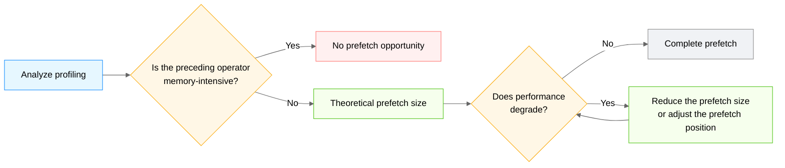

</div>

> Note: Prefetch conditions may vary by model. Adjust the preceding process as needed.


## Future Plan


- [**KV Offload**](../../deepseek_v3_2_exp/en/deepseek_v3.2_exp_inference_guide.md#kvcache-offload): Store part of the KV Cache on the CPU to release NPU memory pressure and easily support long-sequence inference.
- [**SuperKernel**](https://www.hiascend.com/document/detail/zh/CANNCommunityEdition/850alpha001/opdevg/Ascendcopdevg/atlas_ascendc_10_00029.html)(Chinese): Enable Super Kernel to further reduce operator startup overhead and scheduling gaps and improve computation execution efficiency.
<!-- static-meta
{
  "sidebarTitle": "Inference Optimization",
  "quantization": ["bf16", "int8"],
  "parallelism": ["data-parallel", "tensor-parallel", "pipeline-parallel", "context-parallel", "expert-parallel"],
  "cannFeatures": ["multi-stream", "prefetch"],
  "hardware": ["atlas-a2"],
  "frameworks": ["cann-recipes"],
  "llmSpeculativeInference": ["mtp"]
}
-->
