# LongCat-Flash Inference Performance Optimization on an Atlas A3 Cluster
## Overview
This document primarily describes optimization methods for the LongCat-Flash model on Atlas A3 series products.

## Performance Optimization

### General Optimizations
For parts of the LongCat-Flash architecture that are similar to Llama, refer to the general optimizations in [Llama](https://gitcode.com/Ascend/torchair/tree/master/npu_tuned_model/llm/llama), such as fixing the KV Cache size, optimizing cos/sin, and fusing AddRMSNorm.

### Enable Graph Mode
Using a static graph improves inference performance. LongCat-Flash uses the graph compilation process of the inference framework. It is triggered in `ModelWorker.compile_model` in [`model_worker.py`](https://gitcode.com/cann/cann-recipes-infer/blob/master/executor/core/model_worker/model_worker.py) and calls `compile_model_forward` in [`graph_utils.py`](https://gitcode.com/cann/cann-recipes-infer/blob/master/executor/utils/graph_utils.py) to complete compilation.

Configure the execution mode through `model_config.exe_mode` in the YAML file. The supported modes are `eager`, `ge_graph`, and `npugraph_ex`. `ge_graph` and `npugraph_ex` use the compiled `model.forward` in the Decode stage, while the Prefill stage runs in `eager` mode.

#### Enable the Graph Compilation Cache
torch.compile is a Just-In-Time compiler. Initial graph compilation usually takes a long time. In latency-sensitive model inference scenarios, enabling the graph compilation cache stores compiled static graphs and effectively reduces the latency of the first inference operation after service startup, improving inference performance. The current compilation entry is as follows:

```python
self.model_compiled = compile_model_forward(
    self.model.forward,
    exe_mode=self.exe_mode,
    enable_cache_compile=self.enable_cache_compile,
    cache_dir=os.path.join(self.infer_config.model_config.output_path, "cache_compile"),
    enable_static_kernel=self.enable_static_kernel,
)
```

Enable the graph compilation cache through the `model_config.enable_cache_compile` switch in the YAML file. The cache directory is `model_config.output_path/cache_compile`. `ge_graph` mode uses `torchair.inference.cache_compile`, while `npugraph_ex` mode uses `torch.npu.npugraph_ex.inference.cache_compile`. `npugraph_ex` can also enable static kernel compilation through `model_config.enable_static_kernel`.

### Multi-Stream Parallelism and Core Control
In large-model inference scenarios, divide parallelizable scenarios into multiple streams for parallel computation. Computations on multiple streams overlap, reducing overall execution time. For details about multi-stream parallelism, see the [official documentation](https://www.hiascend.com/document/detail/zh/Pytorch/720/modthirdparty/torchairuseguide/torchair_00026.html)(Chinese).

In multi-stream scenarios, one stream may occupy all cores, reducing operator execution parallelism. Therefore, allocate cores to different streams to ensure the benefits of parallel operator execution. For details about core control, see the [official documentation](https://www.hiascend.com/document/detail/zh/Pytorch/720/modthirdparty/torchairuseguide/torchair_00044.html)(Chinese).

The original [LongCat-Flash model](https://arxiv.org/abs/2509.01322) paper provides a four-stage parallel strategy, shown in the following figure.

<div align="center">
    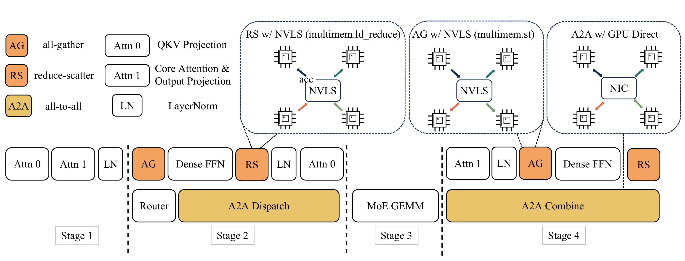
</div>

We adjusted the parallel strategy. The following figure shows the adjusted multi-stream parallelism and core-control solution. Execute the second attention and FFN experts earlier and control the numbers of ai cores and vector cores on multiple streams so that the execution times of the two streams are close, with no significant tail, improving performance. stage1 does not use core control and occupies all ai cores and vector cores by default. In stage2, stream0 uses the c16v32 core-control solution, and stream1 uses c8v16.

The current code controls this optimization through `model_config.custom_params.enable_multi_streams`: `0` disables it, `1` uses the preceding asymmetric core-control solution, and `2` uses the c12v24 solution for both stream0 and stream1. This optimization applies only to the Decode stage and does not support `exe_mode: eager`.

<div align="center">
    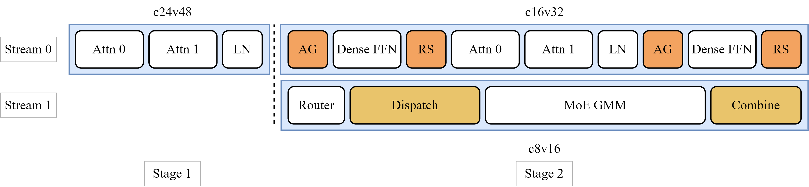
</div>

See the following pseudocode for implementing multi-stream parallelism and core control.
```python
attn
layernorm
with npu_stream_switch(True, "1"):
    with limit_core_num(True, "8", "16"):
        router
        dispatch
        gmm
        combine
with limit_core_num(True, "16", "32"):
    dense
    attn
    layernorm
    dense
```


### Weight Prefetch
This optimization provides network weight prefetch. While operators compute, it uses idle bandwidth to move the weights of some memory-bound operators from HBM to L2 Cache in advance, improving operator performance. For details about npu_prefetch, see the [official documentation](https://www.hiascend.com/document/detail/zh/Pytorch/730/apiref/torchnpuCustomsapi/docs/context/torch_npu-npu_prefetch.md)(Chinese). Enable npu_prefetch through `model_config.custom_params.enable_prefetch`. In LongCat-Flash, this switch depends on the multi-stream optimization, so `enable_multi_streams > 0` must also be set.

In the following example, `Matmul` weights are 20 MB. The preceding `RmsNorm` operator has a low memory-bandwidth requirement and executes for 10 us. Prefetch can write the `Matmul` weights to L2 Cache in advance. Ideally, the maximum prefetch size is `HBM_bandwidth / time_available`. The actual prefetch size varies with the bandwidth used by the network and preceding operators. Assume that 10 MB can be prefetched and executes in parallel with `RmsNorm`. When the `Matmul` operator executes, it only needs to additionally read 10 MB of weights, substantially reducing memory-access time.
<div align="center">
    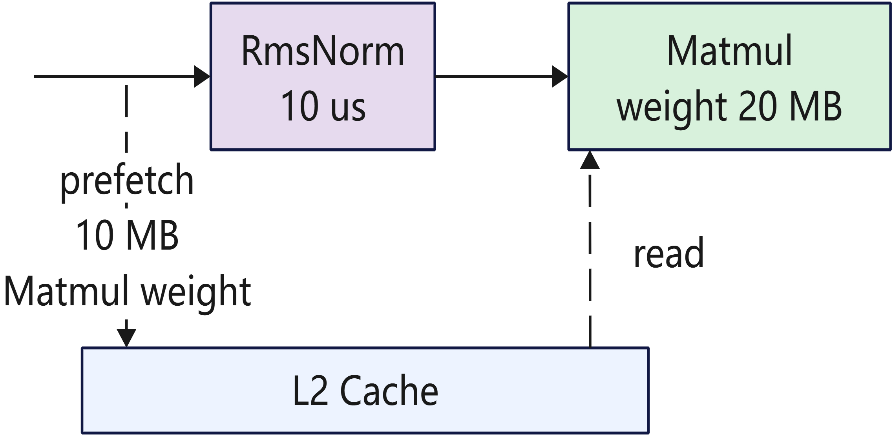
</div>

Use profiling to determine whether the prefetch size and position are appropriate. If the performance of an operator running in parallel with prefetch degrades significantly, further adjust the prefetch position by starting prefetch earlier or moving it away from the degraded operator. If the position cannot be adjusted, reduce the prefetch size so that the parallel operator degrades as little as possible. To maximize prefetch benefits, adjust the configuration through comparative experiments. If the preceding operator is memory-intensive, such as Matmul, parallel execution is unsuitable because bandwidth contention may cause degradation.

The general prefetch analysis and debugging process is as follows:

<div align="center">

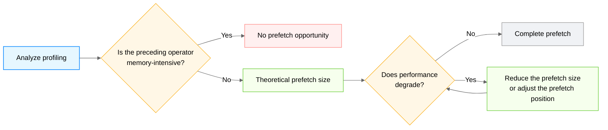

</div>

> Note: Prefetch conditions may vary by model. Adjust the preceding process as needed.

The following figure shows the prefetch positions in LongCat-Flash. We prefetch the corresponding weights for memory-bound operators such as QuantBatchMatmul (QBMM), MLAProlog, and Matmul. MLAProlog contains multiple matrix multiplications and has substantial data-movement overhead. Therefore, we prefetch the weights of the preceding QBMM to provide a larger prefetch window for MLAProlog and obtain greater performance benefits. To view the specific prefetch sizes and positions, search for the `npu_prefetch` API in [`modeling_longcat_flash.py`](https://gitcode.com/cann/cann-recipes-infer/blob/master/models/longcat_flash/models/modeling_longcat_flash.py) and [`ffn.py`](https://gitcode.com/cann/cann-recipes-infer/blob/master/models/longcat_flash/models/ffn.py).

<div align="center">
    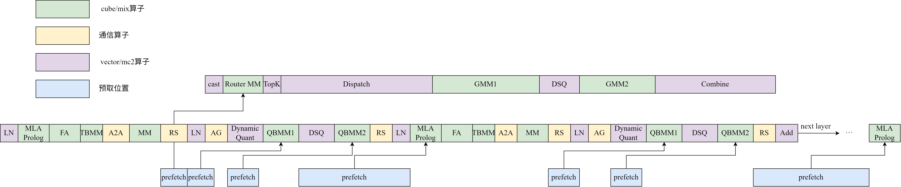
</div>


### Enable SuperKernel
When `ge_graph` graph mode is enabled for Decode, SuperKernel optimizes the model computation graph within a user-defined scope. For details about SuperKernel, see the [official documentation](https://www.hiascend.com/document/detail/zh/Pytorch/710/modthirdparty/torchairuseguide/torchair_00035.html)(Chinese). Enable SuperKernel through `model_config.custom_params.enable_superkernel`. It optimizes some operators within one SuperKernel scope to reduce task-scheduling wait time and scheduling overhead and improve overall performance. In LongCat-Flash, `enable_superkernel` does not support `eager` or `npugraph_ex` mode. Because different streams use different core-partitioning strategies, calibrate each SuperKernel scope according to its core-partitioning and stream-partitioning ranges. The following figure shows the SuperKernel scopes calibrated for Longcat-Flash.

<div align="center">
    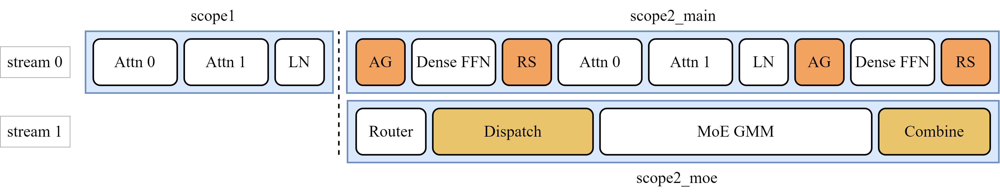
</div>


### MLA (Multi-Head Latent Attention) Low-Rank Compression Optimization
In the Decode stage, use the low-rank compression method described in the [DeepSeek paper](https://arxiv.org/pdf/2405.04434) to reduce KV Cache memory usage and improve inference efficiency. For the related implementation, see the `forward_page_attention_absorb` function of the `LongcatFlashAttention` class. MLA uses Data Parallelism (DP) overall and separately partitions the o_proj matmul with Tensor Parallelism (TP) to improve performance.

#### Fused Operator Optimization
- MLA preprocessing performance optimization: Enable the [npu_mla_prolog_v3] fused kernel to replace computation before attention. It includes Q, K, and V linear-layer computation, rotary position encoding (ROPE), RmsNorm, and KV Cache update.
- Attention performance optimization: Enable the [npu_fused_infer_attention_score](https://www.hiascend.com/document/detail/zh/Pytorch/720/apiref/torchnpuCustomsapi/context/torch_npu-npu_fused_infer_attention_score.md)(Chinese) fused kernel to accelerate MLA computation.

#### o_proj Tensor Parallelism K-Axis Partitioning
Apply row partitioning to the o_proj linear layer. The input dimension of o_proj is `num_heads * v_head_dim`, and the output dimension is `hidden_size`. During o_proj TP, partition the input dimension by `o_proj_tp_size`. `num_heads * v_head_dim` must be divisible by `o_proj_tp_size`, and each rank stores only the weights corresponding to some input channels. During inference, `attn_output` first passes through `all_to_all`, so each rank obtains only the input-feature section for which it is responsible. Each rank then applies the linear transformation to its local tensor to obtain a local output. Finally, `reduce_scatter` sums the local outputs of all ranks by element and partitions them along the batch dimension to obtain the output of each rank.

<div align="center">
    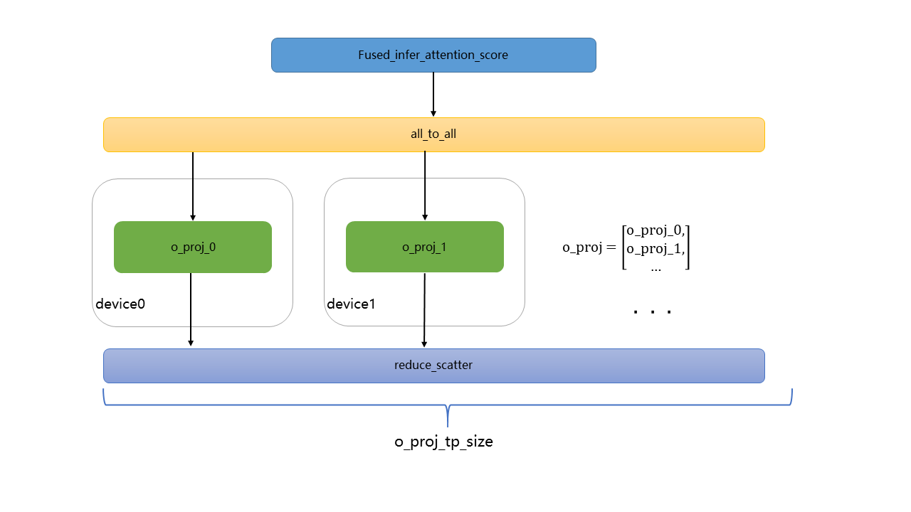
</div>

### Implement Expert Parallel (EP) and Enable Fused Operators for the MoE (Mixture of Experts) Module
The MoE computation stage uses EP (Expert Parallelism), evenly distributing routed experts and zero-computation experts across cards. The current implementation is `LongcatFlashMoE` in [`modeling_longcat_flash.py`](https://gitcode.com/cann/cann-recipes-infer/blob/master/models/longcat_flash/models/modeling_longcat_flash.py). In AFD scenarios, the independent FFN-side model is in [`ffn.py`](https://gitcode.com/cann/cann-recipes-infer/blob/master/models/longcat_flash/models/ffn.py) and is registered as `longcat_flash_ffn` in the framework.

#### Enable a Fused Operator for the Router
Use the [torch_npu.npu_moe_gating_top_k](https://www.hiascend.com/document/detail/zh/Pytorch/720/apiref/torchnpuCustomsapi/context/torch_npu-npu_moe_gating_top_k.md)(Chinese) operator to sort the router computation result and select the top-k experts.

#### Prefill-Stage Optimization
Routed experts in the Prefill stage use the **Double-Routing** strategy. For the specific computation steps, see the MoE deployment strategy optimization section in [DeepSeek-R1 Prefill Inference Performance Optimization on an Atlas A3 Cluster](../../deepseek_r1/en/deepseek_r1_prefill_optimization.md).

#### Decode-Stage Optimization
- High-performance expert computation: Use the [torch_npu.npu_grouped_matmul](https://www.hiascend.com/document/detail/zh/Pytorch/720/apiref/torchnpuCustomsapi/context/torch_npu-npu_grouped_matmul.md)(Chinese) operator to process computation for multiple experts simultaneously, improving computation and data movement efficiency.
- High-performance multi-card communication routing: Enable the [torch_npu.npu_moe_distribute_dispatch_v2](https://www.hiascend.com/document/detail/zh/Pytorch/720/apiref/torchnpuCustomsapi/context/torch_npu-npu_moe_distribute_dispatch_v2.md)(Chinese) and [torch_npu.npu_moe_distribute_combine_v2](https://www.hiascend.com/document/detail/zh/Pytorch/720/apiref/torchnpuCustomsapi/context/torch_npu-npu_moe_distribute_combine_v2.md)(Chinese) operators to implement multi-card communication under EP. Pass the `copy_expert_num` parameter to enable zero-expert processing in the dispatch_v2 and combine_v2 operators. The computation formula is `MoE(ori_x) = ori_x`. Before use, refer to the preceding operator documentation to check whether environment variables such as `HCCL_BUFFSIZE` are configured appropriately and understand the operator scenarios and constraints.

### MLP Linear-Layer Optimization
#### Merge MLP Linear-Layer Computation
The original `LongCatFlashMLP` implementation contains three matmul operations: `gate_proj`, `up_proj`, and `down_proj`. Merge `gate_proj` and `up_proj` into `gate_up_proj` to improve overall computation efficiency.

#### MLP Linear-Layer TP Partitioning
In MLP computation, `gate_up_proj` and `down_proj` must be fully stored on every device, causing device memory pressure. This optimization partitions `gate_up_proj` along the N axis and `down_proj` along the K axis across different devices in the `dense_tp` domain. This completes TP partitioning of the MLP linear layers, reduces per-device memory usage, and reduces weight movement overhead during matmul. Note that the MLP stage uses TP, while the surrounding Attention modules use DP. AllGather and ReduceScatter must run before and after MLP computation to perform DP -> TP -> DP conversion. Despite the additional communication overhead, this approach provides good overall performance benefits. In the current optimization practice, Dense FFN experts use TP8 partitioning.

<div align="center">
    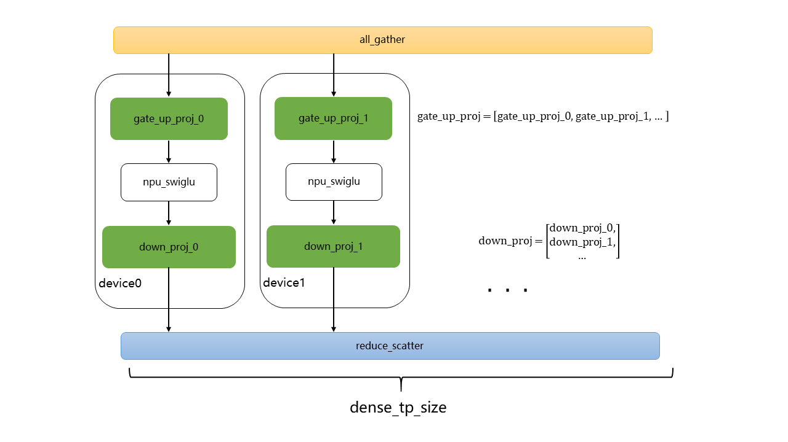
</div>

### Support Multi-Token Prediction (MTP)
MTP speculative inference is implemented. In scenarios that have not reached the computation bound, MTP provides good inference acceleration. Enable MTP through `model_config.next_n` in the YAML file. When `next_n > 0`, the framework loads `LongcatFlashModelMTP`, and [`mtp_worker.py`](https://gitcode.com/cann/cann-recipes-infer/blob/master/executor/core/model_worker/mtp_worker.py) runs the speculative inference process. MTP1 and MTP2 are currently supported.

### Attention-FFN Disaggregation (AFD) Optimization
#### Optimization Motivation
In non-disaggregated scenarios, the Attention and MoE modules are deployed on the same card. Because of the inherent characteristics of the ScMoE architecture, the [Multi-Stream Parallelism and Core Control](#multi-stream-parallelism-and-core-control) section designs a multi-stream strategy for Stage2 to achieve optimal performance. By allocating different numbers of cores, the Attention computation stream and MoE computation stream run as a parallel pipeline.

However, after Stage2 uses core control, the two computation streams can use only some Cube and Vector cores, constraining operator compute power. Measurements on Atlas A3 show that without core control, MLAProlog/FA/MM/TBMM/QBMM take less time than with core control. The following table compares the execution times.
<table style="width:99%; border-collapse:collapse; margin:20px 0;">
    <tr>
        <th style="border:1px solid #ddd; padding:10px; text-align:center;"> Number of Cube_Vector Cores</th>
        <th style="border:1px solid #ddd; padding:10px; text-align:center;">MLAProlog (μs)</th>
        <th style="border:1px solid #ddd; padding:10px; text-align:center;">FA (μs)</th>
        <th style="border:1px solid #ddd; padding:10px; text-align:center;">MM (μs)</th>
        <th style="border:1px solid #ddd; padding:10px; text-align:center;">TBMM (μs)</th>
        <th style="border:1px solid #ddd; padding:10px; text-align:center;">QBMM1 (μs)</th>
        <th style="border:1px solid #ddd; padding:10px; text-align:center;">QBMM2 (μs)</th>
    </tr>
    <tr>
        <td style="border:1px solid #ddd; padding:10px; text-align:center;">12C_24V</td>
        <td style="border:1px solid #ddd; padding:10px; text-align:center;">68.1</td>
        <td style="border:1px solid #ddd; padding:10px; text-align:center;">118</td>
        <td style="border:1px solid #ddd; padding:10px; text-align:center;">18</td>
        <td style="border:1px solid #ddd; padding:10px; text-align:center;">19.6</td>
        <td style="border:1px solid #ddd; padding:10px; text-align:center;">18.7</td>
        <td style="border:1px solid #ddd; padding:10px; text-align:center;">20.1</td>
    </tr>
    <tr>
        <td style="border:1px solid #ddd; padding:10px; text-align:center;">24C_48V</td>
        <td style="border:1px solid #ddd; padding:10px; text-align:center;">45.2</td>
        <td style="border:1px solid #ddd; padding:10px; text-align:center;">91.8</td>
        <td style="border:1px solid #ddd; padding:10px; text-align:center;">14.2</td>
        <td style="border:1px solid #ddd; padding:10px; text-align:center;">12.5</td>
        <td style="border:1px solid #ddd; padding:10px; text-align:center;">14.6</td>
        <td style="border:1px solid #ddd; padding:10px; text-align:center;">16.3</td>
    </tr>
</table>

> Except for the number of cores, all preceding data was collected and decomposed from the full network under the same configuration.

Based on the preceding analysis, Attention-FFN Disaggregation (AFD) can be used for the LongCat-Flash-560B model to further reduce TPOT in the Decode stage. It separates the MoE module from the full network for independent deployment. In other words, the Attention and MoE modules are deployed on different nodes, and Send/Recv operators exchange data between nodes. Enable AFD through `model_config.custom_params.enable_afd`. The framework divides `world_size` in half: Lower-half ranks load `longcat_flash_ffn`, and upper-half ranks load the `longcat_flash` main model. They exchange data between the Attention and FFN sides through `dist.send`/`dist.recv`. The following figure shows the network architectures before and after AFD is enabled.
<p align="center">
  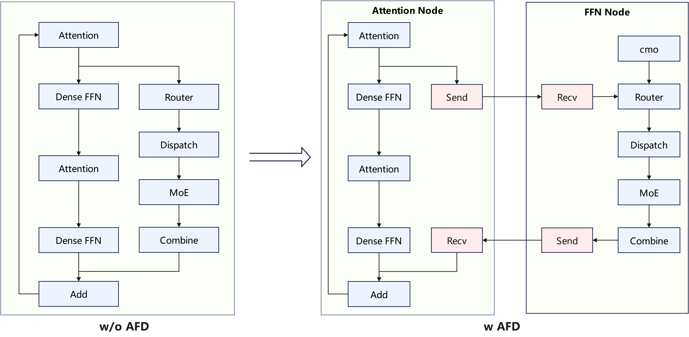
</p>

The following figure shows the independent deployment of Attention and MoE.

<p align="center">
  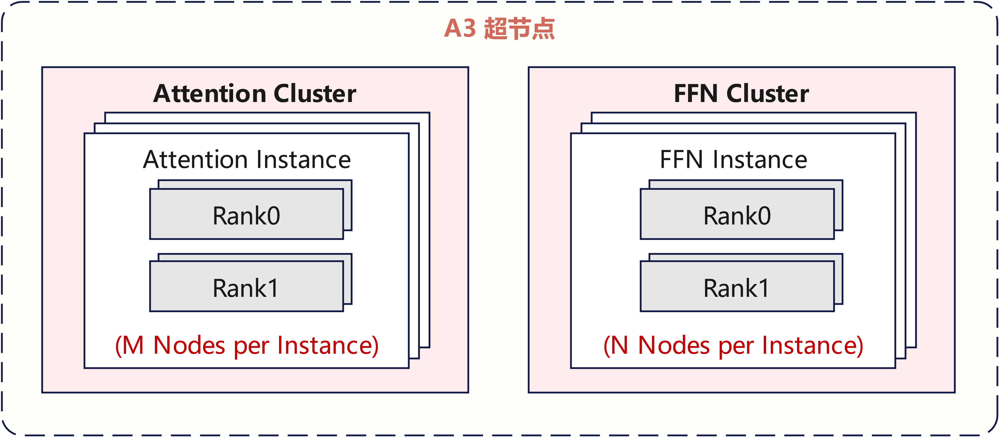
</p>

#### Computation Flow Diagram
After AFD is enabled, cross-node communication by Send/Recv uses SDMA and does not occupy Vector cores. When computation operators in the Attention module run in parallel with Send/Recv, they are no longer constrained by core control.

In the computation flow shown in the following figure, the result of the first LayerNorm (LN) operator on the Attention node is sent to the FFN node through Send and simultaneously passed to the next operator for subsequent computation. After Send completes the send operation, Recv waits for and receives the data returned from the FFN node. Send/Recv on Stream1 of the Attention node overlaps with computation operators on the main Stream0, hiding communication behind computation.

<p align="center">
  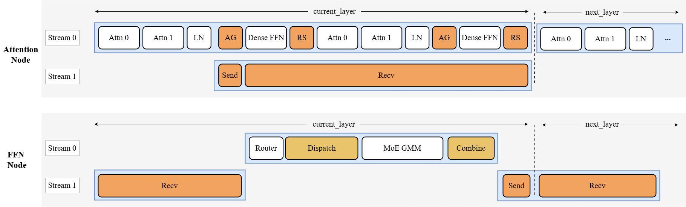
</p>

Similarly, the FFN node acts as the server. The first operator in its execution graph is Recv, which waits until the Attention node sends data through Send. After the FFN node receives the data, it performs Router/Dispatch/MoE-GMM/Combine and finally sends the data back to the Attention node through Send.

#### FFN Weight Prefetch
In non-disaggregated scenarios, after weights are prefetched for QuantBatchMatmul (QBMM), MLAProlog, and Matmul, the execution time of operators on Stream0 in Stage2 is similar to that of Router/Dispatch/MoE GMM/Combine on Stream1. In addition, no suitable time window exists for MoE GMM weight prefetch. Therefore, MoE GMM does not use weight prefetch.

After AFD is enabled and core control is removed on the Attention side, MLAProlog/FA/MM/TBMM/QBMM take less time. The FFN side may become the computation bottleneck, causing Recv on the Attention side to wait a long time for data from the FFN side and producing a trailing EVENT_WAIT gap in the computation flow, as shown in the following figure.
<p align="center">
  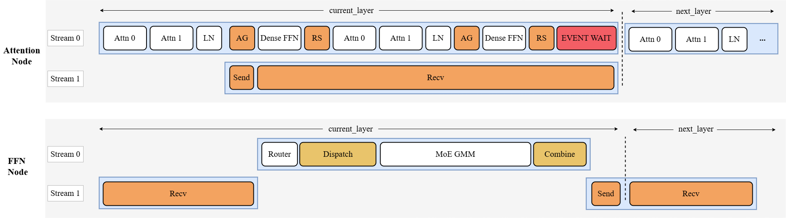
</p>

To address the FFN-side computation bottleneck, prefetch the weights of memory-bound operators such as GMM/Matmul during communication gaps, reducing total FFN-side execution time, as shown in the following figure.
<p align="center">
  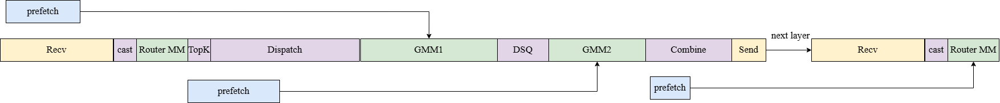
</p>

> In AFD scenarios, weight prefetch on the Attention side remains the same as in non-disaggregated scenarios. See [Weight Prefetch](#weight-prefetch).


## Benchmark
For detailed benchmark performance data, see the [LongCat-Flash model README](https://gitcode.com/cann/cann-recipes-infer/blob/master/models/longcat_flash/README.md#benchmark)(Chinese).

## Appendix
[Environment Deployment and Sample Execution](https://gitcode.com/cann/cann-recipes-infer/blob/master/models/longcat_flash/README.md)(Chinese)
<!-- static-meta
{
  "sidebarTitle": "Inference Optimization",
  "parallelism": ["data-parallel", "tensor-parallel", "expert-parallel"],
  "cannFeatures": ["multi-stream", "superkernel", "prefetch", "npugraph"],
  "hardware": ["atlas-a3"],
  "frameworks": ["cann-recipes"],
  "llmSpeculativeInference": ["mtp"]
}
-->
