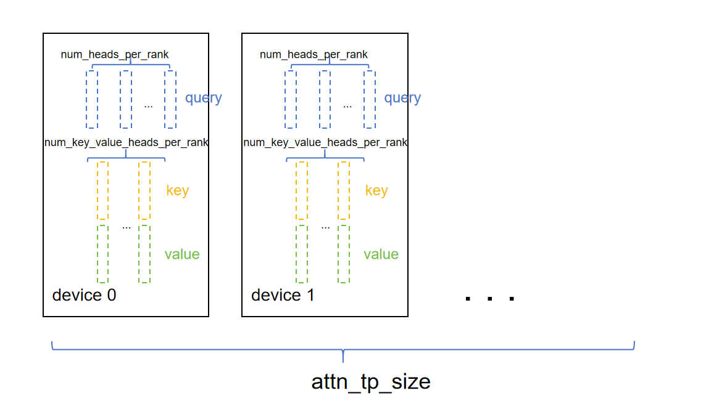
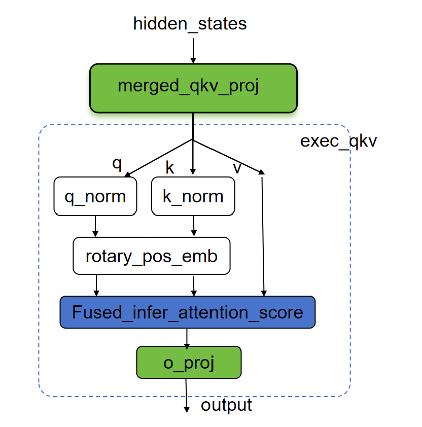
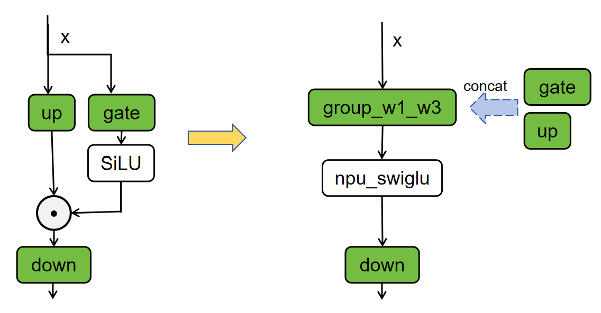
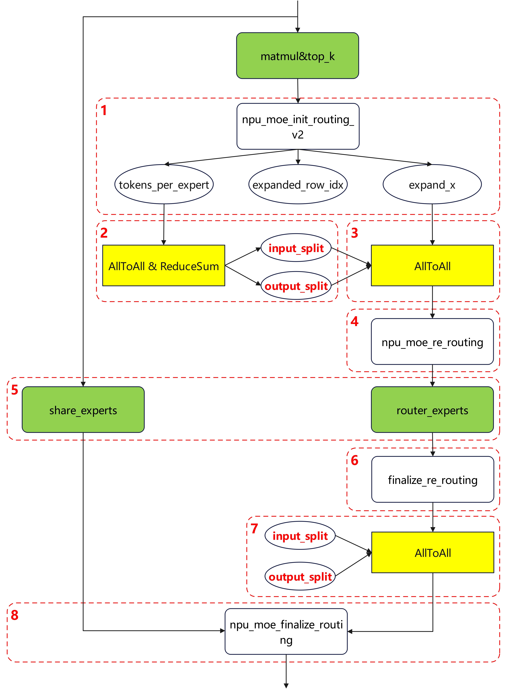

# Qwen3.5-MoE Inference Performance Optimization Practices

## Overview

This document describes NPU-based inference optimizations for Qwen3.5-MoE. The model combines full attention, linear attention, and MoE structures. The inference path therefore needs to optimize Attention and MLP matrix operations while reducing the overhead of MoE routing, EP communication, normalization, and other small operators.

The practices are organized around fused operators, TP/EP parallelism, graph mode, computation decomposition, and matrix fusion.

## Fused Operator Enablement

### Fused RoPE Operator

The full attention layers use MRoPE positional encoding. A native implementation usually splits, rotates, and concatenates tensors through multiple operators, causing extra data movement and scheduling overhead.

This sample uses `torch_npu.npu_rotary_mul` in `Qwen3_5MoeAttention` to rotate query and key. Because RoPE is applied to only part of the head dimension, the code splits query/key into rotated and pass-through parts, applies the fused operator to the rotated parts, and concatenates them:

```python
q_rot = torch_npu.npu_rotary_mul(q_rot, cos_4d, sin_4d, rotary_mode='half')
k_rot = torch_npu.npu_rotary_mul(k_rot, cos_4d, sin_4d, rotary_mode='half')
```

This optimization applies to both Prefill and Decode and reduces the number of small operators in positional encoding.

### Fused FlashAttention Operator

The full attention layers support both full-sequence Prefill and incremental Decode. Expanding native PyTorch attention into QK matmul, mask, softmax, and PV matmul causes considerable memory access and scheduling overhead.

The sample uses `npu_fused_infer_attention_score_v2` as the FlashAttention operator for inference. Q/K/V use the TND layout. After writing block-based KV cache, `block_table`, `block_size`, and actual sequence lengths are passed to FA v2:

```python
attn_output, _ = fa_ops.npu_fused_infer_attention_score_v2(
    query_states, k_cache_fa, v_cache_fa,
    num_query_heads=self.num_heads_per_rank,
    num_key_value_heads=self.num_key_value_heads_per_rank,
    softmax_scale=self.scale_fa, input_layout="TND",
    sparse_mode=sparse_mode,
    atten_mask=forward_metadata.attention_mask if is_prefill else None,
    actual_seq_qlen=actual_seq_qlen, actual_seq_kvlen=actual_seq_kvlen,
    block_table=block_table, block_size=self.block_size,
)
```

In Prefill, causal masking is represented by `sparse_mode=3` and the attention mask. In Decode, K/V are written to the KV cache first and `actual_seq_kvlen` limits the visible cache range. Graph-mode Decode uses `torchair.ops.npu_fused_infer_attention_score_v2`; eager execution uses `torch.ops.npu.npu_fused_infer_attention_score_v2`.

### Fused Chunk Gated DeltaNet Operator

The linear attention layers use Gated DeltaNet. Prefill computes a complete sequence in chunks. The native PyTorch implementation performs multiple matrix multiplications, decay-mask construction, and triangular solves, creating many intermediate tensors.

In `Qwen3_5MoeGatedDeltaNet`, the sample uses `torch_npu.npu_chunk_gated_delta_rule` for Prefill when the current phase is Prefill and the interface is available:

```python
core_attn_out, last_recurrent_state = torch_npu.npu_chunk_gated_delta_rule(
    query.to(torch.bfloat16), key.to(torch.bfloat16), value.to(torch.bfloat16),
    beta=beta.to(torch.bfloat16), initial_state=initial_state,
    actual_seq_lengths=actual_seq_lens.to(torch.int32), scale=scale,
    g=g.to(torch.float32),
)
```

The fused operator combines chunk-decay cumulative sum and exponentiation, the in-chunk lower-triangular solve, and inter-chunk recurrent-state update and output computation. `core_attn_out` is the current chunk output, while `last_recurrent_state` is passed to subsequent chunks or Decode. This primarily benefits Linear Attention Prefill.

### Fused RMSNorm Operator

RMSNorm is frequently used before and after attention, in linear attention, and in the final output norm. Expanding it into square, mean, reciprocal square root, and weighted multiply operations creates scheduling overhead.

`Qwen3_5MoeRMSNorm` uses `torch_npu.npu_rms_norm`:

```python
return torch_npu.npu_rms_norm(x, self.norm_weight, self.eps)[0]
```

For residual inputs, the sample fuses residual addition and RMSNorm with `torch_npu.npu_add_rms_norm`:

```python
y, _, residual = torch_npu.npu_add_rms_norm(residual, x, self.norm_weight, self.eps)
```

`Qwen3_5MoeRMSNormGated` uses the same RMSNorm operator before multiplying by the gate. These optimizations apply across TP, EP, and different batch sizes.

### Fused Matmul AllReduce

In TP execution, some linear layers must all-reduce results across cards. Instead of launching Matmul and collective communication separately, `torch_npu.npu_mm_all_reduce_base` fuses them and reduces intermediate data movement and scheduling overhead.

The sample wraps this operation in `qwen3_5_prefill_mm_all_reduce` for RowParallelLinear output projections, including full-attention `o_proj`, linear-attention `out_proj`, and dense-MLP `down_proj`:

```python
return torch_npu.npu_mm_all_reduce_base(input_, layer.weight.data, hcom, reduce_op="sum")
```

Fusion is enabled only when `enable_mm_all_reduce_base` is enabled, the phase is Prefill, TP size is greater than one and the input is TP-sharded, the layer has no bias and does not use `skip_bias_add`, the layer is non-quantized, and the HCCL group name is available. It is mainly intended for deployments such as A3 where this capability provides communication gains. Otherwise, execution falls back to the normal linear layer and, when needed, `dist.all_reduce`.

### Fused MoE Dispatch/Combine

Qwen3.5-MoE contains many experts, while each Decode token activates only a subset. In pure EP deployment, tokens must be dispatched by expert ownership and then combined in their original order. A conventional `all_to_all` path with repeated reordering, indexing, and combine operations adds communication and small-operator overhead.

For pure EP Decode, the sample provides fused `torch_npu.npu_moe_distribute_dispatch_v2` and `torch_npu.npu_moe_distribute_combine_v2`. The path requires `enable_decode_moe_dispatch_combine_v2`, Decode phase, `moe_ep_size > 1`, and `moe_tp_size == 1`.

```python
output = torch_npu.npu_moe_distribute_dispatch_v2(**dispatch_args)
...
return torch_npu.npu_moe_distribute_combine_v2(**combine_args)
```

The dispatch operator distributes tokens and emits auxiliary expert information; combine uses that information for cross-EP aggregation, weighted combination, and original-order restoration. This is suited to small-batch, low-latency Decode.

## TP and EP Optimization

The sample controls module parallelism through `parallel_config`. `attn_tp_size` controls tensor parallelism for full and linear attention, `moe_tp_size` controls tensor parallelism inside each MoE expert, and `moe_ep_size = world_size // moe_tp_size` controls expert parallelism. Only pure EP (`moe_tp_size=1`, `moe_ep_size=world_size`) or pure TP (`moe_tp_size=world_size`, `moe_ep_size=1`) is supported; mixed EP+TP is rejected during model initialization. Embedding, LM Head, dense MLP, and `o_proj` also have independent TP settings.

### Attention TP Optimization

#### Partitioning Strategy

Full attention is partitioned by head. Given `num_heads` query heads and `attn_tp_size`, each card receives `num_heads_per_rank = num_heads // attn_tp_size`; key/value heads use `num_key_value_heads_per_rank = max(num_key_value_heads // attn_tp_size, 1)`. Each card computes its local Q/K/V heads, then `o_proj` and all-reduce aggregate TP results.



Linear attention likewise partitions `linear_num_key_heads` and `linear_num_value_heads` by `attn_tp_size`. The implementation checks that both counts are divisible by `attn_tp_size` so head distribution remains balanced.

#### Computation Decomposition

Full attention computes Q/K/V in one `merged_qkv_proj` Matmul; the Q projection also emits the attention gate. The result is split into query, key, and value, query/key receive RMSNorm, and `npu_rotary_mul` applies RoPE. After K/V are written to block KV cache, both Prefill and Decode call `npu_fused_infer_attention_score_v2`; Decode uses the actual KV length to limit cache visibility. The attention result is multiplied by the gate and passed to `o_proj`, followed by all-reduce or `npu_mm_all_reduce_base`.



The linear-attention path consists of `in_proj_fused`, depthwise convolution, Gated DeltaNet, RMSNormGated, and `out_proj`. Q/K/V/Z/B/A are produced by one `MergedColumnParallelLinear` and partitioned by `attn_tp_size`; Prefill uses chunk Gated DeltaNet and Decode updates recurrent state with `npu_recurrent_gated_delta_rule`. TP aggregation follows `out_proj`.

### MoE TP Optimization

#### Partitioning Strategy

MoE TP partitions the FFN matrices inside each expert. With `moe_tp_size` partitions and `num_experts` experts, `gate_proj` and `up_proj` are column-partitioned, while `down_proj` is row-partitioned. After loading, `gate_proj` and `up_proj` are merged into `w13_weight` to reduce Matmul operations.

#### Computation Decomposition

Each expert computes `down_proj(SiLU(gate_proj(x)) * up_proj(x))`. The sample merges `gate_proj` and `up_proj` into one GroupedMatmul, applies `npu_swiglu` for `SiLU(gate) * up`, and uses a second GroupedMatmul for `down_proj`. `npu_moe_finalize_routing` restores token order and combines router-weighted outputs; when `moe_tp_size > 1`, `moe_tp_group` all-reduces TP shards.



This approach suits large expert weights where per-card memory must be reduced. When `moe_tp_size == world_size`, `moe_ep_size` is 1 and experts are partitioned within the TP group without EP dispatch.

### MoE EP Optimization

MoE EP distributes routed experts across ranks. Each card loads only its local expert range:

```python
experts_per_rank = num_experts // moe_ep_size
local_expert_start = moe_ep_rank * experts_per_rank
local_expert_end = local_expert_start + experts_per_rank
```

The normal EP path uses Double Routing for dispatch, expert computation, and restoration.



1. Call `npu_moe_init_routing_v2` to expand and sort local tokens by top-k experts, producing `expanded_x`, `tokens_per_expert`, and `expanded_row_idx`.
2. AlltoAll `tokens_per_expert` within the EP group to determine `input_splits` and `output_splits`.
3. Call `dist.all_to_all_single` with those splits so each card receives tokens for its local experts.
4. Call `npu_moe_re_routing` to sort received tokens by local expert and produce `hidden_states_ordered_by_experts`, `tokens_per_local_expert`, and `gathered_ids_unsort`.
5. Run local expert FFNs with GroupedMatmul.
6. Use `torch.index_select` with `gathered_ids_unsort` to restore local receive order.
7. Call `dist.all_to_all_single` again to return expert results to the original token ranks.
8. Call `npu_moe_finalize_routing` with `expanded_row_idx` to restore original token order and combine top-k outputs using router weights.

In pure EP Decode (`moe_ep_size > 1` and `moe_tp_size == 1`), the Double-Routing path can be replaced by `npu_moe_distribute_dispatch_v2` and `npu_moe_distribute_combine_v2` to further reduce communication overhead.

## Graph Mode

Decode is dominated by single-token incremental inference. Its small operators can make NPU execution host-bound. The sample uses `torch_npu` TorchAir graph compilation to compile Decode into a whole graph, reducing CPU-to-NPU dispatch and synchronization overhead. Graph mode currently supports only TP configurations.

During Prefill, normal `model.forward` computes the full input and initializes state. Once Decode starts, `ge_graph` (the `npugraph_ex` mode is not yet verified) executes the compiled model:

```python
if self.exe_mode in ["ge_graph", "npugraph_ex"] and not is_prefill:
    logits = self.model_compiled(**model_inputs)
else:
    logits = self.model(**model_inputs)
```

Compilation is triggered during warm-up. The executor first runs Prefill to initialize KV cache and linear-attention state, then uses a single-token input to compile the Decode graph. For repeated runs with fixed settings, `enable_cache_compile` enables graph compilation caching and avoids subsequent compilation waits.

## Matrix Fusion Optimization

### Gated DeltaNet Input Projection Fusion

The linear-attention layers contain Gated DeltaNet. The original implementation computes `in_proj_qkv`, `in_proj_z`, `in_proj_b`, and `in_proj_a` as independent linear layers:

```python
mixed_qkv = self.in_proj_qkv(hidden_states)
z = self.in_proj_z(hidden_states)
b = self.in_proj_b(hidden_states)
a = self.in_proj_a(hidden_states)
```

The sample merges these projections into `in_proj_fused`, using one `MergedColumnParallelLinear` for Q/K/V, the Z gate, and B/A, then splits by output dimension:

```python
fused_proj = self.in_proj_fused(hidden_states)
mixed_qkv, z, b, a = torch.split(
    fused_proj,
    [self.key_dim * 2 + self.value_dim, self.value_dim, self.num_v_heads, self.num_v_heads],
    dim=-1,
)
```

This reduces input-side Matmul operations and gives `mixed_qkv`, `z`, `b`, and `a` the same TP partitioning, quantization, and output-dtype path. `mixed_qkv` then enters depthwise convolution and Gated DeltaNet; `z` gates RMSNormGated output normalization, while `b` and `a` generate recurrent parameters.

<!-- static-meta
{
  "sidebarTitle": "Inference Optimization",
  "parallelism": ["tensor-parallel", "expert-parallel"],
  "cannFeatures": ["npugraph"],
  "hardware": ["atlas-a3"],
  "llmSpeculativeInference": ["none"]
}
-->
