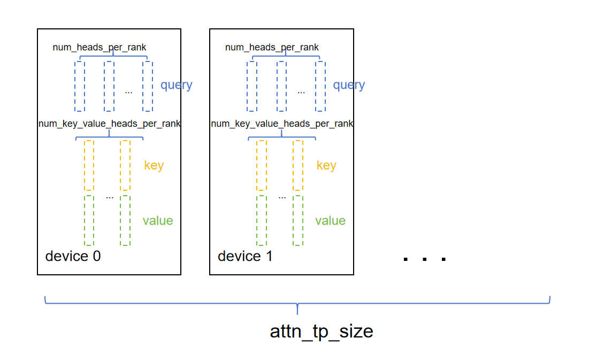
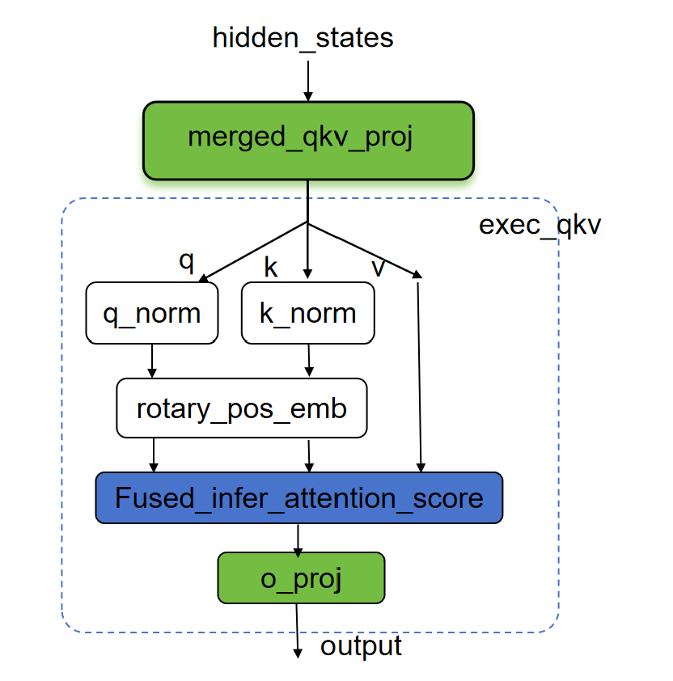
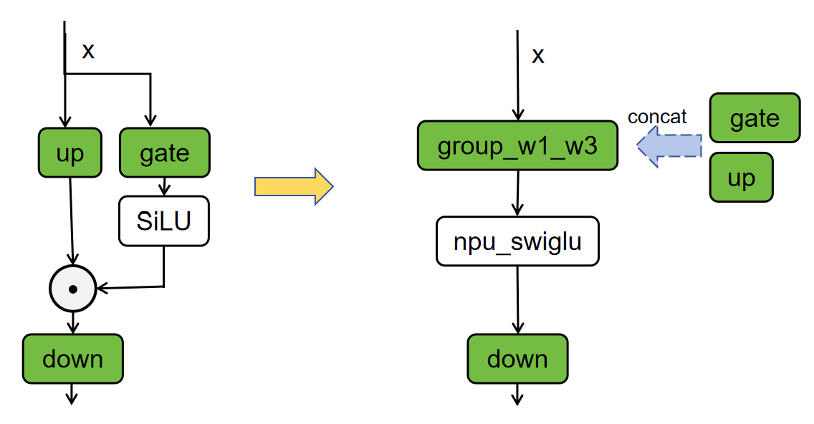
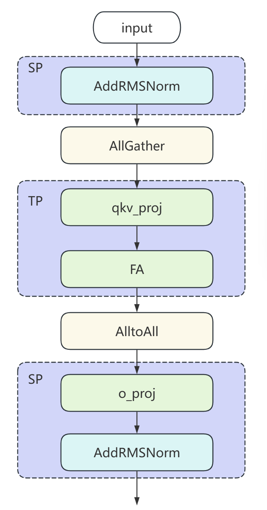

# Low-Latency Inference Performance Optimization Practices for Qwen3-MoE on Atlas A3 and 950 Training/Inference Clusters
## Overview
This document describes NPU-based low-latency inference optimization strategies for the Qwen3-MoE model.
- On the Atlas A3 training/inference series, Decode uses an 8-card deployment to achieve single-batch inference latency below 20 ms in BF16 scenarios.
- On the Atlas 950 PR training/inference series, Decode uses a 4-card deployment to achieve single-batch Prefill latency below 280 ms and Decode latency below 24 ms in 4K W4A8 mixed-precision inference scenarios.


## Tensor Parallel (TP) Optimization for Low-Latency Scenarios
### Attention TP Optimization
#### Partitioning Strategy
The tensor partitioning strategy for Attention can be divided into QKV-head partitioning and linear-layer partitioning.
When partitioning QKV heads, the multi-head computation mechanism of attention makes tensor partitioning straightforward: each head is computed independently, and the results are then concatenated. Assume that an attention layer needs to partition `num_heads` queries by `attn_tp_size`. `num_heads` must be divisible by `attn_tp_size`, and the number of query heads placed on each card is `num_heads_per_rank = num_heads // attn_tp_size`. The numbers of key and value heads are equal and may be less than or equal to the number of query heads (they are smaller in MQA and GQA scenarios). To ensure that each card has at least one key head and one value head, the number of key or value heads on each card is calculated as
`num_key_value_heads_per_rank = max(num_key_value_heads // attn_tp_size, 1)`. The arrangement of QKV heads across multiple cards is shown in the following figure.



For the linear layer `o_proj`, row partitioning is used.

#### Computation Decomposition
This optimization strategy first merges the Q, K, and V linear-layer computations into one Matmul (merged_qkv_proj in the figure) to improve computation performance. After splitting the output of `merged_qkv_proj` into Q, K, and V, it normalizes Q and K and applies rotary positional encoding, computes attention (Fused_infer_attention_score in the figure), and finally outputs the result through the o_proj layer.



### MoE TP Optimization
#### Partitioning Strategy
Assume that the partition count of the model's MoE layer is `moe_tp_size` and the number of experts is `expert_num`. Tensor partitioning is applied to the MoE layer. Each expert is equivalent to an MLP layer, so its partitioning method is similar to MLP tensor partitioning. Specifically, `gate_proj` and `up_proj` are column-partitioned, while `down_proj` is row-partitioned. The `gate_proj` and `up_proj` linear layers are also merged for computation to obtain `w13_weight`.

#### Computation Decomposition
Each expert layer contains three Matmul operations: gate_proj, up_proj, and down_proj. The specific computation is x = down( SiLU(gate(x))*up(x) ). This optimization concatenates the tensor-partitioned gate_proj and up_proj and then enables the [torch_npu.npu_swiglu](https://www.hiascend.com/document/detail/zh/Pytorch/710/apiref/torchnpuCustomsapi/context/%EF%BC%88beta%EF%BC%89torch_npu-npu_swiglu.md)(Chinese) fused operator API. This operator performs the following two computations:
- Split input x into two parts along the last dimension: x = torch.chunk(x, 2, -1).
- Compute and return SiLU(x[0]) * x[1].

By merging gate_proj and up_proj for computation, this optimization improves overall computation efficiency.



## Enabling Fused Operators
### Enabling GMM and Optimizing Routing
In the MoE module, processing each expert with a `for` loop and separately computing `expert_num` feed-forward networks (FFNs) can result in low computation efficiency. CANN provides the `GroupedMatmul` operator, which computes multiple experts simultaneously to improve computation and data-movement efficiency. For the specific implementation, see the [`moe_infer_tp`](https://gitcode.com/cann/cann-recipes-infer/blob/master/models/qwen3_moe/models/modeling_qwen3_moe.py) and `moe_infer_fusion` functions in the [`Qwen3MoeSparseMoeBlock`](https://gitcode.com/cann/cann-recipes-infer/blob/master/models/qwen3_moe/models/modeling_qwen3_moe.py) class.

- Fast expert selection: When calculating routing scores between experts and tokens, the [torch_npu.npu_moe_gating_top_k_softmax](https://www.hiascend.com/document/detail/zh/Pytorch/710/apiref/torchnpuCustomsapi/context/torch_npu-npu_moe_gating_top_k_softmax.md)(Chinese) fused operator can replace the original multi-operator sequence of topk followed by softmax, calculating token-expert scores more quickly.
- Efficient sorting and token routing:
    - Enable the [torch_npu.npu_moe_init_routing](https://www.hiascend.com/document/detail/zh/Pytorch/710/apiref/torchnpuCustomsapi/context/torch_npu-npu_moe_init_routing.md)(Chinese) fused operator to perform MoE routing and obtain the expert order.
    - Enable the [torch_npu.npu_moe_compute_expert_tokens](https://www.hiascend.com/document/detail/zh/Pytorch/710/apiref/torchnpuCustomsapi/context/torch_npu-npu_moe_compute_expert_tokens.md)(Chinese) fused operator to obtain the number of tokens to be processed by each expert.
    - Enable the [torch_npu.npu_moe_finalize_routing](https://www.hiascend.com/document/detail/zh/Pytorch/710/apiref/torchnpuCustomsapi/context/torch_npu-npu_moe_finalize_routing.md)(Chinese) fused operator to reorder the tokens after expert computation and calculate their weighted sum to obtain the final output.
- High-performance expert computation: Enable the [torch_npu.npu_grouped_matmul](https://www.hiascend.com/document/detail/zh/Pytorch/710/apiref/torchnpuCustomsapi/context/torch_npu-npu_grouped_matmul.md)(Chinese) fused operator to perform matrix multiplications for multiple experts and improve computation and data-movement efficiency.

### RmsNorm Operator Optimization
Enabling the [torch_npu.npu_rms_norm](https://www.hiascend.com/document/detail/zh/Pytorch/60RC2/apiref/apilist/ptaoplist_000140.html)(Chinese) operator improves model inference performance. RmsNorm is a normalization operation commonly used in large models. Compared with LayerNorm, it omits the mean-subtraction step.

### FlashAttention Fused Operator Optimization
Enable [torch.ops.npu.npu_fused_infer_attention_score](https://www.hiascend.com/document/detail/zh/Pytorch/710/modthirdparty/torchairuseguide/torchair_00086.html)(Chinese), a FlashAttention operator that supports graph mode in inference scenarios. It supports both full-computation and incremental-computation scenarios.

## Enabling Graph Mode
Static graphs provide better inference performance. `Qwen3MoeRunner` overrides the `graph_compile` function of `ModelRunner` in [`model_runner.py`](https://gitcode.com/cann/cann-recipes-infer/blob/master/executor/model_runner.py) to compile the model into a static graph.

## Enabling Graph Compilation Cache
In model inference, enabling the graph compilation cache stores the compiled static graph and avoids compiling the model for every inference run, thereby improving inference performance. For an example, see the use of `graph_compile` in `Qwen3MoeRunner`:

```python
if self.enable_cache_compile:
    case_name = "compile_cache/" + os.getenv("CASE_NAME")
    cache_dir = os.path.join(os.path.dirname(os.path.abspath(__file__)), case_name)
    self.model.decode = tng.inference.cache_compile(self.model.decode, cache_dir=cache_dir,
                    config=compiler_config, dynamic=True, fullgraph=True, ge_cache=True)
```
The default cache path is `./compile_cache/CASE_NAME`.

## Enabling AIV Expansion for Collective Communication
Use the device's Vector Cores to accelerate collective communication operations. For details, see the [HCCL_OP_EXPANSION_MODE environment variable](https://www.hiascend.com/document/detail/zh/CANNCommunityEdition/83RC1alpha002/maintenref/envvar/envref_07_0096.html)(Chinese):

```shell
export HCCL_OP_EXPANSION_MODE=AIV
```
## Prefill Optimization for High-Throughput Scenarios (Attention SP+TP, MoE EP)
### Overview
In Prefill inference, the model must process the complete input sequence at once, resulting in high computation intensity. To maximize throughput under TTFT latency constraints, a combined strategy of Attention sequence parallelism (SP), tensor parallelism (TP), and MoE expert parallelism (EP) is used together with MXFP8/MXFP4 quantization and multi-operator fusion, significantly reducing computation and communication overhead in Prefill.

### Attention SP+TP Optimization
#### Parallel Strategy Selection
Most Prefill operators are compute-bound. After TP partitioning, the sequence length on each card is shorter, but the AllReduce communication volume is proportional to the full sequence. SP partitions along the sequence dimension, so each card processes only a subsequence of length `seq_len // attn_tp_size`. Its communication operator is AlltoAll, which transfers less data and can be combined with low-bit quantization.

Considering communication volume, data type, and additionally introduced operators, Attention in Prefill uses **hybrid SP+TP parallelism**:
- **Communication before FA**: Use AllGather to aggregate the subsequences from all ranks into the complete sequence, with MXFP8 quantization to reduce communication volume.
- **Communication after FA**: Use AlltoAll to redistribute the output of o_proj to all ranks along the sequence dimension, with MXFP8 quantization.

#### Partitioning Strategy
The input sequence is evenly partitioned along the token dimension by `attn_tp_size`, and each rank processes `seq_len // attn_tp_size` tokens. The input sequence length must be divisible by `attn_tp_size`; otherwise, padding is applied for alignment.

```
Rank 0: [token_0, ..., token_{S/P-1}]
Rank 1: [token_{S/P}, ..., token_{2S/P-1}]
...
Rank P-1: [token_{(P-1)S/P}, ..., token_{S-1}]
```

Here, `S` is the sequence length, and `P` is `attn_tp_size`.

#### Computation Decomposition
The Attention computation flow in Prefill is as follows:

1. **Sequence Partitioning and Embedding**: Partition the input `input_ids` by `attn_tp_size`; each rank performs Embedding only for its local subsequence.
2. **AllGather Aggregation**: Use `dist.all_gather_into_tensor` to aggregate `hidden_states` from all ranks into the complete sequence. If MXFP8 quantization is enabled, aggregate `hidden_states_scale` at the same time.
3. **merged_qkv_proj**: Perform the QKV linear-layer computation on the aggregated complete sequence.
4. **FlashAttention**: Use `npu_fused_infer_attention_score_v2` to complete attention computation.
5. **o_proj + AlltoAll**: o_proj uses `ReplicatedLinear` (each card holds the complete weights). After MXFP8 quantization, the output is redistributed by AlltoAll along the sequence dimension, and each rank retains only the subsequence assigned to it.
6. **Preparing MoE Input**: The output shape after AlltoAll is `(seq_len // attn_tp_size, hidden_size)`, which is used directly as the input to the MoE layer.



### MoE EP Optimization
#### Parallel Strategy Selection
The MoE component supports both TP and EP. TP may partition the K or N axis of GMM too finely, reducing computation performance. Under EP, each rank holds some experts and uses communication to match tokens to experts; communication overhead is controllable when the number of `ep_rank` values is small.

EP is further divided into an AllGather solution and a Double Routing (AlltoAll) solution:

| Parallel Strategy | Communication Operator | Communication Volume | Applicable Scenario |
|---|---|---|---|
| EP (AllGather) | AllGather + ReduceScatter | (B,S,H) × 2 | Smaller data volume when `ep_rank` is small and `top_k > ep_rank` |
| EP (Double Routing) | AlltoAll + AlltoAll | (BS×top_k/ep_rank, H) × 2 | Large-EP scenarios; smaller data volume when `ep_rank > top_k` |

For the current Qwen3-MoE model, `top_k=8`. When `ep_rank=4`, `top_k > ep_rank`, so the AllGather solution has a smaller communication volume and is preferred by default.

#### Computation Decomposition (AllGather Solution, W4A8 Quantization)
When W4A8 (MXFP4) quantization is enabled and `attn_tp_size == moe_ep_size`, MoE EP uses the AllGather + ReduceScatter communication pattern. The specific process is as follows:

1. **MXFP8 Quantization**: Apply `npu_dynamic_mx_quant` to input `hidden_states` to obtain MXFP8-quantized data and its scale.
2. **AllGather**: Use `dist.all_gather_into_tensor` to aggregate quantized data, scale, `topk_ids`, and `topk_weight` from all ranks, obtaining token information for the complete sequence.
3. **Routing**: Use `npu_moe_init_routing_v2` to route the aggregated tokens to experts, retaining only tokens assigned to the expert range on the current rank.
4. **GMM Computation**: Use `npu_grouped_matmul` (encapsulated in [`FusedMoEGMM`](https://gitcode.com/cann/cann-recipes-infer/blob/master/module/fuse_moe_gmm.py)) to perform parallel matrix multiplication for multiple experts.
5. **Finalize Routing**: Use `npu_moe_finalize_routing` to reorder expert computation results by routing information and calculate their weighted sum.
6. **ReduceScatter**: Use `dist.reduce_scatter_tensor` to reduce and distribute partial results from all ranks. Each rank obtains the output of the subsequence assigned to it.


#### Computation Decomposition (Double Routing Solution)
When W4A8 quantization is not enabled, MoE EP uses the Double Routing (AlltoAll) communication pattern. The specific process is as follows:

1. **Routing**: Use `npu_moe_init_routing_v2` for initial token routing and sorting.
2. **Dispatch (AlltoAll)**: Use `dist.all_to_all_single` to dispatch tokens to the corresponding ranks according to expert ownership and exchange `tokens_per_expert` information to determine receive counts.
3. **Re-routing**: Use `npu_moe_re_routing` to sort the received tokens a second time.
4. **GMM Computation**: Use `npu_grouped_matmul` to perform expert computation.
5. **Combine (AlltoAll)**: Use `dist.all_to_all_single` to return expert computation results to the original ranks.
6. **Finalize Routing**: Use `npu_moe_finalize_routing` to complete final result reduction.

### Fused Operator Optimization
In Prefill, normalization, residual addition, and quantization are fused to reduce the additional operator overhead introduced by quantization:

#### Fused RMSNorm + MX Quantization
Enable the `torch_npu.npu_add_rms_norm_dynamic_mx_quant` fused operator to combine residual addition, RMSNorm, and MXFP8 dynamic quantization into one computation, avoiding repeated reads and writes of intermediate results:

```python
hidden_states_mx, residual, hidden_states_scale, _ = \
    torch_npu.npu_add_rms_norm_dynamic_mx_quant(
        hidden_states, past_residual,
        norm_weight, beta=None,
        epsilon=variance_epsilon,
        round_mode='rint',
        dst_type=torch.float8_e4m3fn
    )
```

When the residual is None (the first layer), use `torch_npu.npu_rms_norm_dynamic_mx_quant` to fuse RMSNorm and MX quantization.

#### Fused RMSNorm + Cast
Normalization before MoE needs to output both FP32 (for gate computation) and BF16 (for expert computation). Enable the `torch_npu.npu_add_rms_norm_cast` fused operator to combine residual addition, RMSNorm, and data type conversion:

```python
hidden_states_fp32, hidden_states_bf16, _, residual = \
    torch_npu.npu_add_rms_norm_cast(
        hidden_states, residual,
        norm_weight, epsilon
    )
```

### Configuration Description
Set the parameters related to Prefill SP+TP and MoE EP in the YAML configuration file:

```yaml
parallel_config:
  attn_tp_size: 4     # Attention SP/TP degree; also used as the sequence parallel degree in Prefill
  moe_tp_size: 1      # MoE TP size; set to 1 in EP scenarios
  moe_ep_size: 4      # MoE EP size; must equal attn_tp_size to enable the SP optimization path
```

Parameter constraints:

| Parameter | Constraint | Description |
|---|---|---|
| `attn_tp_size` | `world_size % attn_tp_size == 0` | Attention parallel degree |
| `moe_ep_size` | `world_size % moe_ep_size == 0` | MoE expert parallel degree |
| `attn_tp_size == moe_ep_size` | Equal values recommended | Enable the Prefill SP optimization path (`prefill_opt`) |
| `seq_len` | Must be divisible by `attn_tp_size` | Automatically padded for alignment when needed |

## Appendix
[Environment Deployment and Sample Execution](https://gitcode.com/cann/cann-recipes-infer/blob/master/models/qwen3_moe/README.md)(Chinese)
<!-- static-meta
{
  "sidebarTitle": "Inference Optimization",
  "quantization": ["bf16", "mxfp4"],
  "parallelism": ["tensor-parallel", "sequence-parallel", "expert-parallel"],
  "cannFeatures": ["npugraph"],
  "hardware": ["atlas-a3", "ascend-950"],
  "frameworks": ["cann-recipes"],
  "llmSpeculativeInference": ["none"]
}
-->