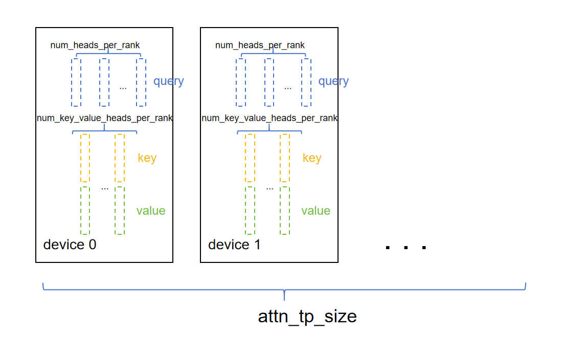
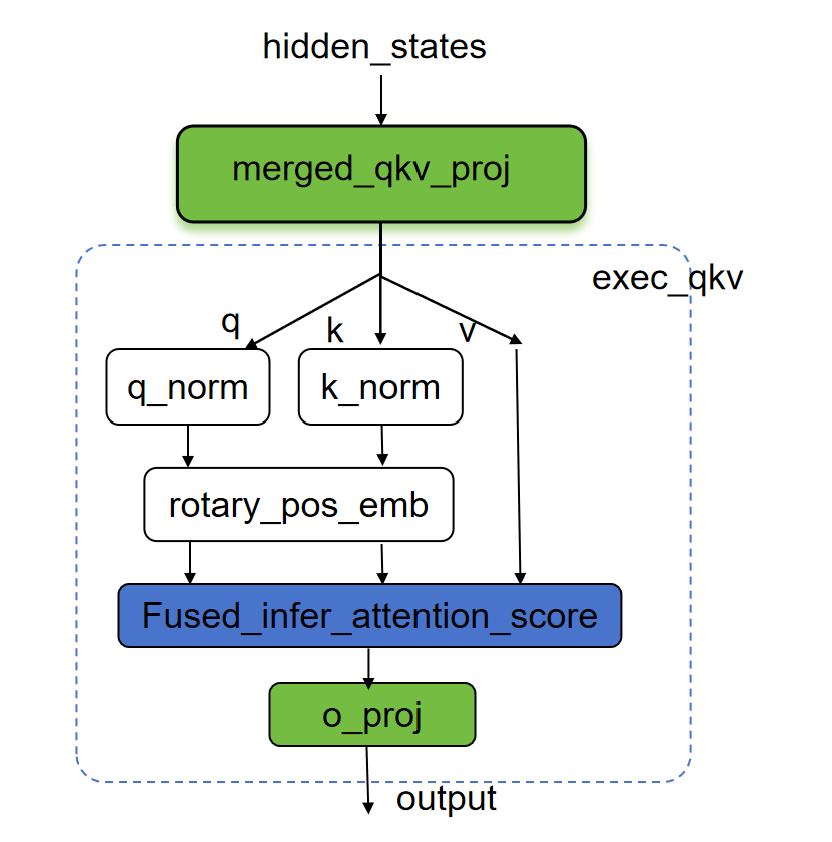
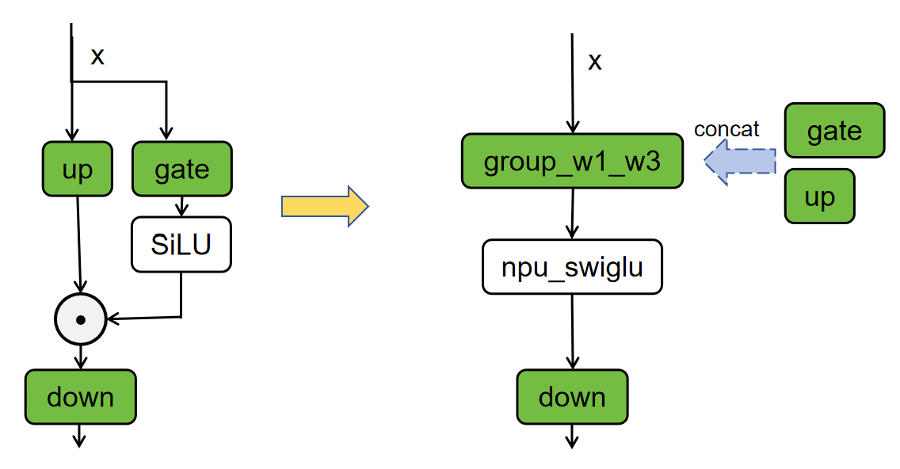
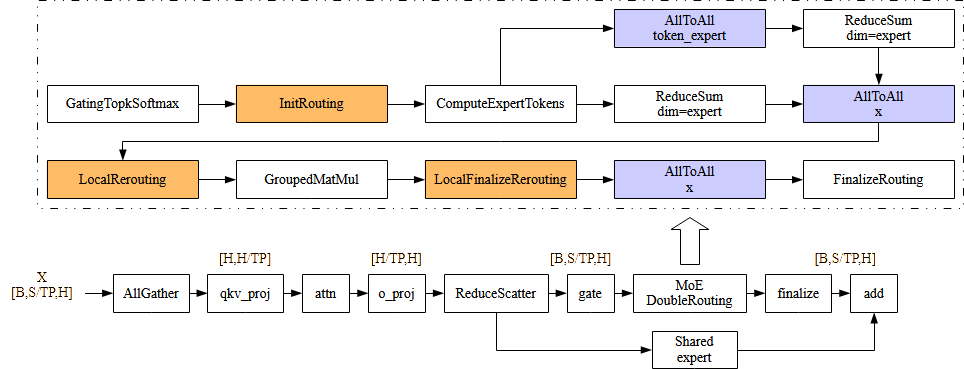
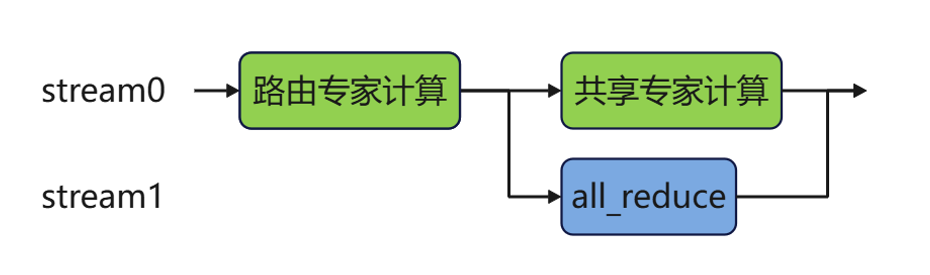
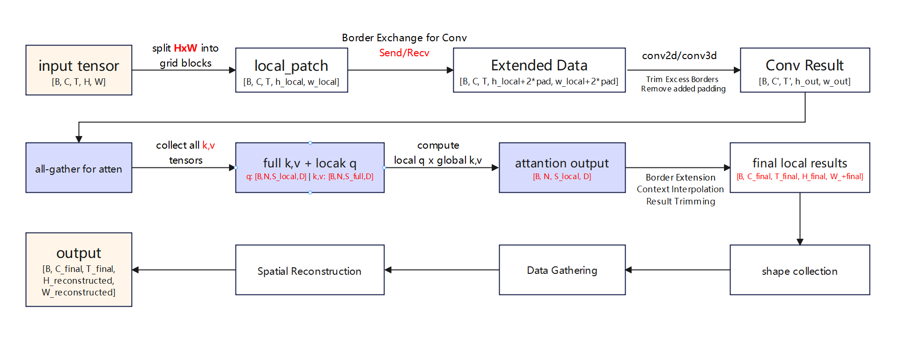
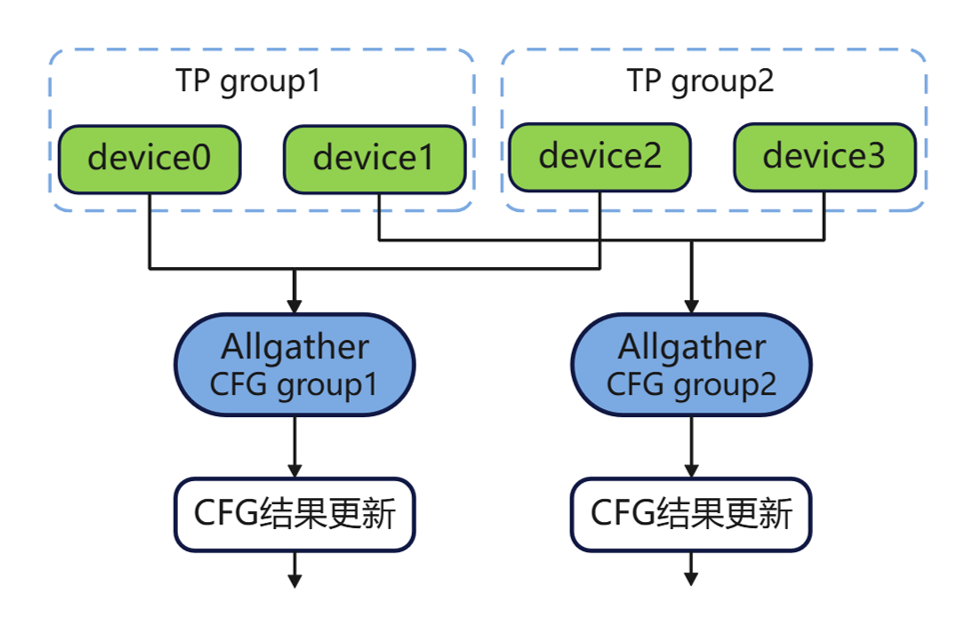

# NPU HunyuanImage-3.0 Model Inference Optimization Practice

## Overview
This document mainly introduces the NPU-based inference optimization strategies for the HunyuanImage-3.0 model. It describes how to perform TP (Tensor Parallel) inference on Atlas A2/A3 series products, as well as other parallel techniques and operator fusion optimization schemes.

## Splitting Strategy

### Attention TP Optimization
#### Splitting Strategy
The tensor splitting strategy for Attention can be divided into splitting the QKV heads and splitting the linear layers.
When splitting the QKV heads, the multi-head computation mechanism of attention facilitates convenient tensor splitting: each head is computed independently first, and then the results are concatenated. Assuming the model's attention layer needs to split `num_heads` query heads according to the split size `attn_tp_size`, `num_heads` must be divisible by `attn_tp_size`, and the number of query heads placed on each card is `num_heads_per_rank = num_heads // attn_tp_size`. The number of key and value heads is equal, and may be less than or equal to the number of query heads (it is smaller in MQA and GQA scenarios). To ensure that each card holds at least one key and value head, the number of key or value heads placed on each card is calculated as
`num_key_value_heads_per_rank = max(num_key_value_heads // attn_tp_size, 1)`. The arrangement of QKV heads across multiple cards is shown in the figure below.



When splitting the linear layer `o_proj`, row splitting is sufficient.

#### Computation Decomposition
This optimization strategy first merges the linear layer computations of Q, K, and V into a single Matmul computation (merged_qkv_proj in the figure), improving compute performance. After splitting the output of `merged_qkv_proj` into Q, K, and V, normalization is applied to Q and V with rotary position encoding, then attention is computed (Fused_infer_attention_score in the figure), and finally the output is produced through the o_proj layer.



### MoE TP Optimization
#### Splitting Strategy
Assuming the split size of the model's MoE layer is `moe_tp_size` and the number of experts is expert_num, tensor splitting is performed on the MoE layer. Specifically, `gate_proj` and `up_proj` are split by columns, and `down_proj` is split by rows. At the same time, the merged-computation optimization is applied to the `gate_proj` and `up_proj` linear layers to obtain `w13_weight`.

#### Computation Decomposition
Each expert layer has three matmul operations: gate_proj, up_proj, and down_proj. The specific operation is x = down( SiLU(gate(x))*up(x) ). This optimization concatenates the split gate_proj and up_proj, then enables the [torch_npu.npu_swiglu](https://www.hiascend.com/document/detail/en/Pytorch/730/apiref/torchnpuCustomsapi/docs/context/overview.md) fused operator interface for optimization. This operator completes the following two computation steps:
- Splits the input x into two blocks along the last dimension, i.e., x = torch.chunk(x, 2, -1).
- Computes and returns SiLU(x[0]) * x[1].

This optimization improves overall computational efficiency by merging the computation of gate_proj and up_proj.



### MoE EP Optimization

Under the aforementioned TP splitting strategy, MoE routing and finalizing are independent of the split count. Regardless of the number of RANKs, the overhead of routing and finalizing remains the same. As the number of RANKs increases, the proportion of this part gradually grows and cannot be optimized.

Therefore, the MoE part is switched to the EP splitting scheme. The gating of the MoE is split along the S axis, and the computation of both routing and finalizing afterward becomes `1/ep_size` of the original. At this point, the MoE part needs to adopt the DoubleRouting scheme:
1. After GatingTopK, use InitRouting to determine which experts the tokens on the current RANK need to be distributed to
2. Use all_to_all communication to send tokens_per_expert to the corresponding RANKs
3. Use all_to_all communication to send tokens to the corresponding RANKs
4. Execute LocalRerouting to reorder tokens by expert order within each RANK
5. Execute GroupedMatMul for expert computation
6. Execute LocalFinalizeRerouting to restore the arrangement after the second all_to_all
7. Use all_to_all to send the computed tokens back to the corresponding RANKs in the original TP domain
8. Execute FinalizeRerouting to accumulate the expert computation results within the TP domain

To optimize communication volume, this EP+DoubleRouting scheme uses AllGather before q_proj to aggregate hidden_states, and uses ReduceScatter after o_proj to distribute the attention results. This creates opportunities for compute-communication fusion (AllGather fused with qkv_proj, o_proj fused with ReduceScatter).




## Parallel Optimization
### MoE Multi-Stream Parallel Optimization
In the MoE module, the routed experts are deployed with TP. The computation of the shared expert and the communication of the routed experts after completing MoE computation can be pipelined and hidden through the multi-stream parallel mechanism, implemented using the asynchronous all_reduce mechanism. The arrangement is shown in the figure below.



### VAE Parallel Optimization
This example enables VAE parallelism for the model. Implemented through spatial parallelism, large-size images are split into multiple blocks along the height and width dimensions and assigned to different NPU processes for parallel processing, which can accelerate the VAE inference of the original model. This optimization is implemented in the [vae_patch_parallel.py](https://gitcode.com/cann/cann-recipes-infer/blob/master/module/vae_patch_parallel.py) script.

The following VAE parallelism flow chart shows the complete execution path of spatial parallel processing:


1. First, the input tensor is split across multiple processes along the spatial dimension, and each process processes its own local blocks;
2. Then, during computation, corresponding communication strategies are adopted based on the characteristics of different operations — convolution operations obtain context by exchanging boundary data with neighbors, attention operations guarantee computational completeness by globally collecting all K and V tensors, and interpolation operations handle upsampling by expanding boundaries, computing, and then cropping;
3. Finally, through a two-stage collection process, the local results of each process are reassembled into a complete output tensor according to the original spatial positions.

### CFG Parallel Optimization
This example enables CFG parallelism for the model.
For the generation of one image, CFG (Classifier Free Guidance) needs to run one unconditional generation and one conditional generation, which is equivalent to the network running two samples. These two samples can be split onto two cards, and then the all_gather communication operation is used to obtain each other's computation results, producing the final prediction result. Taking TP2+CFGP as an example, the arrangement is shown in the figure below.


## Enabling Fused Operators

### Compute-Communication Fusion

In the current EP scheme, hidden_states needs to be AllGather-ed before qkv_proj in the attention part, and attn_output needs to be ReduceScatter-ed after o_proj. When computation and communication are executed serially, a large amount of performance is wasted. Refer to the [Ascend Extension for PyTorch Custom APIs](https://www.hiascend.com/document/detail/en/Pytorch/730/apiref/torchnpuCustomsapi/docs/context/overview.md) to find suitable compute-communication fusion operators to hide and shorten the end-to-end latency.

#### AllGatherMM

For AllGather and qkv_proj, you can consider using [torch_npu.npu_all_gather_base_mm](https://www.hiascend.com/document/detail/en/Pytorch/730/apiref/torchnpuCustomsapi/docs/context/torch_npu-npu_all_gather_base_mm.md) as a replacement. Note that this operator only supports 2-dimensional tensors as input and can only split along the 0th axis. Therefore, before calling this operator, you need to convert the layout of hidden_states from `[b s h]` to `[(s b) h]`, and convert it back to `[b s h]` after the call. Note that the s axis must be the innermost when calling, otherwise accuracy issues may occur.

#### MMReduceScatter

For o_proj and ReduceScatter, you can consider using [torch_npu.npu_mm_reduce_scatter_base](https://www.hiascend.com/document/detail/en/Pytorch/730/apiref/torchnpuCustomsapi/docs/context/torch_npu-npu_mm_reduce_scatter_base.md) as a replacement. Note that this operator only supports 2-dimensional tensors as input and can only split along the 0th axis. Therefore, before calling this operator, you need to convert the layout of hidden_states from `[b n s d]` to `[(s b) (n d)]`, and convert it back to `[b s (n d)]` after the call. Note that the s axis must be the innermost when calling, otherwise accuracy issues may occur (this fused operator is not yet enabled on the A2 platform).

### GMM Enabling && Routing Optimization
In the MoE module, processing each expert through a for loop and computing the `expert_num` feedforward neural networks (FFNs) individually can easily lead to low computational efficiency. CANN provides the `GroupedMatmul` operator, which can compute multiple experts simultaneously, thereby improving computation and data movement efficiency. For the specific implementation, refer to the `npu_grouped_matmul` mode in the `HunyuanMoE` class.

- Efficient sorting and token routing:
    - Enable the [torch_npu.npu_moe_init_routing](https://www.hiascend.com/document/detail/en/Pytorch/710/apiref/torchnpuCustomsapi/context/torch_npu-npu_moe_init_routing.md) fused operator to implement MoE routing computation and obtain the expert sorting;
    - Enable the [torch_npu.npu_moe_compute_expert_tokens](https://www.hiascend.com/document/detail/en/Pytorch/710/apiref/torchnpuCustomsapi/context/torch_npu-npu_moe_compute_expert_tokens.md) fused operator to obtain the number of tokens each expert needs to compute;
    - Enable the [torch_npu.npu_moe_finalize_routing](https://www.hiascend.com/document/detail/en/Pytorch/710/apiref/torchnpuCustomsapi/context/torch_npu-npu_moe_finalize_routing.md) fused operator to rearrange the tokens after expert computation and perform weighted summation to obtain the final output.
- High-performance expert computation: Enable the [torch_npu.npu_grouped_matmul](https://www.hiascend.com/document/detail/en/Pytorch/710/apiref/torchnpuCustomsapi/context/torch_npu-npu_grouped_matmul.md) fused operator to implement matrix multiplication computation for multiple experts, improving computation and data movement efficiency.

### RmsNorm Operator Optimization
Enabling the [torch_npu.npu_rms_norm](https://www.hiascend.com/document/detail/en/Pytorch/60RC2/apiref/apilist/ptaoplist_000140.html) operator can improve the model's inference performance. RmsNorm is a normalization operation commonly used in large models; compared with LayerNorm, it removes the part that subtracts the mean.

## Eliminating Redundant Computation
### Eliminating the Redundant cast Operator in Rotary Position Encoding
```
# Convert cos, sin to bfloat16
cos = real_batched_index_select(cos, dim=1, idx=position_ids).to(torch.bfloat16)
sin = real_batched_index_select(sin, dim=1, idx=position_ids).to(torch.bfloat16)

# The rotary position encoding computation uses cos, sin
if self.use_rotary_pos_emb:
    cos, sin = custom_pos_emb
    query_states, key_states = apply_rotary_pos_emb(query_states, key_states, cos, sin)
```
During the rotary position encoding computation, query_states and key_states are obtained in real time with data type bfloat16. To eliminate the redundant cast operator that automatically converts cos, sin from float32 to bfloat16, cos and sin are converted to bfloat16 in the `HunyuanImage3ForCausalMM` class.

### Eliminating the Redundant cast Operator in gate Computation
```
# Disable the outer `torch.autocast` capability
with torch.npu.amp.autocast(enabled=False):
    if self.wg.weight.dtype == torch.float32:
        hidden_states = hidden_states.float()
    logits = self.wg(hidden_states)
```
Since `torch.autocast` is enabled externally and the data type is set to bfloat16, even if it is set to float32, it will still be converted to bfloat16 during computation, resulting in multiple redundant cast operators. To maintain the accuracy of the gate computation, the gate computation part disables the outer `torch.autocast` capability.

### Eliminating Redundant Computation of scale in FA

Each time the FA operator is called, `scale=1/math.sqrt(d)` is computed by default. This operation is performed on the CPU, which causes an interruption in task dispatch and device waiting, wasting performance. Since `d` is a fixed integer specified in the config file, the value of `scale` can be computed at initialization and reused at subsequent FA call sites.

In cann-recipes-infer, the computation of this `scale` is moved to `HunyuanImage3Model.__init__()` and exists as a member variable. Subsequent calls to `flash_attn_func_npu` use it directly without recomputing it.

### Eliminating Redundant Computation of timestep_index

In DecoderLayer, `timestep_index` needs to be obtained before computing FA to determine `causal_len`. It is obtained via `timestep_index = gen_timestep_scatter_index[0, 0].item()`. This `item()` operation is a strongly synchronous operation that causes an interruption in device computation. In fact, the value of `gen_timestep_scatter_index` is determined at the beginning of `HunyuanImage3Text2ImagePipeline.__call__()` and does not change afterward. Therefore, the initialization of timestep_index can be moved forward to the beginning of `HunyuanImage3Text2ImagePipeline.__call__()` and passed through to where `causal_len` is computed, avoiding repeated Host2Device operations and improving overall performance.

## Appendix
[Environment Deployment and Sample Execution (Chinese)](https://gitcode.com/cann/cann-recipes-infer/blob/master/models/hunyuan-image-3.0/README.md)

<!-- static-meta
{
  "sidebarTitle": "Inference Optimization",
  "parallelism": ["tensor-parallel", "expert-parallel"],
  "hardware": ["atlas-a2", "atlas-a3"],
  "cannFeatures": ["multi-stream"],
  "multimodalDitCache": ["None"],
  "cover": {"type": "auto"}
}
-->
