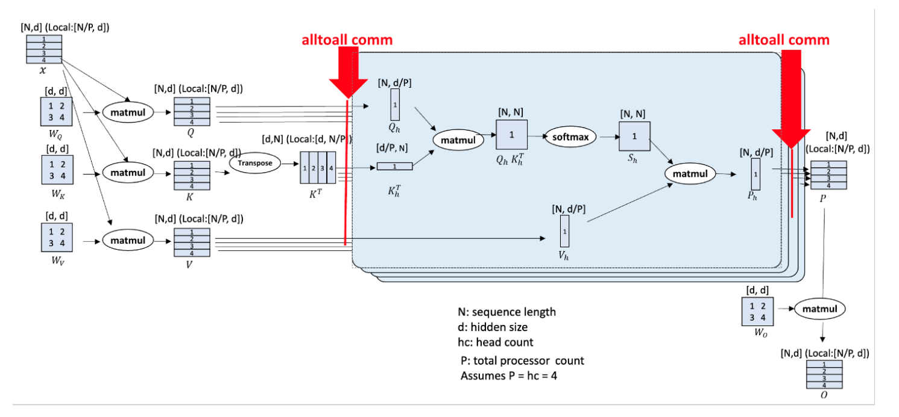
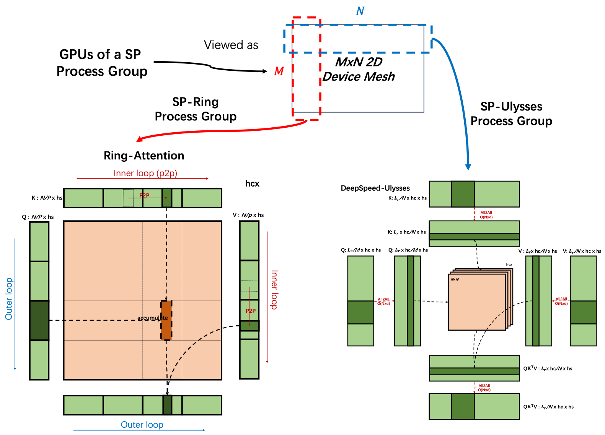
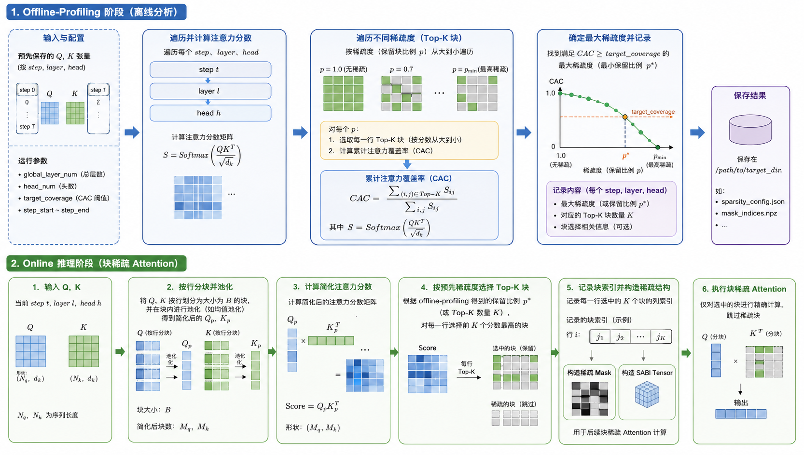
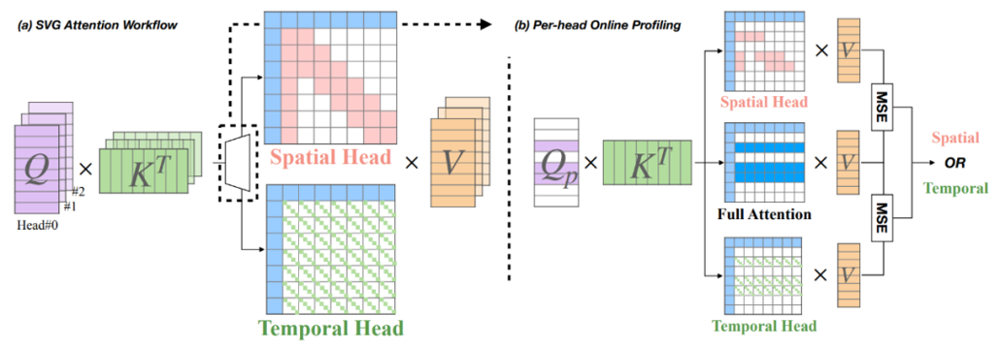
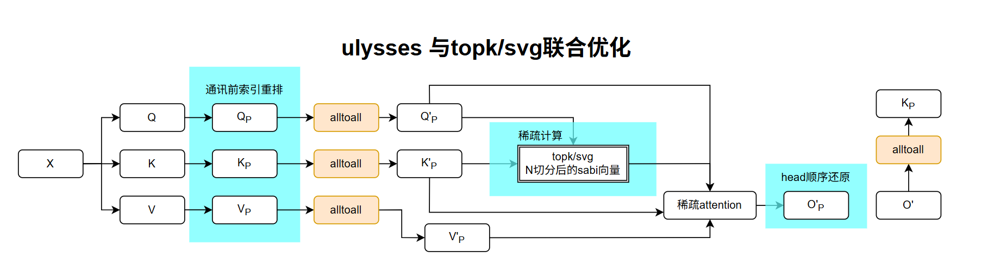

# NPU HunyuanVideo Model Inference Optimization Practice

## Optimization Background

HunyuanVideo is a multimodal video generation model released by Tencent and is currently a popular text-to-video generation model in the open-source community. This solution optimizes the HunyuanVideo code based on the Ascend Atlas A2 environment, achieving NPU adaptation and high inference performance.

HunyuanVideo is based on the DiT architecture. To generate a 5s 720p video (129 frames in total), there is approximately one 3D full Attention computation with a sequence length of 119k. Attention computation accounts for 81% of the model's end-to-end latency, and DiT accounts for 95% of the end-to-end latency. To improve the inference performance of HunyuanVideo, this example makes the following optimizations.

## Optimization Overview

The optimization strategies involved in this solution are shown in the following table:

| Optimization Scheme | Optimization Aspect | Scheme Introduction |
| ------- | -------- | -------- |
| NPU out-of-the-box, FA fused operator adaptation | Fused operator | Use the CANN built-in [FIA fused operator](https://www.hiascend.com/document/detail/en/Pytorch/730/apiref/torchnpuCustomsapi/docs/context/torch_npu-npu_fused_infer_attention_score.md) to replace the attention computation in the transformer. Inside the operator, a tiling strategy reduces runtime dynamic memory and accelerates the attention computation. |
| NPU RMS Norm fused operator adaptation | Fused operator | RMSNorm (Root Mean Square Layer Normalization) is a more efficient layernorm strategy. Use the CANN built-in [RMSNorm fused operator](https://www.hiascend.com/document/detail/en/Pytorch/730/apiref/torchnpuCustomsapi/docs/context/%EF%BC%88beta%EF%BC%89torch_npu-npu_rms_norm.md) to replace the small-operator implementation, reducing unnecessary internal overhead of small operators at runtime (such as data movement and operator head/tail overhead) to achieve acceleration. |
| NPU ROPE fused operator adaptation | Fused operator | Rotary Position Embedding (RoPE) injects position information by rotating the input features in a two-dimensional plane. Use the CANN built-in [npu_rotary_mul fused operator](https://www.hiascend.com/document/detail/en/Pytorch/730/apiref/torchnpuCustomsapi/docs/context/torch_npu-npu_rotary_mul.md) to replace the small-operator implementation; the acceleration principle is the same as above.|
| Ulysses sequence parallelism | Increase compute power | Efficiently split ultra-long sequences across multiple NPUs for parallel processing, with each card responsible for processing its own sequence length. Specifically, outside of Attention, the Ulysses sequence parallelism method splits the sequence length; during Attention computation, it switches to splitting the head num to ensure that attention is fully computed. | 
| Ring Attention sequence parallelism | Increase compute power | Similar to Ulysses sequence parallelism, but during attention computation, each card still processes its own sequence length. To ensure that attention is fully computed, KV blocks need to be passed cyclically between cards. | 
| FBCache | Reduce computation | The principle of DiT generation is to restore noise into semantically meaningful images or videos through multiple DiT time steps. The FBCache method caches the residuals of two DiT time steps and, at the appropriate time, replaces the actual output of a DiT time step with the residual. It reduces the computation by effectively reducing the number of inference steps, improving inference performance. FBCache uses the output of the first DiT Block to determine whether the residual can be reused. |
| TeaCache | Reduce computation | Similar to FBCache, the difference is that TeaCache uses the output of the first img modulate to determine whether the residual can be reused. |
| Ulysses Anything Attention | Function generalization | Extends Ulysses sequence parallelism to support arbitrary head count configurations. Through dynamic padding and alignment mechanisms, it breaks the limitation of standard Ulysses that requires the head count to be divisible by the parallelism degree. |
| VAE parallelism | Increase compute power | Similar to the sequence parallelism strategy, each device card only processes the sequence portion assigned to it. At the same time, to solve the limited receptive field problem in convolution operations, this example supplements the sequence length of each card so that it can obtain partial sequence information from adjacent device cards. |
| VAE optimization | Reduce computation | Use space for time by caching the masks that need to be repeatedly constructed in memory, reducing repeated computation. |
| Disable VAE offload | Reduce data movement | Enable virtual memory to increase available memory space, allowing CPU-offload to be disabled and avoiding frequent weight movement from host to device. |
| FP8 quantized attention | Reduce memory bandwidth | Quantize Q/K/V in attention computation to FP8 format through per-block dynamic quantization, significantly reducing memory bandwidth requirements and improving inference performance. |
| MXFP8 matrix quantization (A8W8) | Reduce memory bandwidth | Apply MXFP8 quantization to the Linear layers in DiT, achieving matrix multiplication with 8-bit activations and 8-bit weights, reducing memory usage and bandwidth requirements and improving inference performance. |
| Block sparse Attention | Reduce computation | Sparse Attention computes the importance of blocks in attention computation and uses it as a basis to determine which blocks need to be computed and which to skip, improving computational efficiency by reducing the FA computation. |

The performance optimization results are shown in the following table, with data from Atlas A3. The baseline only performs out-of-the-box optimization (FIA operator replacement); FBCache uses L1 distance as the accumulated loss with a cache threshold of 0.05; TeaCache uses L1 distance as the accumulated loss with a cache threshold of 0.15; Taylor computes 1 and skips 3, using third-order Taylor. These three cache methods all maintain good inference accuracy. The corresponding configuration is located in the `dit_cache.method` field of [single.yaml](https://gitcode.com/cann/cann-recipes-infer/blob/master/models/hunyuan-video/config/single.yaml) (or [sp8.yaml](https://gitcode.com/cann/cann-recipes-infer/blob/master/models/hunyuan-video/config/sp8.yaml)) — it can be enabled by switching `method` and expanding the corresponding `params` sub-block according to the comments in the yaml. For the field meanings, see [Multi-modal Inference Unified Launch Design](https://gitcode.com/cann/cann-recipes-infer/blob/master/docs/design/mm_inference_design.md) (Chinese) §5.

Note: The default video size is `720x1280x129`. When testing **UAA**, the performance under two configurations — keeping the original size unchanged and adjusting it to `730x1300x129` — was evaluated respectively; see the data in the table where the `UAA` column is `√` and `730, 1300`.

| Parallelism | Fused operator optimization | DitCache | VAE parallelism | VAE optimization | Virtual memory<br>disable VAE offload |    UAA    |  dit(s) | vae(s) |   e2e   | dit speedup | vae speedup | e2e speedup |
| :---------: | :----: | :--------: | :---: | :---: | :-------------------: | :-------: | :-----: | :----: | :-----: | :---------: | :---------: | :---------: |
| 1, **baseline** |    x   |      x     |   x   |   x   |         x        |     x     | 3634.48 | 133.15 | 3768.91 |     1.00    |     1.00    |     1.00    |
|             |    √   |      x     |   x   |   √   |         √        |     x     | 3568.36 |  39.66 |  3612.3 |     1.02    |     3.36    |     1.04    |
|             |    √   |   FBCache  |   x   |   √   |         x        |     x     | 1693.89 |  83.03 | 1778.28 |     2.15    |     1.60    |     2.12    |
|             |    √   |  TeaCache  |   x   |   √   |         x        |     x     | 1737.92 |  88.56 | 1830.75 |     2.09    |     1.50    |     2.06    |
|             |    √   | TaylorSeer |   x   |   √   |         x        |     x     | 1405.68 |  92.85 | 1500.17 |     2.59    |     1.43    |     2.51    |
|   ulysses5  |    √   |      x     |   √   |   √   |         √        |     √     |  769.33 |  40.61 |  811.38 |     4.72    |     3.28    |     4.65    |
|   ulysses8  |    √   |      x     |   √   |   x   |         √        |     x     |  467.67 |  22.78 |  495.94 |     7.77    |     5.85    |     7.60    |
|             |    √   |      x     |   √   |   √   |         √        |     x     |  465.43 |  12.40 |  487.68 |     7.81    |    10.74    |     7.73    |
|             |    √   |      x     |   √   |   √   |         √        |     √     |  477.12 |  13.10 |  482.65 |     7.62    |    10.16    |     7.81    |
|             |    √   |      x     |   √   |   √   |         √        | 730, 1300 |  511.12 |  13.06 |  525.75 |     7.11    |    10.20    |     7.17    |

The performance optimization results for quantization are shown in the following table, with data from 950PR:

| Parallelism | Fused operator optimization | matmul quantization | fa quantization | VAE parallelism | dit(s) | vae(s) | e2e | dit speedup | vae speedup | e2e speedup |
|:---:|:---:|:---:|:---:|:---:|:---:|:---:|:---:|:---:|:---:|:---:|
| 1, **baseline** | √ | x | x | x | 2548.49 | 31.76 | 2580.87 | 1.00 | 1.00 | 1.00 |
|  | √ | √ | x | x | 2392.24 | 31.71 | 2424.52 | 1.07 | 1.00 | 1.06 |
|  | √ | x | √ | x | 1606.29 | 31.70 | 1638.55 | 1.59 | 1.00 | 1.58 |
|  | √ | √ | √ | x | 1539.24 | 31.43 | 1571.24 | 1.66 | 1.01 | 1.64 |
| ulysses8, **baseline** | √ | x | x | √ | 246.29 | 10.27 | 256.92 | 1.00 | 1.00 | 1.00 |
|  | √ | √ | x | √ | 231.55 | 10.33 | 244.47 | 1.06 | 0.99 | 1.05 |
|  | √ | x | √ | √ | 181.85 | 10.50 | 193.96 | 1.35 | 0.98 | 1.32 |
|  | √ | √ | √ | √ | 170.04 | 10.17 | 185.54 | 1.45 | 1.01 | 1.38 |


## Specific Optimization Measures

### NPU Fused Operator Adaptation
#### FIA Fused Operator Adaptation

Use the Fused Infer Attention Score (FIA) fused operator built into torch_npu to replace the FlashAttention operator. See the attention function (L119) in [attention.py](https://gitcode.com/cann/cann-recipes-infer/blob/master/models/hunyuan-video/hyvideo/modules/attention.py). When the parameter `mode=flash` of attention() is used, the FIA operator is enabled. For the specific settings, refer to the [Ascend Community Documentation](https://www.hiascend.com/document/detail/en/Pytorch/730/apiref/torchnpuCustomsapi/docs/context/torch_npu-npu_fused_infer_attention_score.md).

Here, the qkv is split by sequence length. The attention for the image part and the attention for the text part are computed separately, and finally concatenated.

```python
    elif mode == "flash":
        scale = 1.0 / math.sqrt(d)
        if cu_seqlens_q is None:
            x = torch_npu.npu_fused_infer_attention_score(
                q, k, v,
                num_heads=n,
                input_layout="BNSD",
                scale=scale,
            )[0]
        else:
            attn1 = torch_npu.npu_fused_infer_attention_score(
                q[:, :, :cu_seqlens_q[1], :],
                k[:, :, :cu_seqlens_kv[1], :],
                v[:, :, :cu_seqlens_kv[1], :],
                num_heads=n,
                input_layout="BNSD",
                scale=scale,
            )[0]
            attn2 = torch_npu.npu_fused_infer_attention_score(
                q[:, :, cu_seqlens_q[1]:, :],
                k[:, :, cu_seqlens_kv[1]:, :],
                v[:, :, cu_seqlens_kv[1]:, :],
                num_heads=n,
                input_layout="BNSD",
                scale=scale,
            )[0]
            x = torch.cat([attn1, attn2], dim=2)
```

#### RMSNorm Fused Operator Adaptation

Use the npu_rms_norm fused operator built into torch_npu to replace the RMS Norm small operator. See the forward function (L55) in [norm_layers.py](https://gitcode.com/cann/cann-recipes-infer/blob/master/models/hunyuan-video/hyvideo/modules/norm_layers.py). The small-operator implementation is as follows:

```python
    def _norm(self, x):
        """
        Apply the RMSNorm normalization to the input tensor.

        Args:
            x (torch.Tensor): The input tensor.

        Returns:
            torch.Tensor: The normalized tensor.

        """
        return x * torch.rsqrt(x.pow(2).mean(-1, keepdim=True) + self.eps)

    def forward(self, x):
        """
        Forward pass through the RMSNorm layer.

        Args:
            x (torch.Tensor): The input tensor.

        Returns:
            torch.Tensor: The output tensor after applying RMSNorm.

        """
        output = self._norm(x.float()).type_as(x)
        if hasattr(self, "weight"):
            output = output * self.weight
        return output
```

After replacing it with the fused operator, only one line of code is needed:

```python
    def forward(self, x):
        """
        Forward pass through the RMSNorm layer.

        Args:
            x (torch.Tensor): The input tensor.

        Returns:
            torch.Tensor: The output tensor after applying RMSNorm.

        """
        return torch_npu.npu_rms_norm(x, self.weight, epsilon=self.eps)[0]
```

#### Rotary Fused Operator Adaptation

Use the npu_rotary_mul fused operator built into torch_npu to replace the Rope small operator. See the apply_rotary_emb function (L163) in [posemb_layers.py](https://gitcode.com/cann/cann-recipes-infer/blob/master/models/hunyuan-video/hyvideo/modules/posemb_layers.py). The small-operator implementation is as follows:

```python
        xq_out = (xq.float() * cos + rotate_half(xq.float()) * sin).type_as(xq)
        xk_out = (xk.float() * cos + rotate_half(xk.float()) * sin).type_as(xk)
```

The fused operator is written as follows:

```python
        xq_out = torch_npu.npu_rotary_mul(xq, cos, sin, rotary_mode="interleave")
        xk_out = torch_npu.npu_rotary_mul(xk, cos, sin, rotary_mode="interleave")
```


### Sequence Parallelism

Assuming the shape of the input is B, S, N, D, representing (batch size, sequence, number of head, dimension) respectively, sequence parallelism splits the input along the S dimension, achieving lower dynamic memory usage and higher DiT performance on multiple cards.

#### Ulysses Sequence Parallelism (SP):

As shown in the figure, the input is first split into S/SP along the S dimension, where SP is the sequence parallelism count, and fed into the model until the attn operation. Considering that each head is computed in parallel in multi-head self-attention computation, the sequence length of the latent is split outside of attention, while at the attn operation, one AllToAll communication is needed to exchange the data stored on each card, which is equivalent to reshaping the shape of the input from (B, S/SP, N, D) to (B, S, N/SP, D). That is, from splitting the sequence length to splitting the head num. After attn ends, since each card actually computes only the results of 1/SP of the heads, another AllToAll communication is needed to obtain the complete attn result.



#### Ring Attention Sequence Parallelism (SP):

As shown in the figure, the input is first split into S/SP along the S dimension, where SP is the sequence parallelism count, and fed into the model. During attn computation, the 1/SP of Q maintained on the current card is kept unchanged, and the currently maintained 1/SP KV pairs are passed to the next card via P2P (Peer-To-Peer). Each card cyclically receives KV pairs from other cards and computes attention with its own Q.


Image source: [feifeibear](https://github.com/feifeibear/long-context-attention)

#### Ulysses Anything Attention

Standard Ulysses sequence parallelism requires that the number of attention heads (num_heads) be divisible by the sequence parallelism degree (ulysses_degree). This limitation may cause configuration inflexibility in practical applications. Ulysses Anything Attention breaks this limitation through dynamic padding and distributed alignment mechanisms, supporting arbitrary head count configurations.

**Core principle:**

1. **Dynamic padding**: When the head count is not divisible by the parallelism degree, the number of heads to pad is automatically calculated so that the padded head count is divisible by the parallelism degree.
   ```python
   h_pad = world_size - (h % world_size)  # Calculate the number of heads to pad
   new_h_local = (h + h_pad) // world_size  # Local head count per card
   ```

2. **Distributed alignment**: Only the last rank needs padding; other ranks keep the original data, reducing unnecessary memory overhead.

3. **Padding constraint**: The number of padded heads must be less than the local head count per card, ensuring that padding does not cause negative optimization.

**Code implementation:**

The padding logic is located in [uaa.py](https://gitcode.com/cann/cann-recipes-infer/blob/master/module/unified_sp/uaa.py):

```python
def _maybe_pad_qkv_head(x: torch.Tensor, h: int, world_size: int) -> Tuple[torch.Tensor, int]:
    """Maybe pad the head dimension to be divisible by world_size."""
    h_pad = 0
    if h % world_size != 0:
        h_pad = world_size - (h % world_size)
        new_h_local = (h + h_pad) // world_size
        # Constraint: the number of padded heads must be less than the local head count per card
        if h_pad >= new_h_local:
            raise ValueError(
                f"Padding head num {h_pad} should be less than new local head num {new_h_local}"
            )
        x = F.pad(x, (0, 0, 0, h_pad)).contiguous()
    return x, h_pad
```

**How to use:**

```python
# Enable Ulysses Anything mode
attn = UnifiedSPAttention(
    ulysses_group=ulysses_group,
    ring_group=None,
    ulysses_anything=True  # Key parameter
)
```

**Example:**

| Configuration | Head count | Parallelism degree | Padded heads | Heads per card |
|------|------|--------|--------|----------|
| Standard Ulysses | 24 | 8 | 0 | 3 |
| Ulysses Anything | 30 | 8 | 2 | 4 |
| Ulysses Anything | 40 | 8 | 0 | 5 |

**Removing the video size constraint:**

Standard Ulysses sequence parallelism imposes strict constraints on video size: the height H or width W of the video must satisfy `H % 16 % ulysses_degree == 0` or `W % 16 % ulysses_degree == 0`. This means that for different parallelism degree configurations, specific video resolutions need to be selected.

Ulysses Anything removes this constraint through a dynamic sequence length allocation mechanism. Its core lies in supporting inconsistent sequence lengths across ranks: it collects the actual sequence length of each rank through communication and then performs the all-to-all operation:

```python
# Collect the sequence length of each rank
output_split_sizes = _gather_size_by_comm(s_local, self.ulysses_pg)
# Perform all-to-all using the actual sequence length allocation
x = fc.all_to_all_single(x, output_split_sizes, input_split_sizes, self.ulysses_pg)
```

This allows any video size to adapt to any Ulysses parallelism degree configuration, greatly improving configuration flexibility.

### MXFP8 Quantized Attention

MXFP8 quantized attention quantizes the Q, K, and V tensors in attention computation to the MXFP8 format (`npu_dynamic_mx_quant`), significantly reducing memory bandwidth requirements. It is especially suitable for memory-constrained or bandwidth-constrained scenarios.

#### Quantization Principle

This scheme adopts the MXFP8 (Micro-scaling FP8) dynamic quantization strategy:

1. **Per-token/per-channel group MX quantization**: Dynamic MX quantization is applied to Q/K/V separately, with each block group independently computing its scaling factor. The scaling factor uses the E8M0 format (pure exponent representation), occupying only 1 byte.

2. **Differentiated quantization modes**:
   - **Query/Key**: Grouped along the hidden dim direction, i.e., the FIA_v2 operator input parameter `quant_mode=6`.
   - **Value**: Grouped along the seq_len direction, i.e., the FIA_v2 operator input parameter `quant_mode=8`.

3. **FP8 E4M3 format**: Uses the IEEE FP8 E4M3 format (4-bit exponent, 3-bit mantissa), achieving a good balance between dynamic range and precision.

#### Code Implementation

The core quantization function is located in [fa_quant.py](https://gitcode.com/cann/cann-recipes-infer/blob/master/module/fa_quant/fa_quant.py):

```python
def npu_mxfp8_quant(x, dst_type=torch.float8_e4m3fn, output_layout="TND", axis=-1):
    """Perform MXFP8 dynamic quantization for NPU fused attention."""
    b, s, n, d = x.shape
    
    if output_layout == "TND":
        x_tnd = x.contiguous().view(b * s, n, d)
        x_quant, x_scale = torch_npu.npu_dynamic_mx_quant(
            x_tnd, dst_type=dst_type, axis=axis
        )
    
    return x_quant, x_scale
```

Fused attention computation:

```python
def npu_mxfp8_attn(q, k, v, dst_type=torch.float8_e4m3fn, softmax_scale=None):
    """Perform MXFP8 quantized attention computation on NPU."""
    b, s, n, d = q.shape
    kv_s = k.shape[1]
    out_dtype = q.dtype
    
    if softmax_scale is None:
        softmax_scale = 1.0 / math.sqrt(d)
    
    q_quant, q_scale = npu_mxfp8_quant(q, dst_type=dst_type, output_layout="TND")
    k_quant, k_scale = npu_mxfp8_quant(k, dst_type=dst_type, output_layout="TND")
    v_quant, v_scale = npu_mxfp8_quant(v, dst_type=dst_type, output_layout="TND", axis=0)
    
    attn_out = torch_npu.npu_fused_infer_attention_score_v2(
        q_quant, k_quant, v_quant,
        actual_seq_qlen=_actual_seq_lens(b, s, q.device),
        actual_seq_kvlen=_actual_seq_lens(b, kv_s, k.device),
        dequant_scale_query=q_scale,
        dequant_scale_key=k_scale,
        dequant_scale_value=v_scale,
        num_query_heads=n,
        num_key_value_heads=k.shape[2],
        softmax_scale=softmax_scale,
        input_layout="TND",
        sparse_mode=0,       # non-sparse
        query_quant_mode=6,  # per-channel group quant
        key_quant_mode=6,    # per-channel group quant
        value_quant_mode=8,  # per-token group quant
        query_dtype=torch.float8_e4m3fn,
        key_dtype=torch.float8_e4m3fn,
        value_dtype=torch.float8_e4m3fn,
        dequant_scale_query_dtype=torch_npu.float8_e8m0fnu,
        dequant_scale_key_dtype=torch_npu.float8_e8m0fnu,
        dequant_scale_value_dtype=torch_npu.float8_e8m0fnu,
        out_dtype=out_dtype
    )[0]
    
    return attn_out.contiguous().view(b, s, n, d)
```

#### How to Use

**Using quantized attention independently:**

```python
from module.fa_quant import npu_mxfp8_attn

output = npu_mxfp8_attn(q, k, v, dst_type=torch.float8_e4m3fn)
```

**Using it with sequence parallelism:**

```python
attn = UnifiedSPAttention(
    ulysses_group=ulysses_group,
    ring_group=None,
    fa_mxfp8=True  # Enable MXFP8 quantized attention
)
```

#### Quantization Mode Description

MXFP8 uses the `npu_dynamic_mx_quant` operator for dynamic MX quantization. The `npu_fused_infer_attention_score_v2` operator internally processes the following flow:
1. Dequantize the quantized values using the E8M0 scaling factors
2. Perform the attention computation (Q×K^T)
3. Apply Softmax
4. Perform the output computation (Attn×V)
5. Return the output in the original precision format

#### Limitations

- MXFP8 quantized attention currently only supports Ulysses sequence parallelism and does not support Ring Attention
- It is recommended to run comparative tests in precision-sensitive scenarios and select appropriate quantization parameters

### MXFP8 Matrix Quantization (A8W8)

MXFP8 quantization targets the Linear layers in DiT (such as MLP and projection layers), achieving matrix multiplication with 8-bit activations and 8-bit weights to further reduce memory usage and bandwidth requirements.

#### Quantization Principle

MXFP8 (Micro-scaling FP8) is a block-based quantized FP8 format using the E4M3FN data type (4-bit exponent, 3-bit mantissa):

1. **Per-token quantization**: Activations are quantized along the token dimension, with each token having an independent scaling factor.
2. **Per-group quantization**: Weights are quantized in groups, with a default group size of 32, balancing precision and compression ratio.
3. **E8M0 scaling factor**: The scaling factor uses the E8M0 format (pure exponent representation), occupying only 1 byte.

#### Code Implementation

The core quantization code is located in [mxfp8_a8w8.py](https://gitcode.com/cann/cann-recipes-infer/blob/master/models/hunyuan-video/hyvideo/modules/mxfp8_a8w8.py):

**Dynamically quantized Linear layer:**

```python
def dynamic_convert_mxfp8_linear(module, original_dtype, params_to_keep=None):
    """Dynamically convert Linear layers to MXFP8 quantized format."""
    for key, layer in module.named_modules():
        # Only convert Linear layers in transformer blocks
        if isinstance(layer, nn.Linear) and ('double_blocks' in key or 'single_blocks' in key):
            # Skip modulation layers and 1D weights
            if len(layer.weight.shape) == 1 or 'mod' in key:
                continue

            # Dynamically quantize weights to MXFP8 format
            mxfp8_weight, mxfp8_scale = torch_npu.npu_dynamic_mx_quant(
                layer.weight.data,
                dst_type=torch.float8_e4m3fn
            )

            layer.weight.data = mxfp8_weight
            setattr(layer, "weight_scale", mxfp8_scale)
            # Replace forward with the quantized version
            setattr(layer, "forward", lambda input, m=layer: mxfp8_linear_forward(m, original_dtype, input))
```

**Quantized Linear layer forward pass:**

```python
def mxfp8_linear_forward(layer, original_dtype, x):
    """Forward pass for MXFP8 quantized linear layer."""
    # Dynamically quantize the input to MXFP8 format
    x_quant, x_scale = torch_npu.npu_dynamic_mx_quant(x, dst_type=torch.float8_e4m3fn)

    # Perform quantized matrix multiplication (A8W8)
    output = torch_npu.npu_quant_matmul(
        x_quant,
        layer.weight.T,
        pertoken_scale=x_scale,           # Input scaling factor
        bias=layer.bias.to(torch.float32),
        scale=layer.weight_scale.permute(1, 0, 2),  # Weight scaling factor
        output_dtype=original_dtype,      # Output BF16/FP16
        pertoken_scale_dtype=torch_npu.float8_e8m0fnu,
        scale_dtype=torch_npu.float8_e8m0fnu,
        group_sizes=[1, 1, 32]            # Weight quantization group size
    )
    return output
```

#### How to Use

```python
from hyvideo.modules.mxfp8_a8w8 import dynamic_convert_mxfp8_linear

# After the model is loaded, convert the Linear layers to MXFP8 format
dynamic_convert_mxfp8_linear(dit_model, original_dtype=torch.bfloat16)
```

#### Quantization Scope

| Layer type | Quantized | Description |
|--------|----------|------|
| Linear in double_blocks | ✓ | Projection layers of dual-stream attention blocks |
| Linear in single_blocks | ✓ | Projection layers of single-stream attention blocks |
| Modulation layer (adaLN) | ✗ | Keep original precision to ensure modulation accuracy |
| 1D weight layers | ✗ | Not suitable for quantization |

#### Performance Benefits

- **Memory usage**: Weights are compressed from BF16 (2 bytes) to FP8 (1 byte), halving memory usage
- **Bandwidth requirements**: Weight loading bandwidth is reduced by 50%
- **Computational efficiency**: Leverages the NPU's hardware acceleration for quantized matrix multiplication

### Dit Cache

DIT-Cache, as a cache framework for accelerating diffusion model inference, reduces redundant forward computation by reusing/predicting existing results. Its acceleration logic can be clearly divided into Step-level and Block-level paradigms. Step-level determines whether to skip the complete step computation by judging the specific feature differences between different sampling steps and comparing them against a threshold, directly reusing or predicting the cached results. Block-level judges whether to directly reuse or predict cached results at the granularity of blocks (usually attention modules and mlp modules).

This example integrates the Step-level dit cache scheme, supporting [FBCache](https://github.com/chengzeyi/ParaAttention) and [TeaCache](https://github.com/ali-vilab/TeaCache).

#### TeaCache

TeaCache is an inference acceleration optimization for DiT. It caches the difference between the outputs of adjacent DiT steps and reuses this difference to skip the current DiT step, achieving faster inference.

First, the $\ell_1$ distance of the Timestep Embedding Modulated Noisy Input is used to reflect the output difference between the current timestep and the previous timestep.

If the output difference between the two is greater than a threshold (i.e., the accumulated $\ell_1$ distance > threshold), it means the current timestep requires full computation and the $\ell_1$ distance is reset to zero; if the output difference between the two is less than a threshold (i.e., the accumulated $\ell_1$ distance < threshold), it means the current timestep can be skipped and the $\ell_1$ distance is accumulated.

In addition, TeaCache proposes a polynomial scale mechanism. Considering that the mean and variance of model parameters differ between models, the same input may cause large differences in the Timestep Embedding Modulated Noisy Input across different models. Therefore, TeaCache scales the accumulated $\ell_1$ distance through a polynomial function, whose coefficients come from the [TeaCache repository](https://github.com/ali-vilab/TeaCache/blob/main/TeaCache4HunyuanVideo/teacache_sample_video.py#L102).

The core logic of TeaCache is as follows:
```python
coefficients = [7.33226126e+02, -4.01131952e+02, 6.75869174e+01, -3.14987800e+00, 9.61237896e-02]
rescale_func = np.poly1d(coefficients)
self.accumulated_rel_l1_distance += rescale_func(
    ((modulated_inp - self.previous_modulated_input).abs().mean() /
    self.previous_modulated_input.abs().mean()).cpu().item()
)
if self.accumulated_rel_l1_distance < self.rel_l1_thresh:
    should_calc = False
else:
    should_calc = True
    self.accumulated_rel_l1_distance = 0
```

#### FBCache

Similar to TeaCache, the idea of FBCache is simpler: it compares the relative l1 distance of the output of DiT's first block between the current time step and the previous time step to determine whether the residual can be reused.

#### Cache Config

This scheme uses a configuration file to set the Cache parameters. The specific meaning of each parameter is as follows:
```python
{
    "cache_forward": "NoCache", # Set the Cache scheme; choose FBCache or TeaCache, otherwise Cache is not enabled. Cache is disabled by default.
    "comment": "choose from FBCache/TeaCache, otherwise use NoCache", 
    "FBCache":{
            "cache_name": "FBCache", # Name of the dit cache
            "rel_l1_thresh": 0.05,  # FBCache threshold. The larger the threshold, the more steps are skipped and the greater the accuracy loss; performance and accuracy need to be balanced
            "latent": "latent", # Variable to cache
            "judge_input": "cache_latent" # Variable used to determine whether the residual can be reused
    },
    "TeaCache":{
            "cache_name" : "TeaCache", # Name of the dit cache
            "rel_l1_thresh": 0.15,  # TeaCache threshold. The larger the threshold, the more steps are skipped and the greater the accuracy loss; performance and accuracy need to be balanced
            "coefficients": [733.226126,-401.131952,67.5869174,-3.149879,0.0961237896],  #  TeaCache polynomial fitting, fitted through input and output
            "latent": "latent", # Variable to cache
            "judge_input": "modulated_inp" # Variable used to determine whether the residual can be reused
    },
    "NoCache":{
        "cache_name" : "NoCache" # Name of the dit cache
    }
}
```

#### Cache for SP

This scheme supports cache + multi-card inference. For FBCache and TeaCache, the `l1_loss` of each card needs to be collected through all_reduce, and each card uses the same cache reuse/computation judgment.

```python
def _sync_scalar_for_sp(self, value: float) -> float:
    """
    Synchronize a scalar value across all SP ranks.
    Returns the averaged value across all ranks.
    """
    if self.sp_group is None or self.sp_world_size <= 1:
        return value
    tensor = torch.tensor([value], dtype=torch.float32, device='npu')
    dist.all_reduce(tensor, op=dist.ReduceOp.SUM, group=self.sp_group)
    return (tensor.item() / self.sp_world_size)
```


### VAE Parallelism

Similar to the idea of sequence parallelism, the latent is split along the sequence length, and each card processes its own sequence length.

It is worth noting that the VAE stage involves convolution operations. Simple chunking causes insufficient receptive field at the edges (some sequences are split onto adjacent cards), resulting in obvious seam artifacts in the generated videos. For this reason, this example supplements the sequence of each card so that it can obtain partial sequence information from adjacent device cards.

### Block Sparse Attention


This optimization method is implemented based on the [blitz_sparse_attention operator](https://gitcode.com/cann/ops-transformer/blob/master/experimental/attention/blitz_sparse_attention/README.md). Before running, the operator needs to be compiled according to the reference documentation (recompilation is required if the CANN package is updated). To use the LSE merge path of Ring + TopK + overlap, the sparse operator needs to be compiled from the latest `ops-transformer` main repository. The command to compile the operator is as follows:

 ```bash
 git clone https://gitcode.com/cann/ops-transformer.git
 cd ops-transformer

 yum/apt install patch # Install dependencies: CentOS uses yum, Ubuntu uses apt
 pip install -r requirements.txt

 bash build.sh --make_clean --experimental -j96 --pkg --soc=ascend910_93 --ops=blitz_sparse_attention # (--soc, A2: ascend910b, A3: ascend910_93)
 ./build/cann-ops-transformer-custom_linux-"$(uname -i)".run
 (cd experimental/attention/blitz_sparse_attention/torch_interface && bash build.sh custom)

 # short test: kernel & python api (remove 'test_joint.py' to run full test suite)
(cd experimental/attention/blitz_sparse_attention/benchmark && pytest test_joint.py)
 ```

#### TopK

The TopK algorithm is divided into two stages:

1.offline-profiling. The `Cumulative Attention Score Coverage` represents the proportion of attention scores from non-sparse elements, used to measure the importance of the non-sparsified part to the attention computation. The higher the CAC value, the higher the expected accuracy and the lower the sparsity. The calculation formula is:
$$
CAC = \frac{\sum_{(i,j) \in \text{Top-K}} \text{Softmax}\left(\frac{QK^{T}}{\sqrt{d_{k}}}\right)_{ij}}{\sum_{i,j} \text{Softmax}\left(\frac{QK^{T}}{\sqrt{d_{k}}}\right)_{ij}}
$$
Before offline-profiling, you first need to save the qk_data of a complete inference process. Set the following in the `model_args` field of [single_sparse.yaml](https://gitcode.com/cann/cann-recipes-infer/blob/master/models/hunyuan-video/config/single_sparse.yaml)
```python
extract_q_k_data: true
extract_path: "path/to/qk_dir"
```
Run the following command:
```bash
export YAML_FILE_NAME=single_sparse.yaml
bash infer.sh
```

The offline-profiling code is stored in the `cann-recipes-infer` repository under `/module/blockwise_sparse/offline_profiling/` (the script is [`offline_profiling_hyvideo.py`](https://gitcode.com/cann/cann-recipes-infer/blob/master/module/blockwise_sparse/offline_profiling/offline_profiling_hyvideo.py)). Refer to the following command to execute it in the `cann-recipes-infer` repository. offline-profiling runs inference on a few samples. For each step, layer, and head in the dit process, it iterates over different sparsity levels according to the preset CAC threshold, finds the maximum sparsity that satisfies the CAC, and records it. In subsequent inference, each block sparse attention computation uses the previously set sparsity. The command to run offline-profiling is as follows:

```bash
cd module/blockwise_sparse/offline_profiling/
python offline_profiling_hyvideo.py  --qk_dir_path /path/to/qk_dir --target_dir_path /path/to/target_dir --global_layer_num 60 --head_num 24 --target_coverage 0.66 --step_start 0 --step_end 50
```
The q and k tensors of each step and layer need to be saved and placed in `/path/to/qk_dir`, and the results will be saved in `/path/to/target_dir`. `global_layer_num` and `head_num` represent the total number of layers and the number of heads, `target_coverage` represents the target CAC, and `step_start` and `step_end` represent the step id at which sparsification starts and the step id at which it ends, respectively.


2. In the online inference stage, first the q and k are divided into blocks by row and pooled to obtain simplified q and k. The attention scores are computed. For each row, according to the precomputed sparsity, the top k scores are selected as the blocks to compute, and the remaining blocks are treated as sparse. Finally, the ids of the selected blocks in q and k are recorded to construct the sparse mask and sabi tensor.

#### SVG
The computation process of the SVG algorithm is as follows: 1. Construct the masks corresponding to two different sparse paradigms, spatial and temporal. Before each attention computation, for each head, a small portion of q is sampled, and the sparse attention under the two masks and the full attention are computed respectively, then the mse values of the two masks are obtained. The category with the smaller mse error is selected as the pattern to which the head belongs, and the corresponding mask is recorded. 2. Based on the constructed mask, the sparse attention is computed.


Image source: [svg](https://icml.cc/virtual/2025/poster/43743)

Enable Sparse Attention by adding a `sparse:` section at the top level of the launch YAML (it is disabled when the section is absent or `method: no_sparse` is set). [single_sparse.yaml](https://gitcode.com/cann/cann-recipes-infer/blob/master/models/hunyuan-video/config/single_sparse.yaml) is the single-card reference configuration, and [sp8_sparse.yaml](https://gitcode.com/cann/cann-recipes-infer/blob/master/models/hunyuan-video/config/sp8_sparse.yaml) is the 8-card sparse parallelism reference configuration. This configuration enables Ulysses by default; to use Ring Attention, simply change `ulysses-degree` to `1` and `ring-degree` to `8`. Ring + TopK + overlap uses [sp8_sparse_overlap.yaml](https://gitcode.com/cann/cann-recipes-infer/blob/master/models/hunyuan-video/config/sp8_sparse_overlap.yaml). Both multi-card configurations can switch between `TopK` and `SVG` via `sparse.method`. Enabling sparse overrides the block forward of Dit-Cache, and the two are mutually exclusive, so all sparse YAMLs fix `dit_cache.method: NoCache`. The `sparse:` section inlines all fields of the original standalone `sparse_config.yaml`, with the following structure:
```yaml
sparse:
  method: "SVG"                      # [no_sparse, TopK, SVG]
  block_size_Q: 128                  # q/k block size
  block_size_K: 512
  model: "HunyuanVideo"
  params:
    TopK:                            # only used when method == TopK
      sparse_time_step: "10-49"      # Steps to which sparsification is applied
      sparsity_files_path: "./sparsity/720x1280x129/v3"  # Path to offline profiling artifacts
      CAC_threshold: 0.66            # CAC threshold
    SVG:                             # only used when method == SVG
      sparse_time_step: "14-49"
      sparsity: 0.8                  # Sparsity
      sample_mse_max_row: 5000       # Sampling length
      context_length: 256            # Context length
```
The performance data of different block sparse Attention algorithms are as follows:
| Method   | Sparsity | DiT Time (s) | E2E Time (s) | DiT Speedup | E2E Speedup |
|----------|----------|-------------:|-------------:|------------:|------------:|
| Baseline | –        | 3459.52      | 3577.19      | 1.00×       | 1.00×       |
| TopK     | 76%      | **1839.48**  | **1963.52**  | **1.88×**   | **1.82×**   |
| SVG      | 80%      | 2036.18      | 2167.55      | 1.70×       | 1.65×       |


### TopK/SVG + Sequence Parallelism Joint Optimization

In the long-sequence scenario of HunyuanVideo, block sparse Attention can be stacked with Ulysses or Ring Attention, simultaneously gaining the benefits of both "multi-card parallelism" and "reducing the actual attention computation". The overall idea is: first keep the original query/key/value distribution of sequence parallelism, then construct sparse metadata adapted to the current parallel layout before each attention, and finally call `blitz_sparse_attention` to perform the block sparse computation.

The Ulysses path reuses all-to-all communication before and after attention. After communication, each card holds the complete sequence and a portion of the heads, so TopK/SVG can construct `sabi/pattern` on the full-sequence semantics. At the same time, it retains the UAA (Ulysses Anything Attention) capability, supporting arbitrary head counts and more flexible video sizes. For TopK, head-level load balancing is also performed based on the sparsity and computation of different heads, reducing multi-card stragglers.

The Ring path retains the local query shard and aggregates the global key/value. Ring + TopK uses the local query and global key/value to construct the TopK `sabi`, and performs dense attention backfill for the first-frame query using the full key/value. Ring + TopK + overlap further splits key/value into local shards and other shards: it first computes the sparse attention of the local shard while asynchronously performing `all_gather(k/v)`, then computes the other shards after communication completes, and merges the two output segments through LSE. Ring + SVG samples with the local query, synchronizes the spatial/temporal MSE intermediate values to unify the pattern across cards, and then constructs `sabi` according to the global spatiotemporal coordinates of the local query. The current SVG overlap configuration reuses the normal Ring + SVG path.



#### Ulysses + TopK/SVG Performance Data

The following data measures the inference time of HunyuanVideo under dense attention and heterogeneous sparse attention (TopK/SVG), in seconds (s).

| Scheme | Single card | No load balancing (four cards) | Load balancing (four cards) | No load balancing (eight cards) | Load balancing (eight cards) |
| ---- | ---- | ------------------ | ---------------- | ------------------ | ---------------- |
| Dense computation | 3587 | 904 | 904 | 464 | 464 |
| Heterogeneous sparse | 2160 | 576 | 564 | 335 | 321 |
| Speedup vs dense | 1.66x | 1.57x | 1.60x | 1.39x | 1.45x |

From the above data, it can be seen that:

1. Compared with dense attention, heterogeneous sparse significantly reduces DiT computation time in both single-card and multi-card scenarios. For example, single card drops from `3587s` to `2160s`, four cards from `904s` to `576s`, and eight cards from `464s` to `335s`.  
2. In the four-card scenario, the benefit of load balancing is small, only further optimizing the heterogeneous sparse time from `576s` to `564s`, an absolute gain of about `12s`, indicating that the head load is already relatively balanced at this point.  
3. In the eight-card scenario, the benefit of load balancing is more pronounced, reducing the heterogeneous sparse time from `335s` to `321s`, an absolute gain of about `14s` and a relative reduction of about `4.2%`, indicating that head-level computation imbalance becomes more prominent after the parallelism degree increases.  
4. After combining Ulysses with TopK/SVG, both multi-card sequence parallelism can be leveraged to improve throughput, and block sparsity can further reduce the actual FA computation. Taking eight cards as an example, an overall speedup of `1.39x` to `1.45x` can be achieved compared with dense computation.

#### Ring Attention + TopK/SVG Performance Data

The following data is the DiT inference time in the four-card Ring Attention scenario, in seconds (s).

| Scheme | `720*1280*209`, CAC `0.9` | `720*1280*209`, CAC `0.66` | `720*1280*129`, CAC `0.9` | `720*1280*129`, CAC `0.66` |
| ---- | ------------------------: | -------------------------: | ------------------------: | -------------------------: |
| Ring Attention | 2250 | 2250 | 949 | 949 |
| Ring + TopK | 1877 | 1385 | 812 | 554 |
| Ring + TopK + overlap | 1742 | 1327 | 822 | 584 |

From the above data, it can be seen that:

1. In the `720*1280*209` scenario, Ring + TopK reduces the time from `2250s` to `1385s`; after enabling overlap, it is further reduced to `1327s`, accelerating by about `1.70x` compared with dense Ring Attention.
2. In the `720*1280*129` scenario, Ring + TopK reduces the time from `949s` to `554s` at CAC `0.66`, accelerating by about `1.71x` compared with dense Ring Attention.
3. The benefit of overlap is related to the sequence length and the CAC configuration. In the `720*1280*209` scenario, the benefit is more pronounced; in the `720*1280*129` scenario, the benefit of overlapping communication and computation is not enough to offset the extra segmented computation overhead.

<!-- static-meta
{
  "sidebarTitle": "Inference Optimization",
  "parallelism": ["sequence-parallel"],
  "quantization": ["fp8", "mxfp8"],
  "hardware": ["atlas-a2", "atlas-a3", "ascend-950"],
  "multimodalDitCache": ["FBCache", "TeaCache", "TaylorSeer"],
  "cover": {"type": "auto"}
}
-->
