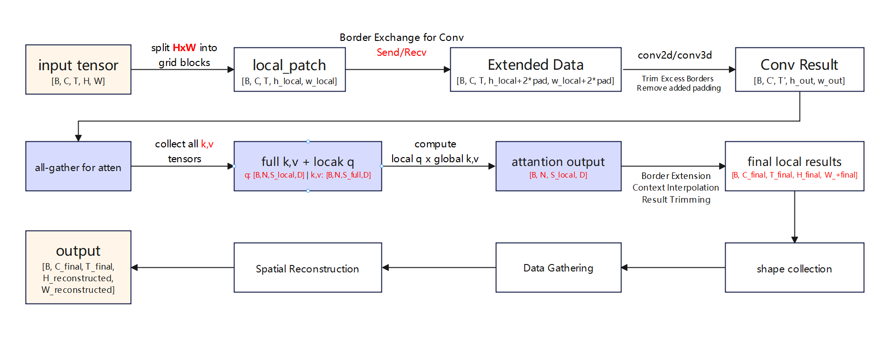
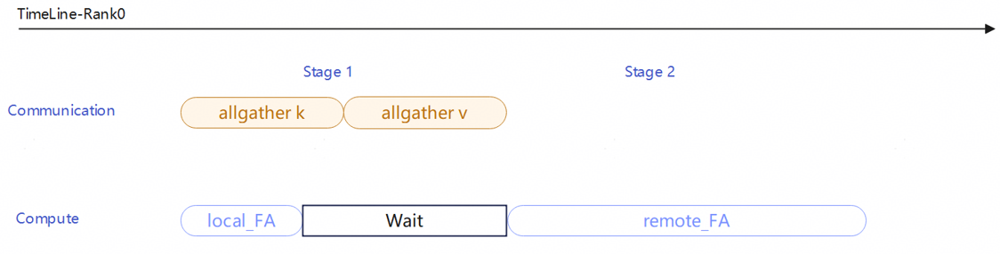

# NPU Wan2.2-I2V Model Inference Optimization Practice

This document mainly introduces the NPU-based inference optimization strategies and implementations for the Wan2.2-I2V model.
###  NPU npu_fused_infer_attention_score Operator Adaptation
First, you need to `import torch_npu` and related packages, and add the following after [generate.py](https://gitcode.com/cann/cann-recipes-infer/blob/master/models/wan2.2-i2v/generate.py) (L30):
```
import torch_npu
torch_npu.npu.set_compile_mode(jit_compile=False)
torch.npu.config.allow_internal_format=False
from torch_npu.contrib import transfer_to_npu
```
This example uses the npu_fused_infer_attention_score fused operator built into torch_npu to replace the FlashAttention operator. For details about this operator, see the [Ascend Community Documentation](https://www.hiascend.com/document/detail/en/Pytorch/720/apiref/torchnpuCustomsapi/context/torch_npu-npu_fused_infer_attention_score.md). In the npu_fused_attention function in [attention.py](https://gitcode.com/cann/cann-recipes-infer/blob/master/models/wan2.2-i2v/wan/modules/attention.py) (L69), enable the fused_infer_attention_score operator:
```
    attention_out, _ = torch_npu.npu_fused_infer_attention_score(
        q, k, v,
        actual_seq_lengths=actual_seq_lengths,
        actual_seq_lengths_kv=actual_seq_lengths_kv,
        num_heads=N,
        scale=float(softmax_scale),
        input_layout="BNSD",
        num_key_value_heads=num_key_value_heads,
        pre_tokens=65535,
        next_tokens=65535 if not causal else 0,
        sparse_mode=0,
        inner_precise=0,
    )
    
    attention_out = attention_out.transpose(1, 2).contiguous()
    return attention_out.to(out_dtype)
```


###  NPU rotary_mul Operator Adaptation
This example uses the npu_rotary_mul fused operator built into torch_npu to replace the small-operator implementation in the source code. For details about npu_rotary_mul, see the [Ascend Community Documentation](https://www.hiascend.com/document/detail/en/Pytorch/710/apiref/torchnpuCustomsapi/context/torch_npu-npu_rotary_mul.md). In the rope_apply function in [model.py](https://gitcode.com/cann/cann-recipes-infer/blob/master/models/wan2.2-i2v/wan/modules/model.py) (L58), enable the npu_rotary_mul fused operator:
```
@torch.amp.autocast('cuda', enabled=False)
def rope_apply(x, grid_sizes, freqs_list):
    s, n, c = x.size(1), x.size(2), x.size(3)
    output = []
    for i, (f, h, w) in enumerate(grid_sizes.tolist()):
        x_i = x[i, :s].reshape(1, s, n, c)
        if not x_i.is_contiguous():
            x_i=x_i.contiguous()
        
        cos, sin = freqs_list[i]

        if cos.dim() == 3:
            cos = cos.unsqueeze(0)
            sin = sin.unsqueeze(0)

        cos = cos.to(dtype=x_i.dtype, device=x_i.device)
        sin = sin.to(dtype=x_i.dtype, device=x_i.device)
        
        x_i = torch_npu.npu_rotary_mul(
            input=x_i,
            r1=cos,
            r2=sin,
            rotary_mode="interleave"
        )

        output.append(x_i)
```

###  NPU rms_norm Operator Adaptation
This example uses the npu_rms_norm fused operator built into torch_npu to replace the small-operator implementation in the source code. For details about npu_rms_norm, see the [Ascend Community Documentation](https://www.hiascend.com/document/detail/en/Pytorch/710/apiref/torchnpuCustomsapi/context/%EF%BC%88beta%EF%BC%89torch_npu-npu_rms_norm.md).

The npu_rms_norm fused operator is enabled in WanRMSNorm.forward in [`model.py`](https://gitcode.com/cann/cann-recipes-infer/blob/master/models/wan2.2-i2v/wan/modules/model.py) (L87):
```
class WanRMSNorm(nn.Module):

    def __init__(self, dim, eps=1e-5):
        super().__init__()
        self.dim = dim
        self.eps = eps
        self.weight = nn.Parameter(torch.ones(dim))

    def forward(self, x):
        r"""
        Args:
            x(Tensor): Shape [B, L, C]
        """
        return torch_npu.npu_rms_norm(x, self.weight, epsilon=self.eps)[0]
```
###  NPU layer_norm_eval Operator Adaptation

This example uses the npu_layer_norm_eval fused operator built into torch_npu to replace the small-operator implementation in the source code. For details about npu_layer_norm_eval, see the [Ascend Community Documentation](https://www.hiascend.com/document/detail/en/Pytorch/710/apiref/torchnpuCustomsapi/context/%EF%BC%88beta%EF%BC%89torch_npu-npu_layer_norm_eval.md).

The npu_layer_norm_eval fused operator is enabled in WanLayerNorm.forward in [`model.py`](https://gitcode.com/cann/cann-recipes-infer/blob/master/models/wan2.2-i2v/wan/modules/model.py) (L103):
```
class WanLayerNorm(nn.LayerNorm):

    def __init__(self, dim, eps=1e-6, elementwise_affine=False):
        super().__init__(dim, elementwise_affine=elementwise_affine, eps=eps)
        self.dim = dim

    def forward(self, x):
        r"""
        Args:
            x(Tensor): Shape [B, L, C]
        """
        return torch_npu.npu_layer_norm_eval(
            x, normalized_shape=[self.dim], weight=self.weight, bias=self.bias, eps=self.eps
        )
```
In addition, this example fuses some layer norm (LN) and modulate operations, also using the npu_layer_norm_eval fused operator. The relevant fused operations are enabled in FusedLayerNormModulate.forward in `/wan/modules/model.py` (L119):
```
class FusedLayerNormModulate(nn.Module):

    def __init__(self, dim, eps=1e-6):
        super().__init__()
        self.dim = dim
        self.eps = eps

    def forward(self, x, scale, shift):
        r"""
        Args:
            x(Tensor)
        """
        weight = 1.0 + scale
        bias = shift
        return torch_npu.npu_layer_norm_eval(
            x, normalized_shape=[self.dim], weight=weight, bias=bias, eps=self.eps
        )
```
Each block of the model has 4 LN operations, of which the gamma and beta of 3 LN operations are fixed to the initial values 1 and 0. Through (x-mean)/var*1+0)*(scale+1)+shift, the NPU fused operator npu_layer_norm_eval is invoked to fuse the 3 LNs with the corresponding modulate steps.

###  8-Card VAE Parallelism
This example enables VAE parallelism for the model. Implemented through spatial parallelism, large-size images are split into multiple blocks along the height and width dimensions and assigned to different NPU processes for parallel processing, which can accelerate the VAE inference of the original model. This optimization is implemented in the [vae_patch_parallel.py](https://gitcode.com/cann/cann-recipes-infer/blob/master/module/vae_patch_parallel.py) script.

The following VAE parallelism flow chart shows the complete execution path of spatial parallel processing:


1. First, the input tensor is split across multiple processes along the spatial dimension, and each process processes its own local blocks;
2. Then, during computation, corresponding communication strategies are adopted based on the characteristics of different operations — convolution operations obtain context by exchanging boundary data with neighbors, attention operations guarantee computational completeness by globally collecting all K and V tensors, and interpolation operations handle upsampling by expanding boundaries, computing, and then cropping;
3. Finally, through a two-stage collection process, the local results of each process are reassembled into a complete output tensor according to the original spatial positions.

###  CFG Parallelism
This example enables CFG parallelism for the model. It is implemented in [image2video.py](https://gitcode.com/cann/cann-recipes-infer/blob/master/models/wan2.2-i2v/wan/image2video.py) (L432):
```
for step_idx, t in enumerate(tqdm(timesteps)):
    latent_model_input = [latent.to(self.device)]
    timestep = [t]
    timestep = torch.stack(timestep).to(self.device)
    
    model = self._prepare_model_for_timestep(t, boundary, offload_model)
    sample_guide_scale = guide_scale[1] if t.item() >= boundary else guide_scale[0]
    
    extra_kwargs = {'t_idx': step_idx} if hasattr(self, 'use_sp') and self.use_sp else {}
    
    if get_classifier_free_guidance_world_size() == 2:
        noise_pred = model(
            latent_model_input, t=timestep, **arg_all, **extra_kwargs)[0].to(
                torch.device('cpu') if offload_model else self.device)
        noise_pred_cond, noise_pred_uncond = get_cfg_group().all_gather(
            noise_pred, separate_tensors=True
        )
        if offload_model:
            torch.cuda.empty_cache()
    else:
        noise_pred_cond = model(
            latent_model_input, t=timestep, **arg_c, **extra_kwargs)[0]
        if offload_model:
            torch.cuda.empty_cache()
        noise_pred_uncond = model(
            latent_model_input, t=timestep, **arg_null, **extra_kwargs)[0]
        if offload_model:
            torch.cuda.empty_cache()
    
    noise_pred = noise_pred_uncond + sample_guide_scale * (
        noise_pred_cond - noise_pred_uncond)
```

When a CFG parallel environment is detected, it assigns the two tasks of conditional generation and unconditional generation to two different processes for simultaneous execution. Each process only needs to run model inference once, then the all_gather communication operation allows the two processes to obtain each other's computation results, and finally the CFG formula is used to mix the conditional and unconditional predictions according to the guidance scale to obtain the final noise prediction result. If the parallel environment is not enabled, it degrades to the traditional mode of executing model inference twice sequentially.


###  Ring Attention Overlap

In multi-card Ring Attention, AllGather is asynchronously started to collect the KV data from other cards, while the local KV is immediately used to compute the first FA, allowing NPU computation and network communication to execute in parallel to hide the communication latency. After AllGather completes, the other remote chunks are merged into a long sequence to compute the second FA at once. Finally, the LSE (Log-Sum-Exp) algorithm is used to correctly merge the two attention outputs, [achieving the hiding of communication time in local computation](https://gitcode.com/cann/cann-recipes-infer/blob/master/module/unified_sp/core.py).


### Dit-Cache

DIT-Cache, as a cache framework for accelerating diffusion model inference, reduces redundant forward computation by reusing/predicting existing results. Its acceleration logic can be clearly divided into Step-level and Block-level paradigms. Step-level determines whether to skip the complete step computation by judging the specific feature differences between different sampling steps and comparing them against a threshold, directly reusing or predicting the cached results. Block-level judges whether to directly reuse or predict cached results at the granularity of blocks (usually attention modules and mlp modules).

This example integrates the Step-level Dit-Cache scheme, supporting [FBCache](https://github.com/chengzeyi/ParaAttention) and [TeaCache](https://liewfeng.github.io/TeaCache/).


**Typical Step-level methods:** Within the Step-level acceleration scope, the principle of [FBCache](https://arxiv.org/pdf/2411.19108) is based on the First Block L1 error, comparing the difference between the output residual of the first block and the output residual of the first block in the previous step. If the difference between the first-block output error and the previous round's first-block output error is less than a specified threshold, the current step computation is skipped, the residual is reused, and the output of the current step is estimated.

[TeaCache](https://liewfeng.github.io/TeaCache/) leverages the strong correlation between model input and output, using the Timestep Embedding (input) to estimate output differences: first, the input is used to roughly estimate the output change, then polynomial fitting corrects the scaling bias, and finally the cumulative difference is used as the judgment criterion to dynamically decide whether to reuse the output cached in the previous step, avoiding redundant computation. Since WAN2.2 has the characteristic of serial CFG, cann-recipes-infer uses the officially implemented [TeaCache](https://github.com/ali-vilab/TeaCache/tree/main/TeaCache4Wan2.1) that manages cond/uncond separately. See [`cache_method.py`](https://gitcode.com/cann/cann-recipes-infer/blob/master/module/dit_cache/cache_method.py) in the cann-recipes-infer repository.

**How to enable:** The Dit-Cache configuration has been consolidated into the `dit_cache` section of the launch YAML. To enable Dit-Cache on a single card, set `YAML_FILE_NAME` in [infer.sh](https://gitcode.com/cann/cann-recipes-infer/blob/master/models/wan2.2-i2v/infer.sh) to [14b_single.yaml](https://gitcode.com/cann/cann-recipes-infer/blob/master/models/wan2.2-i2v/config/14b_single.yaml), then select `FBCache` or `TeaCache` via `dit_cache.method`. Currently, the wan2.2-i2v multi-card path is incompatible with Dit-Cache; when `world_size` > 1, the framework automatically falls back to NoCache and prints a prompt.

Take TeaCache as an example:
```yaml
dit_cache:
  method: "TeaCache"                # NoCache / FBCache / TeaCache
  enable_separate_cfg: true         # CFG separation switch; when true, cond/uncond each maintain their own cache state
  params:                           # Only fill in parameters that need to be overridden; the rest follow DEFAULT_CACHE_CONFIG
    rel_l1_thresh: 0.15              # Example override value; built-in default is 0.15. The larger the value, the more cache reuse and the greater the accuracy loss
    coefficients: [733.226126, -401.131952, 67.5869174, -3.149879, 0.0961237896]
    warmup: 2                       # Force full computation for the first N steps and the last N steps without cache judgment
```

Example infer.sh configuration:
```bash
export YAML_FILE_NAME=14b_single.yaml
```

When [mm_function.sh](https://gitcode.com/cann/cann-recipes-infer/blob/master/executor/scripts/mm_function.sh) starts up, it passes this YAML to `generate.py` as the `--cache_config` path. The `load_cache_config()` function in `module/dit_cache/cache_method.py` parses the `dit_cache` section and merges the built-in default values. For the complete default values of each method, see `module/dit_cache/cache_method.py:DEFAULT_CACHE_CONFIG`, and also refer to [Multi-modal Inference Unified Launch Design](https://gitcode.com/cann/cann-recipes-infer/blob/master/docs/design/mm_inference_design.md) (Chinese) §5.

- **Framework location:** Use `module/dit_cache/` as a custom library and import it at the model forward, as follows:
```
    cann-recipes-infer
        +--- models                            # Model directory
        |   +--- wan2.2-i2v
        |       +--- infer.sh                  # Unified entry
        |       +--- config                    # Launch YAML, including the dit_cache section
        |       +--- wan
        |           +--- cache                 # Cache adaptation model interface
        |               +--- cache_block.py    # Dit-Cache adaptation for dual-stream modules
        +--- module
            +--- dit_cache                     # Step-level cache implementation
                +--- cache_method.py           # CacheManager / FBCache / TeaCache / TaylorSeer / NoCache
```

<!-- static-meta
{
  "sidebarTitle": "Inference Optimization",
  "parallelism": ["sequence-parallel"],
  "multimodalDitCache": ["FBCache", "TeaCache"],
  "cover": {"type": "auto"}
}
-->
