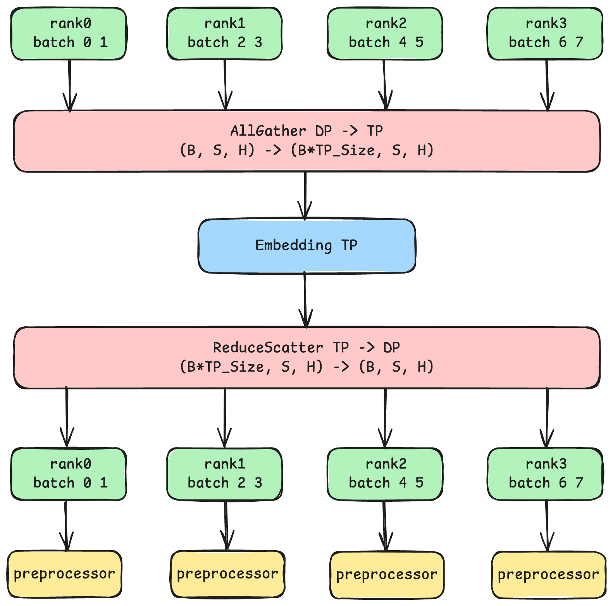
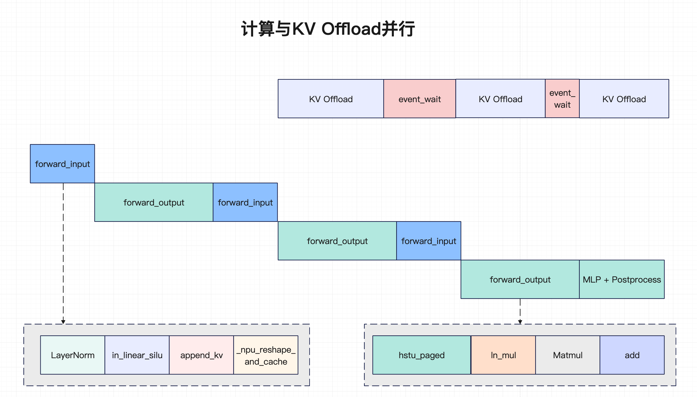
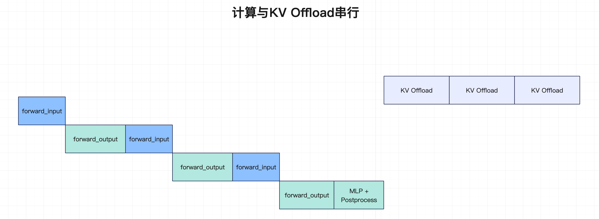

# HSTU Model Inference Optimization on NPU

This document mainly introduces the NPU-based inference optimization strategies for the HSTU model.

## NPU Model Adaptation

Based on the Nvidia Recsys-Examples repository, we implemented Torch small-operator replacements for GPU operators and KV Cache management logic, and implemented the NPU `kv_cache_manager_impl` class to replace the original tensorrt-llm framework implementation logic.

We implemented the `allocate_pools`, `get_primary_pool`, `get_num_free_blocks`, `add_sequence_with_eviction`, `remove_sequence`, `evict_all_sequences`, `get_cached_start_position`, `get_num_tokens_cached`, and `get_cache_block_ids` methods of `kv_cache_manager_impl`. The implementation code is in the [kv_cache_manager_impl.py](https://gitcode.com/cann/cann-recipes-infer/blob/master/models/hstu/modules/kv_cache_manager_impl.py) file.

For the small-operator adaptation logic, we adapted the `jagged_2D_tensor_concat`, `torch_split_2D_jagged`, `torch_add_position_embeddings`, `torch_add_timestamp_positional_embeddings`, and other torch operator implementations.

In addition, for the GPU-related dynamic embedding, we implement it using `nn.Embedding`.

## NPU Operator Adaptation

### NPU hstu Fused Operator
In the hstu attention part, Nvidia implements its own CUDA operator. A corresponding fused operator already exists on NPU. Based on the computation logic, we implemented the `hstu_paged` fused operator adaptation.

```python
jagged_attn_output = torch.ops.mxrec.hstu_paged(q=query,
    k=key,
    v=value,
    kv_cache=kv_cache_table,
    mask=None,
    attn_bias=None,
    mask_type=2,
    max_seq_len=self._max_seqlen,
    max_seq_len_k=jd.seqlen_k,
    silu_scale=1.0 / self._max_seqlen,
    seq_offset=jd.seqlen_offsets,
    seq_offset_k=kv_cache_metadata.total_history_offsets,
    seq_offset_t=jd.num_candidates_offsets,
    page_offsets=kv_cache_metadata.kv_indptr,
    page_ids=kv_cache_metadata.kv_indices,
    last_page_len=kv_cache_metadata.kv_last_page_len,
    num_target=jd.num_candidates,
    target_group_size=1)
```

### NPU _npu_reshape_and_cache Operator

For kvcache management, the original kv cache layout is [num_pages, num_layers, 2, block_size]. We modified it to the [num_layers 2, num_pages, block_size] form and introduced the _npu_reshape_and_cache operator to accelerate the append_kv_cache computation.

```python
torch_npu._npu_reshape_and_cache(src_k, src_v, paged_k_cache, paged_v_cache, slot_i32)
```
### NPU concat_nd_jagged Operator

We uniformly replaced the GPU-side Triton fused operator triton_concat_2D_jagged and the CUDA fused operator jagged_2D_tensor_concat with the NPU-side concat_nd_jagged, achieving an efficient migration with equivalent functionality. The concat_nd_jagged operator is derived and optimized from the concat_2d_jagged operator developed by the RecSDK team. The native operator only supports concatenating 2 tensors and cannot fully meet the scenario requirements of the HSTU model; we completed the enhancement at the Torch adaptation layer, extending the capability to support jagged concat scenarios of n (n≥2) tensors, thereby covering more general fused concatenation requirements and reducing operator fragmentation and maintenance costs.


## Distributed Inference

We added distributed inference capability on the inference side, mainly Embedding Tensor Parallel (TP) and Data Parallel (DP). The biggest difference between generative recommendation and ordinary LLM tasks is that LLM parameters are mainly concentrated in the dense Transformer weights, and input tokens come from a relatively fixed text vocabulary; whereas generative recommendation often models discrete features such as users, items, and context uniformly as tokens, and most of its model capacity comes from ultra-large-scale sparse parameters (Embedding Tables), with the vocabulary scale reaching tens of millions or even hundreds of millions. Based on this, we introduced Embedding TP on the inference side (as shown below), sharding the large tables by vocab dimension onto different NPUs, so as to reduce the single-card memory burden and support model inference. At the same time, DP is adopted outside Embedding TP for parallel processing, and the Embedding part performs the DP -> TP -> DP operation.

<div align="center">
    
</div>

## KV Offload Parallelism

In terms of execution scheduling, we further introduced KV Offload in parallel with HSTU dense computation (as shown below): the original repository implementation needs to wait for HSTU dense to complete before executing KV offload layer by layer. Such a serial manner of computation and KV Offload has low parallelism, resulting in poor performance; on NPU, we moved the offload timing forward to immediately trigger the KV offload of that layer right after each layer's Attention completes, and put it on another NPU stream for asynchronous execution, thereby overlapping the computation pipeline (HSTU dense + MLP + post-processing) with the communication pipeline (KV offload), significantly reducing pipeline bubbles and greatly improving overall performance.

<div align="center">
    
</div>

<div align="center">
    
</div>

## Other Optimization Directions

In the future, we will continue to try to optimize the hstu pre-processing and post-processing logic, using fused operators to handle the `concat_2d_jagged` in the pre-processing part; enable the hstu dense module computation to run in parallel with offload; and complete the development and integration of more fused operators, so as to further reduce inference latency and improve performance. In addition, in the embedding processing and offload flows, we will also try to enable shmen and other means to further improve performance.

<!-- static-meta
{
  "sidebarTitle": "Inference Optimization",
  "parallelism": ["data-parallel", "tensor-parallel"],
  "cannFeatures": ["multi-stream"],
  "cover": {"type": "auto"}
}
-->
