# CANN + TorchTitan: Ascend Optimization Practice for DeepSeek-V3.2 32k Long-Sequence Pretraining

With the release of DeepSeek-V3.2 by the DeepSeek team, its innovative **DeepSeek Sparse Attention (DSA)** architecture has significantly improved long-sequence computation efficiency through the sparse attention mechanism, quickly becoming the focus of industry attention. To seize this technology trend, many vendors are eager to quickly complete the adaptation and reproduction of DSA and integrate it into their own models to explore performance benefits, which also poses a challenge to the rapid adaptation of training frameworks on Ascend NPUs.

This document mainly introduces the technical practice of achieving full-pipeline pretraining adaptation of DeepSeek-V3.2 on Ascend NPU clusters using the PyTorch official native large-model training framework **TorchTitan**. We not only worked through the complex hybrid parallel strategies, but also took the industry lead in overcoming the backward propagation challenge of the DSA operator. Combined with torch.compile compilation acceleration, we achieved native alignment from model definition to operator compilation. The DeepSeek-V3.2 long-sequence CPT training reproduced by the CANN team achieves a performance of **148 TPS/card** in the extreme memory scenario on an A3 64-card cluster.

---

## Highlights

* The training framework uses the TorchTitan + TorchTitan-npu plug-in scheme. The parallel strategies enable **native TP/PP/EP/FSDP2** Ascend adaptation, and a Custom CP is proposed for the sparse DSA structure. 32K long-sequence CPT training is completed on an A3 64-card cluster, and the involved [training framework code](https://gitcode.com/cann/cann-recipes-train/tree/master/llm_rl) has been fully open-sourced
* Based on Ascend C, we implement NPU **fused forward and backward Kernels for Lightning Indexer and Sparse Flash Attention**, unleashing the potential of sparse computation. The Ascend C Kernel [technical documentation (Chinese)](https://gitcode.com/cann/cann-recipes-infer/blob/master/docs/models/deepseek_v3_2_exp/deepseek_v3.2_exp_ascendc_operator_guide.md) and [code](https://gitcode.com/cann/ops-transformer) have been open-sourced
* Leveraging the native memory advantages of FSDP2 (Fully Sharded Data Parallel 2), combined with the high communication bandwidth hardware characteristics of the A3 super node, the weight prefetch communication can be fully masked by computation; at the same time, by taking advantage of the A3 high-speed H2D bandwidth to enable **Swap Optimizer** to Host memory, a memory **minimal deployment scheme** for 671B long-sequence full fine-tuning is achieved
* TorchTitan-npu seamlessly interfaces with the **torch.compile + Inductor** graph optimization capabilities to implement FX computation graph pass optimization, achieving performance gains in the DeepSeek-V3.2 pretraining scenario, and is the main battlefield for future PyTorch compilation optimization in training scenarios

## Outline

* [Why Choose TorchTitan](#why-choose-torchtitan)
* [Distributed Parallelism Strategies](#distributed-parallelism-strategies)
* [Memory Optimization](#memory-optimization)
* [DSA Fused Operators](#dsa-fused-operators)
* [FSDP2 + Torch.compile + Inductor Acceleration](#fsdp2--torchcompile--inductor-acceleration)
* [Benchmark](#benchmark)
* [Future Plan](#future-plan)

## Why Choose TorchTitan

### Native Distributed Programming Model

The most fundamental advantage of TorchTitan lies in its deep application of DTensor, which abstracts tensor parallelism as first-class semantics and enables Lego-style combination of parallel strategies.

* **Unified abstraction**: DTensor decouples parameter partitioning from model definition through Placement (Shard/Replicate/Partial). Developers only need to configure the ParallelStyle of submodules to declare the partitioning approach, without explicitly writing communication logic.

* **Multi-dimensional combination**: Based on DTensor carrying the complete device mesh, TorchTitan can implement 5D parallel (FSDP2+TP+PP+EP+CP) combinations at extremely low intrusion cost, keeping the codebase compact and modular while supporting rich features.

### Seamless Integration with the PyTorch Ecosystem

TorchTitan is a native large-model training framework of the PyTorch community. Integrating with TorchTitan **helps accelerate the deep integration of the Ascend ecosystem with the PyTorch community, reuse open-source solutions, and effectively improve the ease of use of NPU training scenarios**.

#### Deep Integration of torch.compile

TorchTitan natively supports torch.compile and leverages the Inductor compiler to achieve training optimization:

* **FX graph transformation**: Captures the static graph through FX, executes graph-level passes such as computation scheduling and pattern matching, automatically eliminates redundant operations, and generates a streamlined intermediate representation.
* **Operator fusion**: Relies on Triton to implement horizontal fusion (merging chains of consecutive elementwise operations) and vertical fusion (merging compute-intensive operators with bias, activations, etc.), reducing memory access and kernel launch overhead. In the future, the CANN platform can connect to Inductor through Ascend C automatic fusion to further improve performance.

#### Integration of Native PyTorch Community Tools

TorchTitan integrates the tool systems in the PyTorch ecosystem, providing out-of-the-box stability and debugging capabilities:

* **Distributed checkpointing**: Natively integrates DCP and supports asynchronous saving; CheckpointManager saves model shards, optimizer states, and loader offsets at low overhead, and automatically locates the latest checkpoint and verifies its integrity upon recovery.
* **Fault tolerance and diagnostics**: TorchFT enables replica-level checkpoint management. In HSDP scenarios, only the failed node can be recovered upon node failure, significantly improving the mean time between failures; based on FlightRecorder, information such as communication types, data volumes, and call stacks can be cached to assist in locating the root causes of deadlocks and training timeouts.
* **Low-precision training**: Pluggable integration of TorchAO reuses its low-precision data type abstractions and quantization recipes. The community has implemented support for FP8 / MxFP8 data types in TorchTitan and completed validation of low-precision MoE network training.

## TorchTitan-npu Pluggable Support Scheme

TorchTitan provides the **ModelConverter** mechanism, which acts after the model definition and before the application of parallel strategies (TP/FSDP, etc.). It can replace or rewrite model modules through a registration mechanism without modifying the original model definition. For details, please refer to the [official documentation](https://github.com/pytorch/TorchTitan/blob/v0.2.1/docs/extension.md?plain=1#L20)
Based on this mechanism, we designed an NPU pluggable adaptation scheme, with the expected goals:

- Do not modify upstream model code, making it easy to track upstream updates
- Support enabling optimization items through switches
- Support free combination of multiple optimization items

Currently, we mainly enable fused operator optimization, while features such as quantization and optimizer optimization are being gradually expanded; this mechanism also makes it convenient to combine with capabilities such as torch.compile to achieve further optimization.

**Usage example:**

```yaml
[model]  # Simply specify the fused operators to be enabled under the [model] configuration
converters = ["npu_dsa", "npu_rms_norm", "npu_permute", "npu_gmm"]
```

## Distributed Parallelism Strategies:

### MoE TP Strategy Optimization

In the large-EP scenario, routed experts are not partitioned by TP (TP extend EP). The native MoE TP strategy of TorchTitan is shown in the following figure:

<p align="center">
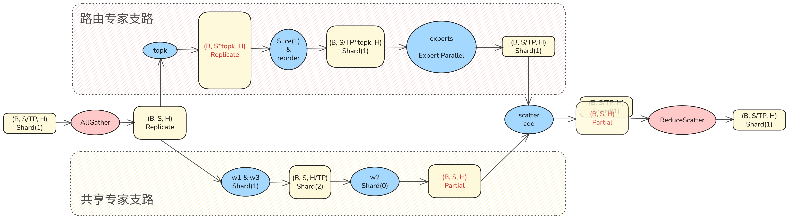
</p>
The above strategy has unreasonable aspects in both branches:

* The routed expert branch receives the activation tensor after AllGather in the TP domain. Every rank within a TP domain performs topk selection on the same tensor, causing redundancy in computation and memory; at the same time, the Reorder module also performs Sequence Parallel, which means the preceding TP-domain AllGather is a redundant operation for the routed expert branch.
* Unlike traditional TP, the shared expert branch does not immediately perform ReduceScatter communication on its output; instead, it maintains an unsafe Partial state and occupies more memory.

The above unreasonable aspects are related to the unreasonable placement of AllGather and ReduceScatter in the TP domain. These two communication operations can be moved to the shared expert branch, while the routed expert branch does not need TP-domain communication. After the adjustment, the MoE TP strategy is shown in the following figure: the routed expert branch no longer has redundant computation and communication, and the shared expert branch follows the ordinary TP strategy:
<p align="center">
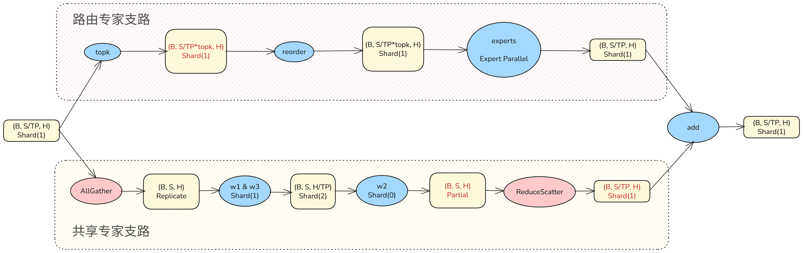
</p>

### Custom CP Strategy

#### Introduction to Native torch CP

In long-sequence scenarios, Context Parallel (CP) over the Sequence dimension of input data is particularly important, as it can greatly reduce the activation memory footprint.

TorchTitan uses the context parallel capability natively provided by torch. Its principle is shown in the following figure: a context environment wraps the model training step. Inside the context, the model input is partitioned along the sequence axis, and the Attention operator is replaced with a RingAttention or AllGatherKV implementation to ensure correct Attention computation.
<p align="center">
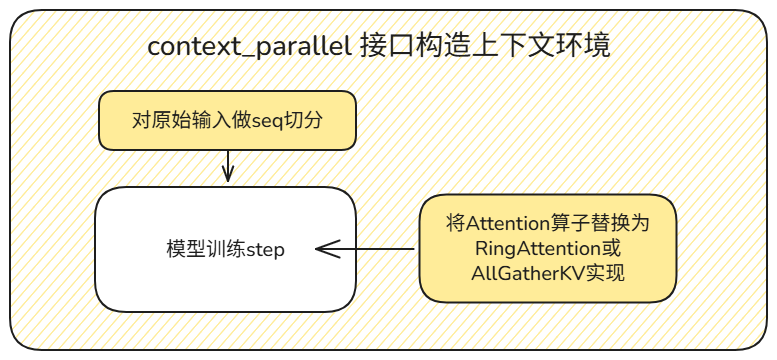
</p>

#### Custom CP for DSA

Unlike traditional dense attention models, the internal Lightning Indexer and DSA sparse attention of the DeepSeek-V3.2 model both need to process Key and Value in the CP scenario to ensure computational correctness. Since the internal attention structure of DeepSeek-V3.2 is more complex and the Attention operator is no longer the commonly used SDPA, the native CP capability of torch does not apply. In this context, while following the design logic of native torch CP, we designed and implemented a custom CP for DeepSeek-V3.2, whose principle is shown in the following figure:
<p align="center">
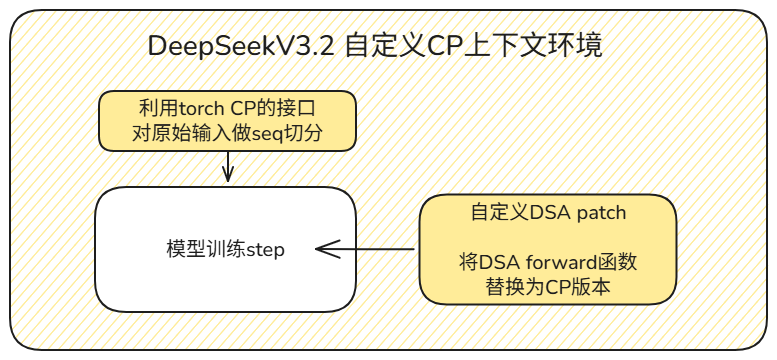
</p>

In the CP scenario, it is necessary to ensure that q_indexer and query each perform attention computation with the k_indexer and key value of the full sequence. Generally, there are two ways to achieve this: the RingAttention form, or directly performing AllGather on KV along the sequence dimension.

* **RingAttention form**: Complex to implement, and it needs to be implemented for both the Indexer and the sparse attention computation; overall, it is complex to develop and not flexible enough.
* **Performing sequence-dimension AllGather on KV**: Simple and flexible to implement. In addition, considering that under weight absorb mode, KV occupies little memory and the key in the Indexer also occupies very little memory, the memory cost of AllGather is fully acceptable.

Based on the above analysis, we implemented a CP version of the DSA forward function, which simply adds AllGather communication for KV on top of the original code. Taking the DSA implementation using NPU fused operators as an example, the computation logic in the CP scenario is shown in the following figure:
<p align="center">
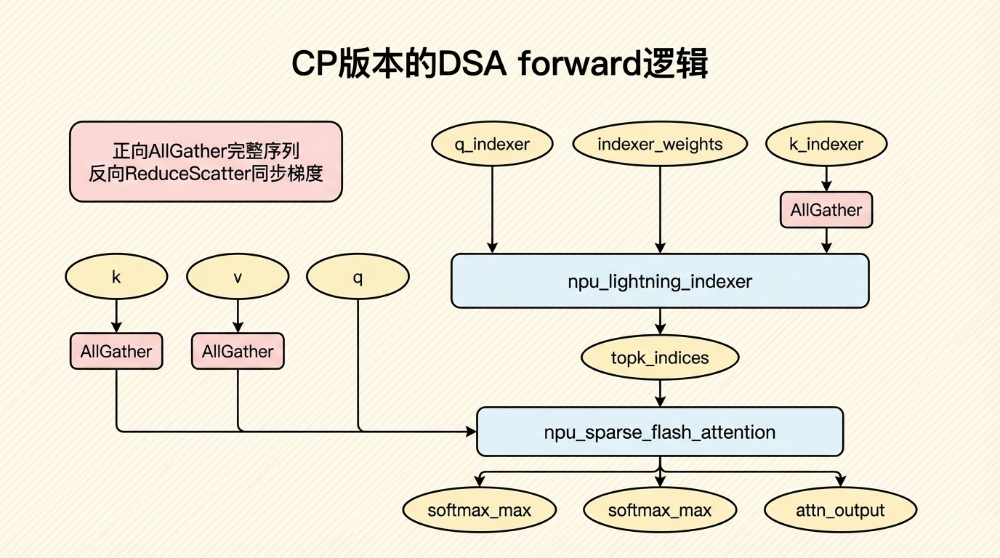
</p>
It is worth mentioning that we first implemented the CustomContextParallelContext base class, which only performs sequence partitioning of the model input. Users can customize the CP patch logic of the model forward computation in subclasses, providing good extensibility.

### Sharding Strategy Optimization for DTensor Computation

#### Operator Sharding Strategies

When using DTensor for computation, the operator dispatch needs to generate sharding strategies for the operator's inputs (including weights) and outputs. For a DTensor, if the selected sharding strategy does not match the current state, it triggers a DTensor state transition, introducing extra operations such as Slice or communication, which can have a very adverse impact on performance and even memory. Therefore, generating a reasonable sharding strategy for operators is crucial. This subsection introduces the sharding strategy optimization for two NPU operators.

#### Matmul Sharding Strategy Optimization

In the TP scenario, the current default matmul sharding strategy generation is unreasonable. Taking the q_lora matrix multiplication as an example, this matrix multiplication does not perform any partitioning within the TP domain, so the matmul can be computed directly, as shown on the right side of the following figure.

However, the current sharding strategy generation is unreasonable. As shown on the left side of the following figure, the generated strategy tries to turn the simple Replicate matrix multiplication into a form where the weight is partitioned along the TP rows, introducing many extra operations and greatly affecting performance:

* **Input X**: Changes from Replicate to Shard(2), requiring a Slice operation.
* **Weight W**: Changes from Replicate to Shard(0), requiring a Slice operation.
* **Output Y**: Since the TP strategy specifies that the q_lora module is not parallelized, the final matmul output needs to be adjusted to the Replicate state, and transitioning from Partial to Replicate requires AllReduce communication.
<p align="center">
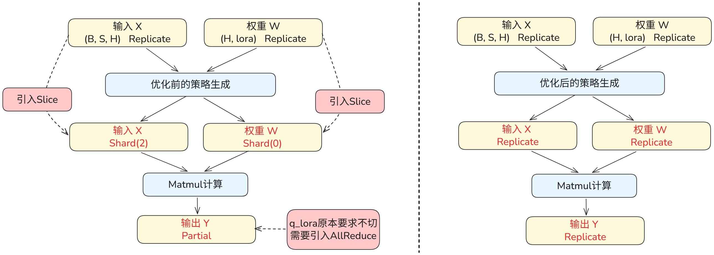
</p>
In fact, PyTorch has already written a fairly complete matmul sharding strategy generation function, which can be used to obtain a more reasonable sharding strategy. For the above example, the expected reasonable strategy can be obtained through the following code:

#### Matmul Backward Sharding Strategy Optimization

The matmul_backward operator also currently has the problem of unreasonable sharding strategies. Taking the output matrix multiplication at the end of the model as an example, its forward pass uses the weight partitioned along the TP columns. In the backward pass, the input partitioning state and the generated default partitioning strategy are shown on the left side of the following figure, and the unreasonable strategy introduces redundant operations:

* **Input X**: Changes from Replicate to Shard(2), requiring a Slice operation.
* **Gradient dY**: Changes from Shard(2) to Replicate, requiring AllGather communication and occupying more memory.
* **Weight W**: Changes from Shard(1) to Shard(0), requiring AllToAll communication.

<p align="center">
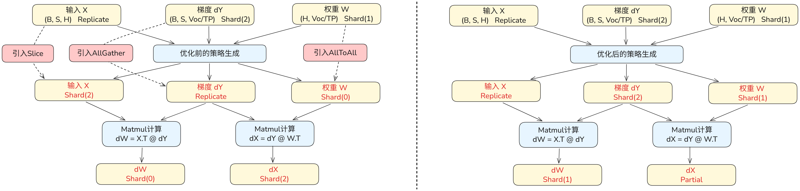
</p>

Although torch does not have a sharding strategy generation function for matmul backward, considering that matmul backward is essentially two matrix multiplications that compute dX and dW, we designed to call _mm_like_strategy for the two matrix multiplications separately to generate strategies, and then fuse them to obtain the final matmul backward sharding strategy.

In addition, since _mm_like_strategy generates multiple strategies for a single matmul, it is also necessary to consider how to select a more reasonable strategy. Since the weight partitioning state is usually not adjusted again during computation, we select, from among the many strategies, the strategy that does not adjust the partitioning state of W (for the dX computation) and the strategy where dW is consistent with the partitioning state of W (for the dW computation). Fusing the two strategies yields the ideal strategy on the right side of the above figure. It can be seen that the ideal strategy actually does not adjust the partitioning state of the operator's input tensor, thereby avoiding the introduction of extra operations.

## Memory Optimization

### Minimal Partitioning Strategy

The core challenge of this deployment is to deploy the DeepSeek-V3.2 model training task, whose parameter count is as high as 671B, on a **small-scale A3 cluster of 64 cards**. Considering that TorchTitan currently stores model weights using the FP32 type, the weights and gradients of DeepSeek-V3.2 occupy **5368GB**, exceeding the total memory of 4096GB on 32 A3 cards. Therefore, 64 cards is already the smallest possible scale for model deployment. Under this constraint, the deployment strategy needs to center on the main thread of 'extremely compressing per-card memory usage'.

#### FSDP2 Flow and Characteristics

FSDP2, as the core evolutionary scheme of PyTorch distributed training, has a core flow that, at each computation step (forward/backward), collects on demand the full set of model parameters partitioned across devices via AllGather, and immediately releases parameters not on the local device after computation completes, thereby reducing the resident memory associated with model parameters and gradients. Compared with FSDP1, FSDP2 has deeply optimized sharding granularity, communication overlap, and memory reuse: it supports unified shard management of parameters, gradients, and optimizer states; it adopts a layer-wise collection and release mechanism to achieve an efficient pipeline where communication and computation mask each other; and it natively adapts to mixed-precision training and the automated partitioning configuration of the TorchTitan framework.

<p align="center">
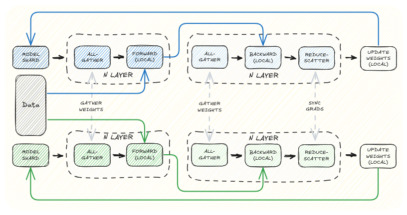
</p>

#### Zero-Redundancy Weights

In the common large-EP, small-TP deployment mode of MoE models, although the MoE part, which accounts for the majority of the model's parameters, is fully partitioned through EP and pipeline parallelism (PP) with expert weights scattered without redundancy, the weights of the Attention/shared-expert parts are often redundantly replicated across cards. In such scenarios where hybrid parallel strategies cause partial parameter redundancy, the advantage of FSDP2 is particularly prominent: by further partitioning the redundantly deployed Attention weights and shared-expert parameters in DP-domain units, FSDP2 can significantly reduce the number of parameter copies across DP domains while keeping the computation logic unchanged, freeing valuable resources for larger-batch or longer-sequence training.

<p align="center">
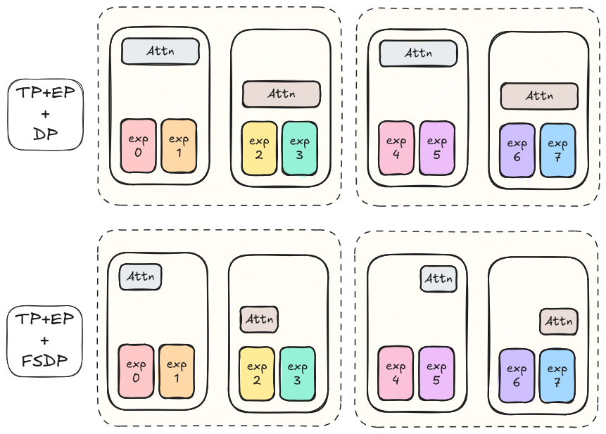
</p>

Specifically, considering the PP2TP4DP16 scenario, the total per-card occupancy of non-MoE weights and gradients is approximately (671B - 654B)/PP2/TP4 * 8Byte = ~18GB. Considering that some of these weights do not participate in TP partitioning (such as `qkv_a` and `indexer`), the actual value will increase further. After enabling FSDP in the DP16 scenario, the weights and gradients are fully and evenly divided among DP domains, almost completely eliminating the related memory usage. Finally, we compared the following partitioning strategies and, after considering the possibility of extreme MoE load imbalance, chose the partitioning approach based on **PP2TP4EP64**.
<p align="center">
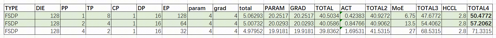
</p>

### Swap Optimizer

The AdamW optimizer commonly used in large-model training needs to store two FP32 momentum values, which brings a huge memory cost: during the forward and backward computation of training, the optimizer is not used, so the optimizer wastes a massive amount of device memory.

To address this problem, the MindSpeed open-source training framework designed the [SwapOptimizer feature (Chinese)](https://gitcode.com/Ascend/MindSpeed/blob/master/docs/zh/features/swap-optimizer.md), which optimizes memory in the following ways:

* To save device memory, the optimizer is offloaded to host memory during the forward and backward passes.
* To reduce the memory peak during optimizer updates and improve performance as much as possible, "optimizer load — optimizer update — optimizer offload" is designed in a sliced, pipelined, and parallel form at the param granularity.

<p align="center">
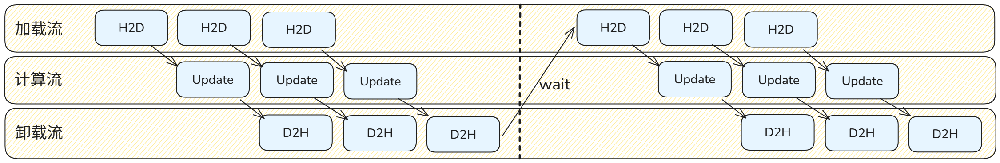
</p>

This example references and implements the SwapOptimizer feature under the TorchTitan framework, greatly saving device memory during training. Unlike MindSpeed, in TorchTitan training the optimizer only manages two FP32 momentum values, and it also needs to handle the scenario where weights are DTensors.

## DSA Fused Operators
### LI/SFA
For an introduction to the `LightningIndexer/SparseFlashAttention` related operators, please refer to [NPU DeepSeek-V3.2 Ascend C Fused Operator Optimization (Chinese)](https://gitcode.com/cann/cann-recipes-infer/blob/master/docs/models/deepseek_v3_2_exp/deepseek_v3.2_exp_ascendc_operator_guide.md)

### SparseLightningIndexerGradKLLoss

`SparseLightningIndexerGradKLLoss` obtains the backward gradient computation for the Top-$k$ positions corresponding to each token in the Sparse Training Stage through a series of operations, and fuses the Loss computation into it. The backward gradient computation process depends on the aggregation and normalization results of the softmax in the Sparse Flash Attention computation process and the output distribution of the Lightning Indexer itself. Considering the balance between memory and compute power, the `SparseLightningIndexerGradKLLoss` operator performs partial recomputation while retaining some important forward computation results. The forward inputs of the Lightning Indexer are Index Query $\tilde{Q}\in\R^{g\times d}$ and Index Key $\tilde{K}\in\R^{S_{k}\times d}$; the forward inputs of Sparse Flash Attention are Query $Q\in\R^{g\times d}$, Key $K\in\R^{S_{k}\times d}$, and $W\in\R^{g\times 1}$, where $g$ is the group size corresponding to GQA, $d$ is the dimension of each head, and $S_{k}$ is the context length. The specific computation flow of the `SparseLightningIndexerGradKLLoss` operator is as follows:

1. The computation formula for the forward Top-$k$ value of the Lightning Indexer:

$$
_{t,:}=W_{t,:}@ReLU(\tilde{q}_{t,:}@\tilde{K}_{topk,:}^\top)
$$

- Here, $W_{t,:}$ is the $weights$ corresponding to the $t$-th token in the $W$ matrix, $\tilde{q}_{t,:}$ is the result after axis-merging the $G$ query heads corresponding to the $t$-th token in the $\tilde{Q}$ matrix, and $\tilde{K}_{topk,:}$ is the matrix composed of tokens taken from the $\tilde{K}$ matrix according to the Top-$k$ indices of $\tilde{q}_{t,:}$.

2. The computation formula for the forward Top-$k$ value of Sparse Flash Attention:

$$
_{t,:} = \text{Softmax}(q_{t,:} @ K_{topk,:}^\top/\sqrt{d})
$$

- Here, $p_{t,:}$ is the Softmax result corresponding to the $t$-th token, $q_{t,:}$ is the result after axis-merging the $G$ query heads corresponding to the $t$-th token in the $Q$ matrix, and ${K}_{topk,:}$ is the matrix composed of tokens taken from the $K$ matrix according to the Top-$k$ indices of ${q}_{t,:}$.

3. During the training stage, the output of the Lightning Indexer needs to be aligned with the softmax result of Sparse Flash Attention to compute the loss. The corresponding loss function is:

$$
oss{=}\sum_tD_{KL}(p_{t,:}||Softmax(I_{t,:}))
$$

- Here, $p_{t,:}$ serves as the target distribution, which needs to be obtained by summing over all heads on the previous computation results, and then applying L1 normalization to the summed result along the context direction. $D_{KL}$ is the KL divergence, whose expression is:
  
  $$
  D_{KL}(a||b){=}\sum_ia_i\mathrm{log}{\left(\frac{a_i}{b_i}\right)}
  $$

4. By taking the derivative, the gradient expression of the Loss can be obtained:

$$
I\mathop{{}}\nolimits_{{t,:}}=Softmax \left( I\mathop{{}}\nolimits_{{t,:}} \left) -p\mathop{{}}\nolimits_{{t,:}}\right. \right.
$$

5. Using the chain rule, the gradients of the weights, query, and key matrices can be computed:

$$
W\mathop{{}}\nolimits_{{t,:}}=dI\mathop{{}}\nolimits_{{t,:}}\text{@} \left( ReLU \left( S\mathop{{}}\nolimits_{{t,:}} \left) \left) \mathop{{}}\nolimits^{\top}\right. \right. \right. \right.
$$

$$
\mathop{{\tilde{q}}}\nolimits_{{t,:}}=dS\mathop{{}}\nolimits_{{t,:}}@\tilde{K}_{topk,:}
$$

$$
\tilde{K}_{topk,:}=\left(dS\mathop{{}}\nolimits_{{t,:}} \left) \mathop{{}}\nolimits^{\top}@\tilde{q}\mathop{{}}\nolimits_{{:t, :}}\right. \right.
$$

- Here, $S$ is the result of the matrix multiplication of $\tilde{Q}$ and $\tilde{K}$, and $S_{t,:}$ is the $t$-th row in the $S$ matrix. $dW_{t,:}$ is the $t$-th row in the $dW$ matrix; $dq_{t,:}$ is the $t$-th row in the $d\tilde{Q}$ matrix; $d\tilde{K}_{topk,:}$ is the accumulated value of the rows corresponding to the Top-$k$ indices in the $d\tilde{K}$ matrix.

In actual development, it is necessary to fully exploit the characteristics of Ascend hardware to achieve better performance. The following will detail the current solutions and specific implementation approaches.

#### SLIG Operator Tiling Design

The inter-core Tiling design of the operator is as follows:

`SparseLightningIndexerGradKLLoss` partitions the B and S axes across cores.

The intra-core Tiling design of the operator is as follows:

`SparseLightningIndexerGradKLLoss` uses a basic block size of $(128,128)$ for a single computation.

- The L1 space is divided as follows:
  
  - $Q$ matrix: $128\times 576\times2\text{ Bytes}=144\text{ KB}$, i.e., the $Q$ matrix permanently resides in L1;
  - $Qindex$ matrix with Double Buffer enabled: $2\times64\times 128\times2\text{ Bytes}=32\text{ KB}$, i.e., the $Qindex$ matrix permanently resides in L1;
  - $Gather$ matrix with Double Buffer enabled: $2\times128\times 128\times2\text{ Bytes}=64\text{ KB}$, where the transfer size of the $Gather$ matrix each time is $(128,128)$;
  - $reluGrad$ matrix: $64\times 2048\times2\text{ Bytes}=288\text{ KB}$, where the transfer size of the $reluGrad$ matrix each time is $(64,2048)$.
- L0A, L0B, and L0C have DoubleBuffer enabled and are divided into $2\times32\text{ KB}$, $2\times32\text{ KB}$, and $2\times64\text{ KB}$, respectively,
  
  - In the $C_1$ stage, the matrix block sizes loaded once into L0A and L0B by $MatmulP$ are $(128,128) / (128,64)$ and $(128,128)$, respectively.
  - In the $C_1$ stage, the matrix block sizes loaded once into L0A and L0B by $MatmulSy$ are $(64,128)$ and $(128,128)$, respectively.
  - In the $C_2$ stage, the matrix block sizes loaded once into L0A and L0B by $MatmulDk$ are $(128,64)$ and $(64,128)$, respectively.
  - In the $C_2$ stage, the matrix block sizes loaded once into L0A and L0B by $MatmulDq$ are $(64,128)$ and $(128,128)$, respectively.

#### SLIG Pipeline Design

The computation flow of `SparseLightningIndexerGradKLLoss` has five stages: preprocessing Gather ($V_0$), matrix multiplication and ReLU operations ($C_1$), followed by multiple vector computations on the $V_1$ side, the $C_1$-side matrix multiplications, and the post-processing ScatterAdd operation ($V_2$). Compared with the `LightningIndexer` and `SparseFlashAttention` operators, the computation flow of this operator is more elaborate and its data dependencies are more complex. A naive pipeline arrangement causes a large number of bubbles in the Cube and Vector computation processes, failing to fully exploit the compute advantage. To prevent multiple stages from executing serially, it is necessary to Preload one $V_0$ in advance to achieve mutual masking of the pipeline. The specific pipeline effect is shown in the following figure:
<p align="center">
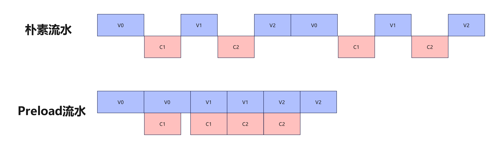
</p>

#### Dispersed Memory-Access Optimization

The Gather ($V_0$) and ScatterAdd ($V_2$) stages of the `SparseLightningIndexerGradKLLoss` operator both require dispersed memory access. For Attention operators in non-Sparse scenarios, data access is generally contiguous, so the time of a single data transfer is longer than the instruction dispatch time, enabling continuous multiple memory accesses and achieving high memory-access bandwidth. However, for the dispersed memory access of Sparse Attention, the time of a single memory access drops significantly, possibly even becoming shorter than the instruction dispatch time, which leads to severe instruction dispatch blocking, as shown in the following figure.

<p align="center">
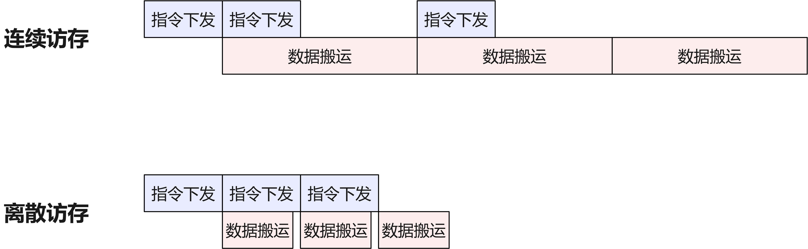
</p>

Based on the characteristic of the A3 chip that the ratio of Cube cores to Vector cores is 1:2, the Vector cores are used to issue memory-access instructions,
doubling the instruction dispatch efficiency. On the other hand, the amount of data in a single memory access itself also affects the actually achieved bandwidth,
while a single dispersed memory access has a small access amount, which causes the data transfer time itself to be higher than expected.
To address this problem, discrete data points can be aggregated in pairs, using the srcGap parameter to implement paired data access, thereby improving memory-access bandwidth, as shown in the figure.

<p align="center">
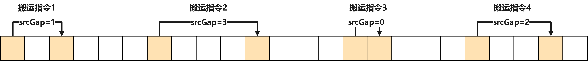
</p>

#### Axis-Merging Optimization

Because different QueryTokens of the `SparseLightningIndexerGradKLLoss` operator correspond to different KeyTokens, the N axis is placed as the inner loop axis, and the B and S axes are used as the partitioning axes.

### SparseFlashAttentionGrad

The `SparseFlashAttention` operator overall follows the computation flow of [FlashAttentionGrad (Chinese)](https://gitcode.com/cann/ops-transformer/blob/master/attention/flash_attention_score_grad/docs/FAG%E7%AE%97%E5%AD%90%E8%AE%BE%E8%AE%A1%E4%BB%8B%E7%BB%8D.md), with meticulous optimizations of instruction reduction and transfer aggregation for dispersed memory access. The backward computation is overall divided into the following core steps, and the overall computation logic is as follows:

1. Take out the corresponding tokens from the $K$ matrix according to the Top-$k$ indices to form the $K_{topk}$ matrix.

$$
_{topk} = \text{Gather}(K, \text{Top-K index})
$$

2. Recompute the forward softmax result of Sparse Flash Attention:

$$
= \text{Softmax}(Q @ K_{topk}^\top/\sqrt{d})
$$

3. Perform matrix multiplication between $dY$ and the transposed $V$ matrix to obtain $dP$:

$$
dP = dY @ V^T
$$

4. Subtract the `FlashSoftmaxGrad` computation result from $dP$, then multiply by $P$ to obtain $dS$:

$$
dS = P *(dP - \text{FlashSoftmaxGrad}(dY @ attention\_in))
$$

- Here, the inputs of `FlashSoftmaxGrad` are the backward gradient `dY` and the forward output `attention_in`.

5. Using the chain rule, the gradients of the query, key, and value matrices can be computed:

$$
dQ = dS @ K_{topk} /\sqrt{d}
$$

$$
dK = \text{ScatterAdd}(dS^\top @ Q /\sqrt{d},\text{Top-K index} )
$$

$$
dV = P^\top @ dY
$$

#### SFAG Operator Tiling Design

The Tiling design of an operator determines whether the storage space is fully utilized, which in turn affects the overall compute utilization and operator performance. For `SparseFlashAttentionScoreGrad`, this section describes the inter-core and intra-core Tiling designs respectively.

The inter-core Tiling design adopts the following scheme:

Currently, the `SparseFlashAttentionScoreGrad` operator merges the Batch axis with $S_{Q}$ and uses it as the core-partitioning axis, with the cores arranged consecutively along the partitioning axis.

- T = B *  $S_{Q}$
- CoreProcessNum = CeilDiv(T, CoreNum)

The intra-core Tiling design adopts the following scheme:
**Intra-core space partitioning**:

|                           | Left matrix L1 basic block | Right matrix L1 basic block |
| ------------------------- | ------------------ | ----------------- |
| $Q_{index}$ @ $K_{index}$ | 128 * 576          | 128 * 128 * 2(DB) |
| $d_{y}$  @V               | 128 * 512          | 128 * 128 * 2(DB) |
| $d_{s}$ @ K               | 128 * 128 * 2(DB)  | 128 * 128 * 2(DB) |
| $d_{s}$ @ Q               | 128 * 128 * 2(DB)  | 128 * 576         |
| $d_{y}$ @ P               | 128 * 128  * 2(DB) | 128 * 512         |

- $Q_{index}$ is loaded into L1 at the granularity of basic blocks of $128\times 256$, and permanently resides in L1 during the computation flow of a single basic block, so that it can be reused in the $d_{s}$ @ $Q_{index}$ computation, reducing repeated memory access. The same technique is also applied to $V_{index}$. As shown in the table, in other matrix multiplication computations, limited by L1 space, the source data transfer enables DoubleBuffer to achieve parallelism between transfer and computation. At the same time, the basic block on the UB uses $128\times 128$.

#### SFAG Pipeline Design

The computation flow of `SparseFlashAttentionScoreGrad` includes five stages: the data transfer of $K_{index}$ and $V_{index}$ from dispersed to contiguous (V0), $Q_{index}$@$K_{index}$ and $d_{y}$@V (C1), computing P and $d_{s}$ (V1), computing $d_{s}$@K, and finally the dispersed write-out of $d_{k}$ and $d_{V}$ outside the core (V2). The basic pipeline arrangement strictly following the computation graph is shown in the upper part of the following figure, where multiple stages execute serially, causing a large number of bubbles in the computation process. Here, the optimization is to launch V0 and C1 twice consecutively at the startup stage to resolve the data dependencies of subsequent computations, thereby achieving pipeline masking. The effect is shown in the lower part of the following figure, where the parallel execution between CV greatly reduces the CV data dependency loss.

<p align="center">
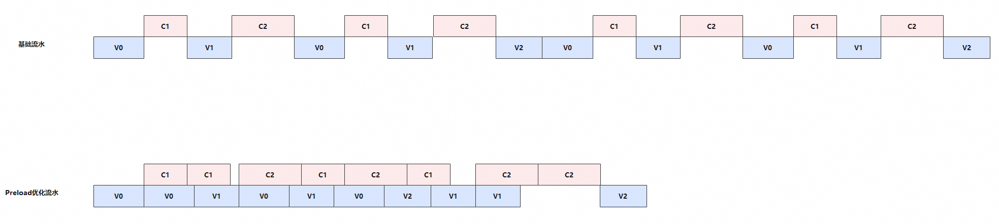
</p>

#### Dispersed Memory-Access Optimization

Compared with the traditional FAG, SFAG adds a large number of dispersed memory accesses, and the amount of data in a single access is small, which causes the overhead of the memory-access instructions themselves to be large and prevents the bandwidth from being fully utilized. To address such problems, the Vector cores can be used to rearrange the dispersed data from non-contiguous to contiguous, placing it into a temporary workspace space in basic blocks of $128\times headDim$. When the Cube side launches computation, it can then transfer the input data contiguously, significantly improving bandwidth utilization, as shown in the following figure.

<p align="center">
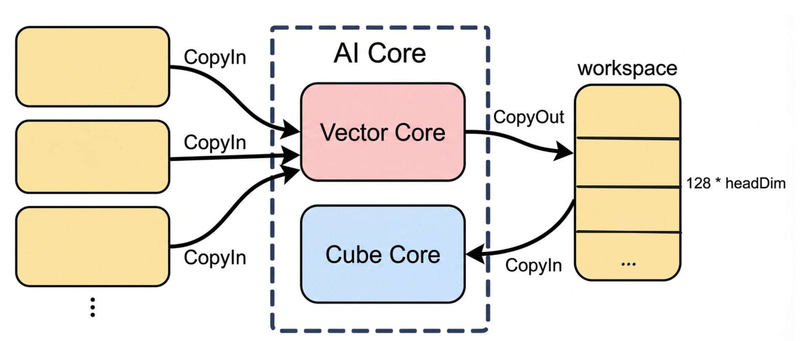
</p>

## FSDP2 + Torch.compile + Inductor Acceleration

### FSDP2 Prefetch Masking on the A3 Super Node

In this practice, as the model parameter count and sequence length surge, communication overhead often becomes the bottleneck restricting cluster scaling efficiency. In the native adaptation of TorchTitan + CANN, we deeply leverage the core feature of **FSDP2** — **Weight Prefetching** — and combine it with the high-bandwidth advantage of the A3 super node to achieve extreme concurrency between computation and communication.

1) FSDP2 weight prefetching: a deterministic communication pipeline

FSDP2 is built on DTensor and provides finer-grained communication control capabilities than traditional FSDP. We implemented precise inter-layer pipeline scheduling on the NPU:

When the Compute Stream executes the forward or backward computation of the N-th Transformer Block layer, the Communication Stream has already initiated the AllGather operation for the N+1-th layer through asynchronous scheduling, aggregating in advance the full parameters needed by the next layer; at the same time, after the N-th layer computation completes, its parameters are immediately reshared back to each card, releasing memory.

This design brings benefits in two aspects: first, it significantly reduces the peak memory usage of model parameters; second, through "prefetching", the compute units do not need to wait for parameters to be in place, achieving true concurrency between communication and computation (Compute-Communication Overlap).

However, it should be noted that the premise of communication-computation masking is that the communication time is shorter than the computation time. Prefetch scheduling at the software level alone is not sufficient — if the communication latency is much greater than the computation time, the pipeline will still block. In this regard, the high-bandwidth interconnect architecture of the A3 super node plays a key role. Its high-throughput, low-latency communication capability effectively compresses the time of AllGather, providing the hardware foundation for communication-computation masking.
<div align="center">
  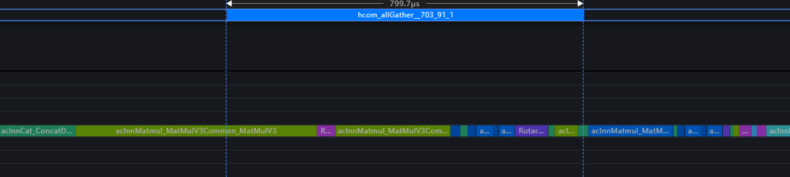
</div>

2) Full communication-computation masking through software-hardware co-design

In the actual Profiling of the above figure, it can be observed that the All_gather communication of weight prefetching is almost completely covered by the computation on the Device side. The training pipeline of DeepSeek-V3.2 shows extremely high compactness, and the performance is effectively improved.

This result stems from the coordinated cooperation between the FSDP2 prefetch mechanism and the A3 high-bandwidth capability:

* **Software side**: FSDP2 precisely schedules communication tasks into the gaps between computations through asynchronous prefetching;
* **Hardware side**: The large-bandwidth interconnect of A3 ensures that communication tasks can complete within the computation window, fully hiding the communication latency within the Device-side computation of the NPU.

### Inductor Graph Optimization Acceleration

Even without relying on operator fusion and CUDA Graphs, Inductor still alleviates the Host-bound problem to some extent through **Codegen Wrapper** and **static analysis**. It transforms the dynamic scheduling process originally driven line by line by the Python interpreter into a precompiled, efficient computation graph execution flow. By completing operator selection, shape inference, and memory planning at compile time, enabling Inductor compilation can successfully bypass the expensive Dispatcher dispatch mechanism and Python interaction overhead of the PyTorch runtime, speeding up operator dispatch on the host side.

Inductor compilation resolves the fixed overhead of dispatching each operator in the original Eager mode during the compilation period, leaving only the most streamlined Kernel Launch scheduling on the host side at runtime. Through Profiling, we can see that the original linear layer contains two operators, aten::t and aten::matmul, which need to go through PythonDispatchMode to dispatch the specific operators, with a total host-side dispatch time of 409.5us; after enabling compile, operator dispatch is completed directly through an executable Python file, and the same four operations take only 118.8us of dispatch time.

<div align="center">
  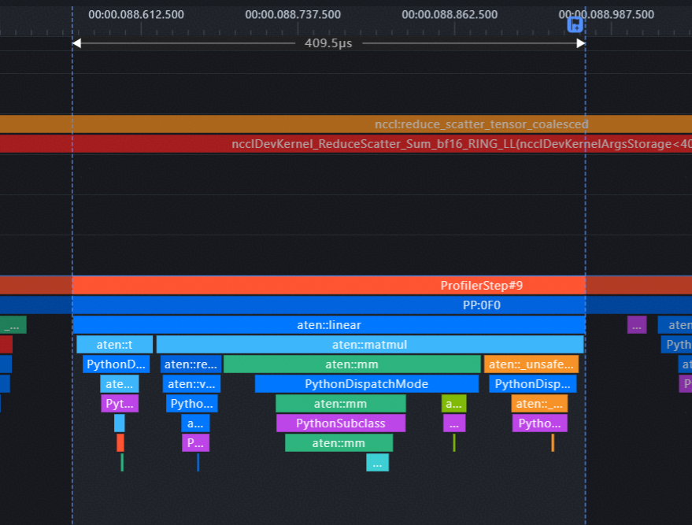
</div>

After enabling inductor:
<div align="center">
  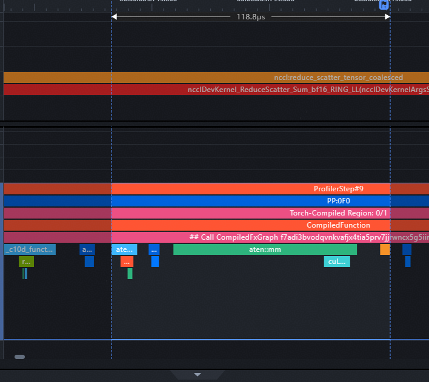
</div>

### Bypass Automatic Fusion

In the Inductor compilation flow, in addition to graph optimization through fx_passes, the following key steps are also included:

- decompositions decompose complex operators into combinations of basic operators;
- the lowerings dictionary maps FX nodes to corresponding IR nodes;
- the Scheduler performs topological sorting and scheduling decisions for operators based on fusion benefits;
- the Scheduler outputs the fused IR nodes and the corresponding execution plan;
- finally, the Codegen stage further converts this information into executable Triton Python code.

In experiments, we found that the Triton operators generated by Inductor automatic fusion on the current NPU perform poorly in both compilation time and execution performance. Therefore, at this stage, we temporarily bypass the Triton Codegen part of the Inductor flow, and will later integrate Ascend C Codegen to better support complete compilation using the Inductor backend on the NPU.

<p align="center">
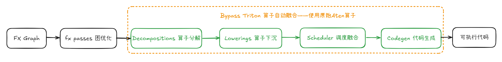
</p>

By clearing lowerings and decompositions before compile, most Aten operators will not be decomposed or lowered to the Inductor IR, and will fall back to the original operator implementations. In addition, since `GraphLowering` adds a `require_contiguous` constraint for backward operators without an explicitly specified memory layout, inserting copy (clone) operations for non-contiguous tensors to make them contiguous memory, this operation would convert Aten operators into separate triton operator implementations in the backward stage. We modified the above code to remove the layout operations for backward operators, so that all operators use their original layouts, completely shielding the triton operators.

## Benchmark

### Precision

Our practice of pretraining the DeepSeek-V3.2 model on the A3 cluster shows that the language model loss (lm loss) and gradient norm (grad norm) converge steadily, demonstrating the stability and efficiency of the TorchTitan framework combined with the TorchTitan-npu adaptation in large-scale model training. The lm loss steadily decreases from 12.25 at step 1 of the initial training to 8.37 at step 37, maintaining a continuously decreasing trend throughout with no obvious oscillation; the gradient synchronously falls smoothly from the initial 28.24 to 16.03, generally trending toward convergence with no abnormal fluctuations.

<p align="center">
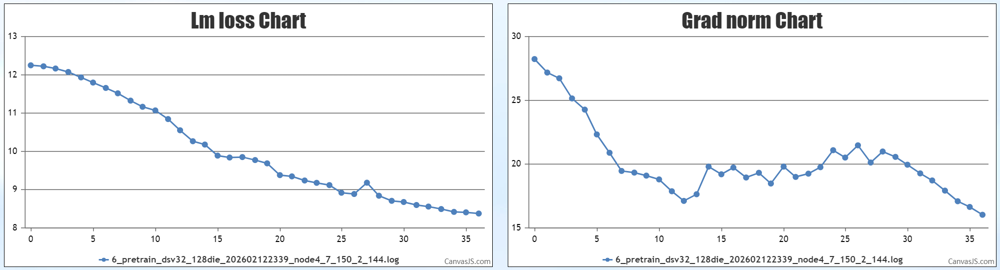
</p>

At the same time, the Lighting Indexer proposed for the DeepSeek-V3.2 network was also trained. Throughout the pretraining process, the indexer loss decreases steadily and maintains a smooth downward trend. Combined with the lm loss and grad norm curves, this proves that the precision is normal in large-scale distributed scenarios and can efficiently support the pretraining task of the DeepSeek-V3.2 model.

<p align="center">
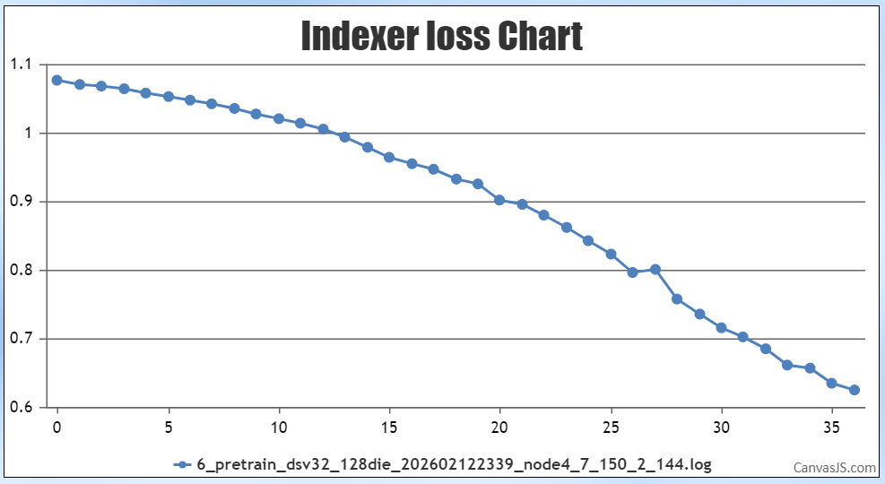
</p>

### Performance

Currently, through the optimization of fused operators and inductor, TorchTitan-npu can achieve fairly obvious performance improvements on the basis of the implementation using Torch native small operators; in the future, when the Inductor backend integrates the Ascend-native Ascend C Codegen, even more obvious performance gains are expected.

#### Fused Operators

Through the lightweight plug-in approach mentioned earlier, support for NPU basic fused operators can be achieved without modifying the torchtitan code. Currently, four basic fused operators — `RMSNorm`, `Rope`, `GMM`, and `permute/unpermute` — and the DeepSeek-V3.2 model `DSA` fused operators `(LI/SFA/LIG)` are supported, and they can be enabled simply by configuring `converters` in the training configuration toml file.

Since the original small-operator implementation has large memory overhead, we compared the performance with the small-operator implementation on an 8-layer trimmed model (1 dense layer, 7 moe layers, each moe layer with 8 experts) and a 4-layer trimmed model (1 dense layer, 3 moe layers, each moe layer with 8 experts), with a training length of 4k. The performance and memory conditions are as follows:

| Trimmed model | Implementation | Memory | Performance |
|---------|---------------|-------------------|-------------------|
| 8-layer trimmed model |  Original small-operator implementation | 58.32G | 155TPS |
| 8-layer trimmed model | Matrix absorption + DSA fused operators | 50.54G | 400TPS |
| 4-layer trimmed model |  Original small-operator implementation | 54.58G | 402TPS |
| 4-layer trimmed model | Matrix absorption + DSA fused operators | 38.71G | 568TPS |

After enabling the `DSA` fused operators, the DeepSeek-V3.2 model can not only significantly reduce memory usage during training, but also improve computation speed.

Further enabling the basic fused operators, the computation time within a single step is reduced by **5.16%** on the complete DeepSeek-V3.2 model. The experiment collected the device-side execution times before and after enabling the fused operators:

| Operator type | Time before fusion | Time after fusion | Time saved | Performance improvement ratio |
|---------|-----------|-----------|---------|-------------|
| **RMSNorm** | 138.7μs | 39.9μs | 98.8μs | **71.2%**  |
| **Permute** | 803.9μs | 127.3μs | 676.6μs | **84.2%**  |
| **GMM** | 3.1ms | 2.4ms | 0.7ms | **22.6%**  |


#### torch.compile
We referenced the `apply_compile` approach in the original TorchTitan code, which performs whole-graph compilation for each `transformer block`, and split the complete Attention part into three parts: `MLAProlog`, `inner_attention`, and `MLAEpilog`. Since `inner_attention` is already implemented with DSA fused operators, the host side does not need to dispatch too many small operators, so whether to compile has little impact on the overall performance. We compile the `MLAProlog` and `MLAEpilog` parts as well as the router, gate, etc. in the MoE part, alleviating the host-side dispatch overhead caused by the large number of small operators.

<p align="center">
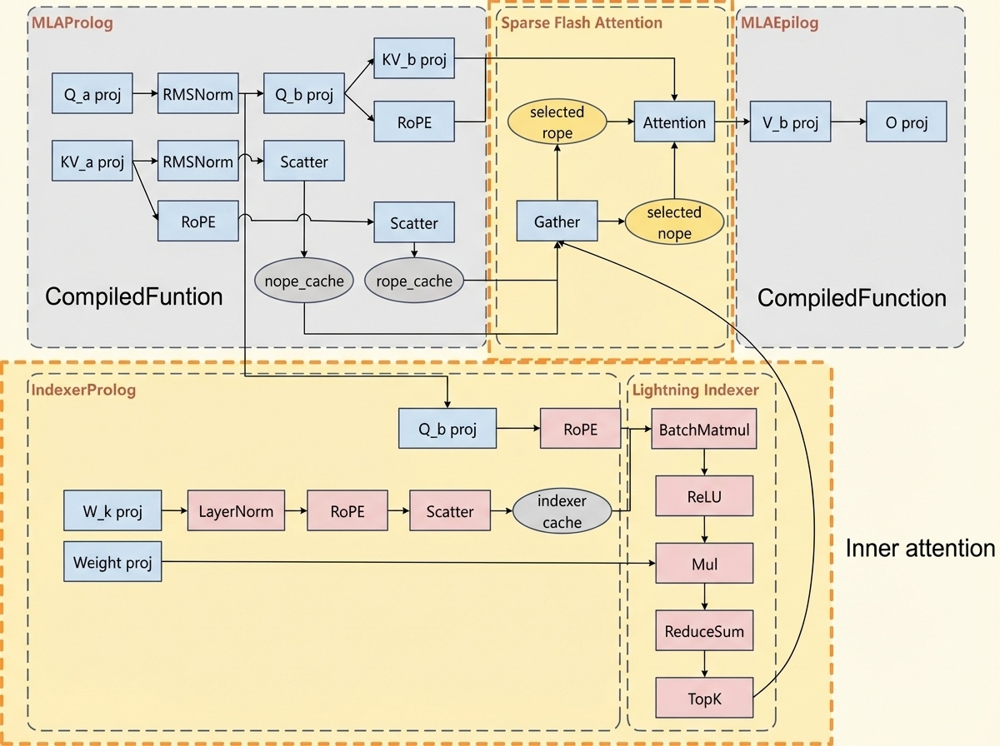
</p>

After enabling compile, the MLAProlog case with obvious host bound is significantly optimized. The original host-side dispatch times:

| | Host-side dispatch time | Device-side compute execution time |
|---|---|---|
| Before enabling compile | 11.0ms | 10.7ms |
| After enabling compile | 5.7ms | 4.5ms |


Measured on the complete DeepSeek-V3.2 model, after enabling inductor compile, the per-layer time is reduced by **5.1%**. Since the computation time of the DeepSeek-V3.2 model is concentrated in the main operators such as SFA and LI, enabling inductor for host-side dispatch optimization has limited effect on improving the overall network performance.

## Future Plan

TorchTitan-npu currently mainly focuses on compatibility with the community ecosystem, migrating the simple and easy-to-use native PyTorch TorchTitan ecosystem to NPUs, so that the community can quickly migrate training tasks to Ascend chips for deployment, enriching the CANN training ecosystem; in the future, we will continue to optimize the out-of-the-box performance based on torch.compile; the current SFAG operator will be upgraded in the next CANN version to greatly improve performance; in addition, we will continue to evolve in the following directions:

### Ascend C Autofuse Integration

The Inductor component of the PyTorch framework in graph mode provides the basic operator fusion and compilation capabilities for this purpose, and its design is compatible with the existing PyTorch ecosystem, with good software inheritance. However, since there are essential differences between NPU and GPU in memory architecture, compute units, and parallel mechanisms, directly adopting GPU-oriented optimization strategies cannot fully unleash the hardware potential of the NPU. Therefore, at this stage, the Bypass Triton approach is used to circumvent the performance insufficiency of the Triton backend on the NPU.
<p align="center">
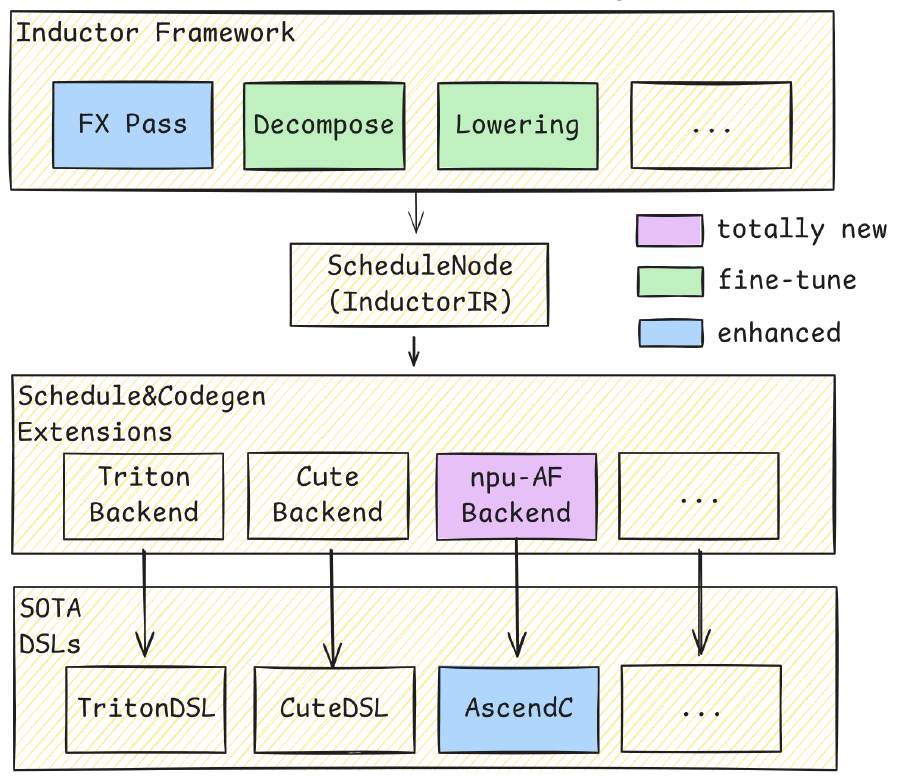
</p>
To achieve efficient fusion for the NPU while inheriting the overall Inductor flow and interfaces, it is necessary to have NPU-oriented Just-In-Time (JIT) operator generation capability. To this end, the AutoFuse component inherited by the CANN framework has been deeply optimized for the architectural characteristics of the NPU, achieving automated mapping and generation from computation graphs to efficient NPU operator code. This component not only maintains synergy and compatibility with Inductor technology, but also further significantly improves the execution efficiency of operator fusion on the NPU through architecture-aware fusion strategies, memory-access optimization, and instruction scheduling, thereby supporting high-performance deployment of complex models on NPU platforms. As a result, it will further improve the performance of the inductor-compiled model.

### DualPipeV Support

[DualPipeV ](https://sail.sea.com/blog/articles/63) is an efficient Pipeline Parallelism (PP) scheduling strategy specifically designed for large-scale MoE models (such as DeepSeek-V3). It originates from [DualPipe](https://github.com/deepseek-ai/DualPipe) designed by the DeepSeek team and draws on [InterLeave1F1B](https://arxiv.org/pdf/2104.04473).

<p align="center">
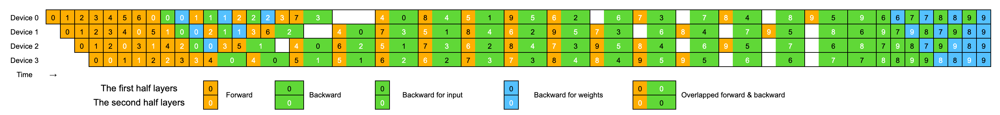
</p>

The core design concept of DualPipeV is: a single device can simultaneously host one forward computation batch and one backward computation batch, and the communication and computation of the two can run in parallel with each other. In this way, the computation of one batch can largely mask the communication overhead brought by MoE EP parallelism.

The TorchTitan community has preliminarily supported the DualPipeV feature, but in practice it was found that DualPipeV cannot be enabled in the ZeRO3 DP partitioning scenario. The reason is that the native torch dW computation implementation constrains the weight W from maintaining the partitioned state in the DP domain. To obtain both memory and performance benefits, TorchTitan will be adapted later to enable ZeRO3 and DualPipeV simultaneously.

### TP_async Support

TP completes cross-card synchronization within a layer through AllGather and ReduceScatter, and the communication latency is directly exposed on the critical path. The core idea of Async TP is to decompose the communication and computation operators simultaneously — AllGather is split into multiple Send/Recv operations, and Matmul is split into corresponding sub-Matmuls — so that the computation of one sub-Matmul executes concurrently with the data transfer of the next chunk, thereby hiding the communication latency.

<p align="center">
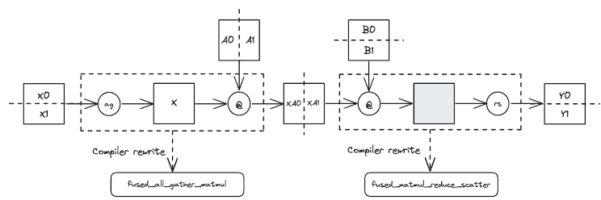
</p>

In TorchTitan-npu, at the FX computation graph stage, the Inductor compiler can recognize patterns such as **all_gather + matmul** or **matmul + reduce-scatter**, and automatically complete this decomposition and reordering without modifying the model code. Combined with the high-bandwidth inter-card interconnect within the A3 node, intra-layer TP communication can be effectively compressed and hidden within the computation window.

<!-- static-meta
{
  "sidebarTitle": "DeepSeek-V3.2 Pretrain",
  "parallelism": ["data-parallel", "tensor-parallel", "expert-parallel", "context-parallel"],
  "hardware": ["atlas-a3"],
  "operator": ["ascendc"],
  "cannFeatures": ["multi-stream", "prefetch"],
  "frameworks": ["torchtitan"],
  "cover": {"type": "auto"}
}
-->

