# Qwen3-235B 32K Long-Sequence RL Training Optimization Practice

This document systematically summarizes the optimization practice for Qwen3-235B 32K long-sequence reinforcement learning training based on the verl framework and the A3 cluster, and describes in detail several optimizations carried out for the issues unique to RL long-sequence scenarios, such as **long-tail sequence load imbalance** and **NPU memory bottlenecks**. Through the techniques described in this document, this practice successfully increased the system throughput from single digits to 122 TPS/card. In addition, this document also compares and analyzes the relevant optimization ideas in the recently released Seer long-sequence RL training system, revealing the consensus and differences in technical approaches.

## 1. Preface
### 1.1 Background

Long-sequence processing capability is the key to making large language models practical. Taking the Qwen3-235B model, which has 32K context-length processing capability, as an example, it can effectively handle real-world tasks such as long-article parsing, complex multi-turn dialogues, and large-scale code writing, and demonstrates important application value in multiple fields including financial research report analysis, legal provision interpretation, and scientific literature comprehension. Therefore, how to efficiently process long-sequence data in training and inference has become a key factor affecting model deployment efficiency.

In particular, in reinforcement learning scenarios, the model not only needs to perform complex chain-of-thought (CoT) reasoning and reward training over extremely long contexts, but also faces challenges such as **HBM memory consumption growing linearly with sequence length and load imbalance caused by long-tail sequence distribution**, which undoubtedly places higher demands on the efficiency and stability of the training and inference system.

To address the above problems, this practice builds on [prior work](https://gitcode.com/cann/cann-recipes-train/blob/master/docs/llm_rl/deepseek_rl_train_optimization.md) (Chinese), reuses the verl frontend, uses vLLM Ascend as the inference engine and MindSpeed as the training engine, and performs 32K long-sequence GRPO algorithm reinforcement learning training optimization for the Qwen3-235B model on a 64-card A3 cluster. This practice systematically improves long-sequence training throughput from multiple dimensions, including **model sharding strategy**, **long-sequence load balancing**, and **compute and communication efficiency**, ultimately achieving a system performance of 122 TPS/card.

It is worth mentioning that the paper [Seer: Online Context Learning for Fast Synchronous LLM Reinforcement Learning](https://arxiv.org/html/2511.14617v1) recently released by Moonshot AI & Tsinghua also proposes several optimization strategies for long-sequence reinforcement learning, which are highly consistent with the ideas of this practice. This document also provides a comparative analysis of some of those strategies.

### 1.2 Overview of the Optimization Practice

This practice adapted and optimized the verl open-source code for the following key features:

-   Training engine adaptation: the verl framework currently natively supports the MindSpeed training engine, but when moe\_alltoall\_overlap is enabled, an abnormal expert weight loading problem occurs. This practice fixed and adapted this problem.

-   Inference engine optimization: the sleep mode in the inference process depends on the dynamic switching of torch\_npu virtual memory. This practice currently uses the method of [prior work](https://gitcode.com/cann/cann-recipes-train/blob/master/docs/llm_rl/deepseek_rl_train_optimization.md) (Chinese) to implement the loading and unloading of inference weights and kv\_cache.

-   Framework adaptation: referring to [prior work](https://gitcode.com/cann/cann-recipes-train/blob/master/docs/llm_rl/deepseek_rl_train_optimization.md) (Chinese), the verl framework was modified to implement old\_log\_prob-free computation in on-policy training algorithms such as GRPO.

This practice carried out systematic optimization for the performance bottlenecks and memory usage in long-sequence inference and training. The specific methods are shown in the figure below:

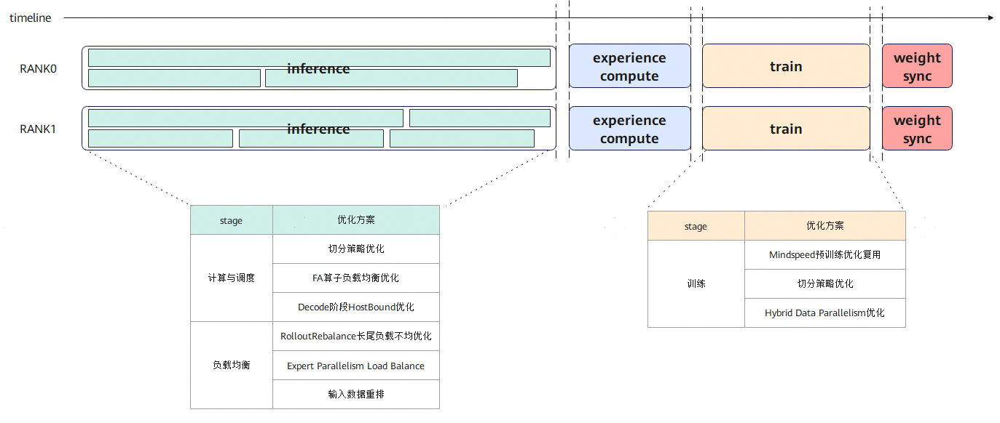

### 1.3 Detailed Performance Results

#### 1.3.1 GRPO Algorithm

On the Atlas A3 (64-card) cluster, GRPO algorithm RL training was performed on the Qwen3-235B-A22B model loaded with real weights. Under the scenario where the maximum Prompt/Response lengths are 2K and 32K respectively, the system throughput reached 122 TPS/card.

|Model|Deployment mode|Deployment environment|RL framework|Inference engine|Training engine|Dataset|step|Avg input length|Avg output length|batchsize|Sampling count|Rollout deployment|Actor deployment|Ref deployment|
|--|--|--|--|--|--|--|--|--|--|--|--|--|--|--|
|Qwen3-235B-A22B|Full card sharing|64 * A3|verl|vLLM+vLLM Ascend|Megatron+MindSpeed|deepscaler|1|73.7|7344.973|512|16|128die DP32TP4EP128|128die TP4PP4CP4EP32|128die TP4PP4CP4EP32|

<table><thead align="left"><tr id="row1458491718124"><th class="cellrowborder" colspan="4" valign="top" id="mcps1.1.10.1.1">
Data generation (s)

</th>
<th class="cellrowborder" valign="top" id="mcps1.1.10.1.2">
Training (s)

</th>
<th class="cellrowborder" valign="top" id="mcps1.1.10.1.3">
Total time (s)

</th>
<th class="cellrowborder" valign="top" id="mcps1.1.10.1.4">
Inference throughput

(tokens/s/card)

</th>
<th class="cellrowborder" valign="top" id="mcps1.1.10.1.5">
Training throughput

(tokens/s/card)

</th>
<th class="cellrowborder" valign="top" id="mcps1.1.10.1.6">
System throughput

(tokens/s/card)

</th>
</tr>
</thead>
<tbody><tr id="row17585181717125"><td class="cellrowborder" colspan="4" valign="top" headers="mcps1.1.10.1.1 ">
5351.17

</td>
<td class="cellrowborder" valign="top" headers="mcps1.1.10.1.2 ">
2353.23

</td>
<td class="cellrowborder" rowspan="3" valign="top" headers="mcps1.1.10.1.3 ">
7780.36

</td>
<td class="cellrowborder" rowspan="3" valign="top" headers="mcps1.1.10.1.4 ">
233.56

</td>
<td class="cellrowborder" rowspan="3" valign="top" headers="mcps1.1.10.1.5 ">
403.5

</td>
<td class="cellrowborder" rowspan="3" valign="top" headers="mcps1.1.10.1.6 ">
122.05

</td>
</tr>
<tr id="row19585817141211"><td class="cellrowborder" valign="top" headers="mcps1.1.10.1.1 ">
rollout (s)

</td>
<td class="cellrowborder" valign="top" headers="mcps1.1.10.1.1 ">
ref prefill (s)

</td>
<td class="cellrowborder" valign="top" headers="mcps1.1.10.1.1 ">
reward (s)

</td>
<td class="cellrowborder" valign="top" headers="mcps1.1.10.1.1 ">
adv (s)

</td>
<td class="cellrowborder" valign="top" headers="mcps1.1.10.1.2 ">
update(s)

</td>
</tr>
<tr id="row19585317161215"><td class="cellrowborder" valign="top" headers="mcps1.1.10.1.1 ">
4065.71

</td>
<td class="cellrowborder" valign="top" headers="mcps1.1.10.1.1 ">
1262.269

</td>
<td class="cellrowborder" valign="top" headers="mcps1.1.10.1.1 ">
21.538

</td>
<td class="cellrowborder" valign="top" headers="mcps1.1.10.1.1 ">
1.654

</td>
<td class="cellrowborder" valign="top" headers="mcps1.1.10.1.2 ">
2353.23

</td>
</tr>
</tbody>
</table>

(Note: The current step1 statistics time does not include the preceding model initialization, graph compilation, etc., and only includes the stages shown in the figure above.)

#### 1.3.2 DAPO Algorithm

DAPO optimization is introduced on the basis of GRPO training, with the specific configuration as follows:

-   Set the clip thresholds (clip\_low=0.2, clip\_higher=0.28).

-   Use token-level importance sampling (rollout\_is\_threshold=2.0).

-   Do not use kl\_loss (actor\_rollout\_ref.actor.use\_kl\_loss=False).

-   Compute the Policy Gradient Loss at the token level (actor\_rollout\_ref.actor.loss\_agg\_mode=\"token-mean\").

-   Enable sample filtering (algorithm.filter\_groups.enable=True) to remove samples whose rewards within a group are all 0 or 1.

This practice performed RL training with the DAPO algorithm on the Qwen3-235B-A22B model loaded with real weights, based on the Atlas A3 (64-card) cluster. The model Prefill and Decode stage lengths are set to 2K and 34K respectively. Since model responses generally become longer on the dapo-math-17k dataset, GBS=128 is adjusted to ensure training efficiency. The performance test results are as follows:

|Model|Deployment mode|Deployment environment|RL framework|Inference engine|Training engine|Dataset|step|Avg input length|Avg output length|batchsize|Sampling count|Rollout deployment|Actor deployment|Ref deployment|
|--|--|--|--|--|--|--|--|--|--|--|--|--|--|--|
|Qwen3-235B-A22B|Full card sharing|64 * A3|verl|vLLM+vLLM Ascend|Megatron+MindSpeed|dapo-math-17k|1|132.78|10119.23|128|16|128die DP32TP4EP128|128die TP4PP4CP4EP32|128die TP4PP4CP4EP32|

<table><thead align="left"><tr id="row147221820256"><th class="cellrowborder" colspan="5" valign="top" id="mcps1.1.11.1.1">
Data generation (s)

</th>
<th class="cellrowborder" valign="top" id="mcps1.1.11.1.2">
Training (s)

</th>
<th class="cellrowborder" valign="top" id="mcps1.1.11.1.3">
Total time (s)

</th>
<th class="cellrowborder" valign="top" id="mcps1.1.11.1.4">
Inference throughput

(tokens/s/card)

</th>
<th class="cellrowborder" valign="top" id="mcps1.1.11.1.5">
Training throughput

(tokens/s/card)

</th>
<th class="cellrowborder" valign="top" id="mcps1.1.11.1.6">
System throughput

(tokens/s/card)

</th>
</tr>
</thead>
<tbody><tr id="row373141816251"><td class="cellrowborder" colspan="5" valign="top" headers="mcps1.1.11.1.1 ">
6638.49

</td>
<td class="cellrowborder" valign="top" headers="mcps1.1.11.1.2 ">
797.93

</td>
<td class="cellrowborder" rowspan="3" valign="top" headers="mcps1.1.11.1.3 ">
7833.16

</td>
<td class="cellrowborder" rowspan="3" valign="top" headers="mcps1.1.11.1.4 ">
100.56

</td>
<td class="cellrowborder" rowspan="3" valign="top" headers="mcps1.1.11.1.5 ">
411.14

</td>
<td class="cellrowborder" rowspan="3" valign="top" headers="mcps1.1.11.1.6 ">
41.88

</td>
</tr>
<tr id="row8731118172518"><td class="cellrowborder" valign="top" headers="mcps1.1.11.1.1 ">
rollout (s)

</td>
<td class="cellrowborder" valign="top" headers="mcps1.1.11.1.1 ">
num_gen_batches

</td>
<td class="cellrowborder" valign="top" headers="mcps1.1.11.1.1 ">
rollout  / single-round inference (s)

</td>
<td class="cellrowborder" valign="top" headers="mcps1.1.11.1.1 ">
reward (s)

</td>
<td class="cellrowborder" valign="top" headers="mcps1.1.11.1.1 ">
adv (s)

</td>
<td class="cellrowborder" valign="top" headers="mcps1.1.11.1.2 ">
update(s)

</td>
</tr>
<tr id="row37341811254"><td class="cellrowborder" valign="top" headers="mcps1.1.11.1.1 ">
6619.78

</td>
<td class="cellrowborder" valign="top" headers="mcps1.1.11.1.1 ">
2

</td>
<td class="cellrowborder" valign="top" headers="mcps1.1.11.1.1 ">
3262.39

</td>
<td class="cellrowborder" valign="top" headers="mcps1.1.11.1.1 ">
18.43

</td>
<td class="cellrowborder" valign="top" headers="mcps1.1.11.1.1 ">
0.28

</td>
<td class="cellrowborder" valign="top" headers="mcps1.1.11.1.2 ">
797.93

</td>
</tr>
</tbody>
</table>

After enabling sample filtering, 2 batches of inference are performed in the first training step. The single-round inference time is 3262.39s, the total inference time is 6619.78s, and the total single-step time is 7833.16s. The inference throughput reaches 100 TPS and the total throughput reaches 41.88 TPS.

The reward and response length curves for the first 15 steps of training are as follows:

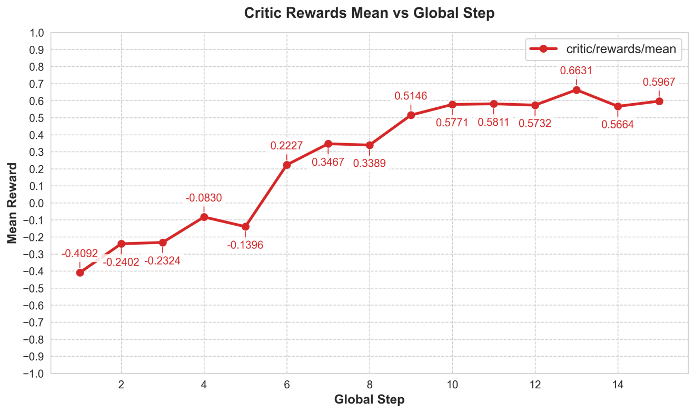

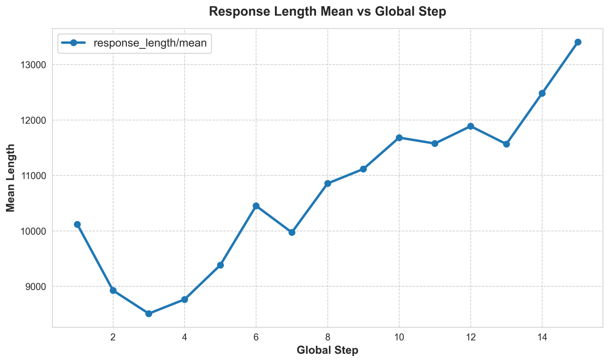

## 2. Inference Optimization

In reinforcement learning training, the data generation inference phase has always been the top priority of performance optimization. In long-sequence scenarios, the inference phase time can account for more than 70% of the total time; in the current 2K-to-32K scenario of the Qwen3-235B model, the inference phase time is likewise the case. To overcome this difficulty, we carried out in-depth optimization on the framework scheduling, communication, and load balancing of RL inference, and finally **in the 2K-to-32K scenario of Qwen3-235B, increased the inference throughput to 233 tokens/s/card**. The main progression is shown in the figure below (the figure shows the change in system throughput):

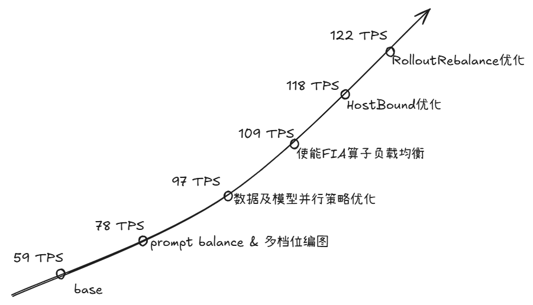

### 2.1 Memory Usage Analysis and Deployment Strategy Selection

In large-model inference, memory usage mainly consists of the following parts: model weights, reserved activation memory, and
KV Cache, whose sizes are each determined in the following ways:

1.  **Model weights**: determined by the specific model and the sharding configuration.\
    Specifically, in the sharding configuration of the Qwen3-235B-A22B model with TP4DP32EP128, the model weights occupy approximately **7.09GB** of memory space in total.

    |TP|DP|EP|Model weights (GB)|Embedding/LmHead (GB)|QKV (GB)|O (GB)|MoE (GB)|Gate (GB)|
    |--|--|--|--|--|--|--|--|--|
    |4|32|128|7.09|0.58|1.65|1.47|3.30|0.09|

2.  **Reserved activation memory/KV Cache**: the reserved activation memory is determined by actual measurement in the initialization phase; the KV Cache memory, on the other hand, is allocated in the remaining memory according to a preset ratio, in addition to the activation memory and model weights.
    In the warm-up phase of inference, the framework executes the model with a batch of preset data and records the peak activation memory allocated during the network computation in model inference. This process is commonly referred to as profiling\_run. As shown in the figure below, after profiling\_run ends:
    
    1.  Through the torch\_npu memory interface family mem\_get\_info/memory\_stats, the currently used device memory used(1) and the current Torch allocated memory current(2) can be queried; their difference is the amount of non-Torch-managed memory others(3) during model execution. Adding this value to the Torch peak memory peak(4) yields the maximum NPU memory usage during network execution, which includes external memory, model weight memory, and the peak activation memory measured in profiling\_run.
    
    2.  vLLM specifies its maximum NPU memory usage (5) at startup; after deducting the aforementioned memory usage items, the remaining memory is requested by vLLM and dedicated to storing the KVCache (6).
    
        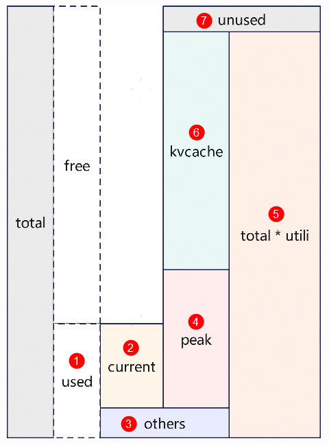

**In the Prefill phase**, the system uses the initial prompt data to fill the KV Cache. In the RL scenario of this practice, the input sequences are usually short, and the memory demand on the KV Cache is not prominent. To improve efficiency, the inference framework usually concatenates multiple prompts together and completes the KV Cache filling of multiple sequences in a single prefill. The maximum length of the concatenated prompts is controlled by the parameter max\_num\_batched\_tokens. On the one hand, under DP-Attention/EP-MoE model deployment, the MoE layers often exhibit large activation values in NPU memory that crowd out the KV Cache memory space due to unbalanced expert load; in NPU-memory-constrained scenarios, max\_num\_batched\_tokens usually cannot be set too large. This practice adapted the new Chunk-MoE feature, which effectively reduces the peak memory in the prefill phase, and therefore configured a larger max\_num\_batched\_tokens. For the specific adaptation code, refer to [cann-recipes-train](https://gitcode.com/cann/cann-recipes-train). On the other hand, because of the memory fragmentation that may occur between RL steps, the actual peak memory of the Prefill phase in subsequent steps tends to grow, so the KV Cache memory also needs to be allocated within a reasonable range to leave some margin for the Prefill activation memory space of subsequent steps. Based on the above considerations, this practice finally adopted the parameter configuration of max\_num\_batched\_tokens=32768 and gpu\_memory\_utilization=0.87 to satisfy the respective memory requirements of the Prefill and Decode phases.

**In the Decode phase**, since the sequence length processed each time is 1, and the number of concurrent sequences max\_num\_seq is usually an order of magnitude lower than max\_num\_batched\_tokens, the activation memory usage generated is low. The main contradiction in this phase is that, as sequences gradually grow longer, the memory demand for the KV Cache may exceed the pre-allocated upper limit. Theoretically, the maximum number of sequences max\_num\_seqs supportable at a given sequence length can be derived in reverse from the total KV Cache size. Taking the 32K long-sequence scenario of the Qwen3-235B-A22B model under TP4 sharding as an example: the KV Cache usage of a single BS is as high as **1.47GB**, which limits the per-card BS upper limit to only the order of 30\~40, contradicting the demand for large BS in offline inference scenarios. An example is shown in the figure below.

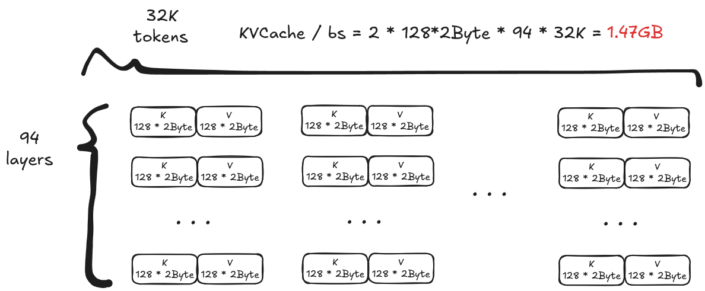

In fact, the above per-card maximum BS estimation is too conservative — the left figure below shows the actual length distribution of 256 responses in one inference pass over the DeepScalar dataset. It can be found that only a few long-tail samples reach the maximum length, and most sequences exit early and release the KVCache. If max\_num\_seqs is strictly limited by the maximum sequence length, the throughput in the early stage of inference will be severely degraded.

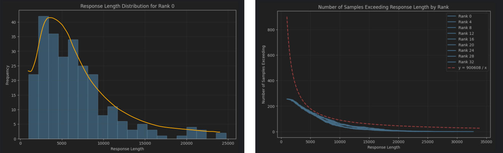

We further tried to estimate a reasonable max\_num\_seqs with the average inference sequence length (7K) of the samples, and found that the result (about 128) was still conservative. In actual tests, even when max\_num\_seqs was set to 256 (already 2 times the estimated value), the KVCache OOM was still not triggered on this dataset. To investigate the reason, we collected the lengths of all 256 responses in each DP domain during inference, counted the "number of remaining sequences at each length", and plotted it together with the "sequence length vs. maximum number of sequences" inverse-proportional curve under a given KVCache capacity, as shown in the right figure above. It can be seen that, as some sequences finish inference and release the KVCache, the remaining sequences can continue to grow to the maximum length. At any point in time, each blue curve in this sample is below the red inverse-proportional curve, so the KVCache memory insufficiency problem is not triggered. Nevertheless, the figure above also shows that, when the inference length reaches 5K\~10K, the KVCache memory is already quite tight. It is precisely because the sequences in the current sample end fast enough that the system can continue to run under the initial high concurrency without triggering OOM. It can be foreseen that in extreme cases, **even if the initial BS is calculated according to the minimum sample sequence length**, as long as the number of remaining sequences during inference decreases in accordance with the aforementioned inverse-proportional function, it is theoretically still possible to complete inference with the limited KVCache.

Therefore, to optimize the throughput performance in long-sequence scenarios, we adopted the TP4 sharding strategy for the Qwen3-235B model: under the memory-access-bound premise of Decode, a larger TP reduces the per-card weight proportion, thereby reserving more KV cache space while alleviating the memory-access bottleneck (see [Split Strategy Optimization](#221-Split-Strategy-Optimization)); at the same time, through the above memory analysis, we set max\_num\_seq to 256, further fully utilizing memory without triggering OOM and greatly improving the inference throughput.

### 2.2 Compute and Scheduling Optimization

This practice carried out a large number of optimizations on the computation and scheduling of the framework. Some of the communication and scheduling issues are common with the optimizations in [prior work](https://gitcode.com/cann/cann-recipes-train/blob/master/docs/llm_rl/deepseek_rl_train_optimization.md) (Chinese) and
are reused here. For the specific implementation, refer to the [relevant technical analysis](https://gitcode.com/cann/cann-recipes-train/blob/master/docs/llm_rl/deepseek_rl_train_optimization.md) (Chinese).

1. Scheduling optimization on the vLLM framework side: we changed it from Gloo-backend CPU-side communication to HCCL-backend NPU-side communication, which significantly reduces communication latency and improves overall throughput. For details, refer to the **"RL inference scheduling bound optimization"** in [prior work](https://gitcode.com/cann/cann-recipes-train/blob/master/docs/llm_rl/deepseek_rl_train_optimization.md) (Chinese).

2. Enable the zero-redundancy TP-to-EP communication optimization to eliminate the StridedSlice and AllGather operators in the MoE layer. For details, refer to the **"Zero-redundancy TP-to-EP communication optimization"** in [prior work](https://gitcode.com/cann/cann-recipes-train/blob/master/docs/llm_rl/deepseek_rl_train_optimization.md) (Chinese).

This section focuses on the 4 new optimizations implemented in long-sequence scenarios.

#### 2.2.1 Split Strategy Optimization

##### Phenomenon Analysis

Facing complex long-sequence inference scenarios, for the routed expert part we default to the large-EP solution, i.e., the EP128 strategy; however, the choice of the TP sharding strategy requires further analysis.

We collected profiling data of long-sequence inference with multi-tier graph compilation enabled, and selected one of the Matmul computations for analysis, as shown in the following table:

|Operator name|decode_length|shape|Wall Duration|
|--|--|--|--|
|MatMul|2k|"256,2048;4096,2048"|32us|
|MatMul|4k|"256,2048;4096,2048"|32us|
|MatMul|8k|"128,2048;4096,2048"|23us|
|MatMul|16k|"32,2048;4096,2048"|19us|
|MatMul|24k|"4,2048;4096,2048"|15us|

It was found that as more requests finish inference, the shape of the graph keeps shrinking and the Matmul computation volume decreases significantly, but the time taken does not change proportionally with the reduction in computation volume.

We speculate that in the long-tail scenario of long sequences, the computation is not bound; instead, most of the time is spent on moving weights, showing an obvious memory-access bound.

##### Optimization Approach

For the non-MoE part, a larger TP sharding strategy is adopted so that each card only loads a smaller amount of weights, increasing the proportion of computation in the overall time.

To verify the feasibility of this solution, we performed the experiments shown in the following table:

|step|Inference model sharding|GBS|Sampling count|910C card count|Dataset|Sequence length|Multi-tier graph compilation|max_num_seq|prompt len|response len|generate_sequence/s|
|--|--|--|--|--|--|--|--|--|--|--|--|
|1|TP4DP32EP128|64|16|64|deepscaler|2K→32K|On|32|76.3|6360|1369.4|
|1|TP1DP128EP128|64|16|64|deepscaler|2K→32K|On|8|76.3|6330.6|1614.2|

In the above experiments, with the inference input data unchanged, the Matmul computation volume on the corresponding rank of the two sharding strategies is exactly the same; however, from the total time and profiling, it can be clearly seen that the Matmul of the TP1 sharding is severely memory-access bound, and a single execution takes longer.

Based on the above analysis, we adopt the TP4DP32 sharding strategy, which gives better overall network performance.

##### Optimization Effect

1. The TP4DP32 sharding strategy reduces the memory-access overhead caused by weight movement and, in memory-access-bound scenarios, brings relatively obvious performance gains. The results are shown in the table above.

2. With the current TP4 sharding, the model occupies less weight per card, allowing more KVCache space to be reserved. In actual training, the TP4 configuration is less likely to encounter request swapping caused by insufficient KVCache, making inference more stable.

 

#### 2.2.2 Graph Mode Path Selection

##### Phenomenon Analysis

In RL inference scenarios, if PyTorch is in eager mode, the NPU is idle most of the time, and the CPU-side operator scheduling overhead becomes the main time cost of inference. Therefore, graph mode is usually enabled to reduce CPU-side scheduling overhead. For the specific analysis, refer to the TorchAir full-graph sinking section of [prior work](https://gitcode.com/cann/cann-recipes-train/blob/master/docs/llm_rl/deepseek_rl_train_optimization.md) (Chinese).

Currently, under the verl+vLLM framework, there are 5 available graph mode paths. We mainly compared two of them and chose the GE graph mode, which is more suitable for this practice scenario.

The differences between the two graph mode paths are as follows. The left path is Full\_decode\_only ACLGraph, and the right path is TorchAir GE:

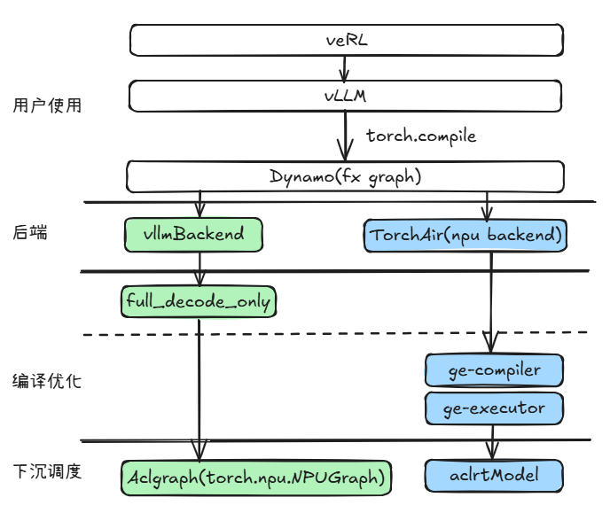

- **Full\_decode\_only ACLGraph:**

  The main solution of this graph mode is to encapsulate the forward computation function of the entire model as a runnable object and capture the sequence of all NPU operations in the forward pass. Currently, this solution has implemented adaptation for the Qwen3 235B model in the latest vLLM Ascend.

- **TorchAir GE graph mode**:

  TorchAir GE is the max-autotune mode of TorchAir. TorchAir converts the FX graph generated by torch.compile into the Ascend intermediate representation (IR), i.e., the Ascend IR computation graph, and implements the compilation, optimization, and execution of the computation graph through GE (Graph Engine). At the same time, in order to obtain optimal execution performance for the model, GE provides technical means such as computation graph optimization, multi-stream parallelism, memory reuse, static kernels, and SuperKernel.

##### Approach Selection

This practice carried out a performance comparison analysis of the two graph modes in the rollout phase of Qwen3 235B long-sequence training:

|step|mode|GBS|Sampling count|910C card count|Dataset|Sequence length|Multi-tier graph compilation|max_num_seq|Infer_DP|prompt len|response len|generate_sequence/s|
|--|--|--|--|--|--|--|--|--|--|--|--|--|
|1|Full_decode_only ACLGraph|512|16|64|deepscaler|2K→30K|Off|64|32|73.7|7089.6|6690|
|1|TorchAir GE|512|16|64|deepscaler|2K→30K|Off|48|32|73.7|7099.5|9123.3|
|1|TorchAir GE|512|16|64|deepscaler|2K→30K|Off|64|32|73.7|7069.5|8145|
|1|TorchAir GE|512|16|64|deepscaler|2K→30K|Off|256|32|73.7|7130.3|6836.2|
|1|TorchAir GE|512|16|64|deepscaler|2K→30K|On|256|32|73.7|7110.8|4918.9|

The following conclusions can be clearly drawn from the results:

1. When the max\_num\_seq configurations of the two graph modes are the same, i.e., the graph batchsize is the same, Full Graph has better overall inference time because it uses operators with better performance (ReshapeAndCacheNdKernel and PagedAttentionMaskNdKernel) (the ablation experiments in rows 1 and 3 of the table above).

2. Under a larger global batchsize configuration, when the data of one DP domain cannot be inferred at once, for example, the max\_num\_seq in rows 2 and 3 of the table is only configured as 48 and 64, which triggers continuous batching, compared with the experiment in row 4, this brings significant performance degradation; choosing a larger max\_num\_seq brings greater memory pressure. In [Memory Usage Analysis and Deployment Strategy Selection](#21-Memory-Usage-Analysis-and-Deployment-Strategy-Selection), we also analyzed the memory usage on the inference side in detail, which also proves the feasibility of this solution (the ablation experiments in rows 2, 3, and 4 of the table above).

3. Because the current Full Graph occupies more memory during inference, the graph batchsize can only be set to 64 (larger will cause OOM). **In actual scenarios, since GE Graph can configure a larger max\_num\_seq and enable multi-tier graph compilation, it can instead achieve the best overall inference time** (the ablation experiments in rows 1 and 5 of the table above).

In addition, since Full graph requires all kernel input addresses to be fixed to the addresses at capture time, it must use vLLM's native sleep
mode to ensure the addresses do not change. However, sleep mode depends on disabling PyTorch's virtual memory, while disabling this feature in the training phase causes a lot of memory fragmentation, which very easily triggers OOM and also leads to poor training performance. The current torch\_npu feature of dynamically enabling virtual memory is still under development, so Full\_decode\_only ACLGraph cannot yet run normally in RL training in large-cluster scenarios.

Correspondingly, as described in the [Seer paper](https://arxiv.org/html/2511.14617v1) mentioned in the [Preface](#1-Preface), in actual deployment, due to insufficient memory, all prompts often cannot be inferred at once, so the system is in the scenario described by rows 1, 2, and 3 of our ablation experiments and needs to rely on continuous batching to schedule all requests. For this scenario, that study proposed an effective strategy to alleviate the long-tail problem caused by continuous batching:

Based on the experimental conclusion that "output lengths within the same group are highly correlated", a prompt is first selected from each group to form a "probe response" to estimate the lengths of the remaining requests in that group in real time; then the scheduler performs approximate Longest-First Scheduling according to the estimated lengths, prioritizing the inference of long texts, thereby significantly compressing the long tail. This provides a new idea for long-tail optimization in memory-constrained scenarios.

##### Optimization Effect

In summary, considering that TorchAir GE has an inference performance advantage in large-batchsize scenarios, does not need to rely on sleep mode, can enable Torch's virtual memory, and does not affect training performance, this practice finally chose TorchAir GE as the graph mode solution for the inference phase.

 

#### 2.2.3 FA Operator Load Balancing Optimization

##### Phenomenon Analysis

Before this optimization, **the original FA operator execution logic was as follows**:

1.  Assume the current scenario is decode inference, and the matrix to be computed is as follows:
    The input is a GQA attention matrix with batch\_size=4, the number of KV heads is 4, and the number of Query heads is 64. Two groups of cache have already reached a sequence\_length of 28672 during inference, while the other two groups in batch1 have already completed inference. The specific progress is shown in the figure below:
    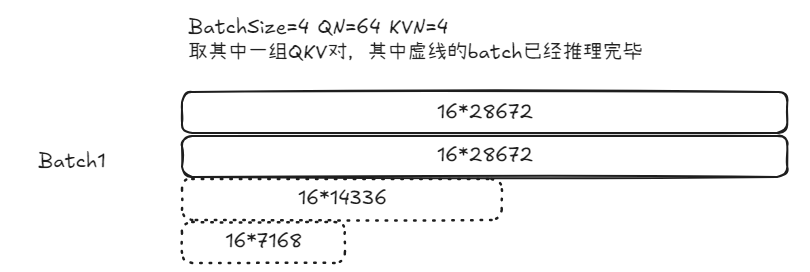
2.  Data partitioning is performed according to compute performance requirements, and the result is shown in the figure below:
    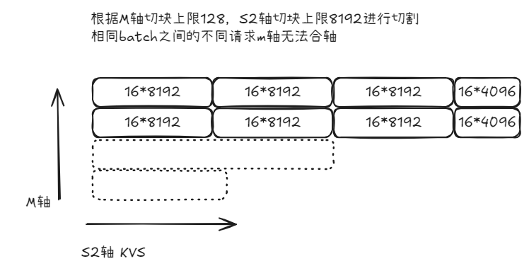

3.  Assume the maximum number of dispatchable cores is 4. Since no load balancing is performed, the current inference computation of the two groups is split across cores as shown in the figure below:
    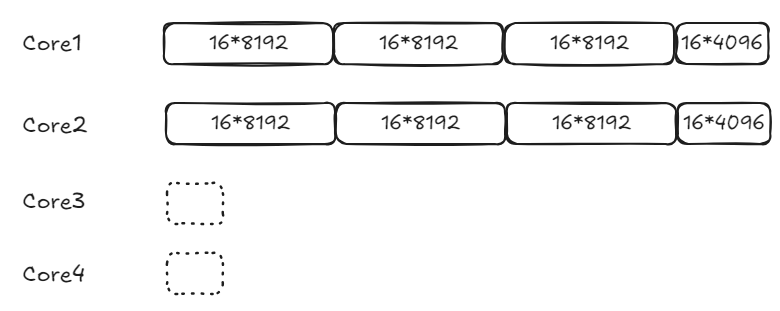
4.  It can be observed that currently only two compute cores are in the active state for inference, and the other two cores have exited the compute task.

    This leads to the following problem: some cores still have a large number of compute tasks, while other cores are idle, resulting in load imbalance and compute waste.

##### Optimization Approach

The core goal of this FA operator optimization is to improve multi-core load balancing. The specific solution is to replace the IFA operator (IncreFlashAttention) with the FIA operator (FusedInferAttention), which currently supports better load balancing logic. For the adaptation implementation of the FIA operator, refer to the [open-source repository](https://gitcode.com/Ascend/op-plugin/blob/7.2.0/docs/context/torch_npu-npu_fused_infer_attention_score.md) (Chinese).

The key problems faced by load balancing optimization are as follows:

-   Block partitioning: loads of different sizes have different overheads (weights) and cannot be uniformly treated as 1.

-   Core allocation: all cores are started by default without considering the scheduling and synchronization overhead, which may lead to performance degradation.

This optimization mainly proceeds from the following two aspects:

1.  Determine the optimal number of cores:

    -   **Increasing the number of cores** can reduce the per-core load and shorten the compute time of slow cores.

    -   **Too many cores** introduce scheduling and synchronization overhead, which instead increases the total FA time.

2.  Optimize the block allocation strategy:

    Allocate blocks to each core reasonably to ensure that the **total compute overhead on each core is basically balanced.**

This practice finally adopted the **core-count-based round-robin simulation** solution, with the specific implementation flow as follows:

1.  Calculate the optimal number of cores.

    TotalBlocks: the total number of blocks; TotalCores: the total number of cores

    - When TotalBlocks \>= (TotalCores-2)∙TotalCores:

      It can be guaranteed that the benefit for large tasks is stable, and all cores can be directly enabled for full-load computation. For example, if TotalBlocks=8 and TotalCores=4, then 4 cores can be used directly.

    - When TotalBlocks \< (TotalCores-2)∙TotalCores:

      Assuming TotalCores = 8 and TotalBlocks = 8, a core count evaluation is required.

      1. Determine the core count range: first determine the range of core counts to be simulated (MinCore ~ MaxCore).

         According to the experimentally fitted formula for the maximum and minimum core counts required for block partitioning, calculate the core allocation range:

         $$MinCore = min(\sqrt{TotalBlocks + \frac{1}{4}} + \frac{1}{2},\ TotalCores)$$

         $$MaxCore = min(TotalBlocks,\ TotalCores)$$

         According to the TotalBlocks calculation in the example above, the core counts to be traversed are in [3,8]

      2. Next, **determine the optimal number of cores**.

         To determine the optimal number of cores, it is necessary to minimize the total FA time $\text{TotalTime}$, where $\text{CoreCost}$ is the core compute overhead, and $\text{CoreUsePlan}$ is the core scheduling cost. $\text{CoreUsePlan}$ is only directly proportional to the number of allocated cores k, denoted as $\rho \times k$, where $\rho$ is a constant.

         $$TotalTime = \max\left( \text{CoreCost}_{0}\ldots\text{CoreCost}_{k} \right) + CoreUsePlan(\rho \times k)$$

         According to the hardware constraints, the attention score matrix is partitioned into two dimensions to obtain N Block partitions. Based on the formula derived from simulation, the actual overhead of each block is calculated and recorded in order as ${\text{Lo}\text{adCost}}_{j}$.

         Iterate over the core count range to be traversed obtained in the first step, and use a greedy algorithm to calculate the total overhead of the k-core scheme.

         - For each core i ∈ [0, k−1], calculate the core overhead upper limit $\text{CostLimit}$, where $\text{UndistributedLoad}$ represents the total unallocated remaining overhead, and $k - i$ represents the number of remaining unallocated cores:
         
           $CostLimit = \frac{\text{UndistributedLoad}}{k - i}$

         - Add blocks to the current core in sequence and calculate the overhead allocated to the current core according to the formula. When the cumulative total overhead $\text{CoreCost}_{i}$ of the current core satisfies the following formula:

           $$\text{CoreCost}_{i} + \text{LoadCost}_{j} \times 0.5 < CostLimit$$

         - The current $\text{Block}_{j}$ is assigned to the current $\text{Core}_{i}$, and the cumulative overhead of $\text{Core}_{i}$ is updated. Otherwise, it is assigned to the next core.

           $$\text{Core}_{i} = \ {\text{Core}\text{Cost}}_{i} + \text{LoadCos}t_{j}$$

         - Record the slowest core's compute overhead of the current core allocation scheme $\text{Cur}\text{MaxCost}$:
           $$CurMaxCost = \ \max\left( \text{CoreCost}_{0}\ldots\text{CoreCost}_{k} \right)$$

         - Finally, compute the $\text{TotalTime}$ of all core allocation schemes and take the minimum overhead cost to obtain the optimal number of cores.

2.  Apply the optimal number of cores and **allocate the optimal number of blocks**.

    For ease of comparison with the pre-optimization state, this example still uses 4 cores. The figure below shows the overhead before and after block allocation optimization:

    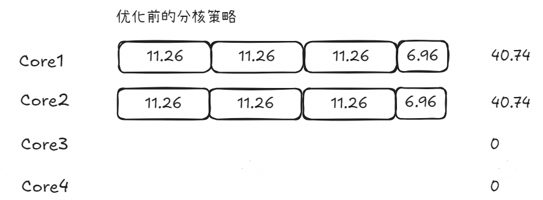
    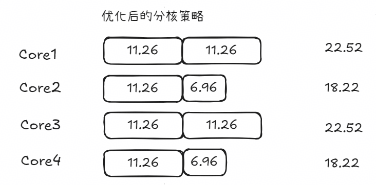
    
    This optimization has been integrated into CANN 8.3.RC1. You only need to call the corresponding FIA operator in the upper-layer code for adaptation.

 

##### Optimization Effect

Test results show that, under the same configuration, after enabling the load balancing optimization, the system throughput increases from 105 to 117, an improvement of 11.4%.

|Optimization|Model sharding|GBS|Sampling count|910C card count|Dataset|Sequence length|Multi-tier graph compilation|Throughput tps|prompt len|response len|generate_sequence/s|
|--|--|--|--|--|--|--|--|--|--|--|--|
|Before FA balancing optimization|TP4 PP4 CP4 EP32|512|16|64|deepscaler|2K→32K|On|105|73.7|7092.5|4919|
|After FA balancing optimization|TP4 PP4 CP4 EP32|512|16|64|deepscaler|2K→32K|On|117|73.7|7110.8|4153|

#### 2.2.4 Decode Phase Host Bound Optimization

##### Phenomenon Analysis

During the optimization of verl inference, it was observed from the logs that the time of each Decode step fluctuates greatly. To further locate the problem, we collected profiling data and found that the Decode computation time of each step is relatively stable, and the time difference mainly lies in the communication tail problem.

Before each Decode, communication across multiple domains is required:

- DP-domain communication is performed in has\_unfinished\_requests().

- TP-domain communication is performed in VocabParallelEmbedding.

- EP-domain communication is performed in MoEDispatch.

The profiling data shows that the normal single-execution time of each communication domain is 10\~20ms, but all of them may have tails lasting from tens of milliseconds to thousands of milliseconds, thereby lengthening the collective communication time of a single step. Only a small amount of NPU computation is involved between the three communications.

Further analysis shows that the root cause of the tail is a bubble on the CPU side, which leads to launch delay. As shown in the figure below, the dispatch time of the all\_reduce operation on card 13 is later than that of other cards in the same DP domain. Before the dispatch, in the scheduler phase, there is a blank period on the CPU, and no other operation runs on the NPU. This problem appears as a communication tail on the surface, but is actually blocking introduced by GC and memory operations on the Host side, resulting in Host Bound.

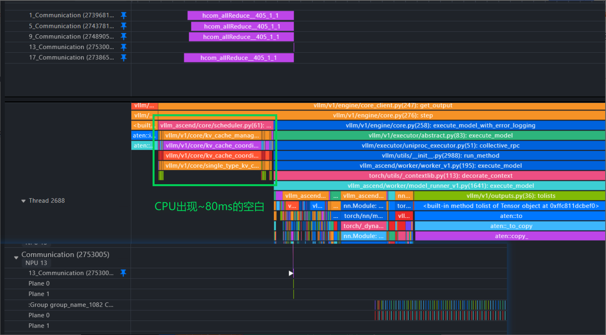

##### Optimization Approach

Based on the above analysis, we performed the following two optimizations:

1. **Disable GC**: temporarily disable GC during the execution phase of the decode step to avoid task dispatch blocking caused by GC occupying CPU resources, and re-enable it after execution ends to avoid Host memory leaks caused by long-term GC disabling.

2. **Add CPU core binding**: considering that the Host Bound in training scenarios may also be caused by multithreaded concurrency preemption, which creates affinity issues between P-cores and NUMA memory, the core binding operation can reduce cross-NUMA memory operations and reduce preemption.

Since it was found in experiments that when Ray starts the training task, the device ids are all set to 0, and the commonly used torch\_npu environment variable CPU\_AFFINITY\_CONF cannot achieve core binding, we finally implemented core binding by calling the Linux taskset command in ActorRolloutRefWorker at the framework initialization phase, and verified that it takes effect.

##### Optimization Effect

||forward / mean (ms)|generate_sequences / step (s)|
|--|--|--|
|baseline|137.64|4851.98|
|GC disabled|135.19|4635.82|
|GC disabled + core binding added|124.66|4192.09|

Without the optimizations enabled, the average single-step decode forward time is 137.64ms and the total inference time is 4851.98s; after adding the GC and core binding optimizations, the average single-step decode forward time is 124.66ms (a decrease of 9.4%), and the total inference time is 4192.09 (a decrease of 13.6%).

### 2.3 Load Balancing Optimization

#### 2.3.1 Optimization for RL Rollout Long-Tail Load Imbalance Scenarios

To solve the "barrel effect" and compute waste caused by long-tail requests in the Rollout phase of reinforcement learning (RL), we designed and implemented a dynamic load balancing scheduling scheme within the vLLM inference engine. By perceiving and migrating tasks in real time and leveraging the multi-tier graph compilation capability, it significantly improves the global inference efficiency and resource utilization in long-sequence scenarios. The finally implemented Rebalance feature supports both "intra-instance load balancing in large-EP deployment scenarios" and "cross-instance load balancing in multi-instance scenarios".

##### Phenomenon Analysis

**The "barrel effect" caused by long-tail requests:** In the Rollout phase of reinforcement learning, a typical performance bottleneck is the "barrel effect". This phenomenon originates from the significant **long-tail distribution** in the lengths of responses generated from the input Prompts. Specifically:

1.  **Uneven task time**: a few tasks that generate extremely long sequences become the performance bottleneck, and their runtime far exceeds that of other ordinary tasks.

2.  **Compute resource waste**: when the compute nodes (DP groups) processing short-sequence tasks complete, they have to enter a long idle waiting state until those long-sequence tasks also complete before they can proceed to the next round of synchronization. This causes severe compute idle and resource waste.

Therefore, the essence of solving the long-tail problem is to achieve efficient **load balancing** in the synchronization scenario of single-round inference, and its core goal is to improve the overall inference efficiency after entering the long-tail state.

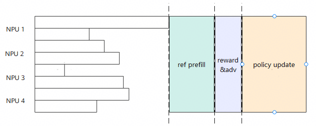

##### Optimization Approach

**Inference-time load balancing based on dynamic awareness**: the core idea of the solution is to dynamically perceive the global load during inference. When it detects that the load imbalance between DP groups satisfies specific conditions, it actively triggers Rebalance (rebalancing) scheduling, migrating tasks between different nodes, thereby restoring load balancing and improving the overall throughput and resource utilization of the system.

After analyzing the flow of verl calling vLLM, we found that the inference process has two loop levels (see the figure below):

-   **Outer loop (green box)**: loads the dataset by Epoch for training and inference.

-   **Inner loop (red box)**: after vLLM receives a single batch of requests, it calls the model for inference.

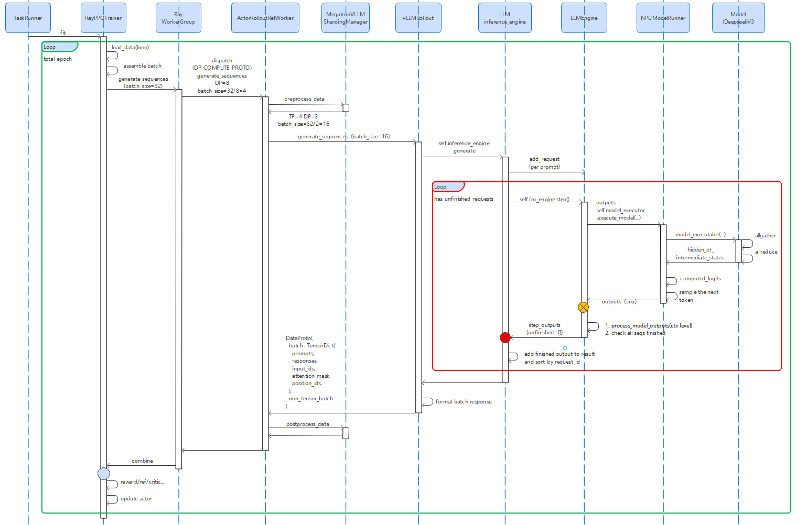

Although request-level balanced scheduling can be implemented at both levels, the key "DP-group inference progress" information can only be precisely perceived in the **inner loop** of vLLM. Therefore, we decided to focus the optimization logic inside the vLLM inference engine, and realize real-time dynamic balancing of inference tasks by appending a "load balancing check + Rebalance scheduling" phase before each inference Step.

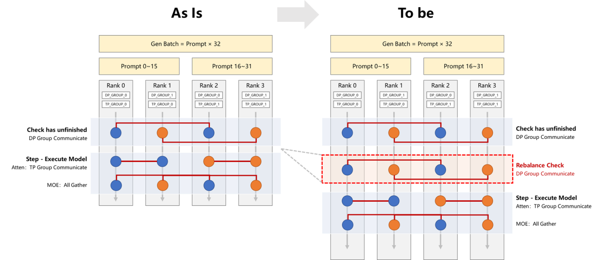

In RL scenarios, graph mode is usually enabled to improve performance. However, in graph mode, even if the number of inference tasks decreases, the Batch Size does not decrease accordingly, resulting in low inference efficiency for small-batch requests.

To solve this problem, we leveraged the **multi-tier graph compilation** capability of vLLM Ascend. This capability can pre-compile computation graphs for different Batch Sizes (such as 64/32/16/8/4/2/1). From the TPOT (Time Per Output Token) data in the table below, it can be seen that as the Batch Size tier decreases, the inference performance improves significantly.

<table><thead align="left"><tr id="row7731205617299"><th class="cellrowborder" colspan="2" valign="top" id="mcps1.1.10.1.1">
Test scenario: initial BS=64, dynamic BS halving during inference

</th>
<th class="cellrowborder" colspan="7" valign="top" id="mcps1.1.10.1.2">
TPOT (ms) at each BatchSize

</th>
</tr>
</thead>
<tbody><tr id="row1573118568298"><td class="cellrowborder" valign="top" width="10%" headers="mcps1.1.10.1.1 ">
Model

</td>
<td class="cellrowborder" valign="top" width="20%" headers="mcps1.1.10.1.1 ">
Multi-tier graph compilation

</td>
<td class="cellrowborder" valign="top" width="10%" headers="mcps1.1.10.1.2 ">
64

</td>
<td class="cellrowborder" valign="top" width="10%" headers="mcps1.1.10.1.2 ">
32

</td>
<td class="cellrowborder" valign="top" width="10%" headers="mcps1.1.10.1.2 ">
16

</td>
<td class="cellrowborder" valign="top" width="10%" headers="mcps1.1.10.1.2 ">
8

</td>
<td class="cellrowborder" valign="top" width="10%" headers="mcps1.1.10.1.2 ">
4

</td>
<td class="cellrowborder" valign="top" width="10%" headers="mcps1.1.10.1.2 ">
2

</td>
<td class="cellrowborder" valign="top" width="10%" headers="mcps1.1.10.1.2 ">
1

</td>
</tr>
<tr id="row77311356182913"><td class="cellrowborder" valign="top" width="11.111111111111112%" headers="mcps1.1.10.1.1 ">
DsV3

</td>
<td class="cellrowborder" valign="top" width="11.111111111111112%" headers="mcps1.1.10.1.1 ">
Enabled

</td>
<td class="cellrowborder" valign="top" width="11.111111111111112%" headers="mcps1.1.10.1.2 ">
76

</td>
<td class="cellrowborder" valign="top" width="11.111111111111112%" headers="mcps1.1.10.1.2 ">
67

</td>
<td class="cellrowborder" valign="top" width="11.111111111111112%" headers="mcps1.1.10.1.2 ">
61

</td>
<td class="cellrowborder" valign="top" width="11.111111111111112%" headers="mcps1.1.10.1.2 ">
57

</td>
<td class="cellrowborder" valign="top" width="11.111111111111112%" headers="mcps1.1.10.1.2 ">
55

</td>
<td class="cellrowborder" valign="top" width="11.111111111111112%" headers="mcps1.1.10.1.2 ">
54

</td>
<td class="cellrowborder" valign="top" width="11.111111111111112%" headers="mcps1.1.10.1.2 ">
54

</td>
</tr>
<tr id="row11731205652917"><td class="cellrowborder" valign="top" width="11.111111111111112%" headers="mcps1.1.10.1.1 ">
DsV3

</td>
<td class="cellrowborder" valign="top" width="11.111111111111112%" headers="mcps1.1.10.1.1 ">
Disabled

</td>
<td class="cellrowborder" valign="top" width="11.111111111111112%" headers="mcps1.1.10.1.2 ">
76

</td>
<td class="cellrowborder" valign="top" width="11.111111111111112%" headers="mcps1.1.10.1.2 ">
74

</td>
<td class="cellrowborder" valign="top" width="11.111111111111112%" headers="mcps1.1.10.1.2 ">
72

</td>
<td class="cellrowborder" valign="top" width="11.111111111111112%" headers="mcps1.1.10.1.2 ">
72

</td>
<td class="cellrowborder" valign="top" width="11.111111111111112%" headers="mcps1.1.10.1.2 ">
71

</td>
<td class="cellrowborder" valign="top" width="11.111111111111112%" headers="mcps1.1.10.1.2 ">
71

</td>
<td class="cellrowborder" valign="top" width="11.111111111111112%" headers="mcps1.1.10.1.2 ">
71

</td>
</tr>
</tbody>
</table>

One of the core strategies of Rebalance scheduling is to first create conditions through task migration so that all global DP groups can switch to a lower Batch
Size tier as soon as possible, thereby maximizing performance gains. We extracted the answer lengths of the OpenR1-Math-220K dataset and used them as the inference output lengths. Combined with the TPOT durations at different BS tiers in the table above, we estimated the theoretical performance gains after enabling "multi-tier graph compilation" and "Rebalance" respectively.

The results of the simulation experiment are shown in the figure below. Each cell in the simulation experiment data on the right represents the BatchSize tier at the corresponding inference length (1\~21K). From Epoch
1, it can be seen that when multi-tier BS graph compilation is enabled alone, the BatchSize tier starts to decrease when the length reaches 16K; if the Rebalance feature is additionally enabled, the timing of the tier decrease can be advanced to 6K. Overall, enabling multi-tier graph compilation alone can bring a gain of 4%\~8%, while combined with Rebalance, because the timing of the tier decrease is significantly advanced, the overall performance gain can reach **15%\~17%**. Rebalance additionally contributes 9%\~14% performance improvement on top of multi-tier graph compilation.

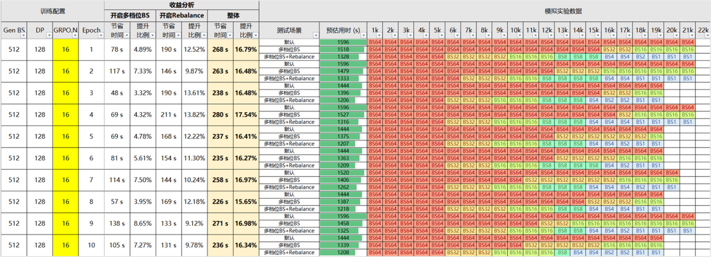

**Key design point 1: Rebalance condition detection method and implementation logic**

To achieve precise scheduling decisions, the system designs a synchronization mechanism for the global load state. This mechanism performs efficient communication between DP groups through HCCL, and each Rank (compute unit) periodically shares the core state information of its scheduler with the global scope. This information mainly includes:

-   **Request queue depth**: the number of requests in the running (Running) and waiting (Waiting) queues, which directly reflects the task pressure of each node.

-   **KVCache usage**: the memory usage of the KVCacheManager, which is a key indicator for measuring whether the NPU memory resources are tight in long-sequence inference.

By aggregating this information, each Rank can perceive the global load view, providing a decision basis for whether to start Rebalance.

Considering that the state synchronization between DP groups introduces additional communication overhead (measured to be less than 2 ms in experiments), overly frequent detection will affect the overall inference efficiency. In order to strike a balance between "scheduling timeliness" and "performance overhead", we introduced a configurable periodic detection mechanism.

-   **Step-based synchronization**: leveraging the feature that the Steps of different DP groups in large-model inference are basically synchronized, the scheduler checks before each Rank's inference Step whether Rebalance synchronization needs to be performed.

-   **Configurable detection strategy**: users can set the manner of global state awareness through the configuration file, such as the detection method (step-count-based detection, asynchronous-thread periodic detection) and the interval step (detect every 1000 Steps, detect every 30s).

This design minimizes the performance impact of periodic detection and achieves effective overhead control.

**Key design point 2: two-phase balanced scheduling strategy**

To ensure that scheduling is both efficient and stable, we designed a two-phase balanced scheduling algorithm.

- Phase 1: timely scheduling of queued requests across DP groups

  Since in the RL inference phase, request tasks are pre-allocated to each DP group, in scenarios where there are queued tasks within a DP group, other DP groups may already have idle resources. Therefore, the core goal of this phase is to maximize resource utilization and prioritize solving the "uneven busy/idle" problem.

  - **Trigger condition**: this strategy is triggered when some DP groups in the system have idle inference capacity while the Waiting queues of other DP groups still have backlogged tasks.

  - **Scheduling logic**: the scheduler migrates waiting tasks from high-load nodes to nodes with idle capacity first, quickly digesting backlogged requests and improving the system throughput.

- Phase 2: load balancing scheduling of runtime requests

  The goal of this phase is to obtain higher compute performance gains by reducing the KV Cache memory usage (tier).

  - **Trigger condition**: this strategy is triggered only when the load levels of all DP groups globally satisfy the condition that "the maximum tier can be decreased".

  - **Scheduling logic**: through global coordination, this strategy ensures that all nodes benefit from the tier decrease. This "all-consistent" principle greatly reduces frequent Rebalance caused by local optimization, avoids unnecessary KV Cache migration overhead, and ensures the stability of scheduling.

  KV Cache migration is the most expensive step in the scheduling process. To ensure transmission efficiency, the algorithm follows the following principles when selecting scheduling targets:

  - **Minimize point-to-point connections**: preferentially select node pairs that can complete multiple task exchanges at once, reducing the communication link establishment overhead.

  - **Avoid "many-to-one" congestion**: carefully design the task distribution paths to prevent multiple senders from transmitting data to a single receiver at the same time, thereby avoiding network congestion and receiver-side queuing and ensuring efficient data transmission.

**Key design point 3: request (Sequence) migration scheme**

To ensure that all nodes have a consistent understanding of the scheduling tasks and execute collaboratively, we designed the following flow:

1.  **Local computation, global consensus**: each Worker (work process) independently runs the same balanced scheduling algorithm based on the global state information and produces a preliminary scheduling task list (for example, node A needs to send 2 tasks to node B).

2.  **Task detail synchronization**: since the initial list only contains the number of tasks and lacks specific request state information, the system exchanges the specific information of the tasks to be migrated (such as request ID, tokens already inferred and output, etc.) among all Workers through one HCCL All2AllSingle communication.

3.  **Role determination and orderly execution**: based on the exchanged detailed task list, each Worker determines whether it is a sender or a receiver and executes the migration operation in a globally uniform order, ensuring the orderliness and consistency of the entire scheduling process.

For running (Running) tasks, their KV Cache must also be migrated accordingly; otherwise, the rePrefill after migration will bring significant negative performance overhead. After the scheduling tasks are synchronized, the Workers that need to migrate the KV Cache establish an independent point-to-point Send/Recv communication to transmit data efficiently. The receiver uses the vLLM framework's request and BlockTable management mechanism to precisely restore the KV Cache state on the local NPU, ensuring that the task can seamlessly continue inference on the new node.

**Key design point 4: externally transparent inference result restoration**

To make the Rebalance process completely transparent to the upper-layer application, the system performs a unified All2All communication after all Workers complete inference. Through this communication, the final inference results of all migrated tasks are accurately transmitted back to their original Ranks. In this way, from the perspective of the external framework, the request processing flow is exactly the same as when no scheduling occurs, achieving truly transparent scheduling.

The [Seer paper](https://arxiv.org/html/2511.14617v1) also mentions that its solution to the KV Cache imbalance problem in long-sequence scenarios is based on Mooncake technology, building a two-level DRAM/SSD KV Cache pool that allows request chunks to be migrated across instances without Prefill recomputation, achieving similar functionality to our rollout rebalance. At the same time, they proposed a Divided Rollout strategy that splits long-sequence requests into multiple sub-chunks, each chunk inferring at most 8K tokens; after inference, the chunks are put back into the cache pool and then allocated to other instances until the request inference is completed. This is a very effective inference acceleration solution for continuous batching scenarios, solving the risks of OOM and mid-process request preemption. In the future, for scenarios with insufficient Device-side memory, this solution will bring great benefits; however, this practice configures an appropriate max\_num\_seq by analyzing the actual memory on the inference side, does not trigger continuous batching, and is more effective at solving the long-tail problem.

##### Optimization Effect

**Experiment 1**: earlier, we verified the actual benefits of the Rebalance feature on a 256-die cluster based on the DeepSeekV3 model.

-   **Dataset**: open-r1/OpenR1-Math-220K

-   **Key parameters**:

    -   data.train\_batch\_size = 512

    -   data.max\_response\_length = 32768

    -   rollout.n = 16

    -   TP = 2, DP = 128, EP = 256

-   **Multi-tier graph compilation configuration**: 64/32/16/8/4

-   **Comparison scenarios**:

    1.  verl default configuration (red line in the figure)

    2.  Multi-tier graph compilation enabled alone (orange line in the figure)

    3.  Multi-tier graph compilation + Rebalance feature enabled together (green line in the figure)

    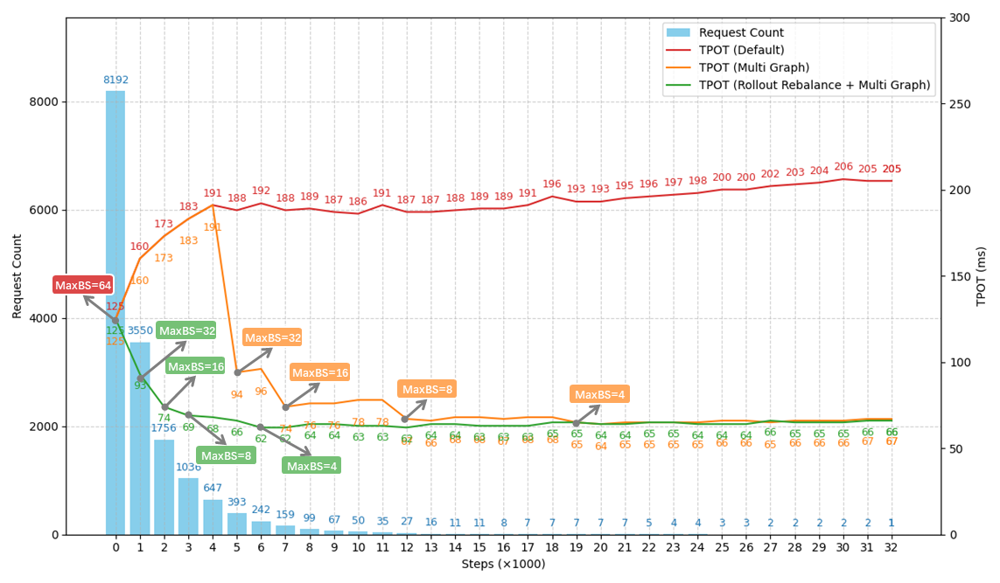

From the experimental results in the figure above:

-   **verl default configuration**: total time **6482s**.

-   **Multi-tier graph compilation enabled**: total time **2861s**, a performance improvement of about **56%** over the baseline.

-   **Multi-tier graph compilation + Rebalance enabled**: total time **2291s**.

Compared with the baseline, this solution ultimately brings a 64% performance improvement. On top of multi-tier graph compilation, the Rebalance feature additionally brings a 20% performance gain (the area between the green and orange curves in the figure is the additional gain).

**Experiment 2:** a comparative experiment was conducted on a 128-die cluster based on the Qwen3-235B model.

-   **Dataset**: Deepscaler

-   **Key parameters**:

    -   data.train\_batch\_size = 512

    -   data.max\_response\_length = 32768

    -   rollout.n = 16

    -   TP = 4, DP = 32, EP = 128

-   **Multi-tier graph compilation configuration**: 256/128/64/32/16/8/4

-   **Comparison scenarios**:

    1.  verl default configuration

    2.  Multi-tier graph compilation enabled alone

    3.  Multi-tier graph compilation + Rebalance feature enabled together

-   **Experimental results**:

    1.  verl default configuration: total inference time 10213s.

    2.  Multi-tier graph compilation enabled alone: total inference time 7841s, a **30%** improvement over the baseline.

    3.  Multi-tier graph compilation + Rebalance feature enabled together: total inference time 6102s, a **67%** improvement over the baseline.

    |Optimization|Model sharding|GBS|Sampling count|910C card count|Dataset|Sequence length|generate_sequence/s|Rollout performance improvement|
    |--|--|--|--|--|--|--|--|--|
    |Base configuration|TP4 PP4 CP4 EP32|512|16|64|deepscaler|2K→32K|10213|-|
    |Multi-tier graph compilation enabled alone|TP4 PP4 CP4 EP32|512|16|64|deepscaler|2K→32K|7841|30%|
    |Multi-tier graph compilation + Rollout Rebalance enabled|TP4 PP4 CP4 EP32|512|16|64|deepscaler|2K→32K|6102|67%|

    The core gain of this solution comes from "completing tier decreases ahead of time through load balancing". Therefore, its effect is strongly correlated with the long-tail distribution of the dataset. If the inference load of the dataset itself is already very balanced, or is made so through data balancing and other means, the additional gain that the Rebalance feature can bring will be reduced.

#### 2.3.2 Expert Parallelism Load Balance

##### Phenomenon Analysis

- Expert module: load "hot/cold differentiation"

  The gating network of the MoE model assigns samples to the suitable experts, resulting in polarization of expert load: in extreme scenarios, the top 20% of "hot experts" bear more than 80% of the compute tasks, and their queues are saturated for a long time; the tail 30% of "cold experts" have a call rate often below 5%, remaining idle most of the time. Moreover, the "hot/cold" identity dynamically shifts with data batch switching, forming load hotspot drift.

- Compute nodes: NPU utilization polarization imbalance

  In the expert parallel architecture, experts are statically assigned to NPU nodes, and the "hot/cold differentiation" is directly transmitted as node load imbalance: in extreme scenarios, the utilization of nodes hosting hot experts is above 90% for a long time, and NPU memory overflow is likely; the utilization of nodes hosting cold experts is mostly below 30%, or even below 10%. The node load also fluctuates dynamically with the "hot/cold" switching of experts, and static scheduling cannot adapt.

##### Optimization Approach

EPLB (Expert Parallelism Load Balancer) is a dynamic load balancing solution first introduced by DeepSeek for the core "load imbalance" pain point in large-scale Mixture-of-Experts (MoE) model training. Its core goal is to eliminate the load differences between expert modules and compute nodes through intelligent scheduling strategies and technical optimizations, maximize NPU resource utilization, and break through the efficiency bottleneck of MoE model scaling training.

1. Dual-mode load balancing scheduling

   EPLB provides two scheduling modes, hierarchical and global, to adapt to different training scenarios:

   - **Hierarchical load balancing strategy**

     When the number of expert groups is divisible by the number of server nodes, EPLB adopts the **hierarchical load balancing strategy**, fully leveraging the Group-Limited Expert Routing feature in DeepSeek-V3.

     1. Evenly allocate the expert groups to each node to ensure load balance between nodes.
     2. Replicate redundant experts within each node.
     3. Allocate the experts to different NPUs within the node to ensure load balance among NPUs.
     
     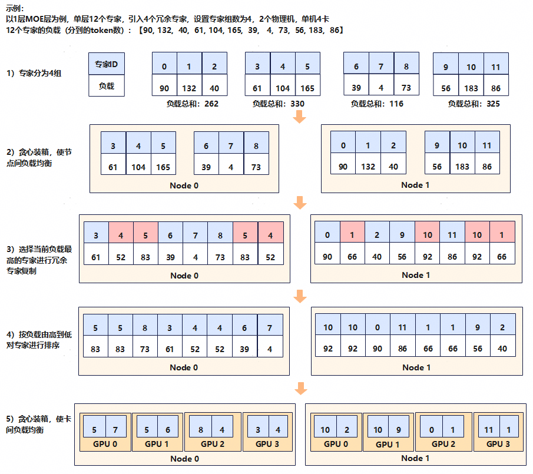
     
   - **Global load balancing strategy**
   
     In other cases (such as the decode phase), EPLB switches to the **global load balancing strategy**, ignoring the expert group restrictions and directly replicating and allocating experts on all NPUs.
     
     - Suitable for larger-scale expert parallel scenarios.
     - Flexibly handle complex load distribution situations.
   
2. Real-time load estimation and dynamic adjustment

   Relying on historical compute data (such as task time and call frequency), a load estimation model is built, and algorithms such as moving average output the load value of each expert and node in real time. Based on the estimation result, EPLB dynamically adjusts the expert replication strategy and allocation scheme, quickly adapting to load hotspot drift caused by changes in training data distribution (such as batch switching and domain migration).

##### Optimization Effect

**Experiment 1**

-   Experiment setup: based on Qwen3-30B loaded with real weights, test the inference time before and after enabling EPLB.
-   Experimental result: enabling EPLB brings no performance improvement.

    |Model name|Training set|Sequence length|batch size*n|Number of dies|infer DP|infer EP|infer TP|EPLB enabled|generate_sequences / step (s)|
    |--|--|--|--|--|--|--|--|--|--|
    |Qwen3-30B|gsm8k|1K→3K|32*16|16|16|16|1|No|80.19|
    |Qwen3-30B|gsm8k|1K→3K|32*16|16|16|16|1|Yes|83.16|

-   Experiment analysis: printing the load of the 1000th inference iteration (the total tokens allocated to experts on each card), the situation is as shown in the following table, and there is no particularly large difference in the load of each card; Experiment 3 constructs a load imbalance scenario as a comparison experiment to verify the effectiveness of EPLB.

    ||rank0|rank1|rank2|rank3|rank4|rank5|rank6|rank7|rank8|rank9|rank10|rank11|rank12|rank13|rank14|rank15|
    |--|--|--|--|--|--|--|--|--|--|--|--|--|--|--|--|--|
    |layer0|202117|151740|223832|220797|131111|180507|175831|286109|210812|297418|205835|173824| 237945|272396|199340|345822|
    |layer20|200978|213408|326325|317587|245067|220074|298096|176724|201202|246980|282587|102573|170262|142857|94099|419867|
    |layer47|232567|326583|121142|253510|316796|108912|211056|212969|101383|313065|223130|213813|175164|355333|176536|182247|

**Experiment 2**

-   Experiment setup: based on Qwen3-235B loaded with real weights, test the inference time before and after enabling EPLB.

-   Experimental result: enabling EPLB brings no obvious performance improvement.

    |Model name|Training set|Sequence length|batch size*n|Number of dies|infer DP|infer EP|infer TP|EPLB enabled|generate_sequences / step (s)|
    |--|--|--|--|--|--|--|--|--|--|
    |Qwen3-235B|deepscaler|2K→32K|256*16|128|64|64|4|No|2291|
    |Qwen3-235B|deepscaler|2K→32K|256*16|128|64|64|4|Yes|2273|

**Experiment 3**

-   Experiment setup: construct an extreme load imbalance scenario by fixing the selected experts to experts 0-15. At this time, rank0 and rank1 have higher load, and the load of the other cards is 0.

-   Experimental result: the inference time is shortened by 17.78%.

    |Model name|Training set|Sequence length|batch size*n|Number of dies|infer DP|infer EP|infer TP|EPLB enabled|generate_sequences / step (s)|
    |--|--|--|--|--|--|--|--|--|--|
    |Qwen3-30B|gsm8k|1K→3K|32*16|16|16|16|1|No|127.52|
    |Qwen3-30B|gsm8k|1K→3K|32*16|16|16|16|1|Yes|104.85|

**Experiment conclusion**

Currently, the Qwen3-30B and Qwen3-235B tests based on the real-weight loading scenario show no obvious performance improvement in practice. Printing the load of each card during inference shows no obvious load imbalance. Experiment 3 constructs an obvious load imbalance scenario and shows that in extreme scenarios, EPLB has obvious performance improvement. The experiments show that when the load is not obviously unbalanced, EPLB cannot bring performance gains.

#### 2.3.3 Input Data Reordering

As described in [Split Strategy Optimization](#221-Split-Strategy-Optimization), to optimize the inference throughput in the low-batch scenario of the long-tail stage, we chose the memory-access-bound-friendly TP4DP32EP128 inference sharding configuration on the attention side. Based on this sharding scheme, we further selected the BS256+DataBalance input organization method to achieve higher end-to-end inference throughput.

##### Phenomenon Analysis

The Roofline model describes how, in the ideal case, operator execution time is affected by the computation volume and the memory-access volume. As shown in the figure below, with the memory-access volume fixed, the device compute throughput shows a trend of "rising linearly first and then leveling off" as the compute intensity increases.

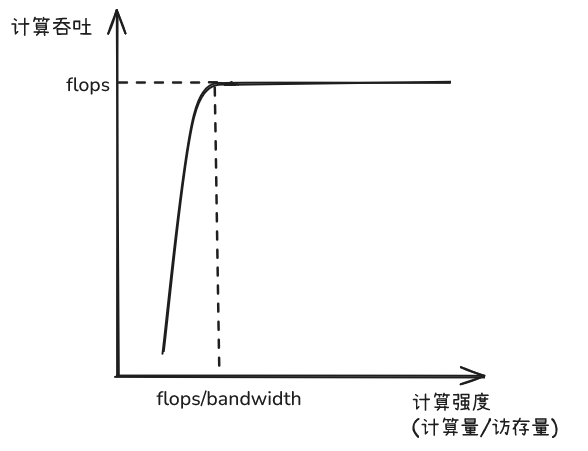

For matrix multiplication operators such as Matmul/GroupedMatmul, it is not difficult to see that the compute intensity happens to be the bs dimension size of the left input matrix. In theory, the compute throughput of the Matmul operators in the whole network can be improved by increasing bs. For the FIA operator, since each bs dimension has an independent KV Cache, its compute intensity does not change with bs growth. On the other hand, the offline inference scenario on which RL training relies only cares about the end-to-end completion time of a given batch of data, and is not constrained by various SLO (Service Level Objective, such as TPOT) conditions in online inference scenarios. Therefore, there is no need to worry about the increase in per-token inference latency caused by bs increases. Based on this idea, we tried to gradually expand the inference batch size in the Qwen3-235B-A22B network and obtained the following test results on the Deepscaler dataset:

|GBS|Actual inference BS|Total inference time|First DP completion time|First DP idle time|First DP idle time ratio|
|--|--|--|--|--|--|
|256|24|02:27:11|01:08:53|01:16:18|50.84%|
|256|64|01:22:32|00:40:57|00:41:35|50.38%|
|256|128|01:18:18|00:27:32|00:50:46|64.84%|

It can be seen that:

1.  In the initial stage of bs increase (24-\>64), both the **first DP completion time** and the **total inference time** decrease relatively obviously.

2.  As bs further expands (64-\>128), the **first DP completion time** further decreases, while the **total inference time** only decreases by 5%, almost unchanged.

The phenomenon in the first stage is consistent with the analysis of the Roofline model: in the memory-access-bound stage of operators, increasing the compute intensity can complete computation of more data batches within a similar time — suggesting that in offline inference scenarios, the optimal BS parameter should be selected to fully utilize hardware compute capacity and improve overall throughput. Combined with the lock-step execution feature of each DP under the large-EP MoE deployment, the phenomenon in the second stage indicates that the data generation lengths of inference tasks differ significantly across different DPs, causing some cards to be idle for more than 64% of the entire inference task — suggesting that in synchronized RL scenarios, the load imbalance problem of the inference dataset should be alleviated to avoid the huge compute waste caused by the long-tail problem in the inference phase.

##### Optimization Approach

-   In handling the dataset load balancing problem, verl by default replicates the inference prompt data by the sampling count n and then **arranges it adjacently**, so that the prompt inputs processed by different DP domains are completely different. When prompts that tend to generate long responses and prompts that tend to generate short responses are assigned to different DP domains, extremely severe load imbalance occurs. To address this, we use the DataBalance method to replicate the prompt data by the sampling count n and then **arrange it in an interleaved manner**, distributing the prompt data as evenly as possible across different DP domains, alleviating the original data imbalance to a certain extent. Before the training phase begins, the response data generated by each DP domain is rearranged in the original manner to ensure that different sampling results of the same prompt remain adjacent to each other.
    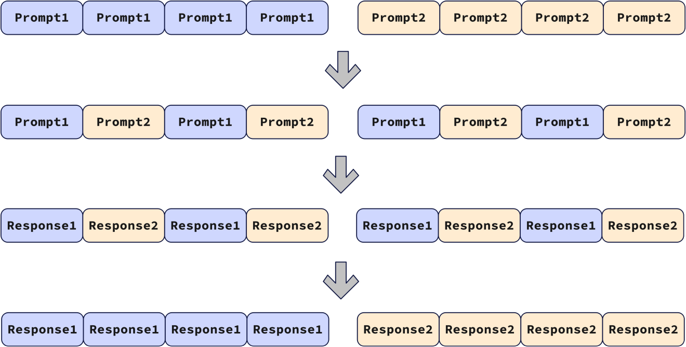

-   Correspondingly, in the [Seer paper](https://arxiv.org/html/2511.14617v1) mentioned in the preface, they also found that multiple outputs of the same prompt are strongly correlated, i.e., the output lengths within a group are strongly correlated, as shown in the figure below:

    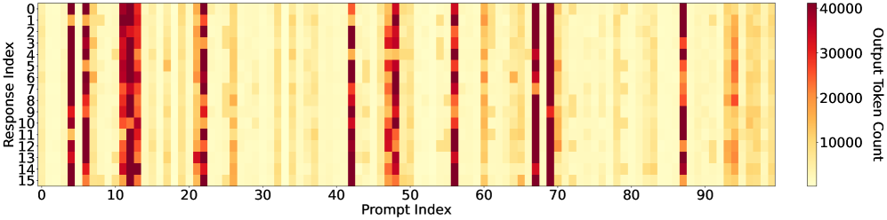

    Therefore, they further cut a group of prompt requests into chunks and schedule each chunk to the most idle instance, thereby solving the OOM and long-tail problems of some inference instances and achieving balance between instances:
    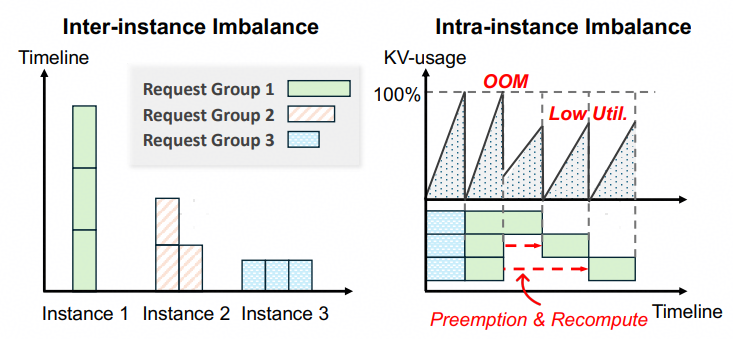
    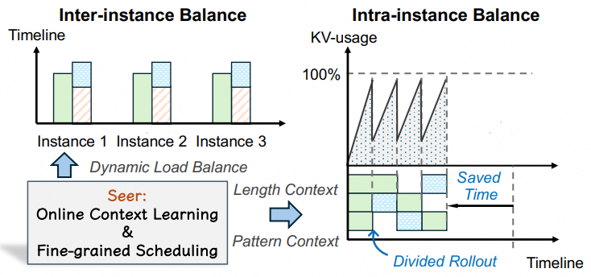

-   Compared with our solution, Seer needs to schedule requests between instances, while we only need to replicate the prompts by the sampling count n and **arrange them in an interleaved manner** before prompt distribution to achieve a similar effect. The implementation is very simple; although the current practice has only one instance and we achieve data balance between DP domains, it can also be very conveniently extended to multi-instance schemes across multiple clusters in the future.

##### Optimization Effect

After the prompt arrangement order is adjusted, the inference long-tail situation under the BS128 configuration is greatly improved, the load of each DP domain is more balanced, and a 25% end-to-end latency reduction is achieved.

Furthermore, after enabling DataBalance to alleviate the long-tail bottleneck caused by load imbalance, more space is created for further expanding the BS to improve throughput. During the process of increasing the BS from 128 to 192 and then 256, we observed further growth in end-to-end inference performance.

|GBS|BS|Inference throughput|Total inference time|First DP completion time|First DP idle time|First DP idle time ratio|
|--|--|--|--|--|--|--|
|256|128|92|01:18:18|00:27:32|00:50:46|64.84%|
|256|128(DataBalance)|132|00:58:03|00:43:38|00:14:25|24.83%|
|384|192(DataBalance)|160|01:10:00|00:57:17|00:12:43|18.16%|
|512|256(DataBalance)|186|01:21:54|01:08:33|00:13:21|16.30%|

## 3. Training Optimization

In the training phase of RL, we mainly focus on the memory issues in long-sequence scenarios, and finally chose the sharding deployment based on TP4PP4CP4EP32, and enabled MindSpeed basic memory and performance optimizations such as swap optimizer, MoE fused operators, and gradient accumulation fused operators.

### 3.1 Memory Usage Analysis and Model Split Strategy Selection

#### Phenomenon Analysis

The memory usage in the training phase mainly consists of two parts: static memory and dynamic memory.

-   Static memory: mainly occupied by model parameters, gradients, and optimizer states. Its size is relatively fixed and is closely related to the model structure and the sharding deployment method.

-   Dynamic memory: mainly occupied by the activations generated during the forward computation. Since its size is proportional to the sequence length of the training input, in long-sequence sample training scenarios, activation memory often becomes the NPU memory bottleneck.

Substituting the model structure parameters of Qwen3-235B-A22B, the following dynamic and static memory usage distribution diagram can be obtained:

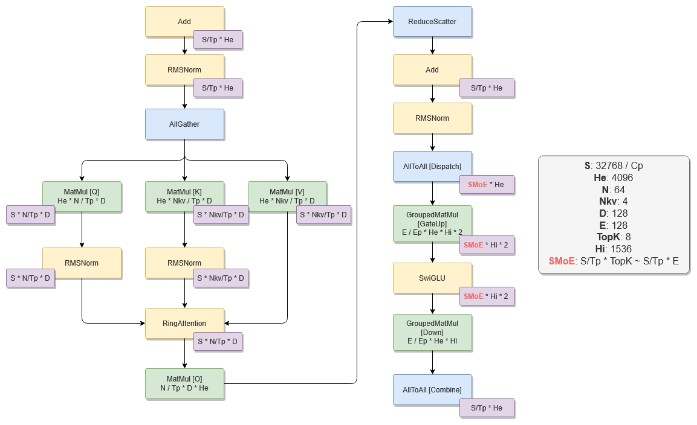

For **static memory**, this practice enabled MindSpeed's swap optimizer optimization to offload the static memory in most of the optimizer from NPU memory during the forward and backward pass. Static memory only retains the model weights and gradients in BF16 format. Under the TP4PP4EP32 sharding deployment, the per-card per-layer BF16 weight memory usage includes the QKVO of the ATTN layer and the Experts of the MoE layer, totaling 34MB + 36MB\*4 = 178MB. According to a single PP rank containing 24 layers of the model, the per-card static memory usage is about **12.51GB**. Considering that after the inference process ends, each card often has 8\~9G of memory usage, after loading static memory, the per-card memory usage in the training phase is about 21.5GB.

|TP|PP|EP|Model layers per card|QKV (MB)|O (MB)|MoE (MB)|Weights per card (GB)|Gradients per card (GB)|Static memory (GB)|
|--|--|--|--|--|--|--|--|--|--|
|4|4|32|24|18|16|144|4.17|8.34|12.51|

For models adopting the Mixture-of-Experts (MoE) architecture, the scale of **dynamic memory** is significantly affected by the degree of expert load balancing. In the ideal load balancing case, each expert receives an approximately equal amount of tokens, and activation memory growth is relatively controllable; however, in long-sequence scenarios, if load imbalance occurs, some experts may need to process a far larger number of tokens than the average, causing the activation memory of the corresponding MoE layer to rise sharply and very easily triggering NPU memory overflow (OOM) problems. As shown in the figure above, the main activation usage of the MoE layer comes from three items containing the SMoE factor, where SMoE is the token sequence length actually allocated to the routed experts of the MoE layer after EP communication. Depending on the degree of load balancing, the expansion factor of SMoE relative to the MoE layer input length fluctuates between 8 (TopK) and 128 (Experts).

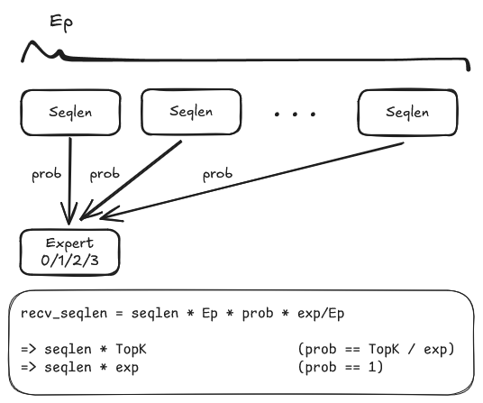

Substituting the specific sequence length data, the estimated dynamic memory size is shown in the following table, where each item of the MoE part shows two scenarios: balanced load and extreme load imbalance. It can be seen that:

-   When sequence splitting is not enabled, since the first PP rank still stores activation memory according to the full number of model layers, the activation memory of only the ATTN layer will reach
    600MB \* 94 = **55.07GB**. Therefore, at the current 32K sequence length, enabling CP splitting is necessary.

-   Even under TP4CP8 with fully enabled sequence splitting, the dynamic activation memory of a single MoE layer in extreme scenarios can reach 128\*1024\*(4096 + 2\*1536 + 2\*1536) \* 2Byte = **2.5GB**. Such a single-layer activation memory size is equally unacceptable.

|TP|PP|CP|EP|ATTN single-layer activation memory (MB)|QKVO output (MB)|FA output (MB)|Norm output (MB)|Add output (MB)|MoE single-layer activation memory (MB)|Dispatch (MB)|GMM1 (MB)|SwiGLU (MB)|Combine (MB)|Add output (MB)|
|--|--|--|--|--|--|--|--|--|--|--|--|--|--|--|
|4|4|8|32|75|26|16|25|8|176 / 2576|64 / 1024|48 / 768|48 / 768|8|8|
|4|4|4|32|150|52|32|50|16|352 / 5152|128 / 2048|96 / 1536|96 / 1536|16|16|
|4|4|2|32|300|104|64|100|32|704 / 10304|256 / 4096|192 / 3072|192 / 3072|32|32|
|4|4|1|32|600|208|128|200|64|1408 / 20608|512 / 8192|384 / 6144|384 / 6144|64|64|

#### Optimization Approach

To alleviate the NPU memory pressure caused by long sequences and the load imbalance in the MoE layers, this practice enabled the CP splitting and MoE layer recomputation techniques provided by MindSpeed. Among them, the core idea of the MoE layer recomputation technique [moe\_zero\_memory](https://gitcode.com/Ascend/MindSpeed/blob/master/docs/zh/features/megatron_moe/megatron-moe-zero-memory.md) (Chinese) is to use the **original** computation or communication in the backward pass to hide the communication and computation introduced by recomputation, thereby reducing activation value storage while lowering the recomputation overhead caused by it. As shown in the figure below, the green box represents the part that needs recomputation, which is also the main source of the activation memory of the MoE layer. After this feature is enabled, the MoE layer no longer needs to store this part of the activation memory that changes drastically with the load, greatly reducing the possibility of training-phase OOM caused by load imbalance.

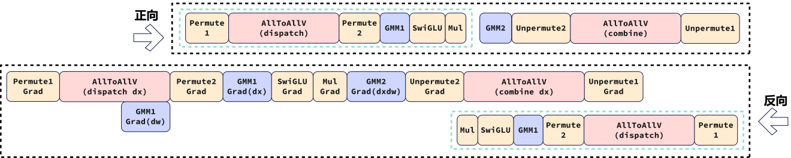

It should be noted that the prerequisite for enabling moe\_zero\_memory is to also enable the self-hiding feature moe\_alltoall\_overlap\_comm of the MoE layer backward computation, and the current implementation of the latter in MindSpeed causes the weight naming scheme of the MoE layer GMM to change, which in turn affects the reshard process in RL training. [Prior work](https://gitcode.com/cann/cann-recipes-train/blob/master/docs/llm_rl/deepseek_rl_train_optimization.md) (Chinese) implemented a zero-redundancy training/inference weight reshard scheme based on AlltoAllV that provides support for this scenario. Interested readers can refer to it for the relevant details.

#### Optimization Effect

According to the aforementioned dynamic memory estimation table, with moe\_zero\_memory enabled, the CP2 sharding still has a risk of memory overflow on the first PP rank — its static/external memory + dynamic memory + MoE single-layer peak memory may reach 21.5GB+(300+64)MB\*94+10GB = 65GB. Therefore, this practice finally adopted the TP4PP4CP4EP32 sharding as the sharding strategy for the ATTN layer in the training phase. The figure below shows the memory usage records when CP2/CP4 are enabled. In the left figure, training with CP2 sharding was interrupted due to OOM, while in the right figure, after switching to CP4 sharding, the first PP rank, which has the greatest memory pressure in the training phase, can still run normally within the existing memory constraints.

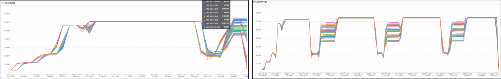

In terms of training performance, compared with CP8 sharding, CP4 can double the DP count and reduce the number of communications in RingAttention computation, ultimately achieving a training throughput improvement of more than 30%.

|GBS|Sharding configuration|Training time (s)|Training throughput|
|--|--|--|--|
|256|TP4PP4EP32CP8|1654|263|
|256|TP4PP4EP32CP4|1057|412|

 

### 3.2 HDP (Hybrid Data Parallelism)

#### Phenomenon Analysis

Context Parallelism (CP) effectively solves the training problem of ultra-long sequences by splitting the sequences in a batch along the sequence length dimension and distributing them to different devices for parallel computation. In model training, to process sequences of different lengths and prevent memory overflow (OOM), multiple sequences are usually packed into a sequence reaching the maximum sequence length max\_packing\_token\_size, and a sufficient context\_parallel\_size is configured.

However, this method has an obvious efficiency defect: regardless of sequence length, all sequences must undergo the same partitioning and communication process. When short sequences are packed together with long sequences and processed with CP, the parts of short sequences that do not need splitting are also forcibly partitioned, introducing unnecessary communication overhead, causing compute resource waste and training efficiency decline. This problem is particularly prominent when the training data contains a large number of short sequences.

#### Optimization Approach

To solve the above problem, we adopted a new optimization algorithm — **Hybrid Data Parallelism (HDP)**. The HDP algorithm fuses data parallelism (DP) and context parallelism (CP) for unified scheduling. The built-in bin packing algorithm automatically selects the optimal parallel strategy according to the sequence length, dynamically adjusting the DP and CP groups, ensuring that long sequences undergo CP while short sequences are partitioned into DP groups as much as possible to avoid unnecessary communication computation.

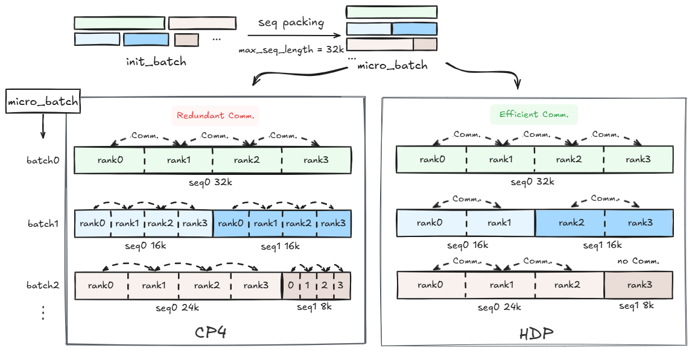

1. HDP bin-packing grouping algorithm design

   For a given micro\_batch, this algorithm groups the sequences according to each sequence length and the total number of ranks. Taking the illustrated batch2: [seq0\_length, seq1\_length] = [24k, 8k], cp\_size = 4 as an example, the final grouping result is: [[1, 2, 3], [4]], where seq0 occupies rank0\~rank2 to execute CP3, and seq1 alone occupies rank3. The specific algorithm flow is as follows:

   -   For a given micro\_batch, first calculate the expected number of ranks occupied by the sequence according to the sequence length and the total number of ranks.

   -   Perform dynamic bin packing according to the number of ranks occupied by each sequence. In the first pass, the algorithm partitions each sequence as a whole and retains the overflowed parts of the sequence during bin packing and their corresponding sequence indices.

   -   For the overflowed parts of the sequences, the algorithm performs round-robin merging or balanced grouping according to the remaining number of ranks to obtain the final hdp\_group.

   -   In addition, the algorithm sets upper and lower thresholds to ensure the robustness of the algorithm.

2. Cross-Rank sequence splitting and aggregation

   To ensure the correct execution of context parallelism (CP), the sequence needs to be pre-processed before being input to the model and post-processed after being output from the model.

   Pre-processing steps:

   -   Obtain the hdp\_group of the current card in batch\_hdp\_group and the corresponding index.

   -   Obtain the corresponding sequence from the batch according to the index, and perform cp splitting according to the size of the hdp\_group.

   -   Set the actual sequence length, used for the TND mode of FA and the q/k/v indices of Ring Attention.

   Post-processing steps:

   -   Collect the sequence lengths and output data of all cards through multiple AllGather operations.

   -   Restore the output data on each card according to the inverse process of the pre-processing.

3. Framework adaptation

   To support HDP, the following targeted modifications need to be made to the model framework:

   -   Positional Embedding: since HDP splits the fixed cp\_size, in RoPE positional encoding, the original CP communication scope needs to be adjusted to the intra-group CP communication scope of the current hdp group.

   -   Ring Attention: similarly, in the Ring attention computation, parameters such as rank\cp\_rank\cp\_global\_ranks\cp\_outer\_ranks need to be adjusted.

#### Experimental Results

Currently, experiments are conducted on the Deepscaler dataset with the settings of GBS512, TP4 PP4 CP4/HDP 128die. The results show that the average training time gain of the first 3 steps is only about 5%, and the RL end-to-end performance gain is even smaller.

Through analysis, the insignificant performance gains are mainly due to the following two reasons:

-   The sequences generated by the Deepscaler dataset are generally long. Under this data length distribution, it is difficult for HDP grouping to achieve fully balanced load, which eats away at the performance gains brought by the reduced communication time.

-   HDP is mainly intended to save the communication overhead in RingAttention after CP splitting, and under the setting where the CP size is only 4, the adjustment space for HDP grouping is very limited.

The experiment randomly selects a step and counts the length distribution of all sequences in that step, as well as the detailed CP/DP situation of sequences in each length range after HDP algorithm scheduling, as shown in the figure below.

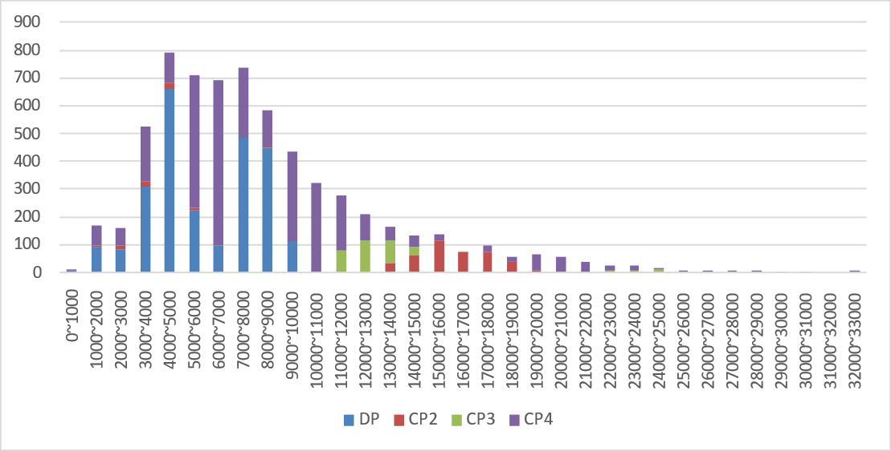

From the results in the figure, it can be found that the lengths of most sequences are concentrated above 3000, which also causes many sequences to be unable to perform DP, and instead seek suboptimal solutions (CP2, CP3) or even CP4.

We also conducted an experimental comparison with a scenario where HDP achieves higher gains. The settings are as follows: openr1-220k dataset, GBS256, TP4 EP32 PP8 CP8/HDP 256die, and the model is DeepSeekv3. The experiment also counts all sequence lengths in a step and the detailed CP/DP situation of each sequence in different ranges after HDP algorithm processing, as shown in the figure below.

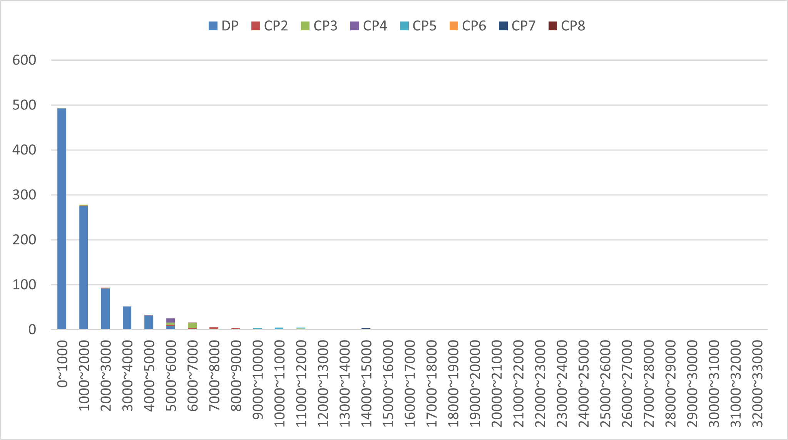

It can be seen from the figure that, when the sequences generated by this dataset are generally concentrated below 3000, most sequences are converted from the original pure CP8 to DP, which greatly reduces the overhead of the communication process and basically has no load imbalance problem. The performance data of this scenario is as follows, and the final training time gain is more than 25%.

|GBS|Sharding configuration|Training time (s)|Training throughput|
|--|--|--|--|
|256|TP4 EP32 PP8 CP8|178.234|77.14532581|
|256|TP4 EP32 PP8 HDP|133.139|107.2523603|

## 4. Future Outlook

After this optimization practice, we have formed several reflections on the future direction of long-sequence optimization for RL training:

1. The deep integration of system optimization and algorithm innovation is an inevitable trend.

   Current work shows that system-level means such as model sharding strategy optimization, dynamic load balancing, and compute-scheduling coordination can effectively improve long-sequence training efficiency. At key bottleneck stages, we are advancing the exploration of multiple new technologies, including:

   -   SAM speculative decoding (Speculative Adaptive Memory): this technology does not require modifying the RL training objectives and reward functions. In RL scenarios, since the model has not fully converged, this draft-model-free speculative strategy is especially applicable; at the same time, in long-sequence cache scenarios, the draft model will have a higher acceptance rate, which will greatly assist the improvement of RL inference throughput in long-sequence scenarios. In the [Seer paper](https://arxiv.org/html/2511.14617v1) mentioned in the preface, a similar draft-model-free speculative decoding method using compressed suffix trees is also adopted. In addition, they aggregate the local token patterns of multiple sequences in the same group, which very effectively improves the acceptance rate of speculative decoding and also provides us with new ideas.
   -   KVP splitting for long-tail long sequences: when processing ultra-long-sequence requests, by distributing the KV Cache across multiple NPUs, a single NPU can process sequences much larger than its NPU memory capacity, thereby directly improving the single-BS throughput; at the same time, the DP domain size is dynamically adjusted to fully utilize the NPUs of idle DP domains after sequence inference completes, further balancing the load and improving inference throughput.

2. The continuous innovation of attention mechanisms may reshape the long-sequence processing paradigm.

   -   Emerging technologies represented by linear attention, state-space models (such as Mamba2), and approximate attention are expected to fundamentally solve the quadratic complexity problem.

   -   Sparse attention represented by DeepSeek's DSA (token-based)/NSA (block-based), as well as optimization schemes such as sliding window attention, can significantly reduce compute overhead while maintaining performance in long-sequence scenarios.

   -   The exploration of new-generation architectures such as Qwen-Next will promote the evolution of hybrid attention mechanisms toward more efficient and more scalable directions. We are also currently investing in the pretraining optimization of the Qwen-Next network, trying to implement the gated\_delta\_rule fused operator based on Triton on Ascend to quickly optimize model training performance, hoping to explore a new path on Ascend that can quickly adapt to algorithm structure innovations.

With the rapid development of large-model RL training technology, scenarios such as multi-turn agents and all-modality RL have pushed the sequence length from thousands to millions of tokens. Under the dual drive of algorithms and systems, continuously building the next-generation technical system for ultra-long-sequence training and inference based on Ascend still faces many challenges. We will continue to track frontier progress and contribute to long-sequence RL training in the Ascend ecosystem.

<!-- static-meta
{
  "sidebarTitle": "Training Optimization",
  "parallelism": ["data-parallel", "tensor-parallel", "pipeline-parallel", "expert-parallel", "context-parallel"],
  "hardware": ["atlas-a3"],
  "frameworks": ["megatron", "mindspeed", "verl", "vllm"],
  "cover": {"type": "auto"}
}
-->
